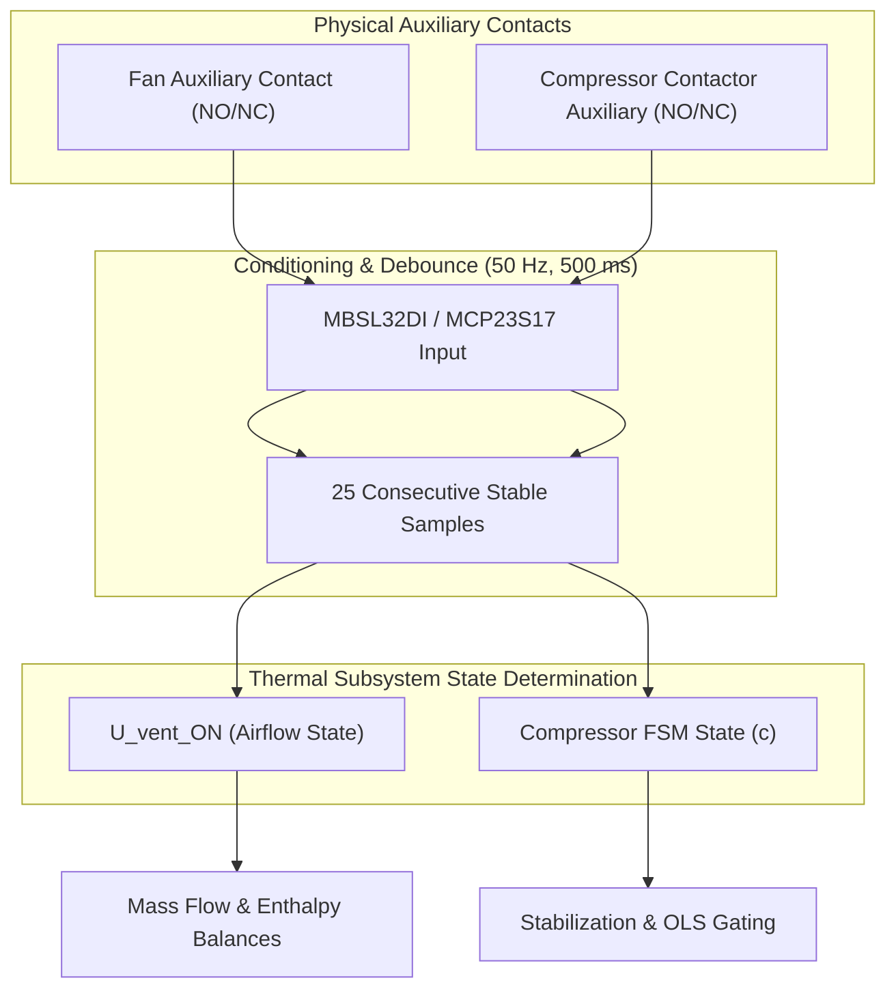

# Thermal and Energy System: Existing Implementation Audit & Technical Analysis

- **Document Identifier**: `doc/architecture/thermal_energy_system_analysis.md`
- **Subsystem**: Thermal and Energy System (`thermal_energy`)
- **Target Platform**: DAECGE BrightC Controller V3 (STM32H743ZIT6, Cortex-M7 @ 480 MHz)
- **Framework**: Zephyr RTOS (West T2 Workspace)
- **Reference Specification**: `doc/request/Mathematical_Model_Specification_REVF.md` (Revision F Baseline)
- **Author**: Lead Embedded Firmware Architect
- **Status**: Stage 1 Architecture Deliverable (Ready for Technical Review)

---

## 1. Executive Summary

This document presents a comprehensive, systematic technical audit of the **BrightC-telemetry** codebase against the requirements of the **Revision F Mathematical Model and Engineering Specification** (`doc/request/Mathematical_Model_Specification_REVF.md`).

The objective is to establish an authoritative baseline of:
1. Implemented, verified, and functional modules ready for direct reuse.
2. Partially implemented modules requiring architectural adaptation or semantic extension.
3. Completely missing components required to deliver Phase 1 thermodynamic, psychrometric, electrical, and predictive capabilities.
4. Physical hardware, devicetree (DTS), Kconfig, and peripheral assignments.
5. Inconsistencies, numerical risks, hardware discrepancies, and architectural boundaries.

> [!IMPORTANT]
> In accordance with project governance (§16 of `doc/tasks/2.thermal.md`), **zero production or test C code has been modified in this analysis phase**. This audit delivers an actionable architectural foundation for subsequent implementation.

---

## 2. Codebase Inventory & Functional Classification

Every module across domain services, Active Objects, adapters, interfaces, and board definitions has been inspected.

### 2.1 Component Taxonomy and Responsibility Matrix

| Subsystem / Module | File Path | Current Responsibility | Classification | Reuse & Modification Strategy |
| :--- | :--- | :--- | :--- | :--- |
| **Sensor Matrix Mapper** | `app/src/domain/services/sensor_matrix_mapper.c` | Maps raw Modbus CWT, internal RTDs, and J9 analog counts into `thermal_matrix_frame_t`. Applies Callendar-Van Dusen, current loop conversion, and 2-point calibration. | **Implemented & Functional (Partial Semantic Coverage)** | **Reuse directly** for acquisition normalization. Modify target index routing and expose site topology configuration rather than hardcoding pilot indices in `sensor_matrix_init_default_pilot_config()`. |
| **Sensor Hardware Map** | `app/include/common/sensor_hardware_map.h` | Provides flat 1-byte sensor ID allocations (1..59) and immutable default catalog `k_brightc_sensor_catalog[33]`. | **Implemented & Functional** | **Reuse flat IDs**. The catalog defines default hardware bindings; site topology mapping in RAM/EEPROM will reference these flat IDs without modifying the hardware map. |
| **Sensor Common Types** | `app/include/common/sensor_types.h` | Defines physical channels (`PHYS_CH_*`), roles (`SENSOR_ROLE_*`), `raw_sensor_readings_t`, and `thermal_matrix_frame_t`. | **Implemented & Functional** | **Reuse core frame**. `thermal_matrix_frame_t` already possesses fields for $N$ pairs ($T_{inj}, T_{ret}$), $M$ room probes ($T_{room}$), $L$ outdoor probes ($T_{outdoor}$), and $HR_{ret}$. |
| **Sensor Zephyr Adapter** | `app/src/infrastructure/adapters/adapter_sensor_zephyr.c` | Implements `i_sensor_matrix_api_t` over Zephyr multi-ADC DMA driver. Acquires 5 RTD channels and 10 J9 channels. Applies 1st-order IIR filtering. | **Implemented & Functional** | **Reuse without modification**. Perfectly encapsulates hardware ADC DMA sampling. |
| **Sensor Matrix AO** | `app/src/application/active_objects/ao_sensor_matrix.c` | Triggers periodic ADC DMA scans (500 ms), updates frame, and publishes to `chan_thermal_matrix` and `chan_sensor_snapshot`. | **Implemented & Functional** | **Reuse directly**. Already publishes `thermal_matrix_frame_t` to `chan_thermal_matrix`. |
| **Sensor Zbus Channels** | `app/src/application/zbus/sensor_channels.c` | Defines `chan_sensor_snapshot` and `chan_thermal_matrix`. | **Implemented & Functional** | **Reuse as primary thermal input feed**. |
| **JSY-MK-339 Codec** | `app/src/domain/services/jsy_mk339_codec.c` | Decodes raw Modbus holding registers (0x0048..0x0077) into `energy_reading_t`. Unpacks 3-phase voltages, currents, active/reactive/apparent power, PF, kWh, Hz. | **Implemented & Functional** | **Reuse without modification**. Fully verified codec providing $P_{elec\_total}$ in kW and energy in kWh. |
| **Modbus AO** | `app/src/application/active_objects/ao_modbus.c` | Manages RS485 polling scheduler (CWT-TM-16PT, JSY-MK-339, MBSL32DI). Invokes callbacks upon parsing. | **Implemented & Functional (Integration Gap)** | **Reuse single polling path**. Currently, JSY callback (`on_modbus_jsy_mk339_reading` in `composition_root.c`) feeds only voltage alarms. Must be wired to provide coherent electrical readings to the thermal subsystem. |
| **Energy Types** | `app/include/common/energy_types.h` | Declares `energy_reading_t` with timestamp, validity, 3-phase metrics, and totals. | **Implemented & Functional** | **Reuse directly**. Complete contract for REVF §2.4. |
| **Digital Input AO** | `app/src/application/active_objects/ao_digital_input.c` | Scans on-board MCP23S17 SPI expanders and remote MBSL32DI at 20 ms (50 Hz), drives debouncing engine, publishes state transitions and snapshots. | **Implemented & Functional** | **Reuse directly**. Provides debounced fan and compressor contacts without polling duplicate hardware. |
| **Digital Input Aggregator** | `app/src/domain/services/digital_input_aggregator.c` | Software integrator debounce filter (25 samples = 500 ms for contactors per REVF §2.3). Tracks active durations and state masks. | **Implemented & Functional** | **Reuse directly**. |
| **Hardware Pin Map** | `app/include/common/hardware_pin_map.h` | Declares pin mappings for MCP23S17, on-chip pins, and MBSL32DI. Maps Fans 1..4 (`DI_ROLE_FAN_1..4_AUX`) and Compressors 1..4 (`DI_ROLE_COMPRESSOR_1..4_AUX`). | **Implemented (Partial Roles)** | **Reuse mapping**. Channels for Units 5..8 on MBSL32DI currently carry generic roles (`DI_ROLE_USER_4..9`). Semantic extension required for full 8-unit support. |
| **Microconf Storage Adapter**| `app/src/infrastructure/adapters/adapter_storage_microconf.c` | Manages 32 KB AT24C256C I2C EEPROM. Implements ping-pong wear leveling, versioned envelope header (`config_envelope.h`), and CRC-16. | **Implemented & Functional** | **Reuse directly**. Provides rock-solid persistence. Subsystem has 29.5 KB unallocated reserve space. |
| **Storage Types & Layout** | `app/include/common/config_types.h` | Defines 5 domains (`DEVICE`, `NET_ETH`, `NET_WIFI`, `HVAC`, `CALIBRATION`). Layout allocates 0x0000..0x09FF. | **Implemented (Needs Extension)** | Extend storage domains to incorporate site topology and learned baseline signature without disturbing existing domains. |
| **HVAC Control Subsystem** | `doc/architecture/hvac_control_subsystem.md` | Industrial HVAC sequencer, lead-lag rotation, and stage control. | **Implemented in Other Subsystem** | Passive observer separation: Thermal monitoring audits thermodynamic performance passively without taking control authority from the HVAC control loop. |
| **Psychrometric & Thermodynamic Engine** | `app/src/domain/services/thermodynamic_engine.c/.h` | Pure C99/C11 domain implementation of REVF baseline: psychrometrics ($P_{atm}, P_{ws}, P_w, \omega, T_{rocio}, \rho, \dot{m}_{da}$), sensible/latent capacity balances, enthalpies, Carnot COP, exergy efficiency ($\eta_{II}$), 46-point Flash R410A LUT, double-precision regularized OLS solver, filter fouling days remaining hierarchy, and weather derating. Tested in `test_thermodynamic_engine.c` (582 lines). | **Implemented & Functional in Domain** | **Reuse directly**. The core equations and OLS linear algebra are already functional and unit-tested. Needs integration into an Active Object (`ao_thermal_energy`), port contracts (`i_thermal_energy_t`), and dynamic site topology injection. |
| **Compressor Stabilization FSM** | N/A (`app/src/domain/thermal/compressor_fsm.c`) | 5-phase temporal state machine per compressor (`OFF`, `INRUSH_WAIT`, `STEP_LOAD_CAPTURE`, `THERMAL_WARMUP`, `STEADY_STATE`). Tracks $t_{off}$, $t_{on}$, and isolates step load $\Delta P_{comp,c} = P(15\text{s}) - P(0^-)$. | **MISSING** | **Must be designed and implemented** in domain layer to feed `thermo_engine_compute()` with qualified steady-state and load fraction ($F_{carga}$) inputs. |
| **Thermal Energy Active Object** | N/A (`app/src/application/active_objects/ao_thermal_energy.*`) | Orchestrates temporal sampling (1 Hz), multi-source capture coherence, manages the 720-hour RAM ring buffer (46.08 KB), drives domain math, publishes results to Zbus, and exposes thread-safe query port (`i_thermal_energy_t`). | **MISSING** | **Must be designed and implemented** following canonical 5-phase lifecycle. |

---

## 3. Detailed Audit Against REVF Specification

### 3.1 Implemented & Functional Capabilities Ready for Reuse

1. **PT100 Temperature Acquisition**:
   - External path: `CWT-TM-16PT` 16-channel Modbus RTU module polled over RS485-1 (`ao_modbus`). Channel health, open-probe detection, and communication status are fully decoded.
   - Internal path: 5-channel on-board `INA826` instrumentation amplifiers ($G=40.403$) sampled via STM32H7 16-bit ADC DMA engine. Callendar-Van Dusen conversion and lead-wire resistance compensation ($\Delta R_{cable}$) are implemented in `transducer_rtd.c`.
2. **Total Electrical Power Metering**:
   - `JSY-MK-339` 3-phase power analyzer polled over RS485-1 at 9600 bps.
   - Decoded into `energy_reading_t` providing active power ($P_{total}$ in kW), line voltages, currents, power factors, and accumulated active energy ($\text{kWh}$).
3. **Contactor Feedback Acquisition & Debouncing**:
   - Sampled at 50 Hz (20 ms interval) via MCP23S17 SPI and MBSL32DI Modbus modules.
   - Software integrator filter enforces exactly 500 ms (25 consecutive identical samples) continuous stability before committing state transitions, matching REVF §2.3.
4. **Persistent Configuration Engine**:
   - `adapter_storage_microconf.c` provides atomic ping-pong writing with CRC-16 integrity verification and schema versioning over the `AT24C256C` EEPROM.

### 3.2 Partially Implemented Capabilities Requiring Adaptation

1. **Sensor Topology Mapping & Index Logic**:
   - Current implementation: `sensor_matrix_mapper.c` possesses a hardcoded default function `sensor_matrix_init_default_pilot_config()` assigning CWT 1..6 as supply, 7..12 as return, 13..14 as room, and 15..16 as outdoor.
   - Problem: Room probes use target indices 5 and 6 (because indices 0..4 were assigned to internal RTDs). REVF defines room probes as $m \in \{1 \dots M\}$ (indices 0..$M-1$).
   - Requirement: Decouple physical channels from mathematical indices. A configurable mapping table must dynamically bind any registered flat sensor ID (1..59) to semantic roles ($T_{inj,k}, T_{ret,k}, T_{sala,m}, T_{ext,l}$).
2. **4-20 mA Return Humidity Transducer**:
   - Current implementation: J9-1 is hardcoded as `SENSOR_ROLE_HUMIDITY_RETURN` in default configuration.
   - Linear conversion from current to %RH exists in `sensor_matrix_mapper.c`.
   - Problems:
     * No Kconfig symbol exists to select which J9 physical channel (J9-1 to J9-10) is assigned to the humidity transducer.
     * Conversion lacks explicit compensation for hardware shunt resistance tolerance ($R_{shunt} = 150\,\Omega \pm 0.1\%$).
     * Open-loop fault threshold ($I_{loop} < 3.5\text{ mA}$) is checked, but does not distinguish between a broken loop (< 3.5 mA) and out-of-range signal (3.5 to 3.99 mA).
3. **JSY-MK-339 Power Data Routing**:
   - Current implementation: Modbus callback in `composition_root.c` routes readings exclusively to `adapter_alarm_detector_volt`.
   - Requirement: A thread-safe distribution mechanism (Zbus channel or direct AO capture cache) must deliver `energy_reading_t` to the thermal subsystem with timestamps and validity flags.
4. **Digital Input Semantic Roles for HVAC Units 5..8**:
   - Current implementation: `hardware_pin_map.h` maps Fans 1..4 and Compressors 1..4. Channels 20..23 and 28..31 on MBSL32DI carry generic roles (`DI_ROLE_USER_4..9`).
   - Requirement: Define explicit semantic roles `DI_ROLE_FAN_5..8_AUX` and `DI_ROLE_COMPRESSOR_5..8_AUX` to support up to 8 units.

### 3.3 Missing Components to Implement in Phase 1

1. **Thermal Energy Active Object (`ao_thermal_energy.c/.h`)**:
   - Manages temporal capture window and input coherence gating.
   - Subscribes to `chan_thermal_matrix`, `chan_digital_input_snapshot`, and JSY electrical readings.
   - Owns the 720-hour (30-day) RAM historical ring buffer ($720 \times 64\text{ B} = 46.08\text{ KB}$).
   - Invokes domain mathematical functions (`thermodynamic_engine.c`) at 1 Hz during qualified steady-state.
   - Serializes domain evaluations and publishes atomic result snapshots.
   - Exposes thread-safe query port (`i_thermal_energy_t`) for consumers.
2. **Compressor Stabilization FSM (`compressor_fsm.c/.h`)**:
   - Per-compressor 5-state machine tracking $t_{off}$ and $t_{on}$.
   - Short-cycle detection ($t_{off} < 180\text{ s}$).
   - Inrush current blanking ($0 < t_{on} < 15\text{ s}$).
   - Power step load disaggregation ($\Delta P_{comp,c} = P(15\text{ s}) - P(0^-)$).
   - Thermal warmup gating ($15\text{ s} < t_{on} < 180\text{ s}$) blocking OLS and predictive alerts.
   - Steady-state qualification ($t_{on} \ge 180\text{ s}$) generating $F_{carga}$ to feed the thermodynamic engine.
3. **Abstract Interface & Port Adapters (`i_thermal_energy.h`)**:
   - Pure contract header defining v-table `i_thermal_energy_api_t`, handle `i_thermal_energy_t`, safety predicate `i_thermal_energy_is_bound()`, and public inline wrappers.
   - Adapter `adapter_thermal_energy_port.c` linking `ao_thermal_energy` to the interface port.
4. **Persistent Storage Domains in EEPROM**:
   - Implement `CONFIG_DOMAIN_THERMAL_SITE` (site topology, airflow, nominal capacity) and `CONFIG_DOMAIN_THERMAL_BASELINE` (learned OLS $\beta$, $\eta_{II,\text{base}}$) in the 29.5 KB unallocated EEPROM area.
5. **Kconfig Subsystem Options**:
   - Add `CONFIG_BRIGHTC_THERMAL_ENERGY` and `CONFIG_BRIGHTC_THERMAL_HUMIDITY_J9_CHANNEL`.

---

## 4. Instrumentation & Signal Limitations (Phase 1 vs Phase 2)

A primary directive of `doc/tasks/2.thermal.md` is to rigorously distinguish available signals from absent signals to prevent false assumptions in mathematical formulas.

### 4.1 Equipment Feedback & Contactor Signals



#### Analytical Findings on Equipment Feedback:
1. **Airflow Mass Flow ($\dot{m}_{da,total}$)**:
   - REVF §4.3.4 explicitly mandates that dry air mass flow summation is governed strictly by units whose supply fan is confirmed active ($u \in U_{vent\_ON}$):
     $$\dot{m}_{da,total} = \sum_{u \in U_{vent\_ON}} \left(\frac{V_{nom,u}}{3600}\right) \times \rho_{da,ret}$$
   - When a compressor cycles off on thermostat, the evaporator fan often continues recirculating air. Coupling mass flow to compressor state would invalidate enthalpy balances.
   - **Phase 1 Rule**: Airflow is computed **only** from confirmed fan contacts ($u \in U_{vent\_ON}$). If fan feedback for unit $u$ is absent, unmapped, or invalid, unit $u$ cannot contribute to mass flow.
2. **Compressor Load Fraction ($F_{carga}$)**:
   - REVF §5.1 relies on $F_{carga} = \sum_{c \in C_{active}} Q_{nom,c} / Q_{nom,total} \in (0, 1]$.
   - **Phase 1 Rule**: Computed strictly from confirmed compressor contactors in steady state (`STEADY_STATE`). If no compressor contacts are confirmed on, $F_{carga} = 0$, which invalidates OLS sample accumulation.
3. **Step Load Power Disaggregation ($\Delta P_{comp,c}$)**:
   - Disaggregating compressor power using a single main feeder meter (`JSY-MK-339`) requires measuring the active power step at $t_{on} = 15\text{ s}$ relative to $t_{on} = 0^-$.
   - **Phase 1 Limitation**: If multiple compressors or large auxiliary loads start simultaneously within the 15-second window, the step cannot be attributed to a single compressor. The system must flag $\Delta P_{comp,c}$ as `UNAVAILABLE` rather than recording an erroneous signature.

### 4.2 Pressure Sensor Exclusions (Phase 1 vs Phase 2)

| REVF Feature | Dependency | Phase 1 Status | Firmware Treatment |
| :--- | :--- | :--- | :--- |
| **Section 4.6.1: Airflow DP Correction** | Type 2 Sensor ($\Delta P_{air}$, 0..500 Pa on air filters) | **EXCLUDED** | Mass flow $\dot{m}_{da}$ uses nominal design airflow $V_{nom,u}$ without DP correction factor. Formula is not evaluated. |
| **Section 4.6.2: Exact R410A Saturation via 46-Point Flash LUT** | Type 1 Sensor ($P_{bar}$, 0..45 bar gauge on refrigerant suction/discharge) | **EXCLUDED (Provisioned)** | The 46-point LUT and $\mathcal{O}(1)$ linear interpolation are documented and kept in flash reserve, but saturation temperatures in Phase 1 use approach/pinch offsets ($\Delta T_{pinch,evap} = 8\text{ K}$, $\Delta T_{pinch,cond} = 10\text{ K}$). |
| **Section 5.3: Pressure-Instrumented Diagnostics** | Direct refrigerant gauge pressures | **EXCLUDED** | Refrigerant leak detection is evaluated via temperature differentials and exergy drop (Section 5.2.2), NOT pressure. Filter fouling is evaluated via thermal residence time drift (Section 5.2.1), NOT differential pressure. |

> [!CAUTION]
> Firmware **MUST NEVER** generate synthetic or estimated pressure values to feed Phase 2 equations. Pressure fields in telemetry frames must be explicitly flagged with `quality = UNAVAILABLE`.

---

## 5. Hardware, DeviceTree & Kconfig Inspection

### 5.1 DeviceTree ADC DMA Channel Allocation
In `boards/daecge/brightc-controllerv3/brightc-controllerv3.dts`, the `adc_dma_engine` node maps 15 physical ADC channels:

```dts
adc_dma_engine: adc-dma-engine {
    compatible = "daecge,adc-dma-engine";
    status = "okay";
    resolution = <16>;

    io-channels = 
        <&adc1 10>,  /* Logical 0:  RTD1   PC0  (Internal RTD 1) */
        <&adc3 2>,   /* Logical 1:  RTD2   PF9  (Internal RTD 2) */
        <&adc3 3>,   /* Logical 2:  RTD3   PF7  (Internal RTD 3) */
        <&adc3 4>,   /* Logical 3:  RTD4   PF5  (Internal RTD 4) */
        <&adc3 5>,   /* Logical 4:  RTD5   PF3  (Internal RTD 5) */
        <&adc2 6>,   /* Logical 5:  J9 1   PF14 (4-20mA Ch 1)    */
        <&adc1 6>,   /* Logical 6:  J9 2   PF12 (4-20mA Ch 2)    */
        <&adc1 5>,   /* Logical 7:  J9 3   PB1  (4-20mA Ch 3)    */
        <&adc1 3>,   /* Logical 8:  J9 4   PA6  (4-20mA Ch 4)    */
        <&adc1 18>,  /* Logical 9:  J9 5   PA4  (4-20mA Ch 5)    */
        <&adc1 15>,  /* Logical 10: J9 6   PA3  (4-20mA Ch 6)    */
        <&adc1 16>,  /* Logical 11: J9 7   PA0  (4-20mA Ch 7)    */
        <&adc1 9>,   /* Logical 12: J9 8   PB0  (4-20mA Ch 8)    */
        <&adc1 2>,   /* Logical 13: J9 9   PF11 (4-20mA Ch 9)    */
        <&adc2 2>;   /* Logical 14: J9 10  PF13 (4-20mA Ch 10)   */
};
```

### 5.2 4-20 mA Humidity Channel Selection Strategy via Kconfig
Connector `J9` provides 10 analog channels with precision $150\,\Omega$ shunts to ground.
To satisfy §5.3 of `doc/tasks/2.thermal.md`, the assignment of the return humidity transmitter must be selectable via Kconfig:

```kconfig
menu "Thermal and Energy System Configuration"

config BRIGHTC_THERMAL_ENERGY
    bool "Thermal, Psychrometric and Energy Monitoring Subsystem"
    default y
    help
      Enables REVF thermodynamic engine, psychrometrics, and predictive analytics.

config BRIGHTC_THERMAL_HUMIDITY_J9_CHANNEL
    int "J9 Analog Channel for Return Humidity Transmitter (HR_ret)"
    depends on BRIGHTC_THERMAL_ENERGY
    default 1
    range 1 10
    help
      Selects the physical J9 current loop channel (1 to 10) wired to the 
      4-20 mA return grille humidity transducer.
      Channel 1 corresponds to PF14 (Logical ADC index 5).

endmenu
```

At initialization, the composition root / adapter verifies:
1. That `CONFIG_BRIGHTC_THERMAL_HUMIDITY_J9_CHANNEL` is between 1 and 10.
2. That the corresponding logical index in `adc_dma_engine` is active and ready.
3. Automatically maps the selected channel to `PHYS_CH_ANALOG_J9_CH1 + (channel - 1)` with role `SENSOR_ROLE_HUMIDITY_RETURN`.

---

## 6. Critical Engineering Observations & Risk Analysis

| Severity | Issue Identifier | Description | Root Cause / Evidence | Proposed Architectural Resolution |
| :--- | :--- | :--- | :--- | :--- |
| **BLOCKER** | **OBS-01: FPU Configuration Discrepancy** | REVF §5.1 mandates 64-bit double precision linear algebra running on hardware DP-FPU. In `app/build/primary/zephyr/.config`, `CONFIG_FPU` is **NOT set** (`# CONFIG_FPU is not set`), even though `CONFIG_CPU_HAS_FPU_DOUBLE_PRECISION=y`. | Cortex-M7 on STM32H743 has hardware DP-FPU (FPv5-D16), but Zephyr defaults to soft-float unless `CONFIG_FPU=y` and `CONFIG_FPU_SHARING=y` are enabled in `prj.conf`. Without this, double operations use software emulation libraries (`__aeabi_dmul`, `__aeabi_ddiv`), causing excessive CPU cycle consumption. | Formally document in architecture. Require `CONFIG_FPU=y` and `CONFIG_FPU_SHARING=y` in target build configuration. Encapsulate matrix inversion in an isolated math service with benchmark assertions. |
| **HIGH** | **OBS-02: MicroSD Hourly Record Size Mismatch** | REVF §6.3 specifies an exact 64-byte binary record for hourly logging. Summing the declared fields: UNIX timestamp (4) + Supply Temps (14) + Return Temps (14) + Room Temps (4) + Outdoor Temps (4) + RH (2) + Active Power (4) + Capacities (8) + COP/Eta (4) + Mask/States (4) + CRC16 (2) = **74 bytes**. | Field definitions in §6.3 exceed the declared 64-byte total. Sizing 7 pairs at 14 bytes each for supply and return takes 28 bytes alone. | Define a strict, packed, aligned 64-byte wire structure with fixed field widths (e.g. 6 pairs = 12 bytes supply, 12 bytes return) and verify with `BUILD_ASSERT(sizeof(hourly_record_t) == 64)`. |
| **HIGH** | **OBS-03: Single-Meter Step Attribution Ambiguity** | REVF §3 isolates compressor power via step load at 15 seconds: $\Delta P_{comp,c} = P(15\text{s}) - P(0^-)$. | If two compressors or a compressor and an auxiliary fan start within the same 15-second window, the step cannot be attributed to a specific compressor. | Enforce a concurrency lockout rule in the stabilization FSM: if another motor transitions within the 15-second capture window, mark $\Delta P_{comp,c}$ as `UNAVAILABLE` and preserve previous baseline. |
| **MEDIUM** | **OBS-04: Timestamp Synchronization & Clock Drift** | REVF §6 requires hourly datalogging with UNIX timestamps. `k_uptime_get()` is monotonic milliseconds from boot, not real-world wall clock time. | An edge controller without verified RTC synchronization (SNTP/NTP or DS3231) cannot assign absolute UNIX epoch timestamps. | Incorporate a timestamp quality flag (`TIME_SYNC_MONOTONIC` vs `TIME_SYNC_UTC`). When UTC is unavailable, log relative monotonic hours with clear telemetry flags. |
| **LOW** | **OBS-05: Modbus Address Default Collisions** | Factory defaults for `CWT-TM-16PT` and `JSY-MK-339` both specify slave address 1 at 9600 8N1. | Hardware commissioning collision if both modules are plugged in before reprogramming. | Retain strict documentation requirement in deployment guides and bus probe diagnostics. |

---

## 7. Impact Matrix for Proposed Integration

| Element / Interface | Current Situation | Proposed Architectural Change | Affected Components | Risk Level | Required Verification |
| :--- | :--- | :--- | :--- | :--- | :--- |
| **Sensor Matrix Frame (`chan_thermal_matrix`)** | Published every 500 ms; carries temperature arrays and validity masks. | Add semantic quality metadata and connect to `ao_thermal_energy` Zbus listener. | `ao_sensor_matrix.c`, `sensor_channels.c` | **Low** | Verify Zbus queue delivery and memory footprint on `native_sim`. |
| **JSY-MK-339 Modbus Route** | Callback feeds only voltage alarm detector in `composition_root.c`. | Wire JSY reading callback to deliver snapshot to `ao_thermal_energy`. | `composition_root.c`, `ao_modbus.c` | **Low** | Verify that both voltage alarms and thermal power snapshot receive data concurrently without extra bus transactions. |
| **Digital Input Telemetry** | Debounced at 500 ms and published to `chan_digital_input_snapshot`. | Thermal AO subscribes to `chan_digital_input_snapshot` to extract fan and compressor states. | `ao_thermal_energy.c`, `digital_input_channels.c` | **Low** | Verify that contact chatter does not prematurely trip compressor FSM. |
| **EEPROM Storage Schema** | 5 active domains covering 0x0000..0x09FF. 29.5 KB unallocated. | Allocate `CONFIG_DOMAIN_THERMAL_SITE` and `CONFIG_DOMAIN_THERMAL_BASELINE` in unallocated space. | `config_types.h`, `adapter_storage_microconf.c` | **Medium** | Ping-pong read/write tests, CRC validation, corrupt envelope recovery tests. |
| **Kconfig Subsystem Options** | No Kconfig options for thermal subsystem or humidity channel. | Add `CONFIG_BRIGHTC_THERMAL_ENERGY` and `CONFIG_BRIGHTC_THERMAL_HUMIDITY_J9_CHANNEL`. | `app/Kconfig` | **Low** | Build tests across configurations and invalid channel boundary assertions. |

---

## 8. Conclusion

The BrightC-telemetry codebase possesses high-quality infrastructure foundations:
- Reliable multi-ADC DMA acquisition and 16-channel Modbus RTU polling.
- Precise industrial JSY-MK-339 electrical decoding.
- Rigorous 500 ms contactor debouncing.
- Robust, wear-leveled, versioned EEPROM persistence.

The proposed architecture introduces **pure domain mathematical engines** and a **single orchestrating Active Object (`ao_thermal_energy`)** that passively audits energy and thermodynamic performance without invasive changes to existing drivers or control loops. All Phase 2 pressure provisions are cleanly quarantined behind feature flags and capability masks.
