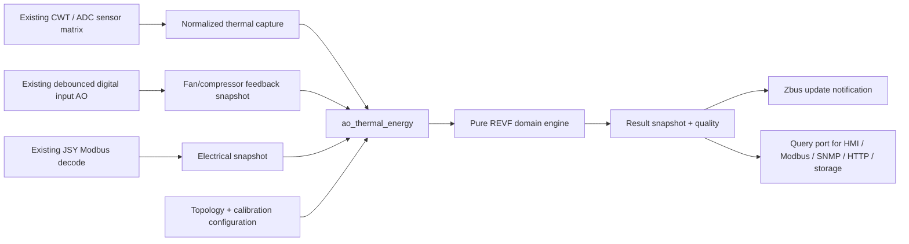
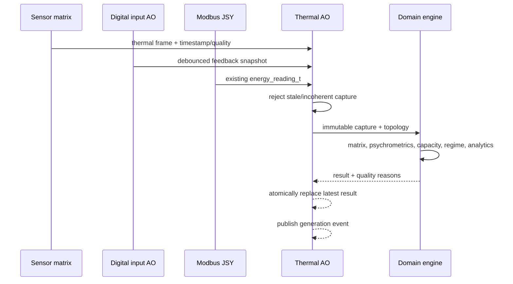

# Thermal and Energy System: Proposed Architecture

## Ownership and boundaries

Create one `ao_thermal_energy` that owns the latest coherent input capture, compressor stabilization state, RAM history, and published result snapshot. It subscribes to existing sensor and digital-input publications and receives JSY readings from the existing Modbus callback path. A pure domain engine receives only value objects and topology; it never receives an ADC, GPIO, Modbus, EEPROM, Zbus, or transport dependency.

## Input contract

`thermal_energy_capture_t` conceptually contains: generation ID; monotonic capture timestamp; normalized thermal matrix; return RH/current quality; JSY reading; fan and compressor state arrays; and configuration revision. The AO accepts each source independently, then processes only a copy whose members are within the coherence limit. The default proposed limit is two sensor periods (1 s at the future 1 Hz aggregation); it is a design setting, not a REVF claim.

Feedback states use a tri-state enum: `CONFIRMED_ON`, `CONFIRMED_OFF`, `UNKNOWN`; separately, source quality marks stale or invalid. `U_vent_ON` consists only of confirmed-on fans mapped to valid pairs. Compressors are not substituted for fans.

## Output contract

`thermal_energy_result_t` contains a schema version, capture timestamp, source ages, result generation, and quality flags for each metric group and pair. It provides pair deltas; means and dispersion; RH, vapor pressure, humidity ratio, dew point and density; mass flow/capacities/COP/exergy; compressor regime; and diagnostic/OLS state. Values whose quality is not valid must be ignored by consumers.

The AO protects its owned snapshot with a mutex for copy-out. It publishes a compact Zbus “new generation” event after replacement. The publisher never waits on a slow consumer; the query port returns a coherent copy.

## Processing pipeline

## Scheduling

| Work | Proposed trigger/frequency | Rationale |
|---|---|---|
| Digital scan/debounce | Existing 20 ms scan / 500 ms contact debounce | Preserve REVF contact filtering and existing AO. |
| Raw sensor acquisition | Existing 500 ms AO, aggregate at 1 Hz in thermal AO | REVF requests 1 Hz accumulators; avoids changing the driver. |
| JSY poll | Existing registry schedule | Reuse device polling cadence; do not create a second transaction. |
| Thermal/psychrometric evaluation | Event coalesced, at most 1 Hz | Thermal dynamics do not need 50 Hz math. |
| Stabilization state | 1 Hz | Matches 15 s and 180 s REVF gates. |
| Hour record and OLS sample | One accepted steady-state summary per hour | Matches REVF learning/historical cadence. |
| OLS solve / trends | Hourly or on demand after new summary | Keeps matrix algebra out of acquisition paths. |

## Phase-2 extension

Add pressure measurements to the normalized capture as optional quality-tagged fields. Enable pressure correction/LUT and pressure diagnostics only behind an explicit capability flag. Existing Phase-1 metrics continue with their current meanings.

