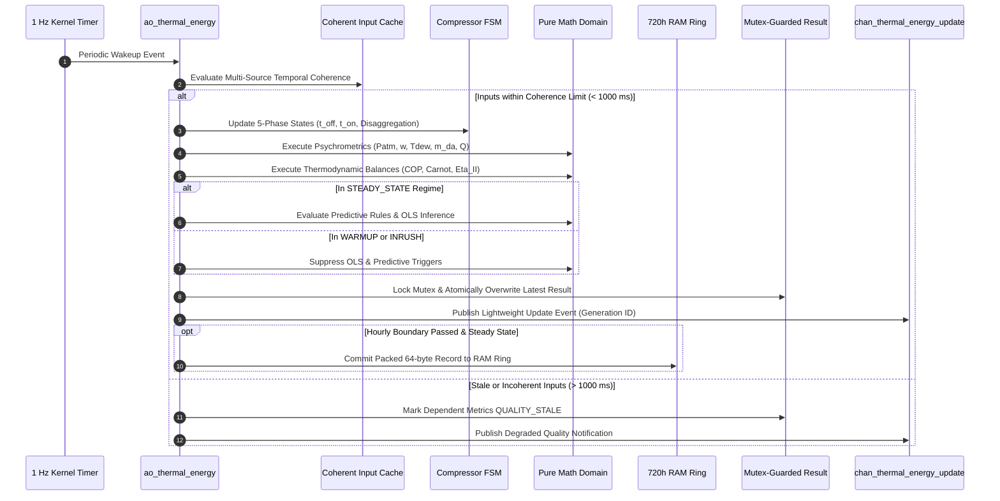
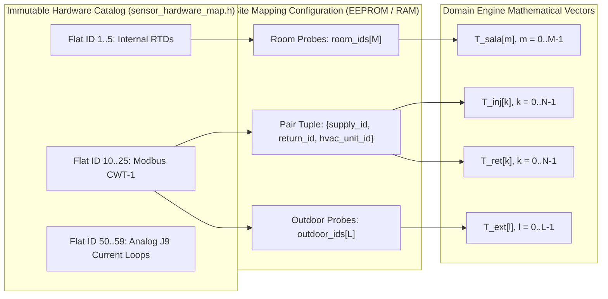
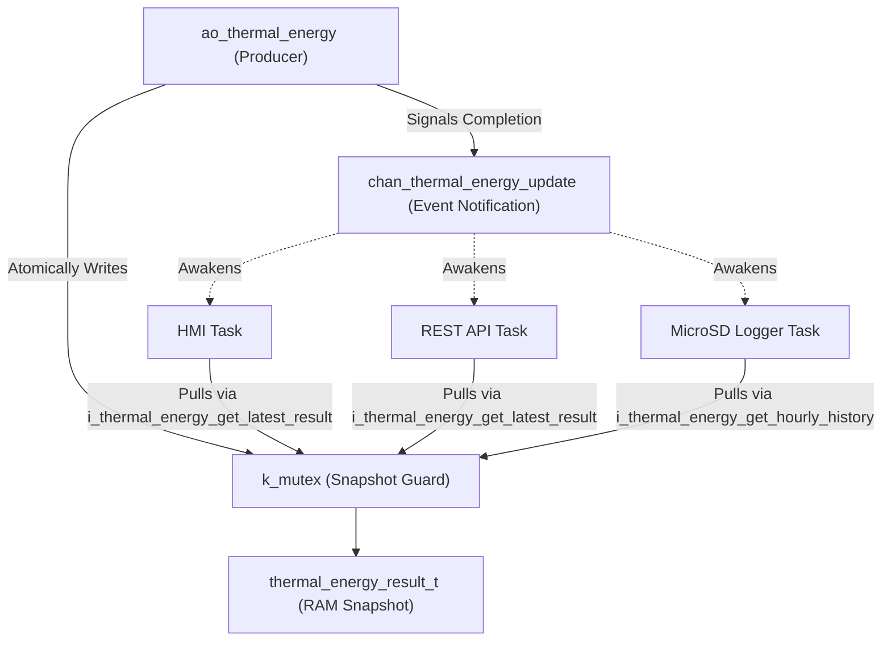

# Thermal and Energy System: Architecture & Design Specification

- **Document Identifier**: `doc/architecture/thermal_energy_system_architecture.md`
- **Subsystem**: Thermal and Energy System (`thermal_energy`)
- **Target Platform**: DAECGE BrightC Controller V3 (STM32H743ZIT6, Cortex-M7 @ 480 MHz)
- **Framework**: Zephyr RTOS (West T2 Workspace)
- **Design Patterns**: Clean Architecture (Hexagonal / Ports & Adapters) + Active Object (Canonical 5-Phase) + Thread-Safe Snapshot Query Port + Zbus Generation Event
- **Author**: Lead Embedded Firmware Architect
- **Status**: Stage 1 Architecture Deliverable (Ready for Technical Review)

---

## 1. Executive Summary & Design Principles

The **Thermal and Energy System** architecture structures firmware modules cleanly, enforces strict separation of concerns, and protects domain algorithms from RTOS and hardware drivers.

```mermaid
flowchart TD
    subgraph Drivers_Adapters["Infrastructure: Drivers & Adapters"]
        ADC_DMA["Zephyr Multi-ADC DMA Engine"] --> AD_SENS["adapter_sensor_zephyr"]
        MB_POLL["RS-485 Modbus Poller (ao_modbus)"] --> JSY_CODEC["JSY-MK-339 Codec"]
        DI_POLL["MCP23S17 / MBSL32DI (ao_digital_input)"] --> DI_AGG["digital_input_aggregator"]
    end

    subgraph Normalization["Ingestion & Normalization Layer"]
        AD_SENS --> MAT_MAP["sensor_matrix_mapper"]
        MAT_MAP --> CHAN_THERM["chan_thermal_matrix (Zbus)"]
        JSY_CODEC --> ELEC_SNAP["energy_reading_t"]
        DI_AGG --> CHAN_DI["chan_digital_input_snapshot (Zbus)"]
    end

    subgraph ActiveObject["Application Layer: Active Object"]
        AO_TE["ao_thermal_energy"]
        SNAP_CACHE["Coherent Input Capture Cache"]
        RING_720H["720-Hour RAM Ring Buffer (46.08 KB)"]
        RES_SNAP["Published Result Snapshot & Mutex"]
    end

    CHAN_THERM --> AO_TE
    ELEC_SNAP --> AO_TE
    CHAN_DI --> AO_TE
    AO_TE --> SNAP_CACHE
    AO_TE --> RING_720H
    AO_TE --> RES_SNAP

    subgraph PureDomain["Domain Layer: Pure Algorithms (Zero RTOS / Zero HW)"]
        PSYCH["psychrometrics (Patm, Pw, w, Tdew, rho, m_da, Q)"]
        THERMO["thermodynamics (COP, Pinch, Carnot, Eta_II)"]
        FSM["compressor_fsm (5-Phase Lifecycle & Disaggregation)"]
        PRED["predictive_analytics (Double OLS, Filter, Leak, Free)"]
    end

    SNAP_CACHE --> PSYCH
    SNAP_CACHE --> FSM
    PSYCH --> THERMO
    THERMO --> PRED
    FSM --> PRED
    PRED --> RES_SNAP

    subgraph Consumers["Decoupled Presentation & Persistence Plane"]
        RES_SNAP --> I_QUERY["i_thermal_energy_query_t (Fat-Pointer Handle)"]
        RES_SNAP --> CHAN_EVT["chan_thermal_energy_update (Zbus Event)"]
        I_QUERY --> HMI["DWIN 4.3\" HMI"]
        I_QUERY --> MB_TCP["Modbus TCP Server"]
        I_QUERY --> SNMP["SNMP Agent"]
        I_QUERY --> REST["Local RESTful API"]
        I_QUERY --> SD_LOG["MicroSD Hourly Datalogger"]
    end
```

### 1.1 Architectural Invariants & SOLID Compliance
1. **Single Responsibility Principle (SRP)**:
   - `Domain`: Pure mathematical formulas, psicrometric balances, exergy, OLS linear algebra. Zero Zephyr headers, zero hardware registers.
   - `Active Object (`ao_thermal_energy`)`: Coordinates temporal sampling (1 Hz), verifies snapshot coherence, drives domain engines, manages the 720-hour RAM ring buffer, and guards published results.
   - `Adapters`: Bridge physical buses (ADC, Modbus, SPI) to domain contracts.
   - `Composition Root`: Instantiates adapters, wires dependencies, injects configurations, and resolves DIP handles.
2. **Open/Closed Principle (OCP)**:
   - The engine is open for extension. Phase 2 pressure sensing will inject optional pressure readings through extended capture fields without altering existing Phase 1 formulas.
3. **Liskov Substitution Principle (LSP)**:
   - Any query client interacts via `i_thermal_energy_t` fat-pointer handles, fully swappable with in-memory test fakes on `native_sim`.
4. **Interface Segregation Principle (ISP)**:
   - High-rate physical telemetry streams (50 Hz / 500 ms) are segregated from analytical consumers, who query processed thermodynamic results at their own pace via `i_thermal_energy_query_t`.
5. **Dependency Inversion Principle (DIP)**:
   - Consumers depend strictly on abstract port interfaces (`app/include/interfaces/i_thermal_energy.h`), never on the internal context of `ao_thermal_energy.c`.

---

## 2. Component Taxonomy & Boundary Definition

```
BrightC-telemetry/
├── app/
│   ├── include/
│   │   ├── common/
│   │   │   ├── thermal_energy_types.h        <-- Pure domain DTOs, quality enums, wire records
│   │   │   └── config_types.h                <-- Domain storage payloads
│   │   └── interfaces/
│   │       └── i_thermal_energy.h            <-- Abstract Port Contract (Rule §4.1.D)
│   └── src/
│       ├── domain/
│       │   └── thermal/
│       │       ├── psychrometrics.h/.c       <-- Air properties, mass flow, capacities, SHF
│       │       ├── thermodynamics.h/.c       <-- COP real/sensible, pinch, Carnot, Eta_II
│       │       ├── compressor_fsm.h/.c       <-- 5-phase stabilization & load step capture
│       │       └── predictive_analytics.h/.c <-- Double-precision OLS, filters, leaks, free kW
│       ├── application/
│       │   ├── active_objects/
│       │   │   ├── ao_thermal_energy.h/.c    <-- 1 Hz thread, 720h RAM ring, snapshot owner
│       │   │   └── ao_thermal_energy_wire.c  <-- Zbus message subscriptions & routing
│       │   └── zbus/
│       │       └── thermal_channels.h/.c     <-- chan_thermal_energy_update event channel
│       └── infrastructure/
│           ├── adapters/
│           │   └── adapter_thermal_energy_port.c <-- Implements i_thermal_energy_t
│           └── di/
│               └── composition_root.c        <-- Static DI wiring and life-cycle gating
```

---

## 3. Abstract Interface Contract (Port `i_thermal_energy.h`)

Adhering strictly to **Rule §4.1.D Fat-Pointer Encapsulation**, external consumers interact through `i_thermal_energy_t`:

```c
/* app/include/interfaces/i_thermal_energy.h */

#ifndef APP_INTERFACES_I_THERMAL_ENERGY_H_
#define APP_INTERFACES_I_THERMAL_ENERGY_H_

#include <stdbool.h>
#include <stddef.h>
#include <stdint.h>
#include <errno.h>

#include "common/thermal_energy_types.h"

#ifdef __cplusplus
extern "C" {
#endif

/* Forward declaration */
struct i_thermal_energy_api;

/**
 * @brief Fat-pointer handle encapsulating instance context and v-table.
 */
typedef struct {
    const struct i_thermal_energy_api *api;
    void                              *impl;
} i_thermal_energy_t;

/**
 * @brief Virtual method table for thermal and energy queries.
 */
typedef struct i_thermal_energy_api {
    int (*get_latest_result)(void *impl, thermal_energy_result_t *out_result);
    int (*get_pair_result)(void *impl, uint8_t pair_index, thermal_pair_metric_t *out_pair);
    int (*get_compressor_state)(void *impl, uint8_t comp_index, compressor_status_t *out_status);
    int (*get_predictive_summary)(void *impl, predictive_summary_t *out_summary);
    int (*get_hourly_history)(void *impl, uint16_t hours_back, thermal_hourly_record_t *out_records, size_t max_records, size_t *out_count);
} i_thermal_energy_api_t;

/**
 * @brief Safety validation predicate verifying fat-pointer binding.
 */
static inline bool i_thermal_energy_is_bound(const i_thermal_energy_t *port)
{
    return (port != NULL &&
            port->api != NULL &&
            port->impl != NULL &&
            port->api->get_latest_result != NULL &&
            port->api->get_pair_result != NULL &&
            port->api->get_compressor_state != NULL &&
            port->api->get_predictive_summary != NULL);
}

/**
 * @brief Public inline wrappers enforcing defensive validation.
 */
static inline int i_thermal_energy_get_latest_result(const i_thermal_energy_t *port,
                                                     thermal_energy_result_t *out_result)
{
    if (!i_thermal_energy_is_bound(port) || out_result == NULL) {
        return -EINVAL;
    }
    return port->api->get_latest_result(port->impl, out_result);
}

static inline int i_thermal_energy_get_pair_result(const i_thermal_energy_t *port,
                                                   uint8_t pair_index,
                                                   thermal_pair_metric_t *out_pair)
{
    if (!i_thermal_energy_is_bound(port) || out_pair == NULL) {
        return -EINVAL;
    }
    return port->api->get_pair_result(port->impl, pair_index, out_pair);
}

static inline int i_thermal_energy_get_predictive_summary(const i_thermal_energy_t *port,
                                                          predictive_summary_t *out_summary)
{
    if (!i_thermal_energy_is_bound(port) || out_summary == NULL) {
        return -EINVAL;
    }
    return port->api->get_predictive_summary(port->impl, out_summary);
}

#ifdef __cplusplus
}
#endif

#endif /* APP_INTERFACES_I_THERMAL_ENERGY_H_ */
```

> [!IMPORTANT]
> External consumers **MUST NEVER** dereference `port->api->get_latest_result(...)` directly. Calling the type-safe static inline wrappers guarantees handle validation and defensive NULL checks.

---

## 4. Input & Output Data Contracts

### 4.1 Input Contract: Coherent Multi-Source Capture (`thermal_energy_capture_t`)
The Active Object aggregates disparate hardware streams into a synchronized snapshot:

```c
typedef struct {
    uint32_t generation_id;               /**< Monotonic sequence ID */
    uint64_t capture_timestamp_ms;        /**< Monotonic timestamp of snapshot assembly */

    /* Temperature Matrix (Normalized from chan_thermal_matrix) */
    uint64_t temp_timestamp_ms;           /**< Timestamp of sensor matrix acquisition */
    uint8_t  configured_pairs;            /**< N (1..16, default 6) */
    float    t_inj[16];                   /**< Cold supply temperatures [deg C] */
    float    t_ret[16];                   /**< Warm return temperatures [deg C] */
    uint16_t pair_valid_mask;             /**< Bit k = 1 if pair k is healthy and valid */
    uint16_t inj_valid_mask;              /**< Bit k = 1 if supply probe k is valid */
    uint16_t ret_valid_mask;              /**< Bit k = 1 if return probe k is valid */

    uint8_t  configured_room_probes;      /**< M (1..16, default 2) */
    float    t_room[16];                  /**< Room zone temperatures [deg C] */
    uint16_t room_valid_mask;

    uint8_t  configured_outdoor_probes;   /**< L (1..8, default 2) */
    float    t_outdoor[8];                /**< Outdoor condenser references [deg C] */
    uint8_t  outdoor_valid_mask;

    /* Psychrometric Loop (J9 4-20 mA) */
    float    humidity_return_pct;         /**< Return relative humidity (0.0..100.0 %) */
    data_quality_t humidity_quality;      /**< VALID, LIMITED, INVALID (loop break) */

    /* Electrical Power (From JSY-MK-339) */
    uint64_t elec_timestamp_ms;
    float    total_active_power_kw;       /**< P_elec_total [kW] */
    float    voltage_v[3];                /**< Line voltages [V] */
    float    current_a[3];                /**< Phase currents [A] */
    float    power_factor;                /**< Total PF */
    double   total_active_energy_kwh;     /**< Accumulated active energy [kWh] */
    data_quality_t elec_quality;          /**< VALID, STALE, INVALID */

    /* Contact Feedback States */
    uint64_t contact_timestamp_ms;
    uint8_t  fan_state_mask;              /**< Bit u = 1 if fan u is CONFIRMED_ON (U_vent_ON) */
    uint8_t  fan_quality_mask;            /**< Bit u = 1 if fan feedback is healthy/known */
    uint8_t  comp_state_mask;             /**< Bit c = 1 if compressor c is CONFIRMED_ON */
    uint8_t  comp_quality_mask;           /**< Bit c = 1 if compressor feedback is healthy */

    /* Site Topology Reference */
    uint32_t config_version;              /**< Active site configuration version */
} thermal_energy_capture_t;
```

### 4.2 Output Contract: Thermodynamic Result Snapshot (`thermal_energy_result_t`)

```c
typedef struct {
    uint32_t schema_version;              /**< Result contract schema version */
    uint32_t generation_id;               /**< Monotonic result generation sequence */
    uint64_t result_timestamp_ms;         /**< Timestamp of computation completion */
    uint32_t calculation_duration_us;     /**< CPU execution time for this cycle */

    /* Data Quality Flags */
    data_quality_t overall_quality;       /**< Subsystem top-level quality */
    data_quality_t thermal_quality;       /**< Temperature matrix quality */
    data_quality_t psychrometric_quality; /**< Psychrometrics and capacity quality */
    data_quality_t cop_quality;           /**< Efficiency and COP quality */
    data_quality_t predictive_quality;    /**< OLS and diagnostic quality */

    /* 1. Thermal Metrics */
    float delta_t_pair[16];               /**< Delta T per pair (T_ret - T_inj) [deg C] */
    float t_inj_mean;                     /**< Airflow-weighted mean supply temp [deg C] */
    float t_ret_mean;                     /**< Airflow-weighted mean return temp [deg C] */
    float delta_t_clima_mean;             /**< Global thermal lift (T_ret_mean - T_inj_mean) */
    float t_sala_mean;                    /**< Average room ambient temp [deg C] */
    float t_sala_max;                     /**< Maximum room hotspot temp [deg C] */
    float t_sala_min;                     /**< Minimum room cold spot temp [deg C] */
    float delta_t_sala_spread;            /**< Spatial spread (T_max - T_min) [deg C] */
    float delta_t_bypass;                 /**< Bypass gradient (T_sala_mean - T_ret_mean) */
    float t_outdoor_effective;            /**< Effective outdoor condensing reference [deg C] */

    /* 2. Psychrometric & Airflow Metrics */
    float p_atm_kpa;                      /**< Site barometric pressure [kPa] */
    float p_ws_ret_kpa;                   /**< Saturation vapor pressure at return [kPa] */
    float p_w_ret_kpa;                    /**< Partial vapor pressure at return [kPa] */
    float humidity_ratio_ret;             /**< Return absolute humidity [kg_vap/kg_da] */
    float t_rocio_ret;                    /**< Return dew point temperature [deg C] */
    float rho_da_ret;                     /**< Dry air density [kg/m^3] */
    float m_dot_da_total;                 /**< Total dry air mass flow [kg/s] */

    /* 3. Evaporator Capacity & Balances */
    float q_sensible_pair[16];            /**< Sensible cooling capacity per pair [kW] */
    float q_sensible_total;               /**< Room total sensible capacity [kW] */
    float q_latente_pair[16];             /**< Latent cooling capacity per pair [kW] */
    float q_latente_total;                /**< Room total latent capacity [kW] */
    float q_total;                        /**< Total thermal cooling capacity [kW] */
    float m_dot_condensate_lph;           /**< Condensate drainage rate [Liters/hour] */
    float shf;                            /**< Sensible Heat Factor (0.0 to 1.0) */
    float pct_latent_heat;                /**< Latent load percentage (0.0 to 100.0 %) */

    /* 4. Efficiency & Exergy Metrics */
    float cop_real;                       /**< Actual operational COP (Total kW / Elec kW) */
    float cop_sensible;                   /**< IT-Useful sensible COP (Sensible kW / Elec kW) */
    float t_evap_sat_k;                   /**< Evaporator saturation temp [K] */
    float t_cond_sat_k;                   /**< Condenser saturation temp [K] */
    float cop_carnot;                     /**< Theoretical Carnot ceiling */
    float eta_ii_pct;                     /**< Second Law exergetic efficiency [%] */
    float active_electrical_power_kw;     /**< P_elec_total consumed [kW] */

    /* 5. Predictive Analytics & Diagnostic Matrix */
    bool  ols_trained;                    /**< True if 168 steady-state hours accumulated */
    uint16_t training_hours_accumulated;  /**< Steady-state hours accumulated (0..168) */
    float q_total_expected_kw;            /**< Expected cooling capacity via OLS [kW] */
    float cop_expected;                   /**< Expected COP via OLS */
    float pct_mechanical_degradation;     /**< Degradation index (0.0 to 100.0 %) */
    float pct_filter_restriction[16];     /**< Filter loading index per pair (0.0 to 100.0 %) */
    uint16_t filter_days_remaining[16];   /**< Projected days remaining (Precedence F-04) */
    float pct_refrigerant_leak[16];       /**< Decoupled leak probability (0.0 to 100.0 %) */
    uint32_t diagnostic_alarm_mask;       /**< Bitmask of active predictive alarm conditions */

    /* 6. Weather-Corrected Capacity & Free Reserve */
    float q_nominal_weather_corrected;    /**< Derated nominal plant capacity [kW] */
    float q_max_safe;                     /**< Safe redundant capacity minus degradation [kW] */
    float kw_free_cooling_margin;         /**< Weather-corrected free cooling margin [kW] */
} thermal_energy_result_t;
```

---

## 5. Processing Pipeline & Active Object Lifecycle

The Active Object (`ao_thermal_energy`) implements the canonical 5-phase lifecycle:
1. `ao_thermal_energy_init()`: Wires ports, zeroes context, allocates 720-hour RAM ring buffer, initializes synchronization mutex and semaphores, creates dormant thread.
2. `ao_thermal_energy_start()`: Transitions thread to execution state, arms 1-second periodic timer.
3. `ao_thermal_energy_stop()`: Signals loop exit.
4. `ao_thermal_energy_wait_stopped()`: Blocks until thread exits cleanly.
5. `ao_thermal_energy_deinit()`: Destroys thread and synchronization primitives.

### 5.1 Temporal Execution Sequence (1 Hz Loop)



---

## 6. Sensor Index Mapping Architecture

To satisfy §5.2 of `doc/tasks/2.thermal.md`, the thermodynamic engine **never** references physical ADC channels or Modbus slave addresses. It references logical indices:



### 6.1 Topology Validation Rules
Before any evaluation cycle, `sensor_topology_validate()` verifies:
1. `N <= 16`, `M <= 16`, `L <= 8`.
2. For every configured pair $k \in \{0 \dots N-1\}$, `supply_id != 0` and `return_id != 0`.
3. `supply_id != return_id`.
4. No single flat sensor ID appears more than once across supply, return, room, or outdoor assignments.
5. If an assigned flat ID is unmapped or unregistered in `k_brightc_sensor_catalog`, configuration is rejected with `-EINVAL`.

---

## 7. Decoupled Presentation & Persistence Plane



1. **Non-Blocking Producer**: The calculation thread updates the snapshot under a brief mutex lock ($< 2\,\mu\text{s}$ copy time) and immediately posts a generation ID over Zbus.
2. **Zero Polling Lockup**: Consumers (HMI, Modbus TCP, SNMP, REST API) wait for the Zbus notification or poll via `i_thermal_energy_get_latest_result()`. A slow network client or blocked TCP socket cannot stall the thermal calculation loop.

---

## 8. Concurrency, Memory & RTOS Configuration

| Attribute | Specification | Rationale |
| :--- | :--- | :--- |
| **Thread Name** | `ao_thermal_energy` | Standard project naming. |
| **Stack Allocation** | `K_THREAD_STACK_DEFINE(s_thermal_energy_stack, 3072)` | File-scope static definition enforcing 32-byte MPU alignment on Cortex-M7. Embeds zero stack in `.bss`. |
| **Thread Priority** | `K_PRIO_PREEMPT(8)` | Lower priority than raw acquisition (ADC/Modbus at 4..6), higher than network/UI (10..14). |
| **Execution Period** | 1000 ms (1 Hz) | Thermal dynamics are slow; 1 Hz is mathematically optimal and leaves > 98% CPU idle. |
| **720h RAM Buffer** | Static array `thermal_hourly_record_t s_ram_history[720]` | 64 bytes x 720 = 46.08 KB allocated in AXI SRAM (512 KB total, well below 50% threshold). |
| **Synchronization** | `k_mutex s_result_mutex` | Protects atomic copy-out of `thermal_energy_result_t`. Lock held $< 2\,\mu\text{s}$. |
