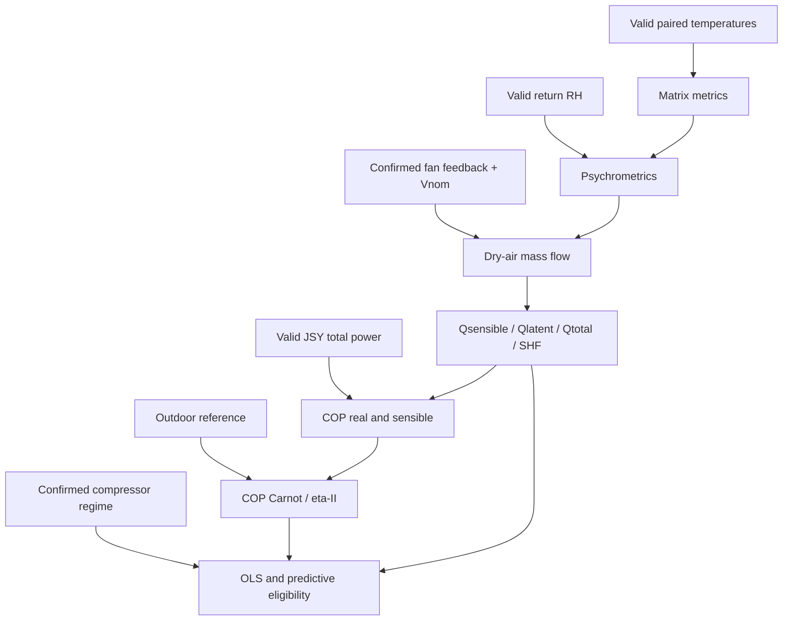

# Thermal and Energy System: REVF Algorithm Mapping

## Calculation map

| REVF section | Algorithm / units | Required valid inputs | Output and Phase-1 status |
|---|---|---|---|
| 4.1 | `ΔT = Tret - Tinj` in °C; means/spread | complete valid pair; room/outdoor probes as relevant | Available. Fan-filtered aggregate requires confirmed fan. |
| 4.2 | PT100 and 4–20 mA conversions | ADC counts, calibration, electrical limits | Existing normalization. RH conversion must distinguish <3.5 mA loop break from 3.5–4 mA range error. |
| 4.3 | `Patm`, `Pws`, `Pw`, `ω`, dew point, density; kPa, kg/kgda, °C, kg/m³ | altitude, valid return mean and RH; physically valid denominator | Available after topology/altitude configuration. |
| 4.3 | `m_da = Σ(Vnom/3600)*rho` kgda/s | previous plus confirmed-on fan and nominal airflow per unit | Available only for confirmed mapped fans. |
| 4.4 | sensible/latent/total kW, condensate L/h, SHF | prior inputs plus valid active pair temperatures | Available conditionally; dry regime gives latent zero. |
| 4.5 | COP real/sensible, Carnot, eta-II | valid capacity, positive JSY total kW, outdoor mean, pinch params | Available conditionally; total meter attribution must be documented. |
| 3 | compressor OFF/inrush/capture/warmup/steady state | confirmed compressor transitions and coherent power history | Available for mapped contacts; suppress OLS/alerts outside steady state. |
| 5.1 | regularized 4x4 OLS | 168 valid steady-state hourly records, load fraction, Q, return/outdoor temperatures | Conditional. `F_carga` requires a defined nominal compressor capacity/mapping. |
| 5.2 | filter, leak, hotspot, bypass, humidity ingress, short-cycle | respective baselines and valid predecessors | Each individually conditional; pressure diagnoses excluded. |
| 5.4 | derated safe capacity/free reserve | nominal capacities, redundancy, outdoor temp, degradation | Conditional after baseline/degradation exists. |

## Numerical policy

Use finite-value checks before every computation. Reject: altitude yielding nonpositive atmospheric-pressure base; `Patm <= Pw`; temperature denominator near `-237.3 °C`; logarithm argument `<=0`; `T+273.15 <=0`; negative mass flow; and capacity/power/Carnot denominators beneath configured epsilon. Clamp only where REVF specifies a physical clamp; otherwise mark the metric out of domain.

Use SI-compatible units exactly at boundaries: kPa with `Rda=0.287055 kPa·m³/(kg·K)`, kJ/(kgda·K), kg/s and kW. The identity kg/s × kJ/kg equals kW; retain this dimensional check in reference-vector tests.

## Precision finding

REVF mandates hardware double precision. The inspected primary Zephyr configuration has `CONFIG_FPU` disabled and the observed compile command lacks a hard-FPU option. Cortex-M7 hardware normally supports single-precision VFP rather than a DP-FPU; this must be verified against the exact toolchain/configuration before accepting the claimed timing. The architecture therefore isolates OLS behind a numeric service: Phase 1 shall compare float, software-double, and externally generated double reference vectors before choosing the deployed policy. This is a blocker for the REVF performance claim, not a reason to silently change the model.

## Dependency diagram

## Explicit exclusions

Do not calculate filter differential-pressure correction, R410A pressure LUT/superheat, or pressure-based leak/condenser/valve diagnosis without real pressure values. Do not compute a fan contribution from a commanded relay state, configured unit, or compressor state.

