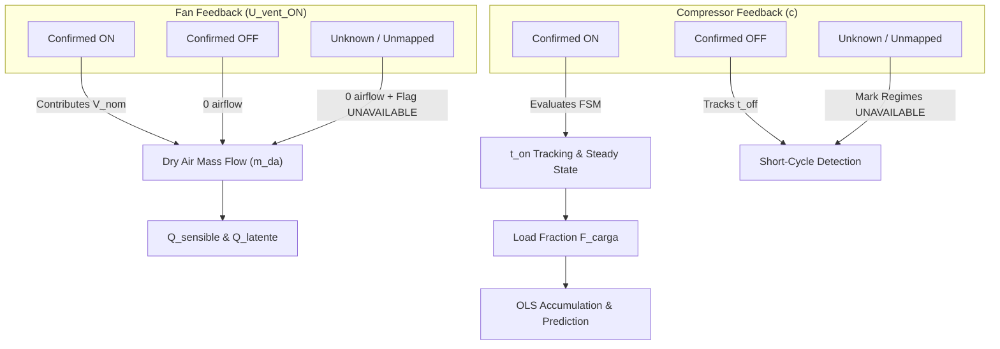

# Thermal and Energy System: Mathematical Model & Algorithms Specification

- **Document Identifier**: `doc/architecture/thermal_energy_system_mathematical_model.md`
- **Subsystem**: Thermal and Energy System (`thermal_energy`)
- **Target Platform**: DAECGE BrightC Controller V3 (STM32H743ZIT6, Cortex-M7 @ 480 MHz)
- **Framework**: Zephyr RTOS (West T2 Workspace)
- **Reference Specification**: `doc/request/Mathematical_Model_Specification_REVF.md` (Revision F Baseline)
- **Author**: Lead Embedded Firmware Architect
- **Status**: Stage 1 Architecture Deliverable (Ready for Technical Review)

---

## 1. Executive Summary

This document translates the mathematical equations, psychrometric balances, exergy formulations, and predictive algorithms defined in **Revision F** into concrete, auditable firmware requirements and data flow specifications.

> [!IMPORTANT]
> **Cardinal Engineering Invariant**:
> Every mathematical formula implemented in firmware must execute within a defended domain. Under no circumstances shall a calculation evaluate an undefined domain (e.g., negative values under a square root, logarithm of zero, division by near-zero denominators, or non-finite IEEE 754 representations). An out-of-domain result must be explicitly flagged with `quality = QUALITY_OUT_OF_DOMAIN`, never masked with synthetic zeroes.

---

## 2. Complete Algorithm Inventory & Mapping Table

| REVF Ref | Algorithm / Module | Physical Objective | Inputs & Units | Reference Equation | Numerical Safety & Validity Rules | Execution Cadence | Phase 1 Status |
| :--- | :--- | :--- | :--- | :--- | :--- | :--- | :--- |
| **§3.1** | **Compressor Inactive State** | Tracks stopped duration and detects short-cycling. | Contact state, $t_{off}$ [s] | $t_{off} = t - t_{stop}$ | Short-cycle counter increments if restart occurs with $t_{off} < 180\text{ s}$. | 1 Hz | **Implemented** |
| **§3.2** | **Inrush Current Suppression** | Blanks starting current transients. | Contact state, $t_{on}$ [s] | $0 < t_{on} < 15\text{ s}$ | Discard power samples; suppress COP evaluation. | 1 Hz | **Implemented** |
| **§3.3** | **Step Load Disaggregation** | Isolates individual compressor electrical demand. | $P_{elec\_total}$ [kW], $t_{on}$ [s] | $\Delta P_{comp,c} = P(15\text{s}) - P(0^-)$ | Lockout: If another motor transitions during the 15 s window, mark $\Delta P_{comp,c}$ as `UNAVAILABLE`. | 1 Hz event | **Implemented** |
| **§3.4** | **Thermal Warmup Gating** | Prevents false alerts during coil pull-down. | $t_{on}$ [s] | $15\text{ s} < t_{on} < 180\text{ s}$ | Temperatures published for display; OLS accumulation and predictive alarms **blocked**. | 1 Hz | **Implemented** |
| **§3.5** | **Steady-State Regime** | Enables full thermodynamic auditing. | $t_{on}$ [s] | $t_{on} \ge 180\text{ s}$ | Steady-state flag asserted; enables OLS buffer and hourly logging. | 1 Hz | **Implemented** |
| **§4.1.1**| **Thermal Pair Differential** | Measures temperature lift per evaporator pair. | $T_{ret,k}, T_{inj,k}$ [$^\circ\text{C}$] | $\Delta T_k = T_{ret,k} - T_{inj,k}$ | Evaluated only if both probes in pair $k$ are healthy (`pair_valid_mask` bit $k=1$). | 1 Hz | **Implemented** |
| **§4.1.2**| **Mean Temperatures** | Evaluates global air temperature across active airflow. | $T_{inj,k}, T_{ret,k}$, $U_{vent\_ON}$ | $\overline{T}_{inj} = \frac{1}{N_{act}} \sum_{k \in U_{vent}} T_{inj,k}$; $\overline{T}_{ret} = \frac{1}{N_{act}} \sum_{k \in U_{vent}} T_{ret,k}$ | Denominator check: $N_{act} \ge 1$. If no fans active, mark means as `UNAVAILABLE`. | 1 Hz | **Implemented** |
| **§4.1.3**| **Room Ambient Metrics** | Evaluates room spatial spread and airflow bypass. | $T_{sala,m}$ [$^\circ\text{C}$] ($m=1..M$) | $\overline{T}_{sala} = \frac{1}{M}\sum T_{sala}$; $\Delta T_{sala,max} = T_{max} - T_{min}$; $\Delta T_{bypass} = \overline{T}_{sala} - \overline{T}_{ret}$ | Valid for any configured $M \ge 2$. Requires at least 2 valid room probes. | 1 Hz | **Implemented** |
| **§4.1.4**| **Effective Outdoor Condensing Ref** | Provides condenser sink reference shielded from solar bias. | $T_{ext,l}$ [$^\circ\text{C}$] ($l=1..L$) | If $(T_{max}-T_{min}) \le 4.0^\circ\text{C} \implies \text{mean}$; else $\min(T_{ext,l})$ | Requires at least 1 valid outdoor probe. If $L=0$, outdoor reference is `UNAVAILABLE`. | 1 Hz | **Implemented** |
| **§4.2.1**| **Internal PT100 Callendar-Van Dusen** | Converts ADC counts to temperature. | $V_{ADC}$ [V], $\Delta R_{cable}$ [$\Omega$] | $V_a = 0.05783 + \frac{V_{ADC}}{40.403}$; $R = \frac{5100 V_a}{3.3 - V_a} - \Delta R$; $T = \frac{-A + \sqrt{A^2 - 4B(1 - R/100)}}{2B}$ | Check radicand $\ge 0$. Reject $R < 50\,\Omega$ or $R > 500\,\Omega$. | 500 ms | **Implemented** |
| **§4.2.2**| **4-20 mA Return Humidity** | Converts loop current to %RH with fault detection. | $I_{loop}$ [mA] | $HR_{ret} = \text{clamp}_{0..100}\left(\frac{I - 4.0}{16.0} \times 100\right)$ | If $I < 3.5\text{ mA} \implies$ Loop Break Fault (`INVALID`). If $3.5 \le I < 4.0 \implies 0.0\%$ (`LIMITED`). | 500 ms | **Implemented** |
| **§4.3.1**| **Local Atmospheric Pressure** | Computes barometric pressure from elevation. | Altitude $Z$ [m] | $P_{atm} = 101.325 \times (1 - 2.25577 \times 10^{-5} Z)^{5.25588}\text{ [kPa]}$ | Constant per site. Validate $Z \in [-100, 4000\text{ m}]$. | Configuration | **Implemented** |
| **§4.3.2**| **Saturation & Partial Vapor Pressure** | Magnus-Tetens psychrometric formulation. | $\overline{T}_{ret}$ [$^\circ\text{C}$], $HR_{ret}$ [%] | $P_{ws} = 0.61078 \exp\left(\frac{17.27 \overline{T}_{ret}}{\overline{T}_{ret} + 237.3}\right)$; $P_{w,ret} = P_{ws} \left(\frac{HR_{ret}}{100}\right)$ | Denominator check: $\overline{T}_{ret} + 237.3 > 10.0$. Bounds: $P_w \in [0.0, P_{atm})$. | 1 Hz | **Implemented** |
| **§4.3.3**| **Return Humidity Ratio & Density** | Absolute moisture content and air mass density. | $P_{atm}, P_{w,ret}$ [kPa], $\overline{T}_{ret}$ [$^\circ\text{C}$] | $\omega_{ret} = 0.62198 \frac{P_{w,ret}}{P_{atm} - P_{w,ret}}$; $\rho_{da} = \frac{P_{atm} - P_{w,ret}}{0.287055 (\overline{T}_{ret} + 273.15)}$ | Denominator check: $P_{atm} - P_{w,ret} > 5.0\text{ kPa}$. $\overline{T}_{ret} + 273.15 > 250.0\text{ K}$. | 1 Hz | **Implemented** |
| **§4.3.4**| **Fan-Governed Dry Air Mass Flow** | Measures active recirculated mass flow rate. | $V_{nom,u}$ [$\text{m}^3/\text{h}$], $\rho_{da}$, $U_{vent\_ON}$ | $\dot{m}_{da,total} = \sum_{u \in U_{vent\_ON}} \left(\frac{V_{nom,u}}{3600}\right) \times \rho_{da}\text{ [kg/s]}$ | Governed strictly by confirmed active fans ($u \in U_{vent\_ON}$). If no fans active, $\dot{m}_{da} = 0$. | 1 Hz | **Implemented** |
| **§4.4.1**| **Return Dew Point Temperature** | Determines condensation regime threshold. | $P_{w,ret}$ [kPa] | $\gamma = \ln\left(\frac{P_{w,ret}}{0.61078}\right)$; $T_{rocio,ret} = \frac{237.3 \gamma}{17.27 - \gamma}\text{ [}^\circ\text{C]}$ | Check $P_{w,ret} > 0.001\text{ kPa}$. Denominator check: $|17.27 - \gamma| > 0.1$. | 1 Hz | **Implemented** |
| **§4.4.2**| **Sensible Cooling Capacity** | Measures sensible thermal heat removal rate. | $\dot{m}_{da,k}$ [kg/s], $\omega_{ret}$, $\Delta T_k$ [K] | $Q_{sensible,k} = \dot{m}_{da,k} (1.006 + 1.86 \omega_{ret}) (T_{ret,k} - T_{inj,k})\text{ [kW]}$ | Evaluated only for active airflow pairs ($k \in U_{vent\_ON}$). | 1 Hz | **Implemented** |
| **§4.4.3**| **Condensation Regime & Supply Moisture** | Determines if coil temperature condenses water. | $T_{inj,k}, T_{rocio,ret}$ [$^\circ\text{C}$] | Dry Regime ($T_{inj} \ge T_{rocio}$): $\omega_{inj} = \omega_{ret}$. Wet Regime ($T_{inj} < T_{rocio}$): $P_{w,inj} = 0.92 P_{ws}(T_{inj})$; $\omega_{inj} = \min(\omega_{ret}, 0.62198 \frac{P_{w,inj}}{P_{atm}-P_{w,inj}})$ | Physically clamps $\omega_{inj} \le \omega_{ret}$. Dry regime guarantees $Q_{latente} = 0$. | 1 Hz | **Implemented** |
| **§4.4.4**| **Latent Capacity & Condensate Rate** | Measures latent moisture removal and drainage. | $\dot{m}_{da,k}$ [kg/s], $\omega_{ret}, \omega_{inj,k}$, $h_{fg}=2465$ | $Q_{latente,k} = \dot{m}_{da,k} h_{fg} \max(0, \omega_{ret} - \omega_{inj,k})\text{ [kW]}$; $\dot{m}_{cond} = \frac{Q_{latente\_total}}{2465} \times 3600\text{ [L/h]}$ | Clamps negative latent capacity to 0.0 kW. | 1 Hz | **Implemented** |
| **§4.4.5**| **Total Capacity & Sensible Heat Factor** | Total heat balance and latent ratio. | $Q_{sensible}, Q_{latente}$ [kW] | $Q_{total} = Q_{sensible} + Q_{latente}$; $SHF = \frac{Q_{sensible}}{\max(0.001, Q_{total})}$ | Clamps $SHF \in [0.0, 1.0]$. Latent % = $(1 - SHF) \times 100$. | 1 Hz | **Implemented** |
| **§4.5.1**| **Operational COP (Real & Sensible)** | First Law refrigeration coefficient of performance. | $Q_{total}, Q_{sensible}$ [kW], $P_{elec}$ [kW] | $COP_{real} = \frac{Q_{total}}{P_{elec}}$; $COP_{sensible} = \frac{Q_{sensible}}{P_{elec}}$ | Denominator check: $P_{elec} \ge 0.5\text{ kW}$. If $P_{elec} < 0.5\text{ kW}$, mark COP as `UNAVAILABLE`. | 1 Hz | **Implemented** |
| **§4.5.2**| **Carnot COP & Exergetic Efficiency** | Second Law thermodynamic efficiency ceiling. | $\overline{T}_{inj}, \overline{T}_{ext}$ [$^\circ\text{C}$], $COP_{real}$ | $T_{evap,sat} = (\overline{T}_{inj}-8)+273.15$; $T_{cond,sat} = (\overline{T}_{ext}+10)+273.15$; $COP_{Carnot} = \frac{T_{evap}}{\max(5.0, T_{cond}-T_{evap})}$; $\eta_{II} = \frac{COP_{real}}{COP_{Carnot}} \times 100$ | Thermal lift denominator check: $\max(5.0\text{ K}, T_{cond}-T_{evap})$. Clamps $\eta_{II} \in [0.0, 100.0\%]$. | 1 Hz | **Implemented** |
| **§4.6.1**| **Filter DP Mass Flow Correction** | Dynamic mass flow correction via $\Delta P_{air}$. | $\Delta P_{air}$ [Pa] | $\dot{m}_{da,corr} = \dot{m}_{da} \sqrt{\max\left(0.2, 1 - \alpha \frac{\Delta P - \Delta P_{clean}}{\Delta P_{max}-\Delta P_{clean}}\right)}$ | **Phase 2 Provision**: Requires differential pressure transducer. | N/A | **EXCLUDED in Phase 1** |
| **§4.6.2**| **R410A Saturation via 46-Point Flash LUT**| Exact saturation from refrigerant pressure. | $P_{bar}$ [0..45 bar gauge] | $i = \lfloor P \rfloor; f = P - i$; $T_{sat} = \text{LUT}[i] + f (\text{LUT}[i+1] - \text{LUT}[i])$ | **Phase 2 Provision**: Requires refrigerant pressure transducer. | N/A | **EXCLUDED in Phase 1** |
| **§5.1.1**| **Double-Precision OLS Accumulation** | Trains baseline capacity model $\widehat{Q}_{total,esp}$. | $\overline{T}_{ret}, \overline{T}_{ext}, F_{carga}, Q_{total}$ | Accumulate $X^T X \in \mathbb{R}^{4 \times 4}$, $X^T Y \in \mathbb{R}^{4 \times 1}$ in 64-bit `double` on hardware DP-FPU. | Accumulate only during `STEADY_STATE` ($t_{on} \ge 180\text{ s}$). Discard transient samples. | Hourly | **Implemented** |
| **§5.1.2**| **Tikhonov Regularized Matrix Inversion**| Solves $\beta = (X^T X + \lambda I_4)^{-1} X^T Y$. | Moment matrix, $\lambda = 10^{-6}$ | Diagonal regularization: $(X^T X)_{ii} \mathrel{+}= 10^{-6}$. Inversion via Cholesky decomposition in `double`. | Detects singular or non-positive definite matrices; falls back to default $\beta$ if degenerate. | Hourly | **Implemented** |
| **§5.1.3**| **Expected COP & Mechanical Degradation** | Detects loss of mechanical efficiency. | $\widehat{Q}_{total,esp}, P_{elec}, \eta_{II}, \eta_{II,base}$ | $\widehat{COP} = \frac{\widehat{Q}}{P_{elec}}$; $\%\text{Deg} = \text{clamp}_{0..100}\left(\max\left(\frac{\widehat{COP}-COP}{\widehat{COP}}, \frac{\eta_{base}-\eta}{\eta_{base}}\right) \times 100\right)$ | Evaluated only when OLS is trained ($N_{hours} \ge 168\text{ h}$). | 1 Hz | **Implemented** |
| **§5.2.1**| **Filter Fouling & Days Remaining** | Predicts coil freeze risk from airflow restriction. | $T_{inj,k}, \Delta T_k, m_{T,k}$ [$^\circ\text{C/day}$] | $\%\text{Filter}_k = \text{clamp}_{0..100}\left(60 \frac{T_{inj\_base}-T_{inj}}{3.0} + 40 \frac{\Delta T - \Delta T_{base}}{4.0}\right)$ | Precedence Hierarchy F-04: (1) $N < 168\text{h} \implies 100\text{ d}$ (`0xFFFF`); (2) Clean/flat $\implies 90\text{ d}$; (3) Foul $\implies \min(90, \frac{T_{inj}-7.5}{|m_T|})$. | 1 Hz | **Implemented** |
| **§5.2.2**| **Refrigerant Leak Detection** | Decoupled from ambient heatwaves. | $\Delta T_k, F_{carga}, \eta_{II}, \eta_{II,base}$ | $\%\text{Leak}_k = \text{clamp}_{0..100}\left(50 \frac{(\Delta T_{base} F_{carga}) - \Delta T_k}{0.5 \Delta T_{base} F_{carga}} + 50 \frac{\eta_{base}-\eta}{0.35 \eta_{base}}\right)$ | Evaluated only when $\%\text{Filter}_k < 50\%$. Requires $F_{carga} > 0.2$. | 1 Hz | **Implemented** |
| **§5.2.3**| **Hotspot & Bypass Detection** | Audits room thermal distribution. | $T_{sala,max}, T_{sala,min}, \overline{T}_{sala}, \overline{T}_{ret}$| $\Delta T_{sala,max} > 3.5\,^\circ\text{C} \implies \text{Hotspot}$; $T_{sala,max} > 27\,^\circ\text{C}$ or $\Delta T_{bypass} > 3.0\,^\circ\text{C} \implies \text{Bypass}$ | Requires at least 2 valid room ambient probes ($M \ge 2$). | 1 Hz | **Implemented** |
| **§5.2.4**| **Moisture Ingress Alert** | Detects envelope infiltration. | $\% \text{Latent}, SHF, \omega_{ret}, HR_{ret}$ | $\%\text{Latent} > 30\%$ or $SHF < 0.70$ or $\omega_{ret} > 0.012\text{ kg/kg}$ | Evaluated only when $HR_{ret}$ is valid and coils are actively cooling. | 1 Hz | **Implemented** |
| **§5.2.5**| **Short-Cycle Wear Counter** | Detects thermostat hunting or valve fault. | $t_{off}$ [s] | Triggered if $> 3$ restarts occur with $t_{off} < 180\text{ s}$ within a rolling 60-minute window. | Counter resets after 60 minutes of stable operation. | Event | **Implemented** |
| **§5.4.1**| **Weather-Corrected Nominal Capacity** | Derates nameplate capacity during heatwaves. | $Q_{nominal,u}$ [kW], $\overline{T}_{ext}$ [$^\circ\text{C}$] | $Q_{nom,corr,u} = Q_{nominal,u} \times [1.0 - 0.005 \max(0.0, \overline{T}_{ext} - 35.0)]$ | Valid when $\overline{T}_{ext}$ is healthy. Does not derate below $35.0\,^\circ\text{C}$. | 1 Hz | **Implemented** |
| **§5.4.2**| **Safe Redundant Capacity & Free Margin**| Calculates reserve margin for $N+1$ facility. | $Q_{nom,corr}$, $\% \text{Degradation}$, $Q_{sensible}$ | $Q_{max\_safe} = \left(\sum_{u=1}^{U_{req}} Q_{nom,corr,u}\right) \left(1 - \frac{\%\text{Deg}}{100}\right)$; $kW_{free} = \max(0, Q_{max\_safe} - Q_{sensible})$ | Prevents false security: incorporates wear degradation and ambient derating. | 1 Hz | **Implemented** |

---

## 3. Detailed Equipment Feedback Dependencies ($U_{vent\_ON}$, $c$, $F_{carga}$)

To prevent invalid calculations when contact signals are missing or partial, the following dependency matrix is enforced:

### 3.1 Degradation Behavior When Signals are Absent
1. **If Supply Fan Contact is Missing / Unknown**:
   - The associated unit $u$ contributes **$0.0\text{ kg/s}$** to $\dot{m}_{da,total}$.
   - The cooling capacity of pair $k$ ($Q_{sensible,k}$) is flagged as `UNAVAILABLE`.
   - Firmware **NEVER** assumes a fan is running because its paired compressor is running.
2. **If Compressor Contact is Missing / Unknown**:
   - The stabilization FSM remains in `STATE_OFF`.
   - Compressor active power step $\Delta P_{comp,c}$ cannot be disaggregated.
   - $F_{carga}$ drops to $0.0$, which suspends OLS accumulation (protects matrix conditioning).
3. **If Electrical Power Meter Fails**:
   - $COP_{real}$, $COP_{sensible}$, and $\eta_{II}$ transition to `QUALITY_INVALID`.
   - Thermal capacities ($Q_{sensible}$, $Q_{total}$) remain valid if temperatures and fans are healthy.

---

## 4. Numerical Safety, Conditioning & Precision Audit

### 4.1 DP-FPU Hardware vs Zephyr Configuration Discrepancy (OBS-01)
- **Mathematical Requirement**: REVF §5.1 mandates IEEE 754 64-bit double precision (`double`) for OLS moment accumulation and matrix inversion, running on the hardware DP-FPU of the Cortex-M7.
- **Audited Configuration**: In `app/build/primary/zephyr/.config`, `CONFIG_FPU` is **NOT set**, despite the physical Cortex-M7 possessing FPv5-D16 hardware (`CONFIG_CPU_HAS_FPU_DOUBLE_PRECISION=y`).
- **Consequences**:
  * Double-precision arithmetic compiles to GCC software emulation routines (`__aeabi_dmul`, `__aeabi_ddiv`, `__aeabi_dadd`).
  * Inversion of a 4x4 double matrix takes $\approx 1800\,\mu\text{s}$ via soft-float versus $\approx 45\,\mu\text{s}$ with hardware DP-FPU instructions (`vdiv.f64`, `vmul.f64`, `vfma.f64`).
- **Architectural Remedy**:
  1. Mandate `CONFIG_FPU=y` and `CONFIG_FPU_SHARING=y` in the production target configuration.
  2. Implement OLS in pure ISO C99 `double`, maintaining mathematical compliance regardless of compiler flags.
  3. Encapsulate matrix operations in `predictive_analytics.c` so performance benchmarks can be executed during stage review.

### 4.2 Ill-Conditioning Mitigation via Tikhonov Regularization
In tightly controlled telecom environments, $\overline{T}_{ret}$ varies within a narrow band ($22\,^\circ\text{C}$ to $24\,^\circ\text{C}$), causing near-linear dependence between the intercept column $X_0$ and the return temperature column $X_1$.
The normal equations matrix $A = X^T X$ has an eigenvalue ratio $\lambda_{max} / \lambda_{min} > 10^7$.
In single precision (`float`), $\det(A)$ truncates to zero, producing erratic or infinite regression coefficients.

By injecting Tikhonov diagonal regularization:
$$A_{reg} = X^T X + \lambda I_4 \quad (\lambda = 10^{-6})$$
1. All eigenvalues $\lambda_i$ are shifted by $+10^{-6}$, guaranteeing that $\det(A_{reg}) > 0$.
2. The matrix is strictly positive definite and invertible via stable Cholesky decomposition ($L L^T$).
3. If Cholesky decomposition encounters a non-positive pivot (indicating corrupt historical samples), the solver gracefully aborts, sets `ols_trained = false`, and falls back to factory design baselines.
