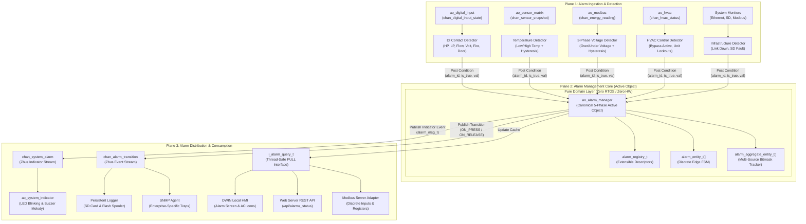
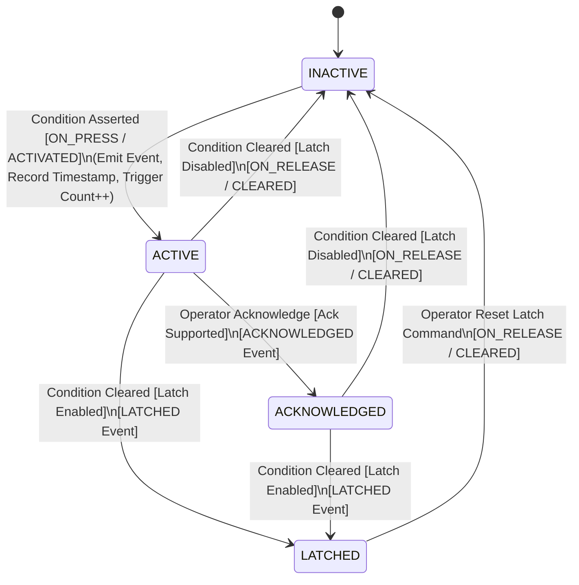
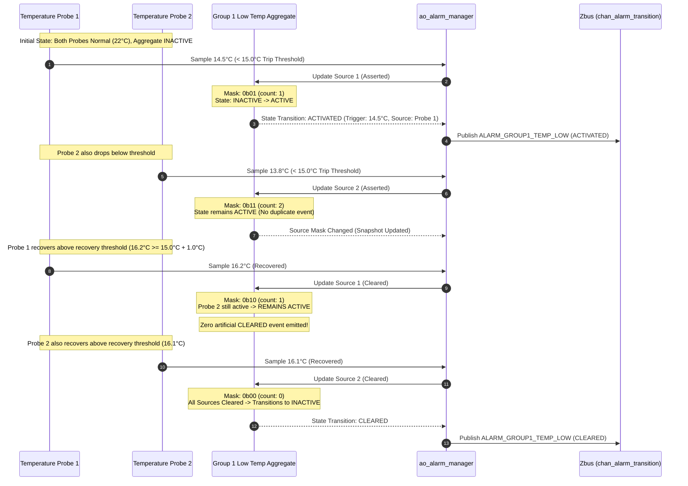
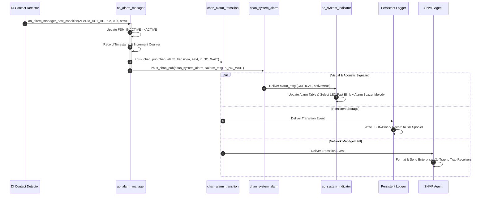
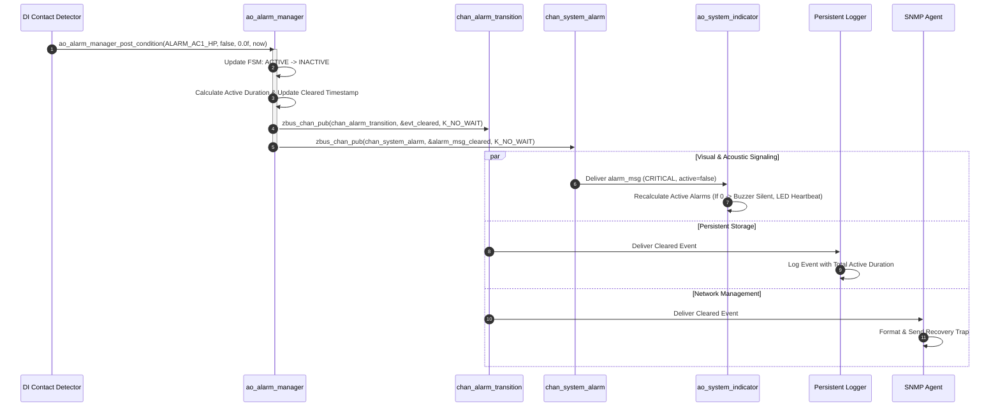
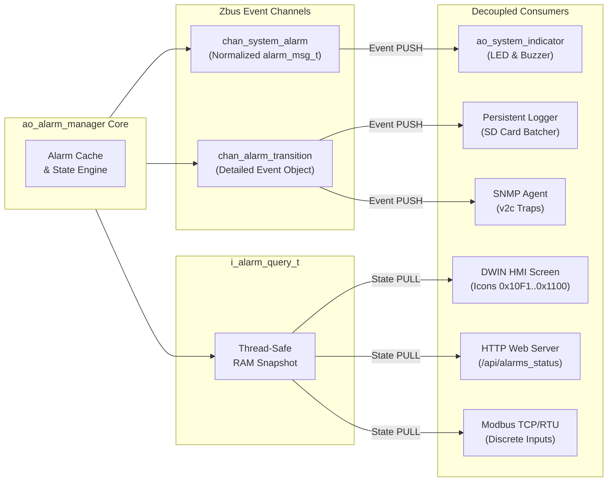

# Alarm Management Subsystem: Technical Architecture Specification

- **Document Identifier**: `doc/architecture/alarm_management_architecture.md`
- **Subsystem**: Centralized Alarm Management Subsystem (`alarm_manager`)
- **Target Platform**: DAECGE BrightC Controller V3 (STM32H743ZIT6, Cortex-M7 @ 480 MHz)
- **Framework**: Zephyr RTOS (West T2 Workspace)
- **Design Patterns**: Clean Architecture (Ports & Adapters) + Active Object (Canonical 5-Phase) + Zbus Pub/Sub + Composite Aggregation
- **Author**: Lead Embedded Firmware Architect
- **Status**: Stage 1 Architecture Specification (Approved for Review)

---

## 1. Executive Summary & Design Principles

The **Alarm Management Subsystem** (`alarm_manager`) is the central orchestrator and single source of truth for all operational, environmental, electrical, and hardware alarms in the BrightC Controller V3.

### 1.1 Architectural Invariants & SOLID Compliance
1. **Single Responsibility Principle (SRP)**:
   - **Detection**: Dedicated source detectors evaluate physical readings and emit condition truth values.
   - **Management**: The core Active Object (`ao_alarm_manager`) manages the FSM lifecycle, timestamps, trigger metrics, and multi-source aggregation.
   - **Consumption**: External consumers (LED/Buzzer indicators, persistent logger, SNMP, HMI, Web Server, Modbus) react to transitions or query status without knowing internal detection algorithms.
2. **Open/Closed Principle (OCP)**:
   - The alarm engine is open for extension via an extensible descriptor table (`alarm_registry_t`). New alarms can be registered at system initialization without modifying the core state machine or dispatch loops.
3. **Liskov Substitution Principle (LSP)**:
   - Any query client or notification sink can interact through standardized interface contracts (`i_alarm_query_t`, `i_alarm_sink_t`) interchangeably in physical hardware or `native_sim` test runners.
4. **Interface Segregation Principle (ISP)**:
   - PUSH notifications (event stream via Zbus `chan_alarm_transition` and `chan_system_alarm`) are strictly segregated from PULL queries (`i_alarm_query_t`).
5. **Dependency Inversion Principle (DIP)**:
   - Domain logic (`app/src/domain/alarm/`) depends strictly on standard ISO C99 libc headers (`stdint.h`, `stdbool.h`). Zero `<zephyr/...>` headers and zero hardware registers exist in the domain layer.

---

## 2. High-Level Subsystem Architecture

The architecture is divided into three distinct operational planes:
1. **Alarm Ingestion & Detection Plane**: Specialized detector adapters consume raw hardware events and telemetry streams, applying debouncing, threshold comparison, and hysteresis.
2. **Alarm Core Lifecycle Plane**: The `ao_alarm_manager` Active Object serializes incoming evaluation requests, drives domain entities, maintains the state table, and updates active alarm metrics.
3. **Alarm Distribution & Consumer Plane**: Asynchronous event dispatching via Zephyr Zbus and synchronous thread-safe query ports.



---

## 3. Alarm Lifecycle & State Machine Model

### 3.1 State Definitions
- **`ALARM_STATE_INACTIVE`**: Normal quiescent condition.
- **`ALARM_STATE_ACTIVE`**: Anomaly condition asserted. Emits `ON_PRESS` (`ALARM_EVENT_ACTIVATED`).
- **`ALARM_STATE_ACKNOWLEDGED`**: Operator acknowledged condition. Physical condition remains asserted.
- **`ALARM_STATE_LATCHED`**: Condition returned to normal, but alarm is held active until an operator manual reset is issued.



### 3.2 Single-Shot Edge Triggering Rules
1. **Rising Edge (`INACTIVE` $\rightarrow$ `ACTIVE`)**:
   - Condition becomes `true` while in `INACTIVE`.
   - Action: Transition state to `ACTIVE`, capture `timestamp_ms`, record `trigger_value`, increment `trigger_count`, emit `ALARM_EVENT_ACTIVATED`.
2. **Falling Edge (`ACTIVE` / `ACKNOWLEDGED` $\rightarrow$ `INACTIVE`)**:
   - Condition becomes `false` while in `ACTIVE` (and latching disabled).
   - Action: Transition state to `INACTIVE`, capture `cleared_timestamp_ms`, emit `ALARM_EVENT_CLEARED`.
3. **Condition Persistence (Steady State)**:
   - Repeated calls with `condition == true` while already `ACTIVE` produce **zero** events (suppress duplicate storms).
   - Repeated calls with `condition == false` while already `INACTIVE` produce **zero** events.

---

## 4. Multi-Source Aggregated Alarm Architecture

Certain alarms (such as **Group Low Temperature**, **Group High Temperature**, or **Group AC Unit Failure**) depend on $M$ independent physical sources.

### 4.1 Aggregation Algorithm
An aggregated alarm contains:
- `uint32_t assigned_sources_mask`: Bitmask of sources participating in the group.
- `uint32_t contributing_sources_mask`: Bitmask of sources currently in an asserted alarm condition.
- `size_t active_source_count`: Number of set bits in `contributing_sources_mask`.



---

## 5. Domain Layer Interface & Contracts (ISO C99 Pure Domain)

### 5.1 Pure Alarm Types (`app/include/common/alarm_types.h`)

```c
#ifndef APP_COMMON_ALARM_TYPES_H_
#define APP_COMMON_ALARM_TYPES_H_

#include <stdbool.h>
#include <stddef.h>
#include <stdint.h>

#ifdef __cplusplus
extern "C" {
#endif

typedef enum {
    ALARM_STATE_INACTIVE = 0,
    ALARM_STATE_ACTIVE,
    ALARM_STATE_ACKNOWLEDGED,
    ALARM_STATE_LATCHED,
    ALARM_STATE_MAX
} alarm_state_t;

typedef enum {
    ALARM_SEVERITY_INFO = 0,
    ALARM_SEVERITY_WARNING,
    ALARM_SEVERITY_CRITICAL,
    ALARM_SEVERITY_FATAL,
    ALARM_SEVERITY_MAX
} alarm_severity_t;

typedef enum {
    ALARM_PRIORITY_LOW = 0,
    ALARM_PRIORITY_MEDIUM,
    ALARM_PRIORITY_HIGH,
    ALARM_PRIORITY_EMERGENCY,
    ALARM_PRIORITY_MAX
} alarm_priority_t;

typedef enum {
    ALARM_SOURCE_DIGITAL_INPUT = 0,
    ALARM_SOURCE_SENSOR_ANALOG,
    ALARM_SOURCE_ELECTRICAL,
    ALARM_SOURCE_HVAC_CONTROL,
    ALARM_SOURCE_SYSTEM_INFRA,
    ALARM_SOURCE_MAX
} alarm_source_category_t;

typedef enum {
    ALARM_EVENT_NONE = 0,
    ALARM_EVENT_ACTIVATED,      /**< ON_PRESS: INACTIVE -> ACTIVE */
    ALARM_EVENT_CLEARED,        /**< ON_RELEASE: ACTIVE/ACK/LATCH -> INACTIVE */
    ALARM_EVENT_ACKNOWLEDGED,  /**< ACTIVE -> ACKNOWLEDGED */
    ALARM_EVENT_LATCHED,        /**< ACTIVE -> LATCHED */
    ALARM_EVENT_SOURCE_CHANGED  /**< Contributing source added/removed in aggregate */
} alarm_transition_type_t;

/**
 * @brief Immutable transition event value object.
 */
typedef struct {
    uint16_t                alarm_id;
    alarm_transition_type_t event_type;
    alarm_state_t           previous_state;
    alarm_state_t           new_state;
    alarm_severity_t        severity;
    alarm_priority_t        priority;
    alarm_source_category_t source_category;
    uint32_t                contributing_sources_mask;
    float                   trigger_value;
    uint64_t                timestamp_ms;
} alarm_transition_event_t;

/**
 * @brief Static Alarm Descriptor (immutable definition).
 */
typedef struct {
    uint16_t                alarm_id;
    const char             *name;
    const char             *description;
    alarm_source_category_t source_category;
    alarm_severity_t        default_severity;
    alarm_priority_t        default_priority;
    bool                    is_latch_supported;
    bool                    is_ack_supported;
    bool                    is_aggregated;
} alarm_descriptor_t;

#ifdef __cplusplus
}
#endif

#endif /* APP_COMMON_ALARM_TYPES_H_ */
```

### 5.2 Query Port Interface (`app/include/interfaces/i_alarm_query.h`)

```c
#ifndef APP_INTERFACES_I_ALARM_QUERY_H_
#define APP_INTERFACES_I_ALARM_QUERY_H_

#include <stdbool.h>
#include <stddef.h>
#include <stdint.h>
#include "common/alarm_types.h"

#ifdef __cplusplus
extern "C" {
#endif

typedef struct i_alarm_query_api i_alarm_query_api_t;

typedef struct {
    const i_alarm_query_api_t *api;
    void                      *impl;
} i_alarm_query_t;

struct i_alarm_query_api {
    size_t (*get_active_count)(void *impl);
    alarm_severity_t (*get_highest_active_severity)(void *impl);
    bool (*is_active)(void *impl, uint16_t alarm_id);
    int (*get_alarm_state)(void *impl, uint16_t alarm_id, alarm_state_t *out_state);
    size_t (*get_active_alarm_ids)(void *impl, uint16_t *out_ids, size_t max_count);
    int (*get_descriptor)(void *impl, uint16_t alarm_id, alarm_descriptor_t *out_desc);
};

static inline bool i_alarm_query_is_bound(const i_alarm_query_t *port)
{
    return (port != NULL && port->api != NULL && port->impl != NULL);
}

static inline size_t i_alarm_query_get_active_count(const i_alarm_query_t *port)
{
    if (!i_alarm_query_is_bound(port)) return 0;
    return port->api->get_active_count(port->impl);
}

static inline bool i_alarm_query_is_active(const i_alarm_query_t *port, uint16_t alarm_id)
{
    if (!i_alarm_query_is_bound(port)) return false;
    return port->api->is_active(port->impl, alarm_id);
}

#ifdef __cplusplus
}
#endif

#endif /* APP_INTERFACES_I_ALARM_QUERY_H_ */
```

---

## 6. Interaction Sequences with External Subsystems

### 6.1 Activation Sequence (`ON_PRESS`)



### 6.2 Deactivation Sequence (`ON_RELEASE`)



### 6.3 Decoupled Integration with All Consumers



---

## 7. Concurrency, Synchronization & Thread Safety

1. **Thread Serialization**:
   - `ao_alarm_manager` owns a private message queue (`k_msgq`) with depth `CONFIG_ALARM_MANAGER_QUEUE_DEPTH` (default: 32 items).
   - Ingestion adapters call non-blocking post helpers (`ao_alarm_manager_post_condition()`) which enqueue evaluation requests.
   - All state transitions, counter increments, and timestamps are updated strictly within the context of the `ao_alarm_manager` thread, eliminating race conditions on alarm entities.
2. **Read-Side Concurrency (PULL Interface)**:
   - To serve external consumers (Modbus server, Web server, HMI) without blocking the Active Object, `ao_alarm_manager` maintains a shadow snapshot table protected by a lightweight reader/writer mutex (`k_mutex`).
   - The query port (`i_alarm_query_t`) reads from this snapshot cache.
3. **Queue Overflow Policy**:
   - If the incoming event queue is full, the manager logs a warning (`LOG_WRN`) and increments an overflow counter. The critical single-shot guarantee is maintained because detectors re-evaluate conditions periodically.

---

## 8. Summary of Architectural Deliverables

| Module | Layer | File Location | Responsibility |
|:---|:---|:---|:---|
| `alarm_types.h` | Common Types | `app/include/common/alarm_types.h` | Pure enums, value objects, descriptor structs |
| `i_alarm_query.h` | Interface Port | `app/include/interfaces/i_alarm_query.h` | Fat-pointer PULL contract for external consumers |
| `alarm_entity.h/.c` | Domain Logic | `app/src/domain/alarm/alarm_entity.*` | Pure single-shot edge FSM entity |
| `alarm_aggregate.h/.c` | Domain Logic | `app/src/domain/alarm/alarm_aggregate.*` | Multi-source bitmask aggregation entity |
| `alarm_registry.h/.c` | Domain Logic | `app/src/domain/alarm/alarm_registry.*` | Extensible static descriptor catalog |
| `ao_alarm_manager.h/.c`| Application AO | `app/src/application/active_objects/ao_alarm_manager.*` | Canonical 5-phase Active Object coordinator |
| `alarm_channels.h/.c` | Zbus Infra | `app/src/application/zbus/alarm_channels.*` | Event channels declaration & definition |
