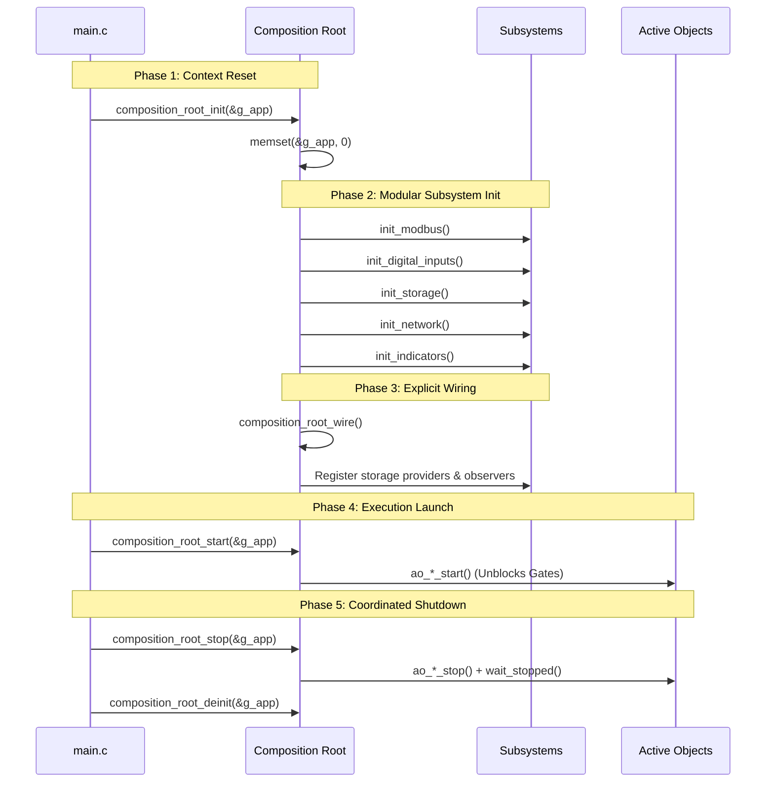

# Dependency Injection Container & Composition Root Architecture

- **Status**: Official Architecture Standard & Implementation Guide
- **Platform**: DAECGE BrightC Controller V3 (STM32H743ZIT6, Cortex-M7 @ 480 MHz)
- **Environment**: Zephyr RTOS (West T2 Topology)
- **Layer**: Infrastructure Layer (Composition Root & Dependency Wiring)
- **Language**: English (per project convention)

---

## 1. Executive Summary & Purpose

The **Composition Root** (implemented via `app_container_t` and `composition_root_*`) is the unified, authoritative location where all system dependencies, hardware adapters, abstract ports, and Active Objects are instantiated, wired, and orchestrated.

### 1.1 Core Principles
1. **Single Point of Static Allocation**: Per the system architecture invariant, `main.c` declares the *only* mutable static application object (`static app_container_t g_app`). All components receive their dependencies strictly by reference or pointer.
2. **Zero Dynamic Memory Allocation**: All memory for adapters, Active Object contexts, event queues, and state buffers is pre-allocated statically at compile time.
3. **Dependency Inversion Principle (DIP)**: Components never couple to concrete adapters. The container exposes abstract port handles (`i_<name>_t`) and public interface getters (`app_container_get_<port>()`).
4. **Separation of Concerns in Lifecycle**: Instantiation, Subsystem Configuration, Inter-Component Wiring, Execution Launch, and Teardown are cleanly divided into distinct phases.

---

## 2. Structural Memory Layout: Vertical Subsystem Grouping

To maximize cohesion, clarity, and maintainability, `app_container_t` organizes its members **vertically by functional subsystem**, rather than horizontally by technical archetype.

Each subsystem encapsulates:
- Its **exposed abstract port** (`i_<name>_t`).
- Its **concrete hardware adapter** (e.g., `adapter_eth_stm32_t`).
- Its **Active Object instance and queue buffers** (`ao_<name>_t`, `struct k_msgq`).
- Its **subsystem-specific initialization flag** (`bool initialized`).

```text
┌─────────────────────────────────────────────────────────────────────────────┐
│                            app_container_t                                  │
├─────────────────────────────────────────────────────────────────────────────┤
│  ▼ Subsystem 1: Modbus Master & Relays                                      │
│    - registry_port, client_port[2], relay_ext_port                          │
│    - registry_impl, waveshare_relay, nmbs[2]                                │
│    - ao[2], ao_queue[2], ao_queue_buf[2], bus_cfg[2], initialized           │
├─────────────────────────────────────────────────────────────────────────────┤
│  ▼ Subsystem 2: Digital Inputs & Contact Alarms                             │
│    - port (i_digital_input_t), aggregator, di_adapter                       │
│    - ao (ao_digital_input_t), queue, queue_buf, initialized                  │
├─────────────────────────────────────────────────────────────────────────────┤
│  ▼ Subsystem 3: Configuration & Persistent Storage                          │
│    - port (i_config_storage_t), storage_adapter                             │
│    - ao (ao_storage_t), queue, queue_buf, initialized                       │
├─────────────────────────────────────────────────────────────────────────────┤
│  ▼ Subsystem 4: Network (Ethernet LAN8742 & WiFi ESP-Hosted)                │
│    - eth_port, wifi_port, eth_adapter, wifi_adapter                         │
│    - ao (ao_network_t), queue, queue_buf, initialized                       │
├─────────────────────────────────────────────────────────────────────────────┤
│  ▼ Subsystem 5: System Indicators (LED & Buzzer)                            │
│    - led_port, buzzer_port, led_adapter, buzzer_adapter                     │
│    - ao (ao_system_indicator_t), queue, queue_buf, initialized              │
├─────────────────────────────────────────────────────────────────────────────┤
│  ▼ Global Container Status: is_initialized, is_running                      │
└─────────────────────────────────────────────────────────────────────────────┘
```

---

## 3. The 5-Phase Lifecycle Sequence

The lifecycle of the DI Container follows a deterministic, 5-phase execution pipeline:



### 3.1 Phase 1: Context Reset & Verification
- `composition_root_init(self)` verifies input pointers and resets the container memory.
- If the container is already fully initialized, it acts idempotently and returns `0`.

### 3.2 Phase 2: Modular Subsystem Initialization
Each subsystem provides a modular initializer:
- `composition_root_init_modbus(self)`
- `composition_root_init_digital_inputs(self)`
- `composition_root_init_storage(self)`
- `composition_root_init_network(self)`
- `composition_root_init_indicators(self)`

**Fault Isolation & Graceful Degradation**:
If non-critical hardware (e.g., secondary WiFi or Ethernet link) is absent in a specific hardware variant, the subsystem marks itself uninitialized or degraded without failing the entire boot process.

### 3.3 Phase 3: Explicit Wiring (`composition_root_wire`)
Decoupled from adapter creation. In this phase:
- Cross-subsystem bindings are established.
- Storage providers are registered with `ao_storage_register_provider()`.
- Zbus channel publishers and listeners are configured.

### 3.4 Phase 4: Active Object Execution Launch (`composition_root_start`)
- Calls `ao_<name>_start()` on all initialized Active Objects.
- Opens synchronization gates (`run_sem` or `AO_MSG_START`), transitioning worker threads into their active `inner loops`.

### 3.5 Phase 5: Coordinated Shutdown (`composition_root_stop` & `deinit`)
Enforces a deterministic shutdown sequence with timeouts to prevent thread deadlocks or truncated flash writes:
1. `ao_modbus` stop (wait up to 1000 ms)
2. `ao_digital_input` stop (wait up to 200 ms)
3. `ao_storage` stop (wait up to 2000 ms — flushes all pending dirty buffers)
4. `ao_network` stop (wait up to 2000 ms)
5. `ao_system_indicator` stop (wait up to 200 ms)
`composition_root_deinit(self)` permanently terminates the outer loops and joins all threads.

---

## 4. DIP Compliance: Interface Access via Public Getters

External modules (e.g., `main.c`, shell commands, presentations, and test runners) **MUST NOT** access `self->modbus.relay_adapter` or private adapter structs directly.

The Composition Root provides validated getter functions that return abstract port handles:

```c
/* =========================================================================
 * Public Interface Getters (DIP Encapsulation)
 * ========================================================================= */

const i_slave_registry_t *app_container_get_registry(const app_container_t *self);
const i_modbus_client_t  *app_container_get_modbus_client(const app_container_t *self, uint8_t bus);
const i_relay_t          *app_container_get_relay(const app_container_t *self);
const i_network_t        *app_container_get_network_eth(const app_container_t *self);
const i_network_t        *app_container_get_network_wifi(const app_container_t *self);
const i_config_storage_t *app_container_get_storage(const app_container_t *self);
const i_digital_input_t  *app_container_get_digital_inputs(const app_container_t *self);
const i_led_t            *app_container_get_led(const app_container_t *self);
const i_buzzer_t         *app_container_get_buzzer(const app_container_t *self);
```

Each getter returns `NULL` (or an unbound handle) if the container pointer is null or the corresponding subsystem failed initialization.

---

## 5. RTOS Concurrency & MPU Stack Invariants

On Cortex-M7 with `CONFIG_HW_STACK_PROTECTION` and `CONFIG_MPU_STACK_GUARD`:
1. **Stacks Defined at File Scope**:
   All thread stacks MUST be allocated at file scope in `composition_root.c` using:
   ```c
   static K_THREAD_STACK_ARRAY_DEFINE(s_ao_modbus_stacks, MODBUS_BUS_MAX, AO_MODBUS_STACK_SIZE);
   static K_THREAD_STACK_DEFINE(s_ao_net_stack, AO_NETWORK_STACK_SIZE);
   static K_THREAD_STACK_DEFINE(s_ao_store_stack, AO_STORAGE_STACK_SIZE);
   static K_THREAD_STACK_DEFINE(s_ao_indicator_stack, AO_INDICATOR_STACK_SIZE);
   static K_THREAD_STACK_DEFINE(s_ao_di_stack, AO_DIGITAL_INPUT_STACK_SIZE);
   ```
2. **Never Embed Stacks in `app_container_t`**:
   Embedding `k_thread_stack_t` in `.bss` structs misaligns memory relative to hardware MPU region boundaries and triggers fatal `MPU FAULT` exceptions.

---

## 6. Isolated Subsystem Testing Guidelines

The modular architecture of the DI Container enables isolated testing without mocking the entire system:
```c
/* In tests/unit/storage/src/test_config_storage.c: */
app_container_t app;
memset(&app, 0, sizeof(app));

/* Initialize ONLY the storage subsystem with fake backend */
app.storage.port = fake_config_storage_get_port();
int err = composition_root_init_storage(&app);
zassert_equal(err, 0, "Storage subsystem should initialize independently");

/* Exercise storage AO without bringing up Modbus or Network */
ao_storage_start(&app.storage.ao);
```
