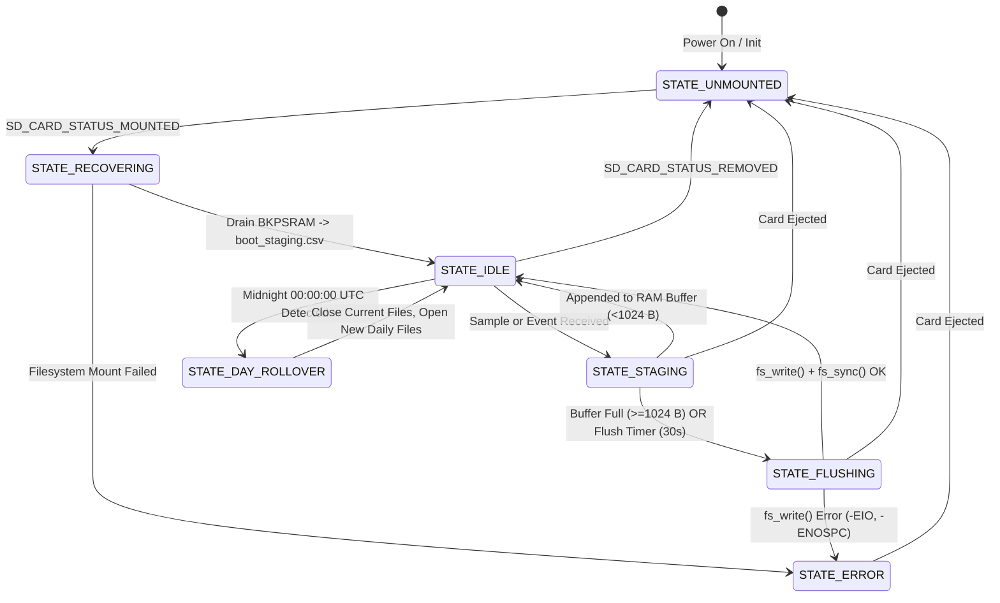
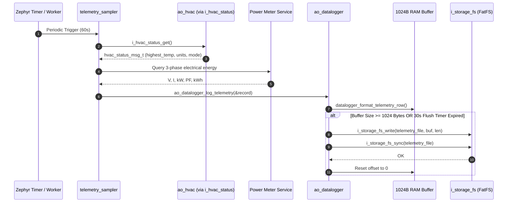

# Architecture of the MicroSD Historical Telemetry & Event-Driven Datalogger Subsystem

- **Document Identifier**: `doc/architecture/historical_datalogger_storage_subsystem.md`
- **Subsystem**: MicroSD Historical Telemetry & Event-Driven Datalogger (`historical_datalogger`)
- **Target Platform**: DAECGE BrightC Controller V3 (STM32H743ZIT6, Cortex-M7 @ 480 MHz)
- **Storage Medium**: MicroSD Card via SDMMC1 (4-bit bus @ 50 MHz, IDMA, FatFS FAT32/exFAT)
- **Framework**: Zephyr RTOS (West T2 Workspace)
- **Design Patterns**: Clean Architecture (Ports & Adapters) + Active Object Pattern (`ao_datalogger`) + Chunked HTTP Streaming
- **Author**: Lead Embedded Firmware Architect
- **Status**: Implemented & Verified (Stage 7 Complete)

---

## 1. Executive Summary & Architecture Rationale

### 1.1 Purpose of the Historical Datalogger Subsystem
The **BrightC Controller V3** serves as an industrial edge telemetry, predictive maintenance, and autonomous HVAC plant controller deployed in telecommunications shelters, edge data centers, and critical infrastructure. Persistent on-device historical data retention is required for:
1. **Facility Environmental & Regulatory Compliance**: Maintaining an unbroken, tamper-evident local time-series record of ambient temperatures, humidity, cooling capacity, and power consumption across weeks or months of autonomous operation.
2. **Forensic Alarm & Incident Investigation**: Providing high-resolution event snapshots when HVAC units trip, power fluctuates, or temperature alarm thresholds are violated, establishing exact cause-and-effect sequences.
3. **Thermodynamic Model Validation & Optimization**: Logging real-time thermodynamic metrics ($Q_{\text{sens}}$, $Q_{\text{lat}}$, $\text{COP}$, air mass flow $\dot{m}$, and sensible heat ratio SHR) from the Revision F Thermodynamic Engine to monitor refrigeration degradation, compressor performance, and coil fouling over time.
4. **Autonomous Edge Visualization**: Serving historical trends directly to field technicians and building management systems via an embedded HTTP web server and REST/chunked streaming API without requiring cloud connectivity.

### 1.2 Data Segregation & Unified Telemetry Rationale
Early conceptual designs often evaluate splitting periodic telemetry into multiple granular CSV files (e.g., separate files for control, electrical energy, and thermodynamic metrics). In the final BrightC architecture, telemetry and forensic events are segregated into three purposeful streams:

| Stream Target | Path Pattern | Cadence / Trigger | Scope & Justification |
| :--- | :--- | :--- | :--- |
| **Unified Periodic Telemetry** | `/SD:/history/YYYY/MM/YYYY-MM-DD_telemetry.csv` | Periodic (default 60 s, configurable 10 s – 3600 s) + State Changes | **Single Time-Series Snapshot**: Merges HVAC operating modes, ambient & governing control temperatures, coil delta-T, 3-phase electrical energy, and thermodynamic calculations into one synchronised row. Eliminates multi-file client joins and concurrent file write locks. |
| **Forensic Alarm Sequence of Events (SOE)** | `/SD:/logs/YYYY/MM/YYYY-MM-DD_alarms.log` | Asynchronous Event-Driven | **Audit Log**: High-priority alarm transitions (TRIP, CLEAR, ACK, LATCH) capturing exact monotonic microsecond/millisecond timestamps, source subsystems, threshold values, and trigger conditions. |
| **Operational System Log** | `/SD:/logs/YYYY/MM/YYYY-MM-DD_system.log` | Asynchronous Event-Driven | **System Lifecycle**: Operational events including interface link status, storage mount/unmount cycles, boot milestones, and state machine phase transitions. |
| **Boot Crash Forensic Staging** | `/SD:/logs/boot/boot_%u_staging.csv` | Post-Mount Recovery | **Zero Data Loss**: Transient pre-mount and crash forensic records recovered directly from STM32H7 Battery-Backed SRAM (BKPSRAM) upon MicroSD card insertion. |

```text
┌────────────────────────────────────────────────────────────────────────────────────────┐
│                        BRIGHTC HISTORICAL STORAGE LAYOUT                               │
├────────────────────────────────────────────────────────────────────────────────────────┤
│                                                                                        │
│   /SD:/history/YYYY/MM/                                                                │
│   └── YYYY-MM-DD_telemetry.csv ◄── Synchronized Periodic Telemetry (27 Columns)        │
│                                                                                        │
│   /SD:/logs/YYYY/MM/                                                                   │
│   ├── YYYY-MM-DD_alarms.log    ◄── Forensic Alarm Sequence of Events (SOE)             │
│   └── YYYY-MM-DD_system.log    ◄── Lifecycle, Link, Storage, & Fault Diagnostics       │
│                                                                                        │
│   /SD:/logs/boot/                                                                      │
│   └── boot_%u_staging.csv      ◄── Flushed from BKPSRAM ring buffer on mount           │
│                                                                                        │
└────────────────────────────────────────────────────────────────────────────────────────┘
```

---

## 2. File Specification & CSV Schemas

All historical telemetry and log files reside under the FatFS root mount point `/SD:` organized strictly by calendar year and month (`/SD:/history/YYYY/MM/` and `/SD:/logs/YYYY/MM/`).

### 2.1 Unified Periodic Telemetry: `YYYY-MM-DD_telemetry.csv`
- **Target Path**: `/SD:/history/YYYY/MM/YYYY-MM-DD_telemetry.csv`
- **Cadence**: Periodic (default 60 s) + discrete HVAC transitions (`DATALOGGER_EVT_HVAC_EVENT`).
- **Record Footprint**: ~180 to 220 bytes/line.
- **Header Line**:
  ```csv
  # schema_version=2;source=BrightC_V3;type=periodic_telemetry
  Timestamp_ISO,Epoch_s,HVAC_Mode,Active_Mask,T_ctrl_avg,T_ctrl_max,T_ctrl_min,T_ctrl_g0,T_ctrl_g1,T_inj_mean,T_ret_mean,Delta_T_clima,V_a,V_b,V_c,I_a,I_b,I_c,P_tot_kW,PF,Energy_kWh,Q_sens_kW,Q_lat_kW,COP_real,AirFlow_kg_s,T_dew_C,Alarm_Bits
  ```

#### Detailed Column Definitions (27 Columns)
1. `Timestamp_ISO` (string, 24 chars): ISO 8601 UTC timestamp (`YYYY-MM-DDTHH:MM:SS.mmmZ`).
2. `Epoch_s` (int64_t): Unix epoch time in seconds.
3. `HVAC_Mode` (uint8_t): Current HVAC plant operating profile (`0=OFF`, `1=AUTO_ROTATE`, `2=SCHEDULED`, `3=ECONOMIZER`, `4=FAILSAFE`).
4. `Active_Mask` (hex uint8_t): Bitmask of energized HVAC compressor units (`0x01`=AC1, `0x02`=AC2, etc.).
5. `T_ctrl_avg` (float, 2 decimals): Mean ambient room temperature across active monitoring probes (°C).
6. `T_ctrl_max` (float, 2 decimals): Peak ambient room temperature among active monitoring probes (°C).
7. `T_ctrl_min` (float, 2 decimals): Minimum ambient room temperature among active monitoring probes (°C).
8. `T_ctrl_g0` (float, 2 decimals): **Governing Control Temperature for HVAC Group 0** (`highest_temp[0]` from `hvac_status_msg_t`). Evaluated directly by `ao_hvac` against group cooling setpoints (`temp_min`, `temp_max`, `temp_alarm`, `temp_bypass`).
9. `T_ctrl_g1` (float, 2 decimals): **Governing Control Temperature for HVAC Group 1** (`highest_temp[1]` from `hvac_status_msg_t`).
10. `T_inj_mean` (float, 2 decimals): Mean evaporator coil supply/injection air temperature across active units (°C).
11. `T_ret_mean` (float, 2 decimals): Mean return air temperature entering active evaporator coils (°C).
12. `Delta_T_clima` (float, 2 decimals): Cooling temperature lift across evaporator coils ($T_{\text{ret\_mean}} - T_{\text{inj\_mean}}$) (°C).
13. `V_a`, `V_b`, `V_c` (float, 1 decimal): RMS phase-to-neutral voltages ($V$).
14. `I_a`, `I_b`, `I_c` (float, 2 decimals): RMS phase currents ($A$).
15. `P_tot_kW` (float, 3 decimals): Total active 3-phase electrical power ($kW$).
16. `PF` (float, 2 decimals): Total system power factor ($-1.00$ to $+1.00$).
17. `Energy_kWh` (float, 2 decimals): Cumulative active electrical energy ($kWh$).
18. `Q_sens_kW` (float, 2 decimals): Sensible cooling capacity ($kW$) from Revision F Thermodynamic Engine.
19. `Q_lat_kW` (float, 2 decimals): Latent cooling capacity ($kW$).
20. `COP_real` (float, 2 decimals): Real Coefficient of Performance ($Q_{\text{tot}} / P_{\text{tot}}$).
21. `AirFlow_kg_s` (float, 3 decimals): Total dry air mass flow rate ($\text{kg/s}$).
22. `T_dew_C` (float, 2 decimals): Return air dew point temperature (°C).
23. `Alarm_Bits` (hex uint32_t): Consolidated 32-bit active alarm bitmask.

### 2.2 Forensic Alarm Sequence of Events: `YYYY-MM-DD_alarms.log`
- **Target Path**: `/SD:/logs/YYYY/MM/YYYY-MM-DD_alarms.log`
- **Cadence**: Immediate event-driven on transition (TRIP, CLEAR, ACK, LATCH).
- **Header Line**:
  ```csv
  # schema_version=2;source=BrightC_V3;type=alarm_soe
  Timestamp_ISO,Uptime_ms,Seq_ID,Alarm_ID,Subsystem,Transition,Threshold,Measured,Severity,Tag
  ```
- **Example Record**:
  ```csv
  2026-11-14T10:15:30.120Z,184520,42,101,HVAC,TRIP,28.00,28.45,2,AC1_HI_TEMP
  2026-11-14T10:22:15.800Z,589200,43,101,HVAC,CLEAR,26.00,25.80,2,AC1_HI_TEMP
  ```

### 2.3 Operational System Log: `YYYY-MM-DD_system.log`
- **Target Path**: `/SD:/logs/YYYY/MM/YYYY-MM-DD_system.log`
- **Cadence**: Operational state transitions and periodic heartbeat.
- **Example Record**:
  ```text
  2026-11-14T08:00:00.005Z [INF] [NET] Eth link up: 100 Mbps Full-Duplex (192.168.1.150)
  2026-11-14T08:00:00.010Z [INF] [STOR] SD Day rollover complete -> /SD:/history/2026/11/2026-11-14_telemetry.csv
  ```

---

## 3. Storage Footprint & Flash Endurance Analysis

To ensure continuous unattended operation over a 10-year product lifespan without SD card wear-out or capacity exhaustion, write volumes are strictly bounded:

### 3.1 Daily Write Budget (at 60-Second Sampling Interval)
With a default sampling interval of $T_{\text{sample}} = 60\text{ s}$ (1,440 periodic samples/day) plus an estimated 60 event-driven rows per day:

$$\text{Records}_{\text{total}} = 1440 + 60 = 1500\text{ rows/day}$$

| Stream | Samples/Day | Line Size (Typ) | Header Size | Daily File Size | Annual Size |
| :--- | :---: | :---: | :---: | :---: | :---: |
| `telemetry.csv` | 1,500 | ~200 B | 275 B | **~300.3 KB** | **~109.6 MB** |
| `alarms.log` | ~50 | ~95 B | 100 B | **~4.9 KB** | **~1.8 MB** |
| `system.log` | ~120 | ~85 B | 0 B | **~10.2 KB** | **~3.7 MB** |
| **Daily Total** | — | — | — | **~315.4 KB / day** | **~115.1 MB / year** |

> [!NOTE]
> On a standard **16 GB** or **32 GB** Class 10 / Industrial pSLC MicroSD card:
> - 1 year of continuous 60-second telemetry consumes **~115 MB** (<0.8% of 16 GB).
> - 10 years of continuous data consumes **~1.15 GB** (<7.2% of 16 GB).
> - Even with conservative flash controller write amplification ($WA \approx 3$), total write endurance consumed over 10 years is $< 3.5\text{ GB}$, well within the 30,000+ P/E cycles of industrial pSLC cards (>50 TBW).

---

## 4. Active Object Architecture & Buffer Staging

### 4.1 Canonical 5-Phase Active Object Lifecycle
The datalogger coordinates disk writes through a dedicated active object thread (`ao_datalogger`):
- **Phase 1: Init** (`ao_datalogger_init`): Allocates buffers in non-cacheable RAM (`.nocache`), binds `i_storage_fs_t` and `i_bkpsram_t`, initializes synchronization primitives (`lock`, `stopped_sem`).
- **Phase 2: Start** (`ao_datalogger_start`): Spawns the processing thread at priority `9` with 4096-byte stack.
- **Phase 3: Stop** (`ao_datalogger_stop`): Sets `is_running = false`, enqueues a wake-up signal to drain the queue.
- **Phase 4: Wait Stopped** (`ao_datalogger_wait_stopped`): Blocks on `stopped_sem` until thread execution completes.
- **Phase 5: Deinit** (`ao_datalogger_deinit`): Closes file handles, resets structures to uninitialized state.

### 4.2 Staging Buffers & Sector Alignment
Raw NAND flash writes in MicroSD cards operate efficiently on 512-byte sectors. Staging buffers are sized and managed as follows:
1. **Buffer Size**: Sized to **1024 bytes** (`AO_DATALOGGER_BUFFER_SIZE`), exactly two 512-byte physical sectors.
2. **Memory Section**: Allocated in `.nocache` RAM with 32-byte alignment to prevent STM32H7 L1 D-Cache coherency issues during SDMMC1 IDMA transfers.
3. **Flush Triggers**:
   - Buffer saturation: When appended text reaches $\ge 1024\text{ bytes}$, the sector block is flushed to FatFS.
   - Periodic timer: A 30-second flush timer (`AO_DATALOGGER_FLUSH_INTERVAL_MS = 30000U`) ensures buffered data is persisted without stale delay.
   - Explicit Flush Request: An external flush enqueues `DATALOGGER_EVT_FLUSH_TRIGGER` in the queue, preserving FIFO ordering so that any preceding telemetry sample is written before the flush occurs.
   - Calendar Day Rollover: When the RTC date rolls over at 00:00:00 UTC, dirty buffers are flushed, file handles closed, and new daily files initialized.

### 4.3 Reader/Writer Concurrency Synchronization
FatFS does not permit simultaneous open handles for reading and writing to the same cluster chain without file locking. To allow the HTTP chunked streamer (`datalogger_streamer`) to read the active day's telemetry file:
1. `datalogger_streamer` detects if the requested query date matches today's active date.
2. If matching, `datalogger_streamer` invokes `ao_datalogger_flush(logger)`.
3. Inside `ao_datalogger`, all staging buffers are flushed via `i_storage_fs_write()`, synced via `i_storage_fs_sync()`, and active file handles are cleanly closed.
4. `datalogger_streamer` yields (`k_sleep(K_MSEC(20))`) allowing the Active Object thread to complete the flush and closure.
5. `datalogger_streamer` opens the file in read-only mode, streams the content in 1024-byte chunks, and closes the file when complete.
6. The next sample received by `ao_datalogger` automatically reopens the file in append mode.

---

## 5. Embedded Chunked HTTP Streamer

```text
 ┌────────────────────────────────────────────────────────────────────────┐
 │                      BROWSER CLIENT (EDGE DASHBOARD)                   │
 │                                                                        │
 │  GET /api/history/telemetry?date=2026-11-14                            │
 └───────────────────────────────────┬────────────────────────────────────┘
                                     │ HTTP GET
                                     ▼
 ┌────────────────────────────────────────────────────────────────────────┐
 │                   DATALOGGER STREAMER SERVICE                          │
 │                                                                        │
 │  1. Validates & sanitizes date parameter (YYYY-MM-DD, 10 chars)        │
 │  2. Synchronizes active AO buffer if date == today                     │
 │  3. Formulates safe path: /SD:/history/YYYY/MM/YYYY-MM-DD_telemetry.csv│
 │  4. Streams in 1024-byte chunks to chunk sink callback                 │
 └───────────────────────────────────┬────────────────────────────────────┘
                                     │ 1024-byte Chunks
                                     ▼
 ┌────────────────────────────────────────────────────────────────────────┐
 │                 NETWORK SOCKET (RMII DMA / ETHERNET)                   │
 │                                                                        │
 │  HTTP 200 OK                                                           │
 │  Content-Type: text/csv; charset=utf-8                                 │
 │  Transfer-Encoding: chunked                                            │
 └────────────────────────────────────────────────────────────────────────┘
```

- **Chunk Size**: 1024 bytes (`DATALOGGER_STREAMER_CHUNK_SIZE`).
- **Path Traversal Protection**: Rejects dates with slashes, dots, or lengths $\ne 10$ characters (`YYYY-MM-DD`). Rejects requests outside `/SD:/history/` or `/SD:/logs/`.
- **Zero Heap Allocation**: Operates on a static or stack-allocated 1024-byte transfer buffer, eliminating dynamic memory fragmentation.

---

## 6. Clean Architecture Layering & Component Contracts

```text
 ┌────────────────────────────────────────────────────────────────────────┐
 │ 1. DOMAIN LAYER (Pure C99, Zero RTOS/Hardware Headers)                 │
 │    common/datalogger_types.h                                           │
 │    domain/datalogger/datalogger_formatters.h                           │
 │    domain/datalogger/datalogger_formatters.c                           │
 └───────────────────────────────────┬────────────────────────────────────┘
                                     │ Uses types and formatters
                                     ▼
 ┌────────────────────────────────────────────────────────────────────────┐
 │ 2. INTERFACE / PORT CONTRACTS (Rule §4.1.D Fat-Pointer Abstractions)   │
 │    interfaces/i_storage_fs.h     (Filesystem VFS abstraction)          │
 │    interfaces/i_bkpsram.h        (Backup SRAM ring buffer abstraction) │
 │    interfaces/i_hvac_status.h    (HVAC snapshot & temperatures port)   │
 └───────────────────────────────────┬────────────────────────────────────┘
                                     │ Consumed by
                                     ▼
 ┌────────────────────────────────────────────────────────────────────────┐
 │ 3. APPLICATION SERVICES & ACTIVE OBJECT COORDINATOR                    │
 │    application/services/telemetry_sampler.h/.c                         │
 │    application/services/datalogger_streamer.h/.c                       │
 │    application/active_objects/ao_datalogger.h/.c                       │
 └───────────────────────────────────┬────────────────────────────────────┘
                                     │ Wired at startup
                                     ▼
 ┌────────────────────────────────────────────────────────────────────────┐
 │ 4. INFRASTRUCTURE & DEPENDENCY INJECTION (Composition Root)            │
 │    infrastructure/di/composition_root.c (Subsystems 12, 13, 14)        │
 │    infrastructure/di/app_event_mediator.c (Zbus dispatching)           │
 └────────────────────────────────────────────────────────────────────────┘
```

### 6.1 The HVAC Status Port Contract: `i_hvac_status.h`
To decouple the Telemetry Sampler service from the internal implementation details of the HVAC plant controller (`ao_hvac`), the port `i_hvac_status_t` encapsulates status queries:

```c
typedef struct i_hvac_status_api i_hvac_status_api_t;

typedef struct {
    const i_hvac_status_api_t *api;
    void                      *impl;
} i_hvac_status_t;

struct i_hvac_status_api {
    int (*get_status)(void *impl, hvac_status_msg_t *out_status);
};

static inline bool i_hvac_status_is_bound(const i_hvac_status_t *port);
static inline int i_hvac_status_get(const i_hvac_status_t *port, hvac_status_msg_t *out_status);
```

### 6.2 HVAC Temperature Ingestion Architecture
`telemetry_sampler` binds `i_hvac_status_t` during initialization:
1. `i_hvac_status_get(&self->hvac_port, &hvac_status)` retrieves the current runtime snapshot.
2. Extracts `highest_temp[0]` and `highest_temp[1]` into `t_ctrl_g0` and `t_ctrl_g1` (the actual governing control temperatures evaluated against setpoints).
3. Computes mean active supply temperature (`t_inj_mean`) and return temperature (`t_ret_mean`) across energized units.
4. Computes thermodynamic cooling lift (`delta_t_clima = t_ret_mean - t_inj_mean`).
5. Extracts active operating mode (`hvac_mode = hvac_status.hvac_mode`) and energized compressor bitmask (`active_unit_mask = hvac_status.active_unit_mask`).

---

## 7. State Transitions & Sequence Flows

### 7.1 Datalogger Operational State Machine



### 7.2 Periodic Telemetry Sampling & Staged Disk Write Flow



---

## 8. Verification & Test Evidence

### 8.1 Unit Test Coverage (Zephyr Twister on `native_sim`)
The entire historical datalogger subsystem is tested on `native_sim` using in-memory mock filesystems and fake Backup SRAM:

- **Command**: `west twister -T BrightC-telemetry/tests/unit/datalogger -p native_sim`
- **Result**: **100% Pass Rate** (23 / 23 unit tests passed, 0 failures, 0 skipped).

| Testsuite Name | Test Cases | Pass | Fail | Description |
| :--- | :---: | :---: | :---: | :--- |
| `ao_datalogger_suite` | 8 | 8 | 0 | Lifecycle (5-phase), staging buffers, date rollover, surprise unmount, BKPSRAM recovery, low-watermark auto-pruning. |
| `telemetry_sampler_suite` | 4 | 4 | 0 | Sampler binding, aggregate HVAC governing temperatures, 3-phase power, periodic submission. |
| `datalogger_domain_suite` | 5 | 5 | 0 | CSV row formatting, precision validation, header injection, buffer overflow bounds checks. |
| `datalogger_streamer_suite` | 3 | 3 | 0 | 1024-byte chunk streaming, date traversal validation, active-day flush synchronization. |
| `bkpsram_ring_suite` | 3 | 3 | 0 | Hardware ring buffer, CRC-16 integrity verification, corruption detection. |

### 8.2 Target Cross-Compilation (`brightc-controllerv3` / STM32H743)
- **Command**: `west build -d BrightC-telemetry/app/build/primary -b brightc-controllerv3 BrightC-telemetry/app`
- **Result**: **Clean compilation** (0 errors, 0 warnings).
- **Target Memory Utilization**:
  - **Flash (FLASH)**: 573,196 B / 2,097,152 B (**27.33%**)
  - **RAM (RAM)**: 305,420 B / 524,288 B (**58.26%**)
  - **SRAM3 (SRAM3)**: 16,384 B / 32,768 B (**50.00%**)
