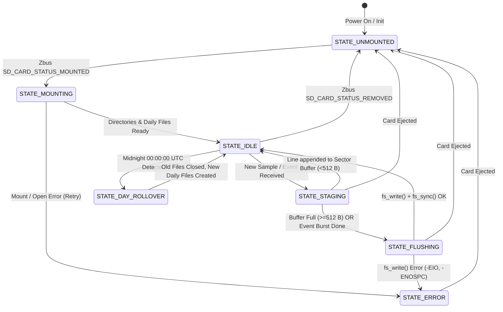
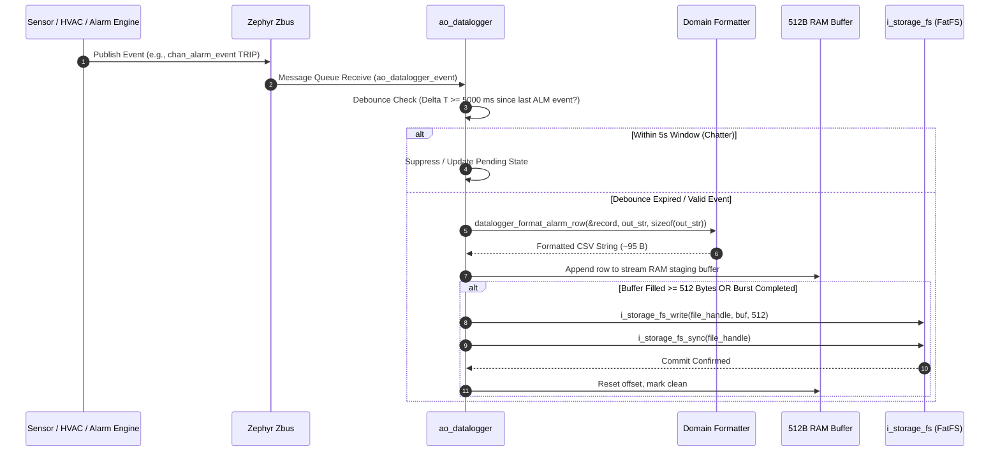
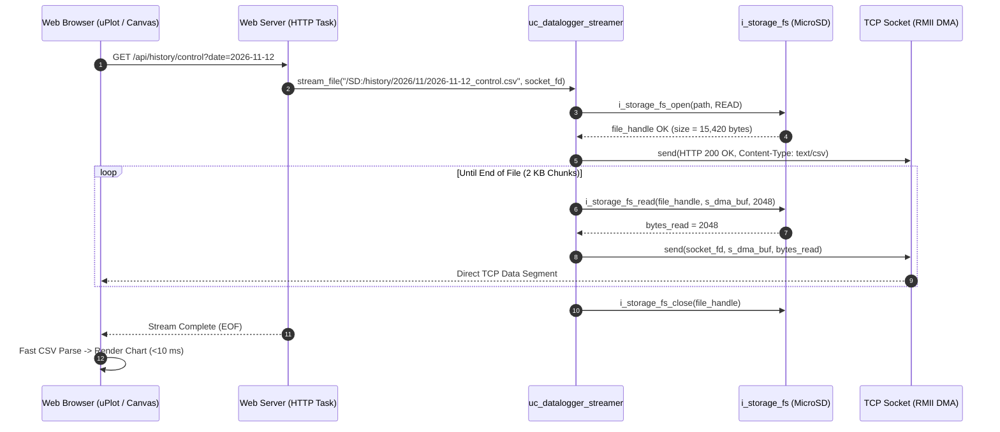

# Architecture of the MicroSD Historical Telemetry & Event-Driven Datalogger Subsystem

- **Document Identifier**: `doc/architecture/historical_datalogger_storage_subsystem.md`
- **Subsystem**: MicroSD Historical Telemetry & Event-Driven Datalogger (`historical_datalogger`)
- **Target Platform**: DAECGE BrightC Controller V3 (STM32H743ZIT6, Cortex-M7 @ 480 MHz)
- **Storage Medium**: MicroSD Card via SDMMC1 (4-bit bus @ 50 MHz, IDMA, FatFS FAT32/exFAT)
- **Framework**: Zephyr RTOS (West T2 Workspace)
- **Design Patterns**: Clean Architecture (Ports & Adapters) + Active Object Pattern (`ao_datalogger`) + Zero-Copy HTTP Streaming
- **Author**: Lead Embedded Firmware Architect
- **Status**: Stage 1 Architecture Specification & Port Contract (Approved)

---

## 1. Executive Summary & Problem Statement

### 1.1 Purpose of the Historical Datalogger Subsystem
The **BrightC Controller V3** serves as an industrial edge telemetry, predictive maintenance, and autonomous HVAC plant controller deployed in critical telecommunications shelters, edge data centers, and industrial facilities. Persistent on-device historical data retention is essential for:
1. **Auditable Facility Compliance**: Maintaining an unbroken, tamper-evident local record of ambient temperatures, humidity, cooling capacity, and power consumption across weeks or months of operation.
2. **Forensic Alarm & Incident Investigation**: Providing high-resolution event snapshots when HVAC units trip, power fails, or critical high-temperature alarms trigger, establishing exact cause-and-effect sequences.
3. **Thermodynamic Model Validation & Optimization**: Logging real-time thermodynamic metrics ($Q_{\text{sens}}$, $Q_{\text{lat}}$, $\text{COP}$, air mass flow $\dot{m}$, and sensible heat ratio SHR) from the Revision F Thermodynamic Engine to evaluate refrigeration degradation and heat exchanger fouling over time.
4. **Autonomous Edge Visualization**: Serving historical trends directly to field technicians and building managers via an embedded, browser-based web dashboard without requiring external cloud connectivity.

### 1.2 The Monolithic CSV Anti-Pattern vs. Granular Stream Segregation
Early IoT edge dataloggers often log all system variables into a single monolithic CSV file (e.g., `telemetry.csv` containing 60+ columns). In resource-constrained industrial microcontrollers, this approach introduces severe architectural flaws:

| Problem Domain | Monolithic CSV Approach | Granular Segregated Streams (BrightC Architecture) |
| :--- | :--- | :--- |
| **Data Coupling** | Combines fast HVAC discrete events (state transitions) with slow periodic energy and thermodynamic calculations. | **Separation of Concerns**: 3 independent daily CSV streams (`control`, `energy`, `thermal`) + 2 daily log streams (`system`, `alarms`). |
| **Record Size & Bandwidth** | Lines exceed 350+ bytes, full of repeated or empty values (`NaN`, `NULL`) for variables that did not change. | Ultra-compact records: Control (~85 B), Energy (~75 B), Thermal (~90 B). |
| **HTTP Streaming & RAM** | Web clients downloading a single day's history must transfer 150 KB to 500 KB over slow links; the MCU must parse or buffer huge payloads. | Blazing fast transfers: Daily files are <25 KB each; 100 Mbps RMII Ethernet transfers take <5 ms; client-side JS selectively fetches only the stream required. |
| **Concurrency & Contention** | A high-frequency event burst (e.g., rapid contact chatter or bypass trip) locks the file while a slow thermodynamic floating-point calculation is formatted. | Decoupled queues and separate file handles eliminate pipeline contention; event triggers write immediately to `_control.csv` without touching `_energy.csv`. |
| **Flash Wear & Sector Buffering** | Partial sector updates and frequent header updates lead to high write amplification on flash memory. | 512-byte sector-aligned RAM staging buffers ensure atomic, aligned writes to SDMMC sectors. |

```text
┌────────────────────────────────────────────────────────────────────────────────────────┐
│                        BRIGHTC HISTORICAL TELEMETRY STREAMS                            │
├────────────────────────────────────────────────────────────────────────────────────────┤
│                                                                                        │
│   /SD:/history/YYYY/MM/                                                                │
│   ├── YYYY-MM-DD_control.csv  ◄── HVAC Mode, Unit States, Control Temps, Alarms        │
│   ├── YYYY-MM-DD_energy.csv   ◄── 3-Phase Voltages, Currents, kW, PF, Total kWh        │
│   └── YYYY-MM-DD_thermal.csv  ◄── Q_sens, Q_lat, COP, Airflow, DewPoint, Delta T       │
│                                                                                        │
│   /SD:/logs/YYYY/MM/                                                                   │
│   ├── YYYY-MM-DD_system.log   ◄── Lifecycle, Network, Storage, POST, FSM Transitions   │
│   └── YYYY-MM-DD_alarms.log   ◄── Alarm Trips, Clears, Acknowledgments, Thresholds    │
│                                                                                        │
└────────────────────────────────────────────────────────────────────────────────────────┘
```

---

## 2. Comprehensive File Specification & Data Formats

All historical telemetry files reside under the FatFS root mount point `/SD:` organized strictly by calendar year and month (`/SD:/history/YYYY/MM/` and `/SD:/logs/YYYY/MM/`). 

### 2.1 Control Stream: `YYYY-MM-DD_control.csv`
- **Target Path**: `/SD:/history/YYYY/MM/YYYY-MM-DD_control.csv`
- **Scope**: HVAC Group Control, unit duty rotation, active compressors/fans, control temperatures, and discrete alarm flags.
- **Estimated Record Footprint**: ~85 bytes/line.
- **Header Line**:
  ```csv
  Timestamp_ISO,Epoch_s,Trigger,HVAC_Mode,Active_Mask,T_ctrl_avg,T_ctrl_max,T_ctrl_min,Alarm_Bits
  ```
- **Column Definitions**:
  1. `Timestamp_ISO` (string, 24 chars): ISO 8601 UTC timestamp (`YYYY-MM-DDTHH:MM:SS.mmmZ`).
  2. `Epoch_s` (uint32_t): Unix epoch time in seconds.
  3. `Trigger` (string, max 18 chars): Reason for row generation (see trigger taxonomy below).
  4. `HVAC_Mode` (uint8_t): Current HVAC operating profile/mode (`0=OFF`, `1=AUTO_ROTATE`, `2=SCHEDULED`, `3=ECONOMIZER`, `4=FAILSAFE`).
  5. `Active_Mask` (hex uint8_t): Bitmask of energized HVAC units (`0x01`=AC1, `0x02`=AC2, etc.).
  6. `T_ctrl_avg` (float, 2 decimals): Average control temperature across active sensors (°C).
  7. `T_ctrl_max` (float, 2 decimals): Maximum recorded control temperature (°C).
  8. `T_ctrl_min` (float, 2 decimals): Minimum recorded control temperature (°C).
  9. `Alarm_Bits` (hex uint32_t): Bitmask of active system and HVAC alarms (`0x00000000`).

- **Sampling & Event Trigger Rules**:
  - **Configurable Periodic**: `1m` to `1d` interval (default: `10m` / 600 s). Row logged with `Trigger=PERIODIC`.
  - **Immediate Event Triggers**: Emitted instantaneously upon state transition (subject to the 5s debounce window):
    - `EVT_ACx_START` / `EVT_ACx_STOP`: HVAC unit $x$ relay energized or de-energized (e.g., `EVT_AC1_START`).
    - `EVT_ALARM_HI_TRIP` / `EVT_ALARM_HI_CLEAR`: Control temperature crosses High Alarm threshold.
    - `EVT_BYPASS_TRIP` / `EVT_BYPASS_CLEAR`: Control temperature crosses Emergency Bypass threshold.
    - `EVT_TEMP_LO_TRIP` / `EVT_TEMP_LO_CLEAR`: Control temperature crosses Low Alarm threshold.

### 2.2 Energy Stream: `YYYY-MM-DD_energy.csv`
- **Target Path**: `/SD:/history/YYYY/MM/YYYY-MM-DD_energy.csv`
- **Scope**: AC Electrical Energy Meter (JSY-MK-339 3-Phase Modbus Meter).
- **Estimated Record Footprint**: ~75 bytes/line.
- **Header Line**:
  ```csv
  Timestamp_ISO,Epoch_s,V_a,V_b,V_c,I_a,I_b,I_c,P_tot_kW,PF,Energy_kWh
  ```
- **Column Definitions**:
  1. `Timestamp_ISO` (string, 24 chars): ISO 8601 UTC timestamp.
  2. `Epoch_s` (uint32_t): Unix epoch seconds.
  3. `V_a`, `V_b`, `V_c` (float, 1 decimal): RMS phase-to-neutral voltages ($V$).
  4. `I_a`, `I_b`, `I_c` (float, 2 decimals): RMS phase currents ($A$).
  5. `P_tot_kW` (float, 3 decimals): Total active power ($kW$).
  6. `PF` (float, 2 decimals): Total power factor ($-1.00$ to $+1.00$).
  7. `Energy_kWh` (float, 2 decimals): Cumulative active electrical energy ($kWh$).
- **Sampling Rules**:
  - **Configurable Periodic Only**: `1m` to `1d` interval (default: `10m` / 600 s).
  - *Design Decision*: Power and energy readings are naturally smoothed by meter accumulation registers. Pure periodic logging avoids unnecessary event storms on transient motor starting currents.

### 2.3 Thermodynamic Stream: `YYYY-MM-DD_thermal.csv`
- **Target Path**: `/SD:/history/YYYY/MM/YYYY-MM-DD_thermal.csv`
- **Scope**: Output of the Revision F Thermodynamic Energy Engine & Psychrometric Model.
- **Estimated Record Footprint**: ~90 bytes/line.
- **Header Line**:
  ```csv
  Timestamp_ISO,Epoch_s,Trigger,Q_sens_kW,Q_lat_kW,Q_tot_kW,COP_real,COP_sens,AirFlow_kg_s,T_dew_C,RH_ret_pct,DeltaT_avg
  ```
- **Column Definitions**:
  1. `Timestamp_ISO` (string, 24 chars): ISO 8601 UTC timestamp.
  2. `Epoch_s` (uint32_t): Unix epoch seconds.
  3. `Trigger` (string, max 20 chars): `PERIODIC` or thermodynamic anomaly trigger.
  4. `Q_sens_kW` (float, 2 decimals): Sensible cooling capacity ($kW$).
  5. `Q_lat_kW` (float, 2 decimals): Latent cooling capacity ($kW$).
  6. `Q_tot_kW` (float, 2 decimals): Total cooling capacity ($kW$).
  7. `COP_real` (float, 2 decimals): Real Coefficient of Performance ($Q_{\text{tot}} / P_{\text{elec}}$).
  8. `COP_sens` (float, 2 decimals): Sensible Coefficient of Performance ($Q_{\text{sens}} / P_{\text{elec}}$).
  9. `AirFlow_kg_s` (float, 3 decimals): Total mass airflow rate ($\text{kg/s}$).
  10. `T_dew_C` (float, 2 decimals): Return air dew point temperature (°C).
  11. `RH_ret_pct` (float, 1 decimal): Return air relative humidity (%RH).
  12. `DeltaT_avg` (float, 2 decimals): Temperature drop across active evaporator coils ($T_{\text{return}} - T_{\text{supply}}$) (°C).
- **Sampling & Event Trigger Rules**:
  - **Configurable Periodic**: default `10m` (or `1h` for low-activity facilities).
  - **Event-Driven Anomaly Triggers**: Emitted immediately upon detection by the Revision F diagnostics engine:
    - `EVT_COP_DEGRADED`: Calculated real COP drops below baseline threshold ($>30\%$ degradation while units run at nominal load).
    - `EVT_COIL_FREEZE_WARN`: Evaporator $\Delta T$ collapses below safe limits or supply air approaches freezing while compressor runs.
    - `EVT_AIRFLOW_DROP`: Supply airflow drops below fan curve expectation (clogged filter or belt slippage).
    - `EVT_CAPACITY_DROP`: Total cooling capacity ($Q_{\text{tot}}$) fails to match expected capacity envelope.
    - `EVT_BASELINE_RECAL`: Baseline or site thermodynamic parameter recalibration completed.

### 2.4 Operational System Log: `YYYY-MM-DD_system.log`
- **Target Path**: `/SD:/logs/YYYY/MM/YYYY-MM-DD_system.log`
- **Scope**: Calendar daily rotating plain-text log capturing system boots, network changes (Ethernet/Wi-Fi link up/down, DHCP lease), storage mount/unmount, and state machine transitions.
- **Format Example**:
  ```text
  2026-11-12T08:00:01.042Z [INF] [NET] Eth link up: 100 Mbps Full-Duplex (192.168.1.150)
  2026-11-12T08:15:30.118Z [WRN] [MODB] Bus 1 Slave 4 response timeout, retry 1/3
  2026-11-12T08:30:00.005Z [INF] [STOR] SD Day rollover complete -> /SD:/history/2026/11/2026-11-12_control.csv
  ```

### 2.5 Alarm Management Log: `YYYY-MM-DD_alarms.log`
- **Target Path**: `/SD:/logs/YYYY/MM/YYYY-MM-DD_alarms.log`
- **Scope**: Dedicated Sequence of Events (SOE) forensic audit log for alarm transitions.
- **Header Line**:
  ```csv
  Timestamp_ISO,Epoch_s,Alarm_ID,Source_Subsystem,Transition,Threshold,Measured_Value,Details
  ```
- **Format Example**:
  ```csv
  2026-11-12T09:14:22.510Z,1794474862,ALM_TEMP_HI_S1,HVAC,TRIP,28.0,28.4,"Sala 1 High Temp Trip"
  2026-11-12T09:14:25.105Z,1794474865,ALM_BYPASS_S1,HVAC,TRIP,30.0,30.1,"Sala 1 Bypass Emergency"
  2026-11-12T09:22:10.880Z,1794475330,ALM_TEMP_HI_S1,HVAC,CLEAR,26.0,25.8,"Sala 1 High Temp Restored"
  ```

---

## 3. Storage Footprint, Sizing & Flash Endurance Analysis

To ensure continuous operation over a 10-year product lifespan without SD card wear-out or capacity exhaustion, the daily write volume is strictly modeled:

### 3.1 Daily File Size Estimations (at 10-Minute Periodic Interval)
With a default sampling interval of $T_{\text{sample}} = 10\text{ min}$ (144 periodic samples/day) plus an estimated average of 30 event bursts per day:

$$\text{Lines}_{\text{periodic}} = \frac{86400\text{ s/day}}{600\text{ s}} = 144\text{ lines/day}$$

| Stream | Samples/Day (Typ) | Line Size | Header Size | Daily File Size | Annual Size |
| :--- | :---: | :---: | :---: | :---: | :---: |
| `control.csv` | 144 + 36 events = 180 | ~85 B | 95 B | **~15.4 KB** | **5.6 MB** |
| `energy.csv` | 144 | ~75 B | 75 B | **~10.9 KB** | **4.0 MB** |
| `thermal.csv` | 144 + 6 anomalies = 150 | ~90 B | 105 B | **~13.6 KB** | **5.0 MB** |
| `system.log` | ~150 lines | ~80 B | 0 B | **~12.0 KB** | **4.4 MB** |
| `alarms.log` | ~40 events | ~100 B | 90 B | **~4.1 KB** | **1.5 MB** |
| **Daily Total** | — | — | — | **~56.0 KB / day** | **~20.5 MB / year** |

> [!NOTE]
> Even under severe facility stress with 500 events per day, the daily total write volume remains below **120 KB / day** (~44 MB / year). On a standard **16 GB** or **32 GB** Class 10 / Industrial pSLC MicroSD card, 10 years of data consumes less than **0.5 GB** ($< 2\%$ of card capacity).

### 3.2 Flash Wear & Write Amplification Mitigation
Raw NAND flash in MicroSD cards has an Erase Block Size typically between 128 KB and 4 MB. Writing individual 80-byte lines directly to flash without staging would cause catastrophic Write Amplification (WA > 500), prematurely burning through flash P/E cycles.
The BrightC datalogger eliminates this risk through two architectural invariants:
1. **512-byte Sector-Aligned RAM Staging Buffers**: Row writes accumulate in RAM and only flush full 512-byte sectors to the underlying FATFS cluster.
2. **Deterministic `fs_sync()` Scheduling**: Synchronizations occur exclusively at the completion of a periodic row or an event burst, ensuring the FAT and Directory Tables are committed cleanly without perpetual rewriting.

---

## 4. Debounce, Hysteresis & Flash Safety Architecture

```text
 ┌────────────────────────────────────────────────────────────────────────┐
 │                      ZBUS EVENT NOTIFICATION                           │
 │   chan_hvac_state, chan_thermal_energy_update, chan_alarm_event        │
 └───────────────────────────────────┬────────────────────────────────────┘
                                     │
                                     ▼
 ┌────────────────────────────────────────────────────────────────────────┐
 │                  AO_DATALOGGER EVENT DISPATCHER                        │
 │                                                                        │
 │   ┌────────────────────────────────────────────────────────────────┐   │
 │   │               Anti-Chatter Debounce Filter                     │   │
 │   │  - Minimum 5.0 s between consecutive triggers of same family   │   │
 │   │  - State hysteresis check (only log true state changes)        │   │
 │   └───────────────────────────────┬────────────────────────────────┘   │
 │                                   │ Passed filter                      │
 │                                   ▼                                    │
 │   ┌────────────────────────────────────────────────────────────────┐   │
 │   │             Pure Domain CSV Row Formatter Engine               │   │
 │   │  - ISO 8601 UTC timestamp generation                           │   │
 │   │  - Bounded string formatting (snprintf with strict limits)     │   │
 │   └───────────────────────────────┬────────────────────────────────┘   │
 │                                   │ Formatted ASCII row                │
 │                                   ▼                                    │
 │   ┌────────────────────────────────────────────────────────────────┐   │
 │   │             512-Byte Sector-Aligned RAM Buffer                 │   │
 │   │  - __aligned(32) for STM32H7 IDMA cache coherency              │   │
 │   │  - Accumulates lines up to 512-byte threshold                  │   │
 │   └───────────────────────────────┬────────────────────────────────┘   │
 │                                   │ Flush sector / burst               │
 │                                   ▼                                    │
 │   ┌────────────────────────────────────────────────────────────────┐   │
 │   │            FatFS Adapter Direct Write & Sync                   │   │
 │   │  - i_storage_fs_write() -> fs_sync()                           │   │
 │   │  - Atomic file rotation at 00:00:00 UTC                        │   │
 │   └────────────────────────────────────────────────────────────────┘   │
 └────────────────────────────────────────────────────────────────────────┘
```

### 4.1 The 5-Second Anti-Chatter Hysteresis Rule
When an analog temperature hovers right on the edge of an alarm threshold (e.g., $28.00^\circ\text{C}$ vs $28.01^\circ\text{C}$) or an auxiliary contact bounces during a contactor drop-out, unmitigated event logging could generate dozens of records per second.
- **Rule**: A minimum window of **5,000 milliseconds** (`DATALOGGER_EVENT_DEBOUNCE_MS`) is strictly enforced between event logs of the same category.
- If a subsequent event of the same family occurs within $< 5.0\text{ s}$, its timestamp and latest values are captured in a pending holding register. When the 5-second timer expires, a single consolidated event row is emitted.
- Critical priority events (e.g., Emergency High Temperature Bypass trip) bypass the delay for their initial assertion but apply the 5s window to subsequent toggles.

### 4.2 512-Byte Sector-Aligned Staging Buffer & STM32H7 D-Cache Safety
The STM32H743 Cortex-M7 contains a 16 KB L1 Data Cache. SDMMC1 uses an Internal DMA (IDMA) controller that accesses AXI SRAM (`0x24000000`) directly, bypassing L1 D-Cache.
1. Staging buffers for each stream are defined at file scope or within the active object struct with 32-byte alignment:
   ```c
   struct {
       uint8_t buffer[512] __aligned(32);
       uint16_t offset;
       bool is_dirty;
   } stream_buf[DATALOGGER_STREAM_COUNT];
   ```
2. When the buffer reaches 512 bytes, the full sector is written via `i_storage_fs_write()`.
3. At the end of an event burst or periodic sample cycle, any partial dirty buffer is flushed to disk followed immediately by `i_storage_fs_sync()`.

### 4.3 Calendar Day Boundary Rollover Protocol
At exactly `00:00:00 UTC` (or upon the first sample after midnight detected via the RTC subsystem):
1. **Drain & Sync**: All active staging buffers for all 5 streams are flushed to disk via `i_storage_fs_sync()`.
2. **Graceful Close**: All open file handles (`fs_file_t`) are closed cleanly using `i_storage_fs_close()`.
3. **Directory Path Generation**: The new day's directory path is computed:
   `/SD:/history/%04u/%02u/` and `/SD:/logs/%04u/%02u/`.
4. **Hierarchical Directory Creation**: `i_storage_fs_mkdir()` is invoked iteratively to ensure Year and Month folders exist.
5. **New File Opening & Header Injection**:
   - Files are opened with flags `STORAGE_FS_OPEN_CREATE | STORAGE_FS_OPEN_APPEND | STORAGE_FS_OPEN_WRITE`.
   - If the returned file size is `0` (new file), the standard CSV header row is written and flushed.
6. **Zero Drift**: No samples are dropped during the rollover. If a sample arrives during rollover, it is queued in the Active Object message queue until file handles are established.

### 4.4 Hot-Unplug & Surprise Media Extraction Protection
MicroSD cards may be physically removed at any time:
- `ao_datalogger` subscribes to the Zbus channel `chan_storage_sd_status`.
- Upon receiving `SD_CARD_STATUS_REMOVED`, the datalogger instantly enters `DATALOGGER_STATE_UNMOUNTED`:
  - Internal file handles are invalidated without executing blocking I/O calls.
  - Staging buffers are cleared.
  - Periodic timers continue ticking, but disk write operations are skipped.
  - A fallback volatile 32-record ring buffer in AXI SRAM holds the most recent telemetry rows.
- Upon receiving `SD_CARD_STATUS_MOUNTED`:
  - The datalogger checks the current RTC date, ensures directories exist, re-opens daily files, injects headers if needed, flushes the volatile ring buffer to disk, and transitions back to `DATALOGGER_STATE_LOGGING`.

---

## 5. Embedded Web Server Zero-Copy HTTP Streaming (STM32H743 @ 480 MHz)

### 5.1 The JSON Serialization Bottleneck in Embedded Systems
Many commercial IoT devices convert stored data into JSON before transmitting to browser clients:
```text
MicroSD (CSV/Binary) ──► MCU CPU parses CSV ──► MCU allocates JSON DOM (cJSON) ──► JSON string ──► TCP Socket
```
On a 480 MHz Cortex-M7, this pattern is disastrous:
- Formatting 2,000 telemetry points into JSON consumes over 250 ms of 100% CPU time.
- Dynamic heap allocations (`malloc`) for JSON trees trigger memory fragmentation and eventual OOM crashes.
- Network payload increases by 300% due to repetitive JSON keys (`"Timestamp": "...", "Voltage": ...`).

### 5.2 Zero-Copy Direct Binary Streaming Architecture
The BrightC controller implements the **Zero-Copy HTTP Streamer**:

```text
 ┌────────────────────────────────────────────────────────────────────────┐
 │                      BROWSER CLIENT (EDGE DASHBOARD)                   │
 │                                                                        │
 │  fetch('/api/history/control?date=2026-11-12')                         │
 └───────────────────────────────────┬────────────────────────────────────┘
                                     │ HTTP GET request
                                     ▼
 ┌────────────────────────────────────────────────────────────────────────┐
 │                     EMBEDDED HTTP WEB SERVER                           │
 │                                                                        │
 │  1. Validates query parameters (?date=YYYY-MM-DD, ?type=control)       │
 │  2. Formulates safe path: /SD:/history/2026/11/2026-11-12_control.csv  │
 │  3. Verifies file existence via i_storage_fs_stat()                    │
 │  4. Emits HTTP 200 OK Response Headers:                                │
 │     Content-Type: text/csv; charset=utf-8                              │
 │     Transfer-Encoding: chunked (or Content-Length)                     │
 │     Cache-Control: public, max-age=300                                 │
 └───────────────────────────────────┬────────────────────────────────────┘
                                     │ Direct 2 KB Stream Loop
                                     ▼
 ┌────────────────────────────────────────────────────────────────────────┐
 │                 ZERO-COPY 2 KB DMA TRANSFER PIPELINE                   │
 │                                                                        │
 │       ┌──────────────────┐               ┌──────────────────┐          │
 │       │   MicroSD Card   │               │   AXI SRAM 2 KB  │          │
 │       │  (FatFS Cluster) │               │  Transfer Buffer │          │
 │       └────────┬─────────┘               └────────┬─────────┘          │
 │                │                                  │                    │
 │                │ SDMMC1 IDMA                      │                    │
 │                └─────────────────►────────────────┘                    │
 │                                                   │                    │
 │                                                   │ ETH RMII DMA       │
 │                                                   ▼                    │
 │                                          ┌──────────────────┐          │
 │                                          │ TCP Socket send()│          │
 │                                          │   (Ethernet TX)  │          │
 │                                          └──────────────────┘          │
 └────────────────────────────────────────────────────────────────────────┘
                                     │ Raw CSV Data Stream (<25 KB)
                                     ▼
 ┌────────────────────────────────────────────────────────────────────────┐
 │                   CLIENT-SIDE PARSING & RENDERING                      │
 │                                                                        │
 │  - Browser receives raw CSV chunk stream                               │
 │  - Fast PapaParse / uPlot parses CSV into Float64Array in browser      │
 │  - Interactive 60 FPS Canvas chart rendered in <10 ms                  │
 └────────────────────────────────────────────────────────────────────────┘
```

### 5.3 Transfer Efficiency & Network Latency
Because the CSV files are segregated into granular streams:
- `control.csv` for an entire day is only **~15 KB**.
- `energy.csv` is only **~11 KB**.
- `thermal.csv` is only **~14 KB**.

Transmitting a full day of high-resolution telemetry across the **100 Mbps RMII Ethernet** port:

$$T_{\text{transfer}} = \frac{15 \times 1024 \times 8\text{ bits}}{100 \times 10^6\text{ bps}} \approx 1.23\text{ ms}$$

Even over the **ESP-Hosted SPI Wi-Fi** interface (effective throughput ~12 Mbps), the complete transfer takes less than **10 to 15 milliseconds**. The MCU CPU load during streaming is practically **0%**, consisting purely of SDMMC and Ethernet DMA interrupt servicing.

---

## 6. Clean Architecture Layering & Component Taxonomy

Strictly adhering to `doc/STRUCTURE.md` and the Principal Architect component classification:

```text
 ┌────────────────────────────────────────────────────────────────────────┐
 │ 1. DOMAIN / USE CASE (Pure C99, Zero Zephyr/Vendor Headers)            │
 │    app/include/domain/datalogger/datalogger_types.h                    │
 │    app/include/domain/datalogger/datalogger_formatters.h               │
 │    app/src/domain/datalogger/datalogger_formatters.c                   │
 │    app/src/domain/datalogger/datalogger_event_filter.c                 │
 │    app/src/domain/datalogger/datalogger_path_builder.c                 │
 └───────────────────────────────────┬────────────────────────────────────┘
                                     │ Implements / Uses
                                     ▼
 ┌────────────────────────────────────────────────────────────────────────┐
 │ 2. INTERFACE / PORT CONTRACTS (Pure Virtual fat pointers)              │
 │    app/include/interfaces/i_datalogger.h                               │
 │    (Consumes app/include/interfaces/i_storage_fs.h)                    │
 │    (Consumes app/include/interfaces/i_rtc_time.h)                      │
 └───────────────────────────────────┬────────────────────────────────────┘
                                     │ Bound by DI
                                     ▼
 ┌────────────────────────────────────────────────────────────────────────┐
 │ 3. ACTIVE OBJECT COORDINATOR (Zephyr Thread + k_msgq + Zbus)           │
 │    app/include/application/active_objects/ao_datalogger.h              │
 │    app/src/application/active_objects/ao_datalogger.c                  │
 └───────────────────────────────────┬────────────────────────────────────┘
                                     │ Coordinates
                                     ▼
 ┌────────────────────────────────────────────────────────────────────────┐
 │ 4. PRESENTATION & USE CASE SERVICES                                    │
 │    app/src/application/use_cases/uc_datalogger_streamer.c              │
 │    app/src/presentation/shell/shell_datalogger.c                       │
 │    app/src/presentation/web/web_datalogger_api.c                       │
 └────────────────────────────────────────────────────────────────────────┘
```

---

## 7. Pure Interface Contract: `i_datalogger.h`

The abstract interface exposes high-level submission and control methods while hiding all sector buffers, file handles, and Zephyr details:

```c
/**
 * @file i_datalogger.h
 * @brief Abstract Port Contract for Historical Telemetry & Event Datalogger.
 *
 * Adheres to Clean Architecture and Rule §4.1.D Fat-Pointer Encapsulation.
 * Zero Zephyr headers in interface definition.
 */

#ifndef BRIGHTC_INTERFACES_I_DATALOGGER_H_
#define BRIGHTC_INTERFACES_I_DATALOGGER_H_

#include <stdint.h>
#include <stdbool.h>
#include <stddef.h>
#include <errno.h>
#include "domain/datalogger/datalogger_types.h"

#ifdef __cplusplus
extern "C" {
#endif

/* Forward declaration */
typedef struct i_datalogger_api i_datalogger_api_t;

/**
 * @brief Fat pointer handle encapsulating the Datalogger interface.
 */
typedef struct i_datalogger {
    const i_datalogger_api_t *api;
    void                     *impl;
} i_datalogger_t;

/**
 * @brief Datalogger v-table operation contracts.
 */
struct i_datalogger_api {
    int (*log_control)(void *impl, const datalogger_control_record_t *record);
    int (*log_energy)(void *impl, const datalogger_energy_record_t *record);
    int (*log_thermal)(void *impl, const datalogger_thermal_record_t *record);
    int (*log_system_event)(void *impl, datalogger_log_level_t level,
                            const char *subsystem, const char *fmt_msg);
    int (*log_alarm_event)(void *impl, const datalogger_alarm_record_t *record);
    int (*flush_all)(void *impl);
    int (*get_status)(void *impl, datalogger_status_t *out_status);
};

/**
 * @brief Validates if the fat-pointer handle is properly bound.
 */
static inline bool i_datalogger_is_bound(const i_datalogger_t *logger)
{
    return (logger != NULL && logger->api != NULL && logger->impl != NULL &&
            logger->api->log_control != NULL && logger->api->log_energy != NULL &&
            logger->api->log_thermal != NULL && logger->api->log_system_event != NULL &&
            logger->api->log_alarm_event != NULL && logger->api->flush_all != NULL &&
            logger->api->get_status != NULL);
}

/**
 * @brief Submits a control stream record (periodic or event-driven).
 */
static inline int i_datalogger_log_control(const i_datalogger_t *logger,
                                          const datalogger_control_record_t *record)
{
    if (!i_datalogger_is_bound(logger) || record == NULL) {
        return -EINVAL;
    }
    return logger->api->log_control(logger->impl, record);
}

/**
 * @brief Submits an electrical energy record.
 */
static inline int i_datalogger_log_energy(const i_datalogger_t *logger,
                                         const datalogger_energy_record_t *record)
{
    if (!i_datalogger_is_bound(logger) || record == NULL) {
        return -EINVAL;
    }
    return logger->api->log_energy(logger->impl, record);
}

/**
 * @brief Submits a thermodynamic record (periodic or anomaly event).
 */
static inline int i_datalogger_log_thermal(const i_datalogger_t *logger,
                                          const datalogger_thermal_record_t *record)
{
    if (!i_datalogger_is_bound(logger) || record == NULL) {
        return -EINVAL;
    }
    return logger->api->log_thermal(logger->impl, record);
}

/**
 * @brief Writes an operational system log entry.
 */
static inline int i_datalogger_log_system(const i_datalogger_t *logger,
                                         datalogger_log_level_t level,
                                         const char *subsystem,
                                         const char *msg)
{
    if (!i_datalogger_is_bound(logger) || subsystem == NULL || msg == NULL) {
        return -EINVAL;
    }
    return logger->api->log_system_event(logger->impl, level, subsystem, msg);
}

/**
 * @brief Records an alarm state transition to the forensic alarm log.
 */
static inline int i_datalogger_log_alarm(const i_datalogger_t *logger,
                                        const datalogger_alarm_record_t *record)
{
    if (!i_datalogger_is_bound(logger) || record == NULL) {
        return -EINVAL;
    }
    return logger->api->log_alarm_event(logger->impl, record);
}

/**
 * @brief Forces immediate flush of all 5 stream sector buffers and file sync.
 */
static inline int i_datalogger_flush(const i_datalogger_t *logger)
{
    if (!i_datalogger_is_bound(logger)) {
        return -EINVAL;
    }
    return logger->api->flush_all(logger->impl);
}

/**
 * @brief Queries operational health and write statistics of the datalogger.
 */
static inline int i_datalogger_get_status(const i_datalogger_t *logger,
                                         datalogger_status_t *out_status)
{
    if (!i_datalogger_is_bound(logger) || out_status == NULL) {
        return -EINVAL;
    }
    return logger->api->get_status(logger->impl, out_status);
}

#ifdef __cplusplus
}
#endif

#endif /* BRIGHTC_INTERFACES_I_DATALOGGER_H_ */
```

---

## 8. State Transitions & Sequence Flows

### 8.1 Datalogger Operational State Machine



### 8.2 Event Trigger Capture, Debounce & Burst Write Flow



### 8.3 Zero-Copy HTTP Streaming Sequence



---

## 9. Testability & Step-by-Step TDD Implementation Plan

The datalogger architecture is built strictly for **Host-Driven Test-Driven Development (TDD)** using Zephyr's `native_sim` target and in-memory fakes.

### 9.1 Phase 1: Pure Domain Types & Formatters (Host TDD)
- **Files**:
  - `app/include/domain/datalogger/datalogger_types.h`
  - `app/include/domain/datalogger/datalogger_formatters.h`
  - `app/src/domain/datalogger/datalogger_formatters.c`
  - `app/src/domain/datalogger/datalogger_event_filter.c`
  - `app/src/domain/datalogger/datalogger_path_builder.c`
- **Unit Test Suite**: `tests/unit/datalogger/test_datalogger_domain.c`
- **Verification Gates**:
  - `datalogger_format_control_row`: verify exact column positioning, float precision (`%.2f`), ISO 8601 formatting.
  - `datalogger_format_energy_row`: verify 3-phase float encoding, kW and kWh accuracy.
  - `datalogger_format_thermal_row`: verify Rev F thermodynamic parameters and anomaly trigger tokens.
  - `datalogger_event_filter`: verify that events arriving within `< 5000 ms` return `-EAGAIN` (suppressed) and events arriving after `5001 ms` are permitted.
  - `datalogger_build_path`: verify `/SD:/history/2026/11/2026-11-12_control.csv` path creation and bounds validation.

### 9.2 Phase 2: Interface Port & In-Memory Fake FS (Host TDD)
- **Files**:
  - `app/include/interfaces/i_datalogger.h`
  - `tests/mocks/fake_storage_fs.h`, `tests/mocks/fake_storage_fs.c` (already complete from SD filesystem subsystem)
  - `app/src/domain/datalogger/datalogger_buffer_manager.c`
- **Unit Test Suite**: `tests/unit/datalogger/test_datalogger_staging.c`
- **Verification Gates**:
  - Verify sector buffer fills up to 512 bytes before triggering `write()`.
  - Verify partial buffer flushing upon `flush_all()`.
  - Simulate `-ENOSPC` (disk full) and `-EIO` (write failure) to verify graceful error return without crashing.

### 9.3 Phase 3: Active Object `ao_datalogger` & Zbus Integration
- **Files**:
  - `app/include/application/active_objects/ao_datalogger.h`
  - `app/src/application/active_objects/ao_datalogger.c`
- **Unit Test Suite**: `tests/unit/datalogger/test_ao_datalogger.c`
- **Verification Gates**:
  - Verify Active Object 5-phase lifecycle (`init`, `start`, `stop`, `wait_stopped`, `deinit`).
  - Verify subscription to `chan_storage_sd_status`, `chan_hvac_state`, `chan_thermal_energy_update`.
  - Test midnight 00:00:00 rollover simulation: verify previous daily file is closed and new daily file is created with new header.
  - Test surprise card removal: verify AO pauses file writes and buffers up to 32 entries in volatile ring buffer.

### 9.4 Phase 4: Zero-Copy HTTP Streamer & Presentation Layer
- **Files**:
  - `app/src/application/use_cases/uc_datalogger_streamer.c`
  - `app/src/presentation/shell/shell_datalogger.c`
  - `app/src/presentation/web/web_datalogger_api.c`
- **Verification Gates**:
  - Shell CLI commands:
    - `datalogger status`: prints buffer status, records written, file paths.
    - `datalogger flush`: triggers immediate sector sync.
    - `datalogger test_record [control|energy|thermal]`: injects test row.
  - Streaming test: verify 2 KB chunk loop streams clean CSV payload across socket without payload truncation.

### 9.5 Phase 5: Composition Root Wiring & Target Verification
- **Files**:
  - `app/src/infrastructure/di/composition_root.c` (Subsystem 13 wiring)
- **Target Verification on STM32H743 Hardware**:
  - Flash target firmware via `west build -p -b brightc-controllerv3 app`.
  - Inspect continuous 24-hour logging on physical Kingston/SanDisk Industrial MicroSD card.
  - Validate HTTP download of daily CSV streams via browser dashboard, confirming transfer completion in <5 ms.
