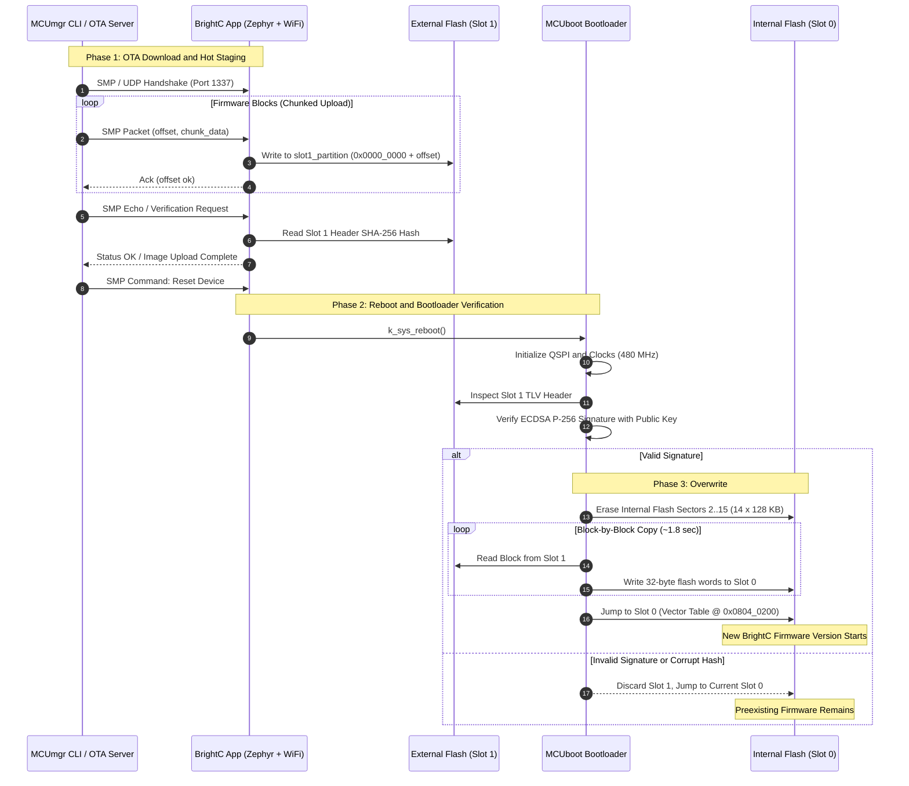

# Firmware OTA Update Architecture with MCUboot and External QSPI Flash
## BrightC Controller V3 — STM32H743ZIT6 + Winbond W25Q16

- **Author:** Principal Embedded Software Architect
- **Project:** BrightC Controller V3 Firmware
- **Status:** Approved Architecture Proposal
- **Date:** October 2026
- **Target MCU:** STMicroelectronics STM32H743ZIT6 (ARM Cortex-M7 @ 480 MHz)
- **Target External Flash:** Winbond W25Q16JV (16 Mbit / 2 MBytes NOR Flash, Quad-SPI)
- **RTOS / Toolchain:** Zephyr RTOS v4.x + Sysbuild + MCUboot v2.x + MCUmgr SMP

---

## 1. Executive Summary and Architectural Decision

The industrial **BrightC Controller V3** requires a robust, secure, and high-availability mechanism for field firmware updates (*Over-The-Air*, OTA). The device integrates Wi-Fi and Bluetooth connectivity through an Espressif ESP32 coprocessor connected via high-speed SPI4 bus (`esp-hosted-mcu`), a complete TCP/IPv4 networking stack, interactive Shell console, RS485 Modbus interfaces, SPI buses for 32 industrial expansion I/O, 15 calibrated ADC channels, and a visual interface for DWIN display.

### Core Hardware Specifications

| Subsystem | Component | Main Features |
| :--- | :--- | :--- |
| **Microcontroller** | STM32H743ZIT6 | ARM Cortex-M7 with FPU DP @ 480 MHz, L1 I/D Cache (16 KB + 16 KB) |
| **Internal Flash** | Dual-Bank Flash | **2048 KiB (2 MB)** organized in 2 symmetric banks of 1024 KiB |
| **System SRAM** | 1024 KiB (1 MB) | DTCM (128 KB), AXI SRAM (512 KB), SRAM1-3 (288 KB), SRAM4 (64 KB) |
| **External Memory** | Winbond W25Q16JV | **16 Mbit (2 MBytes)** NOR Flash connected via QUADSPI bus (4-bit) @ 40 MHz |
| **RF Coprocessor** | ESP32-WROOM-32 | Wi-Fi 802.11 b/g/n + BLE 4.2 via SPI4 (`esp-hosted-mcu`), dma-backed |

### Main Architectural Decision
An **Asymmetric Partitioning Architecture with External Flash for OTA Staging** is adopted:

1. **Slot 0 (Active / XIP):** Located in STM32H7 Internal Flash with an expanded size of **1792 KiB (1.75 MB)**, allowing direct code execution (*Execute-in-Place*) at 480 MHz with zero latency through the ART Accelerator interface and L1 Caches.
2. **Slot 1 (Staging / OTA Download):** Located in Winbond W25Q16 External Flash via QUADSPI with an identical size of **1792 KiB (1.75 MB)**.
3. **Update Mechanism:** **MCUboot in Overwrite mode (`CONFIG_BOOT_UPGRADE_ONLY=y`)** with asymmetric verification based on **ECDSA P-256** digital signatures.
4. **Telemetry Transport and Loading:** **MCUmgr SMP (Simple Management Protocol)** encapsulated over **UDP / Wi-Fi** with local redundancy over **Shell UART**.
5. **Build Orchestrator:** **Zephyr Sysbuild**, guaranteeing coordinated multi-image compilation, automatic cryptographic signature generation, and packaging of production-ready artifacts.

```
+===================================================================================+
|                              HIGH-LEVEL OTA MAP                                     |
+===================================================================================+
|                                                                                   |
|  [ OTA Server / mcumgr CLI ]                                                      |
|               |                                                                   |
|       (Wi-Fi / UDP Port 1337 / SMP Protocol)                                      |
|               v                                                                   |
|  [ BrightC V3 Application ]                                                      |
|         |                                                                         |
|         +---> Writes SMP blocks to Slot 1 (External Flash W25Q16 QSPI)            |
|         |     Size: 1792 KiB                                                      |
|         |                                                                         |
|         +---> Validates integrity and requests k_sys_reboot()                     |
|               |                                                                   |
|               v                                                                   |
|  [ MCUboot Bootloader (Sector 0: 128 KiB Internal Flash) ]                        |
|         |                                                                         |
|         +---> 1. Reads TLV header and verifies ECDSA P-256 signature with Public  |
|         +---> 2. If valid: Copies Slot 1 (QSPI) -> Slot 0 (Internal Flash)        |
|         +---> 3. Jumps to XIP execution of Slot 0 @ 480 MHz                        |
|                                                                                   |
+===================================================================================+
```

---

## 2. Technical Justification

### 2.1 Diagnosis of Current State in `brightc-controllerv3.dts`
In the inherited devicetree configuration from `brightc-controllerv3.dts`, the memory map presented severe underutilization:

```dts
/* Problematic inherited configuration */
boot_partition:    128 KB  (0x0000_0000 - 0x0001_FFFF)
storage_partition: 128 KB  (0x0002_0000 - 0x0003_FFFF)
slot0_partition:   256 KB  (0x0004_0000 - 0x0007_FFFF)  <-- SEVERE LIMITATION!
slot1_partition:   256 KB  (0x0008_0000 - 0x000B_FFFF)
scratch_partition: 128 KB  (0x000C_0000 - 0x000D_FFFF)
/* End of allocation: 896 KB. Internal flash unmapped: 1152 KB */
```

#### Critical Impact:
1. **Firmware Bottleneck:** The application was limited to **256 KiB**.
   - With the Zephyr v4.x networking stack, Wi-Fi `esp-hosted-mcu`, IPv4/DHCP/DNS/Sockets stacks, logging, interactive shell, 4 MCP23S17 expansor chips on SPI, and ADC drivers with DMA, the current compiled image easily exceeds **350 KiB**, making it impossible to compile or add new features (TLS, MQTT, HVAC logic, DWIN UI).
2. **Resource Waste:** More than **1152 KiB (56.25%) of internal flash memory remained unused**.
3. **External Flash Underutilization:** The W25Q16 memory (2048 KiB) was reserved only as a generic storage partition (`ext-flash-storage`), ignoring its potential as a massive OTA staging buffer.

---

### 2.2 Comparison of Architectural Options

Two design approaches were evaluated to solve the partitioning:

| Criterion | Option A: Pure Dual-Bank Internal | Option B: Asymmetric QSPI Partitioning (Selected) |
| :--- | :--- | :--- |
| **Slot 0 Location** | Internal Flash (Bank 1) | Internal Flash (Bank 1 + Bank 2) |
| **Slot 1 Location** | Internal Flash (Bank 2) | External Flash Winbond W25Q16 (QUADSPI) |
| **Max App Size** | **768 KiB to 896 KiB** | **1792 KiB (1.75 MB)** |
| **Internal Flash Free** | 0 KB (Completely consumed by backup) | 0 KB (Fully used for Active App) |
| **External Flash Use** | Data storage only | OTA Staging (1792 KB) + LittleFS Filesystem (256 KB) |
| **XIP Performance** | 480 MHz (Internal Flash) | 480 MHz (Internal Flash) |
| **Internal Flash Wear** | High (each download erases and writes Bank 2) | Minimal (OTA download wears external SPI flash) |
| **Download Isolation** | Potential bus contention during internal erase | Total isolation: external flash erased via QSPI DMA |
| **Expansion Capacity** | Restricted (~800 KB ceiling forever) | Maximum: 1.75 MB allows TLS, graphics, MQTT, ML, WebServer |

### 2.3 Why Option B is the Optimal Solution for BrightC
1. **Headroom Without Compromises:** An industrial control application like BrightC requires margin for mbedTLS cryptographic libraries (HTTPS/MQTTS), embedded diagnostic web servers, ESP32 coprocessor firmware updates through SMP gateway, and telemetry buffers. 1792 KiB ensures useful life for the next 7 to 10 years.
2. **Code Flash Protection:** During packet reception via Wi-Fi (which can be unstable or interrupted), erase and write operations occur exclusively in external QSPI memory. Internal flash is never touched until the image has been fully received and cryptographically validated at boot by MCUboot.
3. **Operational Resilience:** The external Winbond W25Q16 flash offers over 100,000 erase/write cycles per 4 KB sector, absorbing all wear derived from aborted transfers or continuous CI/CD testing.

---

## 3. Flash Compatibility and Sector Size Analysis

One of the greatest challenges in designing bootloaders for high-performance microcontrollers with hybrid memories is the geometric disparity of storage technologies.

### 3.1 Physical Memory Characteristics

#### A) STM32H743ZI Internal Flash (`flash0`)
- **Technology:** Embedded NOR Flash with ECC (Error Correction Code).
- **Organization:** 2 Banks of 1 MB each (Total: 2048 KiB).
- **Sector Geometry:** Uniform **128 KiB (131,072 bytes)** per sector.
  - Bank 1: Sectors 0 to 7 (0x0800_0000 to 0x080F_FFFF).
  - Bank 2: Sectors 8 to 15 (0x0810_0000 to 0x081F_FFFF).
- **Write Granularity:** Flash word of **256 bits (32 bytes)** with 10 ECC bits.
- **Programming Restriction:** A 32-byte word can only be programmed once between sector erase operations. Partial byte-by-byte writes are not supported.

#### B) External Winbond W25Q16JV Flash (`w25q16_qspi`)
- **Technology:** Serial NOR Flash Quad-SPI.
- **Organization:** 2,097,152 bytes (2 MBytes).
- **Sector Geometry:**
  - Uniform sectors of **4 KiB (4,096 bytes)**.
  - 32 KiB blocks (8 sectors) and 64 KiB blocks (16 sectors).
- **Write Granularity:** Page of **256 bytes**. Writes from 1 to 256 bytes per burst are allowed.

---

### 3.2 LCM Alignment Mathematical Demonstration

To ensure that a partition defined in external memory can be mapped and copied to internal memory without causing unaligned writes, ECC corruption, or overwriting adjacent sectors, the partition granularity must be a multiple of the Least Common Multiple (LCM) of the erase sizes of both technologies:

$$\text{EraseSize}_{\text{Internal}} = 128\,\text{KiB} = 131,072\,\text{bytes}$$
$$\text{EraseSize}_{\text{External}} = 4\,\text{KiB} = 4,096\,\text{bytes}$$

$$\text{LCM}(128\,\text{KiB}, 4\,\text{KiB}) = 128\,\text{KiB}$$

#### Validation of Selected Slot ($1792\,\text{KiB}$):
$$1792\,\text{KiB} = 1,835,008\,\text{bytes}$$

1. **In Internal Flash (STM32H7):**
   $$\frac{1792\,\text{KiB}}{128\,\text{KiB}} = 14.0\quad\text{(Exactly 14 complete 128 KiB sectors)}$$
   - Corresponds to Sectors 2, 3, 4, 5, 6, 7 (Bank 1) and 8, 9, 10, 11, 12, 13, 14, 15 (Bank 2).
   - Internal fragmentation: **0 bytes**.

2. **In External Flash (W25Q16):**
   $$\frac{1792\,\text{KiB}}{4\,\text{KiB}} = 448.0\quad\text{(Exactly 448 sectors of 4 KiB)}$$
   $$\frac{1792\,\text{KiB}}{64\,\text{KiB}} = 28.0\quad\text{(Exactly 28 blocks of 64 KiB)}$$
   - External fragmentation: **0 bytes**.

3. **Remaining Space in External Flash:**
   $$2048\,\text{KiB} - 1792\,\text{KiB} = 256\,\text{KiB} = 64 \times 4\,\text{KiB}\quad\text{(Assigned to filesystem /lfs)}$$

---

### 3.3 Justification of Overwrite Mode (`CONFIG_BOOT_UPGRADE_ONLY=y`)

MCUboot supports two main update modes:
1. **Swap Mode:** Swaps sectors between Slot 0 and Slot 1 to allow automatic rollback if the new image is not confirmed (`boot_set_confirmed()`).
2. **Upgrade Only / Overwrite Mode:** Validates Slot 1 and copies it unidirectionally over Slot 0.

#### Why Heterogeneous Swap is Unviable and Dangerous in this Architecture?
- **Sector Disparity (128 KB vs 4 KB):** To perform a swap between sectors of different sizes, MCUboot requires a heterogeneous swap algorithm that needs a scratch partition of at least the size of the largest sector (**128 KiB**) in internal flash.
- **Power Failure Risk:** During a heterogeneous swap, a single 128 KB sector of the STM32H7 must be exchanged with 32 individual 4 KB sectors of external flash through multiple intermediate erase and write steps of status in scratch. A power failure during this process carries a non-negligible risk of inconsistent states.
- **Extreme Swap Time:** Bidirectional swapping doubles the number of I/O operations on QSPI and internal flash, extending update boot time to more than 12 to 15 seconds.

#### Advantages of the Selected Overwrite Mode:
1. **Zero-Risk Prior Verification:** MCUboot does not erase any internal flash sector until the image in Slot 1 has been fully cryptographically verified (ECDSA P-256 digital signature verification over SHA-256 hash). If the image is corrupt or the signature is invalid, Slot 0 remains intact and boots immediately.
2. **Outstanding Update Speed:**
   - External flash is read in Quad-SPI mode (4 lines @ 40 MHz) at $\approx 18\,\text{MB/s}$.
   - The STM32H7 erases its 14 internal sectors and programs 32-byte words at high speed.
   - Total 1.5 MB overwrite time completes in approximately **1.8 to 2.2 seconds**, minimizing industrial system downtime.
3. **Memory Savings:** No `scratch_partition` required, freeing 128 KiB of internal flash for application or calibration storage.

---

## 4. Memory Map and Devicetree Partitioning

### 4.1 General Memory Distribution

```
+===================================================================================+
|                    BRIGHTC CONTROLLER V3 MEMORY MAP                               |
+===================================================================================+

INTERNAL FLASH STM32H743ZI (2048 KiB / 0x0800_0000 - 0x081F_FFFF)
+-------------------+-----------------+-------------+-------------------------------+
| Base Address      | Physical Sector | Size        | DTS Label / Purpose         |
+-------------------+-----------------+-------------+-------------------------------+
| 0x0800_0000       | Sector 0 (B1)   | 128 KiB     | `boot_partition` (MCUboot)    |
| 0x0802_0000       | Sector 1 (B1)   | 128 KiB     | `storage_partition` (NVS)     |
| 0x0804_0000       | Sectors 2..7    | 768 KiB     | `slot0_partition` (App Active)|
| 0x0810_0000       | Sectors 8..15   | 1024 KiB    |  (Slot 0 Continuation in B2)  |
|                   |                 | Total: 1792K|                               |
+-------------------+-----------------+-------------+-------------------------------+

EXTERNAL FLASH WINBOND W25Q16 QUADSPI (2048 KiB / 0x0000_0000 - 0x001F_FFFF)
+-------------------+-----------------+-------------+-------------------------------+
| Relative Offset   | 64K Blocks      | Size        | DTS Label / Purpose         |
+-------------------+-----------------+-------------+-------------------------------+
| 0x0000_0000       | Blocks 0..27    | 1792 KiB    | `slot1_partition` (OTA Stage) |
| 0x001C_0000       | Blocks 28..31   | 256 KiB     | `ext_storage_partition` (LFS) |
+-------------------+-----------------+-------------+-------------------------------+
```

---

### 4.2 Devicetree Snippets for `brightc-controllerv3.dts`

The following blocks replace the corresponding sections in [brightc-controllerv3.dts](file:///media/jeffry/jqb/GitHub/BrightC_Workspace/BrightC_NewFirmware/boards/daecge/brightc-controllerv3/brightc-controllerv3.dts).

#### A) Internal Flash Partitioning (`&flash0`)
```dts
/* ---- Flash partitions (MCUboot + NVS + Slot 0 Asymmetric) ---- */

&flash0 {
	partitions {
		compatible = "fixed-partitions";
		#address-cells = <1>;
		#size-cells = <1>;

		/* Sector 0 (128 KB): MCUboot Bootloader */
		boot_partition: partition@0 {
			label = "mcuboot";
			reg = <0x00000000 DT_SIZE_K(128)>;
			read-only;
		};

		/* Sector 1 (128 KB): Non-Volatile Storage (NVS) for calibration and config */
		storage_partition: partition@20000 {
			label = "storage";
			reg = <0x00020000 DT_SIZE_K(128)>;
		};

		/* Sectors 2 to 15 (1792 KB): Active application running XIP */
		slot0_partition: partition@40000 {
			label = "image-0";
			reg = <0x00040000 DT_SIZE_K(1792)>;
		};
	};
};
```

#### B) External QSPI Flash Partitioning (`&quadspi`) and Filesystem
```dts
/* ---- QSPI: External Flash Winbond W25Q16 (Slot 1 OTA Staging + LittleFS) ---- */

&quadspi {
	pinctrl-0 = <&quadspi_bk1_io0_pf8 &quadspi_bk1_io1_pd12
		     &quadspi_bk1_io2_pe2 &quadspi_bk1_io3_pf6
		     &quadspi_clk_pf10 &quadspi_bk1_ncs_pg6>;
	pinctrl-names = "default";
	flash-id = <1>;
	status = "okay";

	w25q16_qspi: qspi-nor-flash@0 {
		compatible = "st,stm32-qspi-nor";
		reg = <0>;
		size = <DT_SIZE_M(16)>; /* 16 Mbits = 2 MBytes */
		qspi-max-frequency = <40000000>;
		cs-high-time = <2>;
		status = "okay";
		spi-bus-width = <4>;
		writeoc = "PP_1_1_4";

		partitions {
			compatible = "fixed-partitions";
			#address-cells = <1>;
			#size-cells = <1>;

			/* OTA download staging MCUmgr (exactly 1792 KB) */
			slot1_partition: partition@0 {
				label = "image-1";
				reg = <0x00000000 DT_SIZE_K(1792)>;
			};

			/* LittleFS storage for events, logs and history (256 KB) */
			ext_storage_partition: partition@1c0000 {
				label = "ext-storage";
				reg = <0x001c0000 DT_SIZE_K(256)>;
			};
		};
	};
};
```

#### C) `fstab` Node Update (for LittleFS)
```dts
	fstab {
		compatible = "zephyr,fstab";

		lfs_ext: lfs_ext {
			compatible = "zephyr,fstab,littlefs";
			mount-point = "/lfs";
			partition = <&ext_storage_partition>;
			read-size = <16>;
			prog-size = <16>;
			cache-size = <64>;
			lookahead-size = <32>;
			block-cycles = <512>;
		};
	};
```

---

## 5. West, Sysbuild, and Kconfig Configuration

For coordinated orchestration of MCUboot and the main application in Zephyr v4.x, **Sysbuild** is used.

### 5.1 `west.yml` Manifest Update
It is essential to ensure that the MCUboot repository and auxiliary cryptographic libraries are enabled in the `name-allowlist` filter:

```yaml
manifest:
  self:
    west-commands: scripts/west-commands.yml

  remotes:
    - name: zephyrproject-rtos
      url-base: https://github.com/zephyrproject-rtos

  projects:
    - name: zephyr
      remote: zephyrproject-rtos
      revision: main
      import:
        name-allowlist:
          - cmsis_6
          - hal_stm32
          - mcuboot          # <-- Required for Sysbuild Bootloader
          - mbedtls          # <-- Required for crypto and TLS sockets
          - tinycrypt        # <-- Fast cryptographic algorithms for MCUboot
          - fatfs
          - zcbor            # <-- CBOR serializer for MCUmgr SMP
          - lvgl
```

---

### 5.2 Global Sysbuild Configuration (`sysbuild.conf`)
Create the `sysbuild.conf` file at the application root (`app/sysbuild.conf` or `sysbuild.conf`):

```ini
# Enable MCUboot as Sysbuild-managed bootloader
SB_CONFIG_BOOTLOADER_MCUBOOT=y

# Mandatory cryptographic signing for generated images
SB_CONFIG_BOOT_SIGNATURE_TYPE_ECDSA_P256=y
SB_CONFIG_BOOT_SIGNATURE_KEY_FILE="bootloader/keys/brightc_root_ec_p256.pem"
```

---

### 5.3 MCUboot Configuration (`sysbuild/mcuboot.conf`)
MCUboot must be compiled with drivers to initialize the STM32H7 Quad-SPI controller and communicate with the Winbond memory during the boot cycle:

```ini
# -----------------------------------------------------------------------------
# MCUboot Core & Update Algorithm
# -----------------------------------------------------------------------------
CONFIG_BOOT_UPGRADE_ONLY=y
CONFIG_BOOT_SIGNATURE_TYPE_ECDSA_P256=y
CONFIG_BOOT_VALIDATE_SLOT0=y

# Minimize footprint and maximize speed
CONFIG_SIZE_OPTIMIZATIONS=y
CONFIG_MULTITHREADING=n
CONFIG_BOOT_MAX_IMG_SECTORS=512

# -----------------------------------------------------------------------------
# Internal and External QSPI Flash Drivers
# -----------------------------------------------------------------------------
CONFIG_FLASH=y
CONFIG_FLASH_MAP=y
CONFIG_FLASH_PAGE_LAYOUT=y

# QSPI Support for STM32
CONFIG_MEMC=y
CONFIG_MEMC_STM32_QSPI=y
CONFIG_FLASH_STM32_QSPI=y

# -----------------------------------------------------------------------------
# Secure Cryptography for Verification
# -----------------------------------------------------------------------------
CONFIG_BOOT_ECDSA_TINYCRYPT=y

# -----------------------------------------------------------------------------
# Diagnostics and Logging (Disable in Production for Ultra-Fast Boot)
# -----------------------------------------------------------------------------
CONFIG_LOG=y
CONFIG_MCUBOOT_LOG_LEVEL_INF=y
CONFIG_BOOT_BANNER=y
```

---

### 5.4 Application Configuration (`app/prj.conf`)
To support OTA image reception and SMP control via Wi-Fi UDP and Shell:

```ini
# -----------------------------------------------------------------------------
# Flash and Partition Subsystems
# -----------------------------------------------------------------------------
CONFIG_FLASH=y
CONFIG_FLASH_MAP=y
CONFIG_STREAM_FLASH=y
CONFIG_MEMC=y
CONFIG_MEMC_STM32_QSPI=y
CONFIG_FLASH_STM32_QSPI=y

# -----------------------------------------------------------------------------
# MCUmgr Management Subsystem and SMP Protocol
# -----------------------------------------------------------------------------
CONFIG_MCUMGR=y
CONFIG_MCUMGR_MGMT_NOTIFICATION_HOOKS=y
CONFIG_MCUMGR_GRP_OS=y
CONFIG_MCUMGR_GRP_IMG=y
CONFIG_MCUMGR_GRP_OS_RESET=y

# Enable SMP transport over Wi-Fi UDP
CONFIG_MCUMGR_TRANSPORT_UDP=y
CONFIG_MCUMGR_TRANSPORT_UDP_PORT=1337
CONFIG_MCUMGR_TRANSPORT_UDP_STACK_SIZE=4096
CONFIG_MCUMGR_TRANSPORT_UDP_THREAD_PRIO=8

# Local Serial Shell backup
CONFIG_MCUMGR_TRANSPORT_SHELL=y

# Decompression and hashing at runtime for upload verification
CONFIG_IMG_ENABLE_IMAGE_CHECK=y
CONFIG_BOOTLOADER_MCUBOOT=y
```

---

## 6. Security and Cryptographic Key Management

The security of a critical industrial equipment for HVAC and infrastructure control like BrightC demands strict authentication and integrity verification.

```
+-----------------------------------------------------------------------------------+
|                    CRYPTOGRAPHIC KEYS INFRASTRUCTURE                              |
+-----------------------------------------------------------------------------------+
|                                                                                   |
|  [ SECURE DEVELOPMENT ENVIRONMENT / CI-CD ]                                       |
|  - Private Key: `brightc_root_ec_p256.pem` (ECDSA secp256r1)                     |
|  - imgtool sign -> Produces `zephyr.signed.bin` with TLV signature                |
|                                                                                   |
|                           | (Injection at Build Time)                             |
|                           v                                                       |
|  [ MCUBOOT BOOTLOADER ]                                                           |
|  - Public key embedded in flash: `autogen-pubkey.c`                               |
|  - Validates only; never contains the private key                                 |
|                                                                                   |
+-----------------------------------------------------------------------------------+
```

### 6.1 ECDSA P-256 Key Pair Generation
The standard NIST P-256 curve (`secp256r1`) is used:

```bash
# 1. Create secure keys directory
mkdir -p bootloader/keys

# 2. Generate ECDSA P-256 private key
imgtool keygen -k bootloader/keys/brightc_root_ec_p256.pem -t ecdsa-p256

# 3. Extract public key in C for inspection or static validation
imgtool getpub -k bootloader/keys/brightc_root_ec_p256.pem > bootloader/keys/brightc_pubkey.c
```

> [!CAUTION]
> The file `brightc_root_ec_p256.pem` must never be committed to the public repository. It must reside in a CI/CD secrets store (GitHub Secrets, HashiCorp Vault) or in HSM keys for production deployments.

### 6.2 Manual or Automatic Image Signing
Sysbuild signs the image automatically at compile time if `SB_CONFIG_BOOT_SIGNATURE_KEY_FILE` is configured. However, the canonical `imgtool` command for CI/CD is:

```bash
imgtool sign \
    --key bootloader/keys/brightc_root_ec_p256.pem \
    --header-size 0x200 \
    --align 32 \
    --version 1.0.0+0 \
    --slot-size 0x1C0000 \
    --pad-header \
    build/app/zephyr/zephyr.bin \
    build/app/zephyr/zephyr.signed.bin
```

Key parameters:
- `--header-size 0x200`: Standard 512-byte MCUboot header.
- `--align 32`: Mandatory 32-byte (256-bit) alignment for STM32H7 flash.
- `--slot-size 0x1C0000`: Exact slot size ($1792\,\text{KiB}$).

---

## 7. Operational Flow and Execution



### 7.1 Factory Build and Flashing Procedure
To generate and flash the entire system (MCUboot + Application + Keys):

```bash
# 1. Unified compilation with Sysbuild for BrightC Controller V3
west build -b brightc-controllerv3 app --sysbuild -d build/brightc_v3

# 2. Direct programming via SWD through ST-Link (writes MCUboot at 0x08000000 and App at 0x08040000)
west flash -d build/brightc_v3
```

### 7.2 Field OTA Update Procedure (Wi-Fi / UDP)
From the technician's workstation or central server connected to the BrightC local network:

```bash
# 1. Configure mcumgr connection with BrightC Controller V3 IP
mcumgr conn add brightc_wifi type="udp" connstring="192.168.1.150:1337"

# 2. Consult version and slot status
mcumgr -c brightc_wifi image list

# 3. Upload signed image to external flash (Slot 1)
mcumgr -c brightc_wifi image upload build/app/zephyr/zephyr.signed.bin

# 4. Confirm hash and image status in Slot 1
mcumgr -c brightc_wifi image list

# 5. Order reboot so MCUboot executes the upgrade
mcumgr -c brightc_wifi reset
```

---

## 8. Phased Implementation Plan

To guide firmware development without regressions in the main tree, the following execution sequence is established:

```
[ Phase 1: Manifest and Sysbuild ]
              |
              v
[ Phase 2: Devicetree Update (DTS) ]
              |
              v
[ Phase 3: MCUboot and App Kconfig Configuration ]
              |
              v
[ Phase 4: Hardware-in-the-Loop (HIL) SWD Validation ]
              |
              v
[ Phase 5: Hot OTA Validation over Wi-Fi ]
```

### Phase 1: Manifest and Cryptographic Keys
- [ ] Incorporate `mcuboot` and `tinycrypt` into `west.yml` in `name-allowlist`.
- [ ] Run `west update` to clone the MCUboot repository into `bootloader/mcuboot`.
- [ ] Generate the ECDSA P-256 key pair in a secure project directory (`bootloader/keys/`).

### Phase 2: Devicetree Modification
- [ ] Modify `boards/daecge/brightc-controllerv3/brightc-controllerv3.dts`:
  - Replace `&flash0` partitioning (128 KB mcuboot, 128 KB storage, 1792 KB slot0).
  - Replace `&quadspi` partitioning (1792 KB slot1, 256 KB ext-storage).
  - Update `fstab` node to point to `&ext_storage_partition`.
- [ ] Validate with `west build -t devicetree` that no address overlaps exist.

### Phase 3: Sysbuild and Kconfig Configuration
- [ ] Create `sysbuild.conf` at app root linking the ECDSA key.
- [ ] Create `sysbuild/mcuboot.conf` with STM32 QSPI support and Overwrite mode.
- [ ] Update `app/prj.conf` with MCUmgr SMP over Wi-Fi UDP and Shell flags.

### Phase 4: Initial Bench Validation (SWD / HIL)
- [ ] Compile complete target: `west build -b brightc-controllerv3 app --sysbuild`.
- [ ] Flash via ST-Link and verify via UART1 console that MCUboot boots, detects slots, and initializes active application.
- [ ] Verify that shell commands `shell> mcumgr echo test` and `shell> fs ls /lfs` respond appropriately.

### Phase 5: Field OTA Testing over Wi-Fi
- [ ] Connect BrightC to test Wi-Fi network.
- [ ] Compile version v1.0.1 with a visual increment or differentiated banner.
- [ ] Run `mcumgr -c brightc_wifi image upload zephyr.signed.bin`.
- [ ] Send `mcumgr -c brightc_wifi reset` and measure with logic analyzer / UART:
  - MCUboot boot time.
  - QSPI -> Internal Flash copy time ($\approx 1.8$ s).
  - Correct new firmware startup.

---

## 9. Risks and Mitigations Matrix

| Identified Risk | Severity | Probability | Architectural Mitigation |
| :--- | :---: | :---: | :--- |
| **Power failure during OTA download** | Medium | High | Download occurs in external flash (`slot1`). Slot 0 remains intact; upon reboot, MCUboot detects incomplete hash and boots original firmware without alterations. |
| **Power failure during MCUboot Overwrite** | High | Low | Critical window lasts only 1.8 seconds. Source image remains in external QSPI flash; upon power return, MCUboot detects Slot 0 has no valid signature and restarts copy process from Slot 1. |
| **Malicious or altered binary injection** | Critical | Low | Hardware cryptographic authentication. MCUboot rejects any image whose hash does not exactly match the ECDSA P-256 digital signature generated with the root private key. |
| **QSPI clock incompatibility** | Medium | Medium | `qspi-max-frequency = <40000000>` (40 MHz) set, within BrightC V3 PCB signal integrity safe limit and supported by W25Q16JV (up to 133 MHz). |
| **Calibration data NVS corruption** | High | Very Low | `storage_partition` (Sector 1, 128 KB) completely isolated from `slot0_partition` and MCUboot update routines. |

---

*Document approved for implementation in the official BrightC NewFirmware repository.*