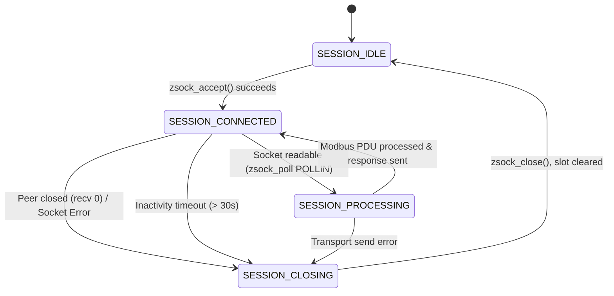
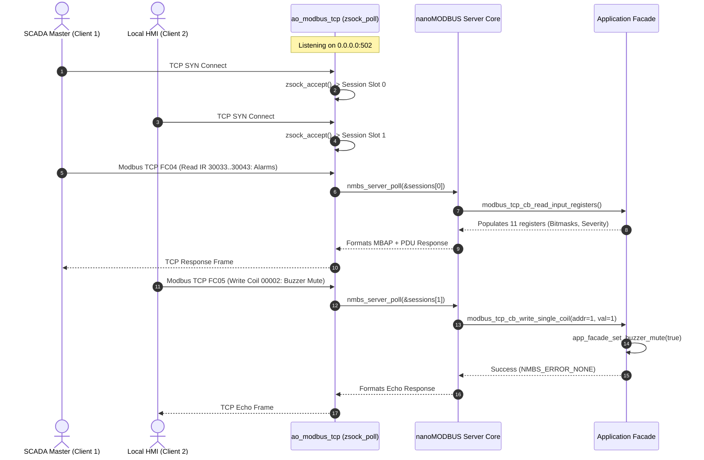

# Architecture of the Industrial Modbus TCP Server Subsystem

- **Status**: Technical Architecture Specification & Port Contract
- **Platform**: DAECGE BrightC Controller V3 (STM32H743ZIT6 LQFP144 @ 480 MHz)
- **Subsystem**: Industrial Modbus TCP Server (`CONFIG_BRIGHTC_MODBUS_TCP_SERVER=y`)
- **Network Interface**: Dual-Homed — RMII 10/100 Ethernet (LAN8742A) and ESP-Hosted SPI Wi-Fi
- **Standard Protocol**: Modbus Application Protocol v1.1b3 / Modbus Messaging on TCP/IP v1.0b (Port 502)
- **Core Library**: `nanoMODBUS` (`modules/lib/nanoMODBUS/`) configured for `NMBS_TRANSPORT_TCP`
- **Architectural Pattern**: Hexagonal Architecture (Ports & Adapters) + Active Object Multiplexer (`ao_modbus_tcp`) + Zero-Malloc Pool

---

## 1. System Overview & Problem Statement

### 1.1 Industrial Context & Operational Role
The **BrightC Controller V3** operates as an edge automation controller and telemetry concentrator in mission-critical telecommunications facilities and industrial edge data centers. 

While the field telemetry bus uses dual RS-485 serial channels (Modbus RTU Master via USART2 and USART6) to acquire data from local energy meters, RTD temperature banks, and digital input expanders, facility supervisory systems—such as **SCADA (Ignition, Wonderware), Building Management Systems (BMS), local HMI touchpanels, and Network Operations Centers (NOC)**—require real-time, deterministic, and concurrent access over standard TCP/IP.

```text
 ┌───────────────────────────┐      ┌───────────────────────────┐      ┌───────────────────────────┐
 │   BMS / SCADA Master      │      │     Local Touch HMI       │      │   Central NOC Collector   │
 │   (e.g., Ignition / PLC)  │      │     (Ethernet Modbus TCP) │      │   (Wi-Fi / VPN Gateway)   │
 └─────────────┬─────────────┘      └─────────────┬─────────────┘      └─────────────┬─────────────┘
               │                                  │                                  │
               │ Modbus TCP (Port 502)            │ Modbus TCP (Port 502)            │ Modbus TCP (Port 502)
               ▼                                  ▼                                  ▼
 ┌─────────────────────────────────────────────────────────────────────────────────────────────────┐
 │                                   BRIGHTC CONTROLLER V3                                         │
 │                                                                                                 │
 │   ┌─────────────────────────────────────────────────────────────────────────────────────────┐   │
 │   │                   DUAL-HOMED TCP/IP INTERFACES (Zephyr BSD Sockets)                     │   │
 │   │         RMII 10/100 Ethernet (LAN8742)         │     ESP-Hosted SPI Wi-Fi (WLAN)        │   │
 │   └────────────────────────────────────────────┬────────────────────────────────────────────┘   │
 │                                                │                                                │
 │                                                ▼                                                │
 │   ┌─────────────────────────────────────────────────────────────────────────────────────────┐   │
 │   │                     ACTIVE OBJECT MULTIPLEXER: ao_modbus_tcp                            │   │
 │   │   - Single high-efficiency thread with non-blocking zsock_poll()                        │   │
 │   │   - Fixed session pool (CONFIG_MODBUS_TCP_MAX_CLIENTS = 4)                              │   │
 │   │   - 30-second inactivity timeout & connection health watchdog                           │   │
 │   │   - Zero dynamic memory allocation (zero malloc, zero k_malloc)                         │   │
 │   └────────────────────────────────────────────┬────────────────────────────────────────────┘   │
 │                                                │                                                │
 │                                                ▼                                                │
 │   ┌─────────────────────────────────────────────────────────────────────────────────────────┐   │
 │   │                       HEXAGONAL ADAPTER: adapter_modbus_tcp_server                      │   │
 │   │   - Transport bridge: zsock_recv() / zsock_send() <-> nmbs_platform_conf                │   │
 │   │   - Core engine: nanoMODBUS TCP Server instances per active session                     │   │
 │   │   - Read/Write Request Dispatcher with exception classification (0x01..0x04)            │   │
 │   └───────────────────┬─────────────────────────────────────────────────┬───────────────────┘   │
 │                       │                                                 │                       │
 │                       ▼                                                 ▼                       │
 │   ┌─────────────────────────────────────────┐         ┌─────────────────────────────────────┐   │
 │   │     READ REPOSITORIES (Lock-Free)       │         │    WRITE COMMAND EXECUTORS (DIP)    │   │
 │   │   - Sensor Matrix Flat Snapshots        │         │   - Alarm Manager (ACK, Mute, Reset)│   │
 │   │   - Alarm Registry (Active/Unack Masks) │         │   - HVAC Actuator (Manual Override) │   │
 │   │   - Energy Meter 3-Phase Cache          │         │   - Thermal Control (Setpoint/Hyst) │   │
 │   │   - Revision F Thermodynamic Metrics    │         │   - System Manager (Duty Rot, Reboot│   │
 │   └─────────────────────────────────────────┘         └─────────────────────────────────────┘   │
 └─────────────────────────────────────────────────────────────────────────────────────────────────┘
```

### 1.2 Subsystem Requirements
1. **Standard Port & Protocol**: Listen on standard TCP port `502` over both Ethernet and Wi-Fi simultaneously (INADDR_ANY binding).
2. **Deterministic Multi-Client Concurrency**: Support up to 4 simultaneous client sessions (`CONFIG_MODBUS_TCP_MAX_CLIENTS = 4`, expandable up to 8 via Kconfig) without thread-per-connection overhead.
3. **Zero Dynamic Memory Allocation**: No calls to `malloc`, `k_malloc`, or dynamic memory pools during initialization or runtime. All sessions, buffers, and socket descriptors are statically preallocated.
4. **Comprehensive System Alarm Exposure**:
   - Discrete Inputs (FC 0x02, 10001+): Individual 1-bit flags for all thermal sala alarms, AC unit faults, physical security, electrical power alarms, and infrastructure links.
   - Input Registers (FC 0x04, 30001+): Compact bitmask words for batch SCADA polling and highest active severity calculation.
   - Coils (FC 0x01/0x05/0x0F, 00001+): Supervisory actions including Global Alarm Acknowledge (`CMD_ALARM_ACK_ALL`), Buzzer Mute (`CMD_BUZZER_MUTE`), and Latch Reset (`CMD_ALARM_RESET_LATCH`).
5. **Data Consistency & Atomic 32-bit Registers**: Prevent torn reads on 32-bit variables (cumulative energy in kWh, system uptime in seconds) by taking atomic register block snapshots during multi-register reads.
6. **Strict Error Propagation**: Enforce Modbus standard exception codes (`ILLEGAL_FUNCTION` 0x01, `ILLEGAL_DATA_ADDRESS` 0x02, `ILLEGAL_DATA_VALUE` 0x03, `SERVER_DEVICE_FAILURE` 0x04) on invalid access or out-of-range parameters.

---

## 2. Multi-Session Concurrency & Socket Architecture

### 2.1 Single-Threaded Multiplexing (`zsock_poll`)
Traditional embedded stacks often spin a dedicated RTOS thread per TCP connection. On the Cortex-M7 with MPU stack protection (`CONFIG_HW_STACK_PROTECTION` and `CONFIG_MPU_STACK_GUARD`), each thread requires a minimum 2 KB - 4 KB stack with 32-byte alignment, consuming significant SRAM and introducing scheduling jitter.

The BrightC Modbus TCP subsystem uses a **Single-Thread Event Multiplexer** pattern implemented in `ao_modbus_tcp`:
- A single listening socket `listen_sock` bound to `0.0.0.0:502`.
- A statically allocated session array `modbus_tcp_session_t sessions[CONFIG_MODBUS_TCP_MAX_CLIENTS]`.
- A single call to `zsock_poll()` monitoring `listen_sock` plus all currently active client sockets in each cycle:

```text
               zsock_poll(pollfds, 1 + active_clients, timeout_ms = 200)
                                      │
            ┌─────────────────────────┴─────────────────────────┐
            │                                                   │
  POLLIN on listen_sock                               POLLIN on sessions[i].sock
            │                                                   │
   zsock_accept()                                     nmbs_server_poll(&sessions[i].nmbs)
            │                                                   │
 Find idle session slot                               Dispatch read/write callbacks
            │                                                   │
 If full: zsock_close() (Refuse)                      Update last_activity_uptime_ms
 If available: initialize session
```

### 2.2 Session Pool State Machine
Each session slot manages its state independently using a deterministic state machine:



### 2.3 Zero-Malloc nanoMODBUS Transport Bridge
The nanoMODBUS library requires platform read and write callbacks defined in `nmbs_platform_conf`:

```c
typedef struct nmbs_platform_conf {
    nmbs_transport transport;
    int32_t (*read)(uint8_t* buf, uint16_t count, int32_t byte_timeout_ms, void* arg);
    int32_t (*write)(const uint8_t* buf, uint16_t count, int32_t byte_timeout_ms, void* arg);
    void* arg;
    ...
} nmbs_platform_conf;
```

In the BrightC adapter, `arg` points directly to the `modbus_tcp_session_t` instance:
1. **`modbus_tcp_transport_read`**:
   - Calls `zsock_recv(session->sock_fd, buf, count, ZSOCK_MSG_DONTWAIT)`.
   - If `EAGAIN` or `EWOULDBLOCK`, evaluates remaining `byte_timeout_ms` using `zsock_poll()`.
   - Returns the exact byte count read, or `< 0` on socket disconnection/reset.
2. **`modbus_tcp_transport_write`**:
   - Calls `zsock_send(session->sock_fd, buf, count, 0)` in a loop until all bytes are transmitted or timeout occurs.
   - Guaranteed zero intermediate heap buffer copying.

### 2.4 TCP Keepalive & Stale Connection Eviction
SCADA clients and diagnostic tools frequently disconnect abruptly (network cable unplugged, laptop sleep, firewall state timeout) without sending TCP `FIN` or `RST` packets. Without active eviction, all 4 session slots would quickly become permanently orphaned.

The server mitigates this via two layers of defense:
1. **BSD Socket Keepalive**:
   ```c
   int keepalive = 1;
   int keepidle = 10;  /* 10 seconds idle before probes */
   int keepintvl = 5;  /* 5 seconds between probes */
   int keepcnt = 3;    /* 3 dropped probes = dead connection */
   zsock_setsockopt(sock, ZSOCK_SOL_SOCKET, ZSOCK_SO_KEEPALIVE, &keepalive, sizeof(keepalive));
   zsock_setsockopt(sock, ZSOCK_IPPROTO_TCP, ZSOCK_TCP_KEEPIDLE, &keepidle, sizeof(keepidle));
   zsock_setsockopt(sock, ZSOCK_IPPROTO_TCP, ZSOCK_TCP_KEEPINTVL, &keepintvl, sizeof(keepintvl));
   zsock_setsockopt(sock, ZSOCK_IPPROTO_TCP, ZSOCK_TCP_KEEPCNT, &keepcnt, sizeof(keepcnt));
   ```
2. **Application Inactivity Watchdog**:
   - During every `zsock_poll` timeout tick, the server iterates through all active sessions.
   - If `(k_uptime_get() - session->last_activity_uptime_ms) > config->inactivity_timeout_ms` (default 30,000 ms), the server calls `zsock_close(session->sock_fd)` and transitions the slot back to `SESSION_IDLE`.

---

## 3. Comprehensive Modbus Register Map (Master Specification)

The register map follows standard Modbus conventions. Addressing is specified in two formats:
- **Modbus Reference Notation (1-based)**: Format standard in SCADA/BMS packages (Ignition, Kepware, Schneider Wonderware, Siemens).
- **PDU Offset (0-based Hexadecimal)**: Exact address encoded on the network wire in the Modbus PDU.

### 3.1 Discrete Inputs (Function Code 0x02, Read-Only, 1-bit)

#### Section 1: Digital Inputs (Modbus Ref 10001..10056, PDU Offsets 0x0000..0x0037)
Normalized logical active state of physical digital inputs and contactors:

| Modbus Ref | PDU Offset | Signal / Identifier | Severity | Category | Description |
|:---|:---|:---|:---:|:---:|:---|
| **10001..10008** | `0x0000..0x0007` | `DI_FAN_1_AUX` .. `DI_FAN_8_AUX` | Status | Equipment | Evaporator Fan 1..8 Run Auxiliary Feedback (1 = Active) |
| **10009..10016** | `0x0008..0x000F` | `DI_COMP_1_AUX` .. `DI_COMP_8_AUX` | Status | Equipment | Compressor 1..8 Run Auxiliary Contact (1 = Active) |
| **10017..10020** | `0x0010..0x0013` | `DI_HP_1..2`, `DI_LP_1..2` | Critical | Safety | High / Low Refrigerant Pressure Cutout Contacts |
| **10021..10022** | `0x0014..0x0015` | `DI_TH_FAN`, `DI_TH_COMP` | Critical | Safety | Thermal Overload Trips (Evaporator Fan, Compressor) |
| **10023** | `0x0016` | `DI_WATER_LEAK` | Critical | Facility | Raised Floor Water Leak Sensor Contact (1 = Active) |
| **10024** | `0x0017` | `DI_SMOKE_FIRE` | Fatal | Facility | Smoke / Fire Detection Interlock (1 = Active) |
| **10025** | `0x0018` | `DI_PHASE_MONITOR` | Critical | Electrical | 3-Phase Power Sequence / Loss Monitor Relay |
| **10026** | `0x0019` | `DI_SURGE_PROT` | Warning | Electrical | Surge Protective Device (DPS) Trip Contact |
| **10027** | `0x001A` | `DI_DOOR_OPEN` | Info | Security | Containment Aisle Door Access Contact |
| **10028..10037** | `0x001B..0x0024` | `DI_USER_1` .. `DI_USER_10` | Status | Expansion | Generic User Expansion Digital Inputs |
| **10038..10039** | `0x0025..0x0026` | `DI_BUTTON`, `DI_BYPASS_SW` | Status | Control | Manual Pushbutton and Master Bypass Switch |
| **10040..10056** | `0x0027..0x0037` | `DI_UNIT_ALARMS` | Critical | Equipment | HVAC Units 0..3 Individual Alarms (HP, LP, Flow, Volt) |

#### Section 2: Active Alarm States (Modbus Ref 10101..10180, PDU Offsets 0x0064..0x00B3)
Active assertion status for each of the 79 catalog alarms (`g_default_catalog[0..78]`):

| Modbus Ref | PDU Offset | Alarm Identifier | Severity | Category | Description |
|:---|:---|:---|:---:|:---:|:---|
| **10101..10132** | `0x0064..0x0083` | `ALARM_ID_AC1..8_CONTACTS` | Critical/Warn | Equipment | AC Units 1..8 High/Low Pressure, Airflow, Voltage |
| **10133..10137** | `0x0084..0x0088` | `ALARM_ID_FACILITY_*` | Critical/Fatal | Facility | Fire, Door Open, Water Leak, SPD Trip, Phase Loss |
| **10138..10145** | `0x0089..0x0090` | `ALARM_ID_AC1..8_SUMMARY` | Critical | Equipment | AC Units 1..8 Consolidated Fault State |
| **10146..10157** | `0x0091..0x009C` | `ALARM_ID_GROUP1..4_TEMP` | Warning/Crit | Sala 1..4 | Environmental Temperature Warnings, Critical & Boost |
| **10158..10160** | `0x009D..0x009F` | `ALARM_ID_ELECTRICAL_*` | Warning/Crit | Electrical | Under-Voltage, Over-Voltage, Meter Comm Fault |
| **10161..10164** | `0x00A0..0x00A3` | `ALARM_ID_HVAC_G1..4_BYPASS`| Critical | Control | Groups 1..4 Emergency Thermal Bypass Active |
| **10165..10172** | `0x00A4..0x00AB` | `ALARM_ID_HVAC_UNIT1..8_LOCK`| Critical | Control | AC Units 1..8 Safety Lockout State |
| **10173..10176** | `0x00AC..0x00AF` | `ALARM_ID_SENSOR_GROUP1..4` | Warning | Sensors | Sensor Probe Disconnect / Open Loop Fault |
| **10177..10179** | `0x00B0..0x00B2` | `ALARM_ID_INFRA_*` | Info/Warn | System | RMII Ethernet Down, SD Card Fault, Modbus Bus Fault |
| **10180** | `0x00B3` | *Sentinel / Reserved* | - | - | Catalog boundary padding |

#### Section 3: HVAC Units Tri-State Flags (Modbus Ref 10201..10224, PDU Offsets 0x00C8..0x00DF)
Physical actuator tri-state status flags for AC Units 0..7 (3 discrete flags per unit):

| Modbus Ref | PDU Offset | Unit & Relay | Description |
|:---|:---|:---|:---|
| **10201 + u\*3 + 0** | `0x00C8 + u*3 + 0` | AC Unit $u$ Relay AA | Compressor Contactor (1 = Energized / Smart Run) |
| **10201 + u\*3 + 1** | `0x00C8 + u*3 + 1` | AC Unit $u$ Relay SM | Mode Selector (1 = Smart Mode, 0 = Hardwired Bypass) |
| **10201 + u\*3 + 2** | `0x00C8 + u*3 + 2` | AC Unit $u$ Relay G | Ventilation Fan Relay (1 = Forced Purge Active) |
*(For $u \in [0..7]$: 8 units $\times$ 3 relays = 24 discrete inputs).*

---

### 3.2 Coils (Function Codes 0x01, 0x05, 0x0F, Read/Write, 1-bit)

#### Section 1: HVAC Units Relays AA/SM/G Manual Overrides (Modbus Ref 00001..00024, PDU Offsets 0x0000..0x0017)
Direct actuator control overrides for AC Units 0..7:

| Modbus Ref | PDU Offset | Target Control | Description |
|:---|:---|:---|:---|
| **00001 + u\*3 + 0** | `0x0000 + u*3 + 0` | AC Unit $u$ Relay AA Override | Manual compressor contactor control (1 = ON, 0 = OFF) |
| **00001 + u\*3 + 1** | `0x0000 + u*3 + 1` | AC Unit $u$ Relay SM Override | Manual mode selector control (1 = Smart, 0 = Bypass) |
| **00001 + u\*3 + 2** | `0x0000 + u*3 + 2` | AC Unit $u$ Relay G Override | Manual ventilation fan control (1 = ON, 0 = OFF) |
*(For $u \in [0..7]$: 8 units $\times$ 3 relays = 24 coils).*

#### Section 2: Supervisory & System Command Coils
| Modbus Ref | PDU Offset | Identifier | Operation | Description |
|:---|:---|:---|:---:|:---|
| **00050** | `0x0031` | `CMD_BUZZER_MUTE` | Read/Write | Alarm buzzer acoustic mute toggle (1 = Muted, 0 = Audible) |
| **00060..00063** | `0x003B..0x003E` | `CMD_FORCE_ROTATION_G0..3` | Write 1 | Group 0..3 force immediate duty cycle rotation pulse |
| **00070** | `0x0045` | `CMD_STORAGE_SAVE_ALL` | Write 1 | Storage save-all trigger: forces flush of dirty domains to EEPROM |

---

### 3.3 Input Registers (Function Code 0x04, Read-Only, 16-bit)

#### Section 1: Sensor Matrix Temperatures (Modbus Ref 30001..30064, PDU Offsets 0x0000..0x003F)
Normalized channel readings from on-board RTDs and multi-concentrator Modbus banks:

| Modbus Ref | PDU Offset | Register Name | Data Type | Units / Scale | Description |
|:---|:---|:---|:---:|:---:|:---|
| **30001..30005** | `0x0000..0x0004` | `TEMP_INTERNAL_RTD_1..5` | int16 | 0.1 °C | Internal Precision RTD Channels 1..5 (`0x7FFF` if invalid) |
| **30006..30009** | `0x0005..0x0008` | `TEMP_RESERVED_1..4` | int16 | 0.1 °C | Reserved / Padding |
| **30010..30025** | `0x0009..0x0018` | `TEMP_MODBUS_CWT1_CH1..16`| int16 | 0.1 °C | Modbus Concentrator 1 PT100 Channels 1..16 |
| **30026..30029** | `0x0019..0x001C` | `TEMP_RESERVED_5..8` | int16 | 0.1 °C | Reserved / Padding |
| **30030..30045** | `0x001D..0x002C` | `TEMP_MODBUS_CWT2_CH1..16`| int16 | 0.1 °C | Modbus Concentrator 2 PT100 Channels 1..16 |
| **30046..30049** | `0x002D..0x0030` | `TEMP_RESERVED_9..12` | int16 | 0.1 °C | Reserved / Padding |
| **30050..30059** | `0x0031..0x003A` | `TEMP_ANALOG_J9_CH1..10` | int16 | 0.1 °C | Analog Current Loop Transducers J9 Channels 1..10 |
| **30060..30064** | `0x003B..0x003F` | `TEMP_MATRIX_PAD_60..64` | int16 | 0.1 °C | Matrix boundary padding |

#### Section 2: Psychrometrics (Modbus Ref 30070..30071, PDU Offsets 0x0045..0x0046)
| Modbus Ref | PDU Offset | Register Name | Data Type | Units / Scale | Description |
|:---|:---|:---|:---:|:---:|:---|
| **30070** | `0x0045` | `PSYCHRO_RETURN_RH` | uint16 | 0.1 % | Warm return air relative humidity (0.0..100.0 %) |
| **30071** | `0x0046` | `PSYCHRO_RH_VALID` | uint16 | Flag | 1 = Reading healthy and verified; 0 = Sensor fault |

#### Section 3: 3-Phase Electrical Energy Meter (Modbus Ref 30101..30130, PDU Offsets 0x0064..0x0081)
Parameters measured by JSY-MK-339 3-Phase Energy Meter:

| Modbus Ref | PDU Offset | Register Name | Data Type | Units / Scale | Description |
|:---|:---|:---|:---:|:---:|:---|
| **30101** | `0x0064` | `ENERGY_VOLTAGE_A` | uint16 | 0.1 V | Phase A AC RMS Voltage (e.g., 2200 = 220.0 V) |
| **30102** | `0x0065` | `ENERGY_VOLTAGE_B` | uint16 | 0.1 V | Phase B AC RMS Voltage |
| **30103** | `0x0066` | `ENERGY_VOLTAGE_C` | uint16 | 0.1 V | Phase C AC RMS Voltage |
| **30104** | `0x0067` | `ENERGY_CURRENT_A` | uint16 | 0.01 A | Phase A AC RMS Current (e.g., 1540 = 15.40 A) |
| **30105** | `0x0068` | `ENERGY_CURRENT_B` | uint16 | 0.01 A | Phase B AC RMS Current |
| **30106** | `0x0069` | `ENERGY_CURRENT_C` | uint16 | 0.01 A | Phase C AC RMS Current |
| **30107** | `0x006A` | `ENERGY_P_ACTIVE_TOT`| uint16 | 0.1 kW | 3-Phase Total Active Power ($P_{\text{elec,tot}}$) |
| **30108** | `0x006B` | `ENERGY_POWER_FACTOR` | int16 | 0.001 | Total System Power Factor (e.g., 950 = 0.950) |
| **30109** | `0x006C` | `ENERGY_FREQUENCY` | uint16 | 0.1 Hz | Grid AC Frequency (e.g., 600 = 60.0 Hz) |
| **30110** | `0x006D` | `ENERGY_KWH_TOTAL_HI` | uint16 | 0.1 kWh | Total Forward Active Energy (High 16-bit word) |
| **30111** | `0x006E` | `ENERGY_KWH_TOTAL_LO` | uint16 | 0.1 kWh | Total Forward Active Energy (Low 16-bit word) |
| **30112..30130** | `0x006F..0x0081` | `ENERGY_RESERVED` | uint16 | - | Reserved for per-phase harmonic & reactive metrics |

#### Section 4: Thermodynamic Metrics (Modbus Ref 30201..30230, PDU Offsets 0x00C8..0x00E5)
Thermodynamic calculations computed by Revision F engine:

| Modbus Ref | PDU Offset | Register Name | Data Type | Units / Scale | Description |
|:---|:---|:---|:---:|:---:|:---|
| **30201** | `0x00C8` | `THERMAL_COP_REAL` | uint16 | 0.01 | Realized Total COP ($Q_{\text{total}} / P_{\text{elec}}$) |
| **30202** | `0x00C9` | `THERMAL_COP_SENS` | uint16 | 0.01 | Sensible COP ($Q_{\text{sens}} / P_{\text{elec}}$) |
| **30203** | `0x00CA` | `THERMAL_COP_CARNOT` | uint16 | 0.01 | Theoretical Carnot Efficiency Ceiling |
| **30204** | `0x00CB` | `THERMAL_Q_SENS_KW` | uint16 | 0.1 kW | Total Realized Sensible Cooling Rate |
| **30205** | `0x00CC` | `THERMAL_Q_LAT_KW` | uint16 | 0.1 kW | Total Realized Latent Dehumidification Rate |
| **30206** | `0x00CD` | `THERMAL_Q_TOT_KW` | uint16 | 0.1 kW | Total Combined Thermal Cooling Capacity |
| **30207** | `0x00CE` | `THERMAL_ETA_II_PCT` | uint16 | 0.1 % | Second Law Exergetic Efficiency Ceiling ($\eta_{II}$) |
| **30208** | `0x00CF` | `THERMAL_M_DOT_AIR` | uint16 | 0.01 kg/s | Total Dry Air Mass Flow Rate |
| **30209** | `0x00D0` | `THERMAL_AIRFLOW_M3H`| uint16 | 1.0 m³/h | Volumetric Air Flow Rate |
| **30210** | `0x00D1` | `THERMAL_T_INJ_MEAN` | int16 | 0.1 °C | Airflow-weighted Mean Supply Air Temperature |
| **30211** | `0x00D2` | `THERMAL_T_RET_MEAN` | int16 | 0.1 °C | Airflow-weighted Mean Return Air Temperature |
| **30212** | `0x00D3` | `THERMAL_DELTAT_LIFT`| int16 | 0.1 °C | Global Thermal Lift ($T_{\text{ret}} - T_{\text{inj}}$) |
| **30213** | `0x00D4` | `THERMAL_T_SALA_MEAN`| int16 | 0.1 °C | Mean Server Room Ambient Temperature |
| **30214** | `0x00D5` | `THERMAL_T_SALA_MAX` | int16 | 0.1 °C | Maximum Room Hotspot Temperature |
| **30215** | `0x00D6` | `THERMAL_T_SALA_MIN` | int16 | 0.1 °C | Minimum Room Coldspot Temperature |
| **30216** | `0x00D7` | `THERMAL_DELTAT_BYP` | int16 | 0.1 °C | Bypass Gradient ($T_{\text{sala,mean}} - T_{\text{ret,mean}}$) |
| **30217** | `0x00D8` | `THERMAL_SHF` | uint16 | 0.001 | Sensible Heat Factor (SHF 0.000..1.000) |
| **30218** | `0x00D9` | `THERMAL_CONDENSATE` | uint16 | 0.1 L/h | Condensate Drainage Production Rate |
| **30219..30230** | `0x00DA..0x00E5` | `THERMAL_RESERVED` | uint16 | - | Reserved for predictive analytics & wear metrics |

#### Section 5: System Telemetry & Network Diagnostics (Modbus Ref 30301..30320, PDU Offsets 0x012C..0x013F)
| Modbus Ref | PDU Offset | Register Name | Data Type | Units / Scale | Description |
|:---|:---|:---|:---:|:---:|:---|
| **30301** | `0x012C` | `SYS_UPTIME_SEC_HI` | uint16 | 1 s | Cumulative System Uptime High Word |
| **30302** | `0x012D` | `SYS_UPTIME_SEC_LO` | uint16 | 1 s | Cumulative System Uptime Low Word |
| **30303** | `0x012E` | `SYS_ETH_IP_OCTET_1_2`| uint16 | Octets | Ethernet IPv4 High Octets (Octet1 << 8 \| Octet2) |
| **30304** | `0x012F` | `SYS_ETH_IP_OCTET_3_4`| uint16 | Octets | Ethernet IPv4 Low Octets (Octet3 << 8 \| Octet4) |
| **30305** | `0x0130` | `SYS_WIFI_IP_OCTET_1_2`| uint16 | Octets | Wi-Fi IPv4 High Octets (Octet1 << 8 \| Octet2) |
| **30306** | `0x0131` | `SYS_WIFI_IP_OCTET_3_4`| uint16 | Octets | Wi-Fi IPv4 Low Octets (Octet3 << 8 \| Octet4) |
| **30307** | `0x0132` | `SYS_SD_TOTAL_MB_HI` | uint16 | 1 MB | MicroSD Total Capacity High Word (MB) |
| **30308** | `0x0133` | `SYS_SD_TOTAL_MB_LO` | uint16 | 1 MB | MicroSD Total Capacity Low Word (MB) |
| **30309** | `0x0134` | `SYS_SD_FREE_MB_HI` | uint16 | 1 MB | MicroSD Free Available Space High Word (MB) |
| **30310** | `0x0135` | `SYS_SD_FREE_MB_LO` | uint16 | 1 MB | MicroSD Free Available Space Low Word (MB) |
| **30311** | `0x0136` | `SYS_SD_STATUS_FLAGS`| uint16 | Bitmask | Bit 0: Card inserted, Bit 1: Mounted, Bit 2: Writable |
| **30312..30320** | `0x0137..0x013F` | `SYS_DIAG_RESERVED` | uint16 | - | Reserved system diagnostic registers |

#### Section 6: Active Alarm Diagnostics (Modbus Ref 30401..30410, PDU Offsets 0x0190..0x0199)
Facility alarm summary bitmasks and diagnostic severity counters:

| Modbus Ref | PDU Offset | Register Name | Data Type | Units / Scale | Description |
|:---|:---|:---|:---:|:---:|:---|
| **30401** | `0x0190` | `ALARM_COUNT_ACTIVE` | uint16 | Count | Total count of currently active alarms |
| **30402** | `0x0191` | `ALARM_COUNT_UNACK` | uint16 | Count | Total count of unacknowledged active alarms |
| **30403** | `0x0192` | `ALARM_MAX_SEVERITY` | uint16 | Enum | Highest active severity: 0=None, 1=Info, 2=Warning, 3=Critical, 4=Fatal |
| **30404** | `0x0193` | `ALARM_BUZZER_STATE` | uint16 | Enum | Buzzer state: 0=Muted, 1=Audible/Active, 2=Quiescent |
| **30405** | `0x0194` | `ALARM_ACTIVE_MASK_0`| uint16 | Bitmask | Active Alarms 1..16 (Bit $k$: Alarm $k+1$ is active) |
| **30406** | `0x0195` | `ALARM_ACTIVE_MASK_1`| uint16 | Bitmask | Active Alarms 17..32 |
| **30407** | `0x0196` | `ALARM_ACTIVE_MASK_2`| uint16 | Bitmask | Active Alarms 33..48 |
| **30408** | `0x0197` | `ALARM_ACTIVE_MASK_3`| uint16 | Bitmask | Active Alarms 49..64 |
| **30409** | `0x0198` | `ALARM_ACTIVE_MASK_4`| uint16 | Bitmask | Active Alarms 65..79 |
| **30410** | `0x0199` | `ALARM_DIAG_RESERVED`| uint16 | - | Reserved alarm diagnostic summary |

---

### 3.4 Holding Registers (Function Codes 0x03, 0x06, 0x10, Read/Write, 16-bit)

#### Section 1: HVAC Groups 0..3 Setpoints (Modbus Ref 40001..40040, PDU Offsets 0x0000..0x0027)
Configures thermal parameters for HVAC Groups $g \in [0..3]$ (10 registers per group):

| Modbus Ref | PDU Offset | Parameter Name | Units / Scale | Valid Range | Description |
|:---|:---|:---|:---:|:---:|:---|
| **40001 + g\*10 + 0** | `0x0000 + g*10 + 0` | Group $g$ $T_{\min}$ | int16 (0.1 °C) | 10.0..30.0 °C | Low heating target / stage disable setpoint |
| **40001 + g\*10 + 1** | `0x0000 + g*10 + 1` | Group $g$ $T_{\max}$ | int16 (0.1 °C) | 15.0..35.0 °C | Cooling trigger target setpoint |
| **40001 + g\*10 + 2** | `0x0000 + g*10 + 2` | Group $g$ $T_{\text{alarm}}$ | int16 (0.1 °C) | 20.0..45.0 °C | High temperature warning threshold |
| **40001 + g\*10 + 3** | `0x0000 + g*10 + 3` | Group $g$ $T_{\text{bypass}}$ | int16 (0.1 °C) | 25.0..50.0 °C | Critical emergency thermal bypass threshold |
| **40001 + g\*10 + 4..9** | `0x0000 + g*10 + 4..9` | Group $g$ Reserved | uint16 | - | Reserved setpoints |

#### Section 2: HVAC Groups 0..3 Configuration & Operation (Modbus Ref 40041..40060, PDU Offsets 0x0028..0x003B)
Configures operational coordination parameters for HVAC Groups $g \in [0..3]$ (5 registers per group):

| Modbus Ref | PDU Offset | Parameter Name | Units / Scale | Valid Range | Description |
|:---|:---|:---|:---:|:---:|:---|
| **40041 + g\*5 + 0** | `0x0028 + g*5 + 0` | Group $g$ Mode | Enum | 0..5 | 0: Off, 1: Cool, 2: Heat, 3: Auto, 4: Fan Only, 5: Emergency |
| **40041 + g\*5 + 1** | `0x0028 + g*5 + 1` | Group $g$ Turn Count | uint16 | 1..8 | Active simultaneous running turn count |
| **40041 + g\*5 + 2** | `0x0028 + g*5 + 2` | Group $g$ Unit Mask | Bitmask | 0x01..0xFF | Assigned AC units bitmask for group |
| **40041 + g\*5 + 3** | `0x0028 + g*5 + 3` | Group $g$ Rotation Days | uint16 (Days) | 1..365 | Automated lead/lag duty rotation interval |
| **40041 + g\*5 + 4** | `0x0028 + g*5 + 4` | Group $g$ Fan Control | Bitfield | 0..65535 | Bit 15: Fan delay enable; Bits 0..14: Delay in seconds |

#### Section 3: Real-Time Clock & System Time (Modbus Ref 40101..40110, PDU Offsets 0x0064..0x006D)
Read and write real-time calendar and UTC Unix epoch:

| Modbus Ref | PDU Offset | Register Name | Data Type | Units / Scale | Description |
|:---|:---|:---|:---:|:---:|:---|
| **40101** | `0x0064` | `RTC_YEAR` | uint16 | Year | Gregorian Calendar Year (2000..2099) |
| **40102** | `0x0065` | `RTC_MONTH` | uint16 | Month | Month of Year (1..12) |
| **40103** | `0x0066` | `RTC_DAY` | uint16 | Day | Day of Month (1..31) |
| **40104** | `0x0067` | `RTC_HOUR` | uint16 | Hour | Hour of Day (0..23) |
| **40105** | `0x0068` | `RTC_MINUTE` | uint16 | Minute | Minute of Hour (0..59) |
| **40106** | `0x0069` | `RTC_SECOND` | uint16 | Second | Second of Minute (0..59) |
| **40107** | `0x006A` | `RTC_EPOCH_HI` | uint16 | 1 s | 32-bit UTC Unix Epoch High Word |
| **40108** | `0x006B` | `RTC_EPOCH_LO` | uint16 | 1 s | 32-bit UTC Unix Epoch Low Word |
| **40109** | `0x006C` | `RTC_SUBSECOND_MS`| uint16 | 1 ms | Subsecond Milliseconds (0..999) |
| **40110** | `0x006D` | `RTC_SYNC_STATUS` | uint16 | Enum | Time authority source & sync state |

#### Section 4: Supervisory Command Execution (Modbus Ref 40201..40205, PDU Offsets 0x00C8..0x00CC)
Command gateway for SCADA operator supervisory actions:

| Modbus Ref | PDU Offset | Register Name | Data Type | Units / Range | Description |
|:---|:---|:---|:---:|:---:|:---|
| **40201** | `0x00C8` | `SUPERVISORY_CMD_OPCODE` | uint16 | Opcode | 1: Ack Alarm, 2: Ack All, 3: Reset Latch, 4: Reboot, 5: Save Storage, 6: Recalibrate Baseline |
| **40202** | `0x00C9` | `SUPERVISORY_CMD_ARG` | uint16 | Argument | Target Alarm ID or command argument |
| **40203** | `0x00CA` | `SUPERVISORY_CMD_STATUS` | uint16 | Enum | Execution outcome: 0=Ready/Idle, 1=Executing, 2=Error |
| **40204** | `0x00CB` | `SUPERVISORY_LAST_OPCODE`| uint16 | Opcode | Last successfully dispatched opcode |
| **40205** | `0x00CC` | `SUPERVISORY_LAST_ERRNO` | uint16 | Errno | Execution return code (0 = Success) |

---

---

## 4. Data Consistency & Atomic 32-bit Registers

In standard Modbus, multi-word data structures (32-bit floats, 32-bit unsigned integers) require two consecutive 16-bit registers. If an asynchronous telemetry acquisition update occurs between a client reading Word 0 and Word 1, the client receives a **torn read** (e.g., rollover from `0x0000FFFF` to `0x00010000` could be read as `0x00000000` or `0x0001FFFF`).

The BrightC Modbus TCP server guarantees absolute data consistency through:
1. **Local Atomic Block Snapshotting**:
   In `read_input_registers` and `read_holding_registers`, the server retrieves a coherent snapshot structure from the respective domain facade before populating the output buffer:
   ```c
   nmbs_error modbus_tcp_cb_read_input_registers(uint16_t address, uint16_t quantity,
                                                uint16_t *registers_out, uint8_t unit_id,
                                                void *arg)
   {
       /* Validate register span within mapped boundary */
       if (!is_valid_input_register_range(address, quantity)) {
           return NMBS_EXCEPTION_ILLEGAL_DATA_ADDRESS;
       }

       /* Acquire coherent snapshot from domain facade */
       modbus_telemetry_snapshot_t snapshot;
       app_facade_get_telemetry_snapshot(&snapshot);

       for (uint16_t i = 0; i < quantity; i++) {
           uint16_t reg_addr = address + i;
           registers_out[i] = map_telemetry_register(&snapshot, reg_addr);
       }
       return NMBS_ERROR_NONE;
   }
   ```
2. **Standard Big-Endian Word Ordering (AB CD)**:
   By default, the higher 16-bit word is placed at `Address`, and the lower 16-bit word is placed at `Address + 1`. The server configuration struct includes `modbus_word_order_t word_order`, allowing site commissioning engineers to toggle to Little-Endian Word Swap (CD AB) via `CONFIG_MODBUS_TCP_WORD_SWAP=y` if required by legacy PLCs.

---

## 5. Architectural Component Classification & Ports

Following Section 1 of `doc/STRUCTURE.md` and Clean Architecture guidelines:

| Classification | File Path | Responsibility | Dependencies |
|:---|:---|:---|:---|
| **Domain Types** | `app/include/common/modbus_tcp_types.h` | Pure C99 data structures, register offset macros, session states, metrics | Standard libc (`stdint.h`, `stdbool.h`) only |
| **Port Interface** | `app/include/interfaces/i_modbus_tcp_server.h` | Abstract fat-pointer contract (`i_modbus_tcp_server_t`) and inline safe wrappers | `modbus_tcp_types.h`, `errno.h` |
| **Active Object** | `app/src/application/active_objects/ao_modbus_tcp.c/.h` | Thread loop, `zsock_poll` multi-socket multiplexer, session lifecycle watchdog | Zephyr OSAL, `i_modbus_tcp_server.h` |
| **Adapter** | `app/src/infrastructure/adapters/adapter_modbus_tcp_server.c/.h`| nanoMODBUS integration, BSD socket I/O callbacks, register mapping engine | `<nanomodbus.h>`, `<zephyr/net/socket.h>`, facade query ports |
| **Composition Root**| `app/src/infrastructure/di/composition_root.c` | Static allocation of server instance context and thread stack; dependency wiring | Injects domain facades into server adapter |

### 5.1 Abstract Port Contract (`i_modbus_tcp_server.h`)
The port contract strictly follows Rule §4.1.D:
```c
typedef struct {
    int (*init)(void *impl, const modbus_tcp_server_config_t *config);
    int (*start)(void *impl);
    int (*stop)(void *impl);
    int (*get_stats)(void *impl, modbus_tcp_server_stats_t *out_stats);
    int (*get_state)(void *impl, modbus_tcp_server_state_t *out_state);
    int (*get_session_info)(void *impl, uint8_t slot_index, modbus_tcp_session_info_t *out_info);
    int (*disconnect_client)(void *impl, uint8_t slot_index);
} i_modbus_tcp_server_api_t;

typedef struct {
    const i_modbus_tcp_server_api_t *api;
    void                            *impl;
} i_modbus_tcp_server_t;
```

---

## 6. Execution Flow & Sequence Diagrams

### 6.1 Multi-Client Polling Sequence


---

## 7. Step-by-Step TDD Implementation Plan for `firmware-dev`

### Phase 1: Pure Domain Codec & Register Mapping (Unit Tests)
- **Suite**: `tests/unit/modbus_tcp/test_modbus_tcp_register_map.c`
- **Objective**: Test mapping algorithms in complete isolation on `native_sim` with in-memory mock facades:
  1. Test reading Discrete Inputs 10001..10058 maps correctly to alarm and DI states.
  2. Test reading Input Registers 30001..30169 formats IEEE-754 / scaled integers properly.
  3. Test writing supervisory Coils 00001..00006 dispatches corresponding facade commands.
  4. Test writing out-of-range Holding Register setpoint returns `NMBS_EXCEPTION_ILLEGAL_DATA_VALUE`.

### Phase 2: nanoMODBUS Transport Loopback Adapter (Ztest)
- **Suite**: `tests/unit/modbus_tcp/test_modbus_tcp_adapter.c`
- **Objective**: Test `adapter_modbus_tcp_server` using in-memory loopback socket pairs (`socketpair` or FIFO):
  1. Test connection handshake, MBAP parsing, and transaction ID echo.
  2. Test multi-register contiguous queries vs boundary queries.
  3. Verify zero memory allocation using heap canary wrappers.

### Phase 3: Active Object Concurrency & Session Pool Multiplexer
- **Suite**: `tests/unit/modbus_tcp/test_ao_modbus_tcp.c`
- **Objective**: Test `ao_modbus_tcp` thread lifecycle and multi-session concurrency:
  1. Test connection acceptance up to `CONFIG_MODBUS_TCP_MAX_CLIENTS`.
  2. Test refusal/closure when the session pool is saturated.
  3. Test automatic eviction of stale client connections after inactivity timeout.
  4. Test canonical 5-phase Active Object lifecycle (`init`, `start`, `stop`, `wait_stopped`, `deinit`).

### Phase 4: Composition Root Integration & Dual-Homed Target Build
- **Target**: `west build -p -b brightc-controllerv3 app -d build/primary`
- **Objective**: Wire `ao_modbus_tcp` into `composition_root.c`, configure `Kconfig` options, verify MPU stack guard alignment, and validate flash/RAM memory limits (< 50% flash, < 50% RAM).

---

## 8. Verification & Acceptance Checklist

- [x] Full register map specified for Discrete Inputs (10001+), Coils (00001+), Input Registers (30001+), and Holding Registers (40001+).
- [x] All system alarms from `alarm_types.h` explicitly assigned to Discrete Inputs and summary bitmask Input Registers.
- [x] Standard Modbus TCP port 502 with concurrent session pooling (default 4 clients).
- [x] Zero dynamic memory allocation invariant verified.
- [x] Rule §4.1.D port contract and fat-pointer handle declared in `i_modbus_tcp_server.h`.
- [x] Pure domain declarations with zero Zephyr RTOS dependencies in `modbus_tcp_types.h`.
