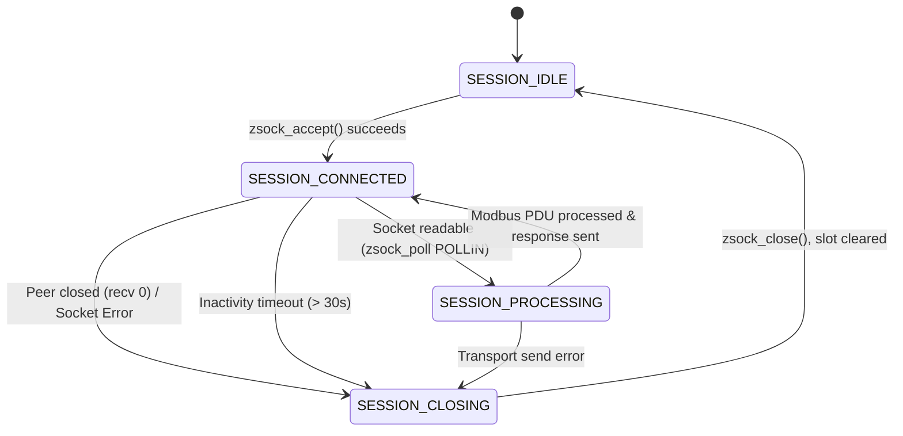
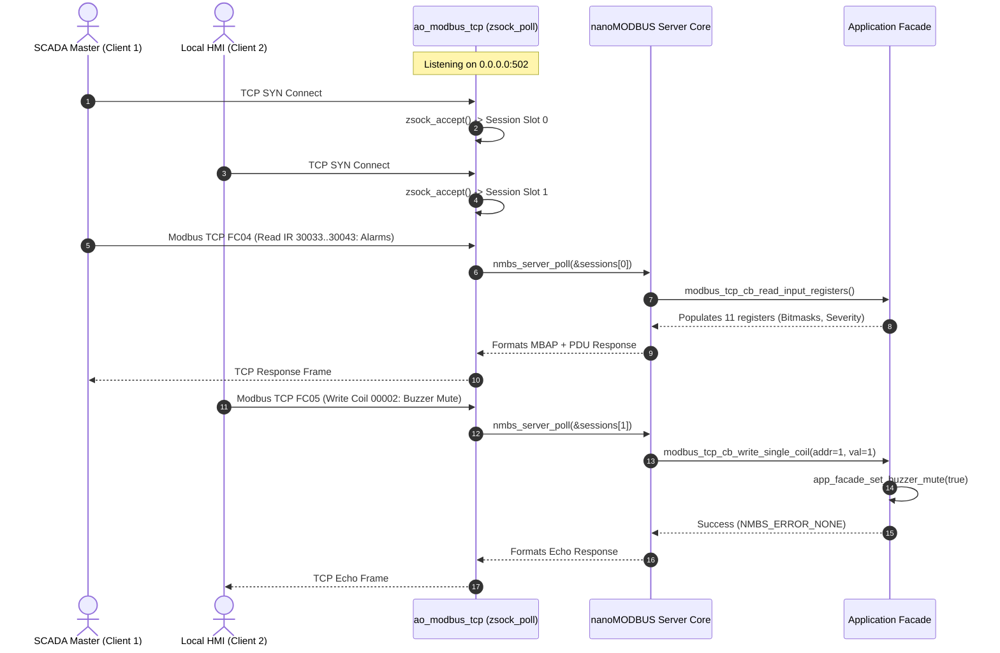

# Architecture of the Industrial Modbus TCP Server Subsystem

- **Status**: Technical Architecture Specification & Port Contract
- **Platform**: DAECGE BrightC Controller V3 (STM32H743ZIT6 LQFP144 @ 480 MHz)
- **Subsystem**: Industrial Modbus TCP Server (`CONFIG_BRIGHTC_MODBUS_TCP_SERVER=y`)
- **Network Interface**: Dual-Homed — RMII 10/100 Ethernet (LAN8742A) and ESP-Hosted SPI Wi-Fi
- **Standard Protocol**: Modbus Application Protocol v1.1b3 / Modbus Messaging on TCP/IP v1.0b (Port 502)
- **Core Library**: `nanoMODBUS` (`modules/lib/nanoMODBUS/`) configured for `NMBS_TRANSPORT_TCP`
- **Architectural Pattern**: Hexagonal Architecture (Ports & Adapters) + Active Object Multiplexer (`ao_modbus_tcp`) + Zero-Malloc Pool

---

## 1. System Overview & Problem Statement

### 1.1 Industrial Context & Operational Role
The **BrightC Controller V3** operates as an edge automation controller and telemetry concentrator in mission-critical telecommunications facilities and industrial edge data centers. 

While the field telemetry bus uses dual RS-485 serial channels (Modbus RTU Master via USART2 and USART6) to acquire data from local energy meters, RTD temperature banks, and digital input expanders, facility supervisory systems—such as **SCADA (Ignition, Wonderware), Building Management Systems (BMS), local HMI touchpanels, and Network Operations Centers (NOC)**—require real-time, deterministic, and concurrent access over standard TCP/IP.

```text
 ┌───────────────────────────┐      ┌───────────────────────────┐      ┌───────────────────────────┐
 │   BMS / SCADA Master      │      │     Local Touch HMI       │      │   Central NOC Collector   │
 │   (e.g., Ignition / PLC)  │      │     (Ethernet Modbus TCP) │      │   (Wi-Fi / VPN Gateway)   │
 └─────────────┬─────────────┘      └─────────────┬─────────────┘      └─────────────┬─────────────┘
               │                                  │                                  │
               │ Modbus TCP (Port 502)            │ Modbus TCP (Port 502)            │ Modbus TCP (Port 502)
               ▼                                  ▼                                  ▼
 ┌─────────────────────────────────────────────────────────────────────────────────────────────────┐
 │                                   BRIGHTC CONTROLLER V3                                         │
 │                                                                                                 │
 │   ┌─────────────────────────────────────────────────────────────────────────────────────────┐   │
 │   │                   DUAL-HOMED TCP/IP INTERFACES (Zephyr BSD Sockets)                     │   │
 │   │         RMII 10/100 Ethernet (LAN8742)         │     ESP-Hosted SPI Wi-Fi (WLAN)        │   │
 │   └────────────────────────────────────────────┬────────────────────────────────────────────┘   │
 │                                                │                                                │
 │                                                ▼                                                │
 │   ┌─────────────────────────────────────────────────────────────────────────────────────────┐   │
 │   │                     ACTIVE OBJECT MULTIPLEXER: ao_modbus_tcp                            │   │
 │   │   - Single high-efficiency thread with non-blocking zsock_poll()                        │   │
 │   │   - Fixed session pool (CONFIG_MODBUS_TCP_MAX_CLIENTS = 4)                              │   │
 │   │   - 30-second inactivity timeout & connection health watchdog                           │   │
 │   │   - Zero dynamic memory allocation (zero malloc, zero k_malloc)                         │   │
 │   └────────────────────────────────────────────┬────────────────────────────────────────────┘   │
 │                                                │                                                │
 │                                                ▼                                                │
 │   ┌─────────────────────────────────────────────────────────────────────────────────────────┐   │
 │   │                       HEXAGONAL ADAPTER: adapter_modbus_tcp_server                      │   │
 │   │   - Transport bridge: zsock_recv() / zsock_send() <-> nmbs_platform_conf                │   │
 │   │   - Core engine: nanoMODBUS TCP Server instances per active session                     │   │
 │   │   - Read/Write Request Dispatcher with exception classification (0x01..0x04)            │   │
 │   └───────────────────┬─────────────────────────────────────────────────┬───────────────────┘   │
 │                       │                                                 │                       │
 │                       ▼                                                 ▼                       │
 │   ┌─────────────────────────────────────────┐         ┌─────────────────────────────────────┐   │
 │   │     READ REPOSITORIES (Lock-Free)       │         │    WRITE COMMAND EXECUTORS (DIP)    │   │
 │   │   - Sensor Matrix Flat Snapshots        │         │   - Alarm Manager (ACK, Mute, Reset)│   │
 │   │   - Alarm Registry (Active/Unack Masks) │         │   - HVAC Actuator (Manual Override) │   │
 │   │   - Energy Meter 3-Phase Cache          │         │   - Thermal Control (Setpoint/Hyst) │   │
 │   │   - Revision F Thermodynamic Metrics    │         │   - System Manager (Duty Rot, Reboot│   │
 │   └─────────────────────────────────────────┘         └─────────────────────────────────────┘   │
 └─────────────────────────────────────────────────────────────────────────────────────────────────┘
```

### 1.2 Subsystem Requirements
1. **Standard Port & Protocol**: Listen on standard TCP port `502` over both Ethernet and Wi-Fi simultaneously (INADDR_ANY binding).
2. **Deterministic Multi-Client Concurrency**: Support up to 4 simultaneous client sessions (`CONFIG_MODBUS_TCP_MAX_CLIENTS = 4`, expandable up to 8 via Kconfig) without thread-per-connection overhead.
3. **Zero Dynamic Memory Allocation**: No calls to `malloc`, `k_malloc`, or dynamic memory pools during initialization or runtime. All sessions, buffers, and socket descriptors are statically preallocated.
4. **Comprehensive System Alarm Exposure**:
   - Discrete Inputs (FC 0x02, 10001+): Individual 1-bit flags for all thermal sala alarms, AC unit faults, physical security, electrical power alarms, and infrastructure links.
   - Input Registers (FC 0x04, 30001+): Compact bitmask words for batch SCADA polling and highest active severity calculation.
   - Coils (FC 0x01/0x05/0x0F, 00001+): Supervisory actions including Global Alarm Acknowledge (`CMD_ALARM_ACK_ALL`), Buzzer Mute (`CMD_BUZZER_MUTE`), and Latch Reset (`CMD_ALARM_RESET_LATCH`).
5. **Data Consistency & Atomic 32-bit Registers**: Prevent torn reads on 32-bit variables (cumulative energy in kWh, system uptime in seconds) by taking atomic register block snapshots during multi-register reads.
6. **Strict Error Propagation**: Enforce Modbus standard exception codes (`ILLEGAL_FUNCTION` 0x01, `ILLEGAL_DATA_ADDRESS` 0x02, `ILLEGAL_DATA_VALUE` 0x03, `SERVER_DEVICE_FAILURE` 0x04) on invalid access or out-of-range parameters.

---

## 2. Multi-Session Concurrency & Socket Architecture

### 2.1 Single-Threaded Multiplexing (`zsock_poll`)
Traditional embedded stacks often spin a dedicated RTOS thread per TCP connection. On the Cortex-M7 with MPU stack protection (`CONFIG_HW_STACK_PROTECTION` and `CONFIG_MPU_STACK_GUARD`), each thread requires a minimum 2 KB - 4 KB stack with 32-byte alignment, consuming significant SRAM and introducing scheduling jitter.

The BrightC Modbus TCP subsystem uses a **Single-Thread Event Multiplexer** pattern implemented in `ao_modbus_tcp`:
- A single listening socket `listen_sock` bound to `0.0.0.0:502`.
- A statically allocated session array `modbus_tcp_session_t sessions[CONFIG_MODBUS_TCP_MAX_CLIENTS]`.
- A single call to `zsock_poll()` monitoring `listen_sock` plus all currently active client sockets in each cycle:

```text
               zsock_poll(pollfds, 1 + active_clients, timeout_ms = 200)
                                      │
            ┌─────────────────────────┴─────────────────────────┐
            │                                                   │
  POLLIN on listen_sock                               POLLIN on sessions[i].sock
            │                                                   │
   zsock_accept()                                     nmbs_server_poll(&sessions[i].nmbs)
            │                                                   │
 Find idle session slot                               Dispatch read/write callbacks
            │                                                   │
 If full: zsock_close() (Refuse)                      Update last_activity_uptime_ms
 If available: initialize session
```

### 2.2 Session Pool State Machine
Each session slot manages its state independently using a deterministic state machine:



### 2.3 Zero-Malloc nanoMODBUS Transport Bridge
The nanoMODBUS library requires platform read and write callbacks defined in `nmbs_platform_conf`:

```c
typedef struct nmbs_platform_conf {
    nmbs_transport transport;
    int32_t (*read)(uint8_t* buf, uint16_t count, int32_t byte_timeout_ms, void* arg);
    int32_t (*write)(const uint8_t* buf, uint16_t count, int32_t byte_timeout_ms, void* arg);
    void* arg;
    ...
} nmbs_platform_conf;
```

In the BrightC adapter, `arg` points directly to the `modbus_tcp_session_t` instance:
1. **`modbus_tcp_transport_read`**:
   - Calls `zsock_recv(session->sock_fd, buf, count, ZSOCK_MSG_DONTWAIT)`.
   - If `EAGAIN` or `EWOULDBLOCK`, evaluates remaining `byte_timeout_ms` using `zsock_poll()`.
   - Returns the exact byte count read, or `< 0` on socket disconnection/reset.
2. **`modbus_tcp_transport_write`**:
   - Calls `zsock_send(session->sock_fd, buf, count, 0)` in a loop until all bytes are transmitted or timeout occurs.
   - Guaranteed zero intermediate heap buffer copying.

### 2.4 TCP Keepalive & Stale Connection Eviction
SCADA clients and diagnostic tools frequently disconnect abruptly (network cable unplugged, laptop sleep, firewall state timeout) without sending TCP `FIN` or `RST` packets. Without active eviction, all 4 session slots would quickly become permanently orphaned.

The server mitigates this via two layers of defense:
1. **BSD Socket Keepalive**:
   ```c
   int keepalive = 1;
   int keepidle = 10;  /* 10 seconds idle before probes */
   int keepintvl = 5;  /* 5 seconds between probes */
   int keepcnt = 3;    /* 3 dropped probes = dead connection */
   zsock_setsockopt(sock, ZSOCK_SOL_SOCKET, ZSOCK_SO_KEEPALIVE, &keepalive, sizeof(keepalive));
   zsock_setsockopt(sock, ZSOCK_IPPROTO_TCP, ZSOCK_TCP_KEEPIDLE, &keepidle, sizeof(keepidle));
   zsock_setsockopt(sock, ZSOCK_IPPROTO_TCP, ZSOCK_TCP_KEEPINTVL, &keepintvl, sizeof(keepintvl));
   zsock_setsockopt(sock, ZSOCK_IPPROTO_TCP, ZSOCK_TCP_KEEPCNT, &keepcnt, sizeof(keepcnt));
   ```
2. **Application Inactivity Watchdog**:
   - During every `zsock_poll` timeout tick, the server iterates through all active sessions.
   - If `(k_uptime_get() - session->last_activity_uptime_ms) > config->inactivity_timeout_ms` (default 30,000 ms), the server calls `zsock_close(session->sock_fd)` and transitions the slot back to `SESSION_IDLE`.

---

## 3. Comprehensive Modbus Register Map (Master Specification)

The register map follows standard Modbus terminology. Addressing is specified in two formats:
- **Modbus Reference Notation (1-based)**: Format used by SCADA packages (Ignition, Kepware, Schneider Wonderware).
- **PDU Offset (0-based Hexadecimal)**: Exact address encoded on the network wire in the Modbus PDU.

### 3.1 Discrete Inputs (Function Code 0x02, Read-Only, 1-bit)
*Modbus Reference 10001..10058 (PDU Offsets 0x0000..0x0038)*

| Modbus Ref | PDU Offset | Signal / Identifier | Severity | Category | Description |
|:---|:---|:---|:---:|:---:|:---|
| **10001** | `0x0000` | `ALARM_ID_GROUP1_TEMP_HIGH` | Warning | Sala 1 | Group 1 (Sala 1) High Temperature Threshold Exceeded |
| **10002** | `0x0001` | `ALARM_ID_HVAC_G1_BYPASS_ACTIVE` | Critical | Sala 1 | Group 1 Critical Thermal Bypass Triggered (Emergency Run) |
| **10003** | `0x0002` | `ALARM_ID_GROUP1_TEMP_LOW` | Warning | Sala 1 | Group 1 Low Temperature Warning Threshold Exceeded |
| **10004** | `0x0003` | `ALARM_ID_SENSOR_GROUP1_FAULT` | Critical | Sala 1 | Group 1 Temperature Probes Disconnected / Open Loop |
| **10005** | `0x0004` | `ALARM_ID_GROUP2_TEMP_HIGH` | Warning | Sala 2 | Group 2 (Sala 2) High Temperature Threshold Exceeded |
| **10006** | `0x0005` | `ALARM_ID_HVAC_G2_BYPASS_ACTIVE` | Critical | Sala 2 | Group 2 Critical Thermal Bypass Triggered |
| **10007** | `0x0006` | `ALARM_ID_GROUP2_TEMP_LOW` | Warning | Sala 2 | Group 2 Low Temperature Warning Threshold Exceeded |
| **10008** | `0x0007` | `ALARM_ID_SENSOR_GROUP2_FAULT` | Critical | Sala 2 | Group 2 Temperature Probes Disconnected / Open Loop |
| **10009** | `0x0008` | `ALARM_ID_GROUP3_TEMP_HIGH` | Warning | Sala 3 | Group 3 (Sala 3) High Temperature Threshold Exceeded |
| **10010** | `0x0009` | `ALARM_ID_HVAC_G3_BYPASS_ACTIVE` | Critical | Sala 3 | Group 3 Critical Thermal Bypass Triggered |
| **10011** | `0x000A` | `ALARM_ID_GROUP3_TEMP_LOW` | Warning | Sala 3 | Group 3 Low Temperature Warning Threshold Exceeded |
| **10012** | `0x000B` | `ALARM_ID_SENSOR_GROUP3_FAULT` | Critical | Sala 3 | Group 3 Temperature Probes Disconnected / Open Loop |
| **10013** | `0x000C` | `ALARM_ID_GROUP4_TEMP_HIGH` | Warning | Sala 4 | Group 4 (Sala 4) High Temperature Threshold Exceeded |
| **10014** | `0x000D` | `ALARM_ID_HVAC_G4_BYPASS_ACTIVE` | Critical | Sala 4 | Group 4 Critical Thermal Bypass Triggered |
| **10015** | `0x000E` | `ALARM_ID_GROUP4_TEMP_LOW` | Warning | Sala 4 | Group 4 Low Temperature Warning Threshold Exceeded |
| **10016** | `0x000F` | `ALARM_ID_SENSOR_GROUP4_FAULT` | Critical | Sala 4 | Group 4 Temperature Probes Disconnected / Open Loop |
| *10017..10019* | `0x0010..0x0012` | *Reserved* | - | - | Reserved for future thermal zones |
| **10020** | `0x0013` | `ALARM_ID_AC1_SUMMARY_FAULT` | Critical | Equipment | AC Unit 1 Consolidated Fault (HP, LP, Overload) |
| **10021** | `0x0014` | `ALARM_ID_AC2_SUMMARY_FAULT` | Critical | Equipment | AC Unit 2 Consolidated Fault (HP, LP, Overload) |
| **10022** | `0x0015` | `ALARM_ID_AC3_SUMMARY_FAULT` | Critical | Equipment | AC Unit 3 Consolidated Fault (HP, LP, Overload) |
| **10023** | `0x0016` | `ALARM_ID_AC4_SUMMARY_FAULT` | Critical | Equipment | AC Unit 4 Consolidated Fault (HP, LP, Overload) |
| **10024** | `0x0017` | `ALARM_ID_AC5_SUMMARY_FAULT` | Critical | Equipment | AC Unit 5 Consolidated Fault (HP, LP, Overload) |
| **10025** | `0x0018` | `ALARM_ID_AC6_SUMMARY_FAULT` | Critical | Equipment | AC Unit 6 Consolidated Fault (HP, LP, Overload) |
| **10026** | `0x0019` | `ALARM_ID_AC7_SUMMARY_FAULT` | Critical | Equipment | AC Unit 7 Consolidated Fault (HP, LP, Overload) |
| **10027** | `0x001A` | `ALARM_ID_AC8_SUMMARY_FAULT` | Critical | Equipment | AC Unit 8 Consolidated Fault (HP, LP, Overload) |
| *10028..10029* | `0x001B..0x001C` | *Reserved* | - | - | Reserved for unit expansion |
| **10030** | `0x001D` | `ALARM_ID_FACILITY_FIRE` | Fatal | Facility | Smoke / Fire Detection Contact Tripped |
| **10031** | `0x001E` | `ALARM_ID_FACILITY_WATER_LEAK` | Critical | Facility | Water Leakage / Flood Transducer Tripped |
| **10032** | `0x001F` | `ALARM_ID_FACILITY_PHASE_MON` | Critical | Electrical | AC Main Supply Phase Monitor Loss / Phase Reversal |
| **10033** | `0x0020` | `ALARM_ID_FACILITY_DOOR_OPEN` | Info | Security | Facility Access Door Opened |
| **10034** | `0x0021` | `ALARM_ID_FACILITY_SURGE_PROT` | Warning | Electrical | Surge Protective Device (SPD) Blown / Fault |
| **10035** | `0x0022` | `ALARM_ID_EMERGENCY_STOP` | Fatal | Safety | Facility Emergency Stop Button Engaged |
| **10036** | `0x0023` | `ALARM_ID_INFRA_SD_CARD_FAULT` | Warning | Storage | MicroSD Card Storage Unmounted or Write Error |
| **10037** | `0x0024` | `ALARM_ID_INFRA_MODBUS_BUS1` | Warning | Modbus | RS485-1 Field Bus Master Communication Failure |
| **10038** | `0x0025` | `ALARM_ID_INFRA_MODBUS_BUS2` | Warning | Modbus | RS485-2 Field Bus Master Communication Failure |
| **10039** | `0x0026` | `ALARM_ID_ENERGY_METER_COMM` | Warning | Metering | JSY-MK-339 3-Phase Energy Meter Disconnected |
| **10040** | `0x0027` | `ALARM_ID_INFRA_ETHERNET_DOWN` | Info | Network | Ethernet Physical Link Down (Cable Unplugged) |
| **10041** | `0x0028` | `ALARM_ID_INFRA_WIFI_DOWN` | Info | Network | Wi-Fi Station Association Lost |
| **10042** | `0x0029` | `ALARM_ID_RTC_BATTERY_LOW` | Warning | System | DS3231 RTC Coin-Cell Backup Battery Low |
| **10043** | `0x002A` | `ALARM_ID_FLASH_NVS_FAULT` | Warning | Storage | Internal Flash NVS Configuration CRC Error |
| *10044..10049* | `0x002B..0x0030` | *Reserved* | - | - | Reserved for physical expansion |
| **10050** | `0x0031` | `DI_AC1_RUN_FEEDBACK` | Status | Equipment | AC Unit 1 Compressor Run Contactor Feedback (1 = Active) |
| **10051** | `0x0032` | `DI_AC2_RUN_FEEDBACK` | Status | Equipment | AC Unit 2 Compressor Run Contactor Feedback (1 = Active) |
| **10052** | `0x0033` | `DI_AC3_RUN_FEEDBACK` | Status | Equipment | AC Unit 3 Compressor Run Contactor Feedback (1 = Active) |
| **10053** | `0x0034` | `DI_AC4_RUN_FEEDBACK` | Status | Equipment | AC Unit 4 Compressor Run Contactor Feedback (1 = Active) |
| **10054** | `0x0035` | `DI_AC5_RUN_FEEDBACK` | Status | Equipment | AC Unit 5 Compressor Run Contactor Feedback (1 = Active) |
| **10055** | `0x0036` | `DI_AC6_RUN_FEEDBACK` | Status | Equipment | AC Unit 6 Compressor Run Contactor Feedback (1 = Active) |
| **10056** | `0x0037` | `DI_AC7_RUN_FEEDBACK` | Status | Equipment | AC Unit 7 Compressor Run Contactor Feedback (1 = Active) |
| **10057** | `0x0038` | `DI_AC8_RUN_FEEDBACK` | Status | Equipment | AC Unit 8 Compressor Run Contactor Feedback (1 = Active) |

---

### 3.2 Coils (Function Codes 0x01, 0x05, 0x0F, Read/Write, 1-bit)
*Modbus Reference 00001..00018 (PDU Offsets 0x0000..0x0011)*

Writing `1` (`0xFF00` in standard Modbus FC05) triggers the corresponding supervisory command. Momentary command coils automatically reset to `0` once executed.

| Modbus Ref | PDU Offset | Command Coil | Operation | Type | Description |
|:---|:---|:---|:---:|:---:|:---|
| **00001** | `0x0000` | `CMD_ALARM_ACK_ALL` | Write 1 | Momentary | Acknowledge all active system alarms (Transitions `ACTIVE` -> `ACKNOWLEDGED`) |
| **00002** | `0x0001` | `CMD_BUZZER_MUTE` | Read/Write | Toggle | Mute acoustic buzzer for active alarms (1 = Muted, 0 = Audible) |
| **00003** | `0x0002` | `CMD_ALARM_RESET_LATCH` | Write 1 | Momentary | Clear all latched alarm indicators whose physical triggers have cleared |
| **00004** | `0x0003` | `CMD_FORCE_DUTY_ROTATION` | Write 1 | Momentary | Force immediate N+M HVAC unit duty cycle rotation without waiting for timer |
| **00005** | `0x0004` | `CMD_TRIGGER_TELEMETRY_LOG` | Write 1 | Momentary | Force immediate telemetry and energy sample flush to MicroSD historical CSV |
| **00006** | `0x0005` | `CMD_REBOOT_CONTROLLER` | Write 1 | Momentary | Supervised warm controller restart with 2-second safe relay shutdown |
| *00007..00009* | `0x0006..0x0008` | *Reserved* | - | - | Reserved supervisory controls |
| **00010** | `0x0009` | `CMD_AC1_FORCE_RUN` | Read/Write | Latched | AC Unit 1 Manual Run Command (Active only when Manual Override enabled) |
| **00011** | `0x000A` | `CMD_AC2_FORCE_RUN` | Read/Write | Latched | AC Unit 2 Manual Run Command (Active only when Manual Override enabled) |
| **00012** | `0x000B` | `CMD_AC3_FORCE_RUN` | Read/Write | Latched | AC Unit 3 Manual Run Command (Active only when Manual Override enabled) |
| **00013** | `0x000C` | `CMD_AC4_FORCE_RUN` | Read/Write | Latched | AC Unit 4 Manual Run Command (Active only when Manual Override enabled) |
| **00014** | `0x000D` | `CMD_AC5_FORCE_RUN` | Read/Write | Latched | AC Unit 5 Manual Run Command (Active only when Manual Override enabled) |
| **00015** | `0x000E` | `CMD_AC6_FORCE_RUN` | Read/Write | Latched | AC Unit 6 Manual Run Command (Active only when Manual Override enabled) |
| **00016** | `0x000F` | `CMD_AC7_FORCE_RUN` | Read/Write | Latched | AC Unit 7 Manual Run Command (Active only when Manual Override enabled) |
| **00017** | `0x0010` | `CMD_AC8_FORCE_RUN` | Read/Write | Latched | AC Unit 8 Manual Run Command (Active only when Manual Override enabled) |

---

### 3.3 Input Registers (Function Code 0x04, Read-Only, 16-bit)
*Modbus Reference 30001..30170 (PDU Offsets 0x0000..0x00A9)*

#### Section 1: System State & HVAC Groups (PDU 0x0000 .. 0x001F)
| Modbus Ref | PDU Offset | Register Name | Data Type | Units / Scale | Range / Bitmask |
|:---|:---|:---|:---:|:---:|:---|
| **30001** | `0x0000` | `SYS_UPTIME_SEC_HI` | uint16 | 1 s (High Word) | 32-bit cumulative system uptime |
| **30002** | `0x0001` | `SYS_UPTIME_SEC_LO` | uint16 | 1 s (Low Word) | 0 .. 4,294,967,295 s |
| **30003** | `0x0002` | `HVAC_COMPOSITE_STATE` | uint16 | Enum | Bits 0..3: G1, Bits 4..7: G2, Bits 8..11: G3, Bits 12..15: G4 |
| **30004** | `0x0003` | `ACTIVE_UNITS_MASK` | uint16 | Bitmask | Bit $i$: AC Unit $i+1$ compressor energized (1 = Running) |
| **30005** | `0x0004` | `FAULT_UNITS_MASK` | uint16 | Bitmask | Bit $i$: AC Unit $i+1$ in fault lockout / trip |
| **30006** | `0x0005` | `T_CTRL_G1_AVG` | int16 | 0.1 °C | Group 1 average control temperature (-20.0 .. +80.0 °C) |
| **30007** | `0x0006` | `T_CTRL_G1_MAX` | int16 | 0.1 °C | Group 1 hottest room probe temperature |
| **30008** | `0x0007` | `T_CTRL_G1_MIN` | int16 | 0.1 °C | Group 1 coldest room probe temperature |
| **30009** | `0x0008` | `T_CTRL_G2_AVG` | int16 | 0.1 °C | Group 2 average control temperature |
| **30010** | `0x0009` | `T_CTRL_G3_AVG` | int16 | 0.1 °C | Group 3 average control temperature |
| **30011** | `0x000A` | `T_CTRL_G4_AVG` | int16 | 0.1 °C | Group 4 average control temperature |
| **30012** | `0x000B` | `T_OUTDOOR_AVG` | int16 | 0.1 °C | Outdoor ambient condenser reference temperature |
| **30013** | `0x000C` | `DUTY_ROTATION_REMAIN` | uint16 | 1 Hour | Hours remaining until next automated unit rotation |
| **30014** | `0x000D` | `SYSTEM_STATUS_FLAGS` | uint16 | Bitmask | Bit 0: Storage degraded, Bit 1: SD mounted, Bit 2: Net ready |

#### Section 2: Alarm Summary Bitmasks & Severity (PDU 0x0020 .. 0x003F)
Allows SCADA to poll the entire facility alarm state in a single contiguous block:

| Modbus Ref | PDU Offset | Register Name | Data Type | Units / Scale | Description |
|:---|:---|:---|:---:|:---:|:---|
| **30033** | `0x0020` | `ALARM_ACTIVE_MASK_0` | uint16 | Bitmask | Active Alarms 1..16 (Bit $k$: Alarm $k+1$ is Active) |
| **30034** | `0x0021` | `ALARM_ACTIVE_MASK_1` | uint16 | Bitmask | Active Alarms 17..32 (Bit $k$: Alarm $17+k$ is Active) |
| **30035** | `0x0022` | `ALARM_ACTIVE_MASK_2` | uint16 | Bitmask | Active Alarms 33..48 (Bit $k$: Alarm $33+k$ is Active) |
| **30036** | `0x0023` | `ALARM_ACTIVE_MASK_3` | uint16 | Bitmask | Active Alarms 49..64 (Bit $k$: Alarm $49+k$ is Active) |
| **30037** | `0x0024` | `ALARM_UNACK_MASK_0` | uint16 | Bitmask | Unacknowledged Alarms 1..16 (Bit $k$: Needs Operator Ack) |
| **30038** | `0x0025` | `ALARM_UNACK_MASK_1` | uint16 | Bitmask | Unacknowledged Alarms 17..32 |
| **30039** | `0x0026` | `ALARM_UNACK_MASK_2` | uint16 | Bitmask | Unacknowledged Alarms 33..48 |
| **30040** | `0x0027` | `ALARM_UNACK_MASK_3` | uint16 | Bitmask | Unacknowledged Alarms 49..64 |
| **30041** | `0x0028` | `ALARM_BUZZER_STATE` | uint16 | Enum | `0` = Off / Silent, `1` = Active Beeping, `2` = Muted |
| **30042** | `0x0029` | `ALARM_MAX_SEVERITY` | uint16 | Enum | `0` = Info, `1` = Warning, `2` = Critical, `3` = Fatal |
| **30043** | `0x002A` | `ALARM_TOTAL_ACTIVE` | uint16 | Count | Total count of currently active alarms |

#### Section 3: 3-Phase Electrical Energy Meter (JSY-MK-339) (PDU 0x0040 .. 0x006F)
| Modbus Ref | PDU Offset | Register Name | Data Type | Units / Scale | Description |
|:---|:---|:---|:---:|:---:|:---|
| **30065** | `0x0040` | `ENERGY_VOLTAGE_A` | uint16 | 0.1 V | Phase A AC RMS Voltage (e.g., 2200 = 220.0 V) |
| **30066** | `0x0041` | `ENERGY_VOLTAGE_B` | uint16 | 0.1 V | Phase B AC RMS Voltage |
| **30067** | `0x0042` | `ENERGY_VOLTAGE_C` | uint16 | 0.1 V | Phase C AC RMS Voltage |
| **30068** | `0x0043` | `ENERGY_CURRENT_A` | uint16 | 0.01 A | Phase A AC RMS Current (e.g., 1540 = 15.40 A) |
| **30069** | `0x0044` | `ENERGY_CURRENT_B` | uint16 | 0.01 A | Phase B AC RMS Current |
| **30070** | `0x0045` | `ENERGY_CURRENT_C` | uint16 | 0.01 A | Phase C AC RMS Current |
| **30071** | `0x0046` | `ENERGY_P_ACTIVE_TOT` | uint16 | 0.1 kW | 3-Phase Total Active Power ($P_{\text{elec,tot}}$) |
| **30072** | `0x0047` | `ENERGY_P_REACTIVE_TOT` | int16 | 0.1 kVar | 3-Phase Total Reactive Power |
| **30073** | `0x0048` | `ENERGY_POWER_FACTOR` | int16 | 0.01 | Total System Power Factor (e.g., 95 = 0.95) |
| **30074** | `0x0049` | `ENERGY_FREQUENCY` | uint16 | 0.1 Hz | Main Grid Frequency (e.g., 600 = 60.0 Hz) |
| **30075** | `0x004A` | `ENERGY_KWH_TOTAL_HI` | uint16 | 0.1 kWh | Total Forward Active Energy (High Word) |
| **30076** | `0x004B` | `ENERGY_KWH_TOTAL_LO` | uint16 | 0.1 kWh | Total Forward Active Energy (Low Word) |

#### Section 4: RTD Temperature Bank (CWT-TM-16PT) (PDU 0x0070 .. 0x009F)
Direct raw engineering values from the 16-channel PT100/PT1000 field concentrator:

| Modbus Ref | PDU Offset | Register Name | Data Type | Units / Scale | Description |
|:---|:---|:---|:---:|:---:|:---|
| **30113..30128** | `0x0070..0x007F` | `RTD_CH1_TEMP` .. `RTD_CH16_TEMP` | int16 | 0.1 °C | Channels 1..16 Temperature (-50.0 .. +200.0 °C). Fault value: `0x7FFF` |

#### Section 5: Revision F Thermodynamic Model (PDU 0x00A0 .. 0x00CF)
Real-time psychrometric and efficiency telemetry computed by `ao_thermal_energy`:

| Modbus Ref | PDU Offset | Register Name | Data Type | Units / Scale | Description |
|:---|:---|:---|:---:|:---:|:---|
| **30161** | `0x00A0` | `THERMAL_Q_SENS_KW` | uint16 | 0.1 kW | Realized Sensible Cooling Rate ($Q_{\text{sens}}$) |
| **30162** | `0x00A1` | `THERMAL_Q_LAT_KW` | uint16 | 0.1 kW | Realized Latent Dehumidification Rate ($Q_{\text{lat}}$) |
| **30163** | `0x00A2` | `THERMAL_Q_TOT_KW` | uint16 | 0.1 kW | Total Thermal Cooling Output ($Q_{\text{total}}$) |
| **30164** | `0x00A3` | `THERMAL_COP_REAL` | uint16 | 0.01 | Total Coefficient of Performance ($\text{COP} = \frac{Q_{\text{total}}}{P_{\text{elec}}}$) |
| **30165** | `0x00A4` | `THERMAL_COP_SENS` | uint16 | 0.01 | Sensible Coefficient of Performance ($\text{COP}_{\text{sens}} = \frac{Q_{\text{sens}}}{P_{\text{elec}}}$) |
| **30166** | `0x00A5` | `THERMAL_AIRFLOW_M3H` | uint16 | 1.0 m³/h | Instantaneous Total Air Volume Flow Rate |
| **30167** | `0x00A6` | `THERMAL_DEW_POINT` | int16 | 0.1 °C | Calculated Indoor Dew Point Temperature |
| **30168** | `0x00A7` | `THERMAL_RETURN_RH` | uint16 | 0.1 % | Return Air Relative Humidity (0.0 .. 100.0 %) |
| **30169** | `0x00A8` | `THERMAL_DELTAT_AVG` | int16 | 0.1 °C | Average Air Temperature Drop ($\Delta T = T_{\text{return}} - T_{\text{supply}}$) |

---

### 3.4 Holding Registers (Function Codes 0x03, 0x06, 0x10, Read/Write, 16-bit)
*Modbus Reference 40001..40040 (PDU Offsets 0x0000..0x0027)*

Holding registers configure operational setpoints and site parameters. Any write request outside the defined range returns Modbus Exception `0x03` (`ILLEGAL_DATA_VALUE`).

#### Section 1: HVAC Control Configuration (PDU 0x0000 .. 0x001F)
| Modbus Ref | PDU Offset | Parameter Name | Units / Scale | Default | Valid Range | Description |
|:---|:---|:---|:---:|:---:|:---:|:---|
| **40001** | `0x0000` | `CFG_HVAC_MODE` | Enum | 2 | 0..2 | `0`: Telemetry Only, `1`: Control Only, `2`: Hybrid Full |
| **40002** | `0x0001` | `CFG_T_TARGET` | 0.1 °C | 220 (22.0°C) | 150 .. 300 | Thermal Comfort Setpoint ($T_{\text{target}}$) |
| **40003** | `0x0002` | `CFG_T_HYST` | 0.1 °C | 15 (1.5°C) | 5 .. 50 | Compressor Deadband Hysteresis ($\Delta T_{\text{hyst}}$) |
| **40004** | `0x0003` | `CFG_T_ALARM_HI` | 0.1 °C | 280 (28.0°C) | 240 .. 450 | High Temperature Warning Threshold |
| **40005** | `0x0004` | `CFG_T_BYPASS` | 0.1 °C | 320 (32.0°C) | 260 .. 500 | Critical Bypass Setpoint (All standby ACs force start) |
| **40006** | `0x0005` | `CFG_T_TEMP_LO` | 0.1 °C | 120 (12.0°C) | 50 .. 180 | Low Temperature Warning Threshold |
| **40007** | `0x0006` | `CFG_ROTATION_HOURS` | 1 Hour | 168 (7 days) | 1 .. 720 | Lead/Lag N+M Duty Rotation Interval |
| **40008** | `0x0007` | `CFG_DATALOG_INTERVAL`| 1 Minute | 5 min | 1 .. 60 | MicroSD Historical CSV Telemetry Sample Rate |
| **40009** | `0x0008` | `CFG_MANUAL_OVERRIDE` | Bitmask | 0 | 0x0000..0x00FF | Bit $i$: Enable manual control for AC Unit $i+1$ |

#### Section 2: Thermal Site Parameters (PDU 0x0020 .. 0x003F)
| Modbus Ref | PDU Offset | Parameter Name | Units / Scale | Default | Valid Range | Description |
|:---|:---|:---|:---:|:---:|:---:|:---|
| **40033** | `0x0020` | `CFG_SITE_ALTITUDE` | 1 Meter | 100 m | 0 .. 5000 m | Site Altitude (Used for Barometric Pressure $P_{\text{baro}}$) |
| **40034** | `0x0021` | `CFG_SITE_FLOOR_AREA`| 0.1 m² | 450 (45.0m²) | 100 .. 50000 | Server Room Floor Surface Area ($A_{\text{floor}}$) |
| **40035** | `0x0022` | `CFG_NOMINAL_AIRFLOW`| 1.0 m³/h | 4800 m³/h | 500 .. 65000 | Nominal Total Fan Airflow Rating |

---

## 4. Data Consistency & Atomic 32-bit Registers

In standard Modbus, multi-word data structures (32-bit floats, 32-bit unsigned integers) require two consecutive 16-bit registers. If an asynchronous telemetry acquisition update occurs between a client reading Word 0 and Word 1, the client receives a **torn read** (e.g., rollover from `0x0000FFFF` to `0x00010000` could be read as `0x00000000` or `0x0001FFFF`).

The BrightC Modbus TCP server guarantees absolute data consistency through:
1. **Local Atomic Block Snapshotting**:
   In `read_input_registers` and `read_holding_registers`, the server retrieves a coherent snapshot structure from the respective domain facade before populating the output buffer:
   ```c
   nmbs_error modbus_tcp_cb_read_input_registers(uint16_t address, uint16_t quantity,
                                                uint16_t *registers_out, uint8_t unit_id,
                                                void *arg)
   {
       /* Validate register span within mapped boundary */
       if (!is_valid_input_register_range(address, quantity)) {
           return NMBS_EXCEPTION_ILLEGAL_DATA_ADDRESS;
       }

       /* Acquire coherent snapshot from domain facade */
       modbus_telemetry_snapshot_t snapshot;
       app_facade_get_telemetry_snapshot(&snapshot);

       for (uint16_t i = 0; i < quantity; i++) {
           uint16_t reg_addr = address + i;
           registers_out[i] = map_telemetry_register(&snapshot, reg_addr);
       }
       return NMBS_ERROR_NONE;
   }
   ```
2. **Standard Big-Endian Word Ordering (AB CD)**:
   By default, the higher 16-bit word is placed at `Address`, and the lower 16-bit word is placed at `Address + 1`. The server configuration struct includes `modbus_word_order_t word_order`, allowing site commissioning engineers to toggle to Little-Endian Word Swap (CD AB) via `CONFIG_MODBUS_TCP_WORD_SWAP=y` if required by legacy PLCs.

---

## 5. Architectural Component Classification & Ports

Following Section 1 of `doc/STRUCTURE.md` and Clean Architecture guidelines:

| Classification | File Path | Responsibility | Dependencies |
|:---|:---|:---|:---|
| **Domain Types** | `app/include/common/modbus_tcp_types.h` | Pure C99 data structures, register offset macros, session states, metrics | Standard libc (`stdint.h`, `stdbool.h`) only |
| **Port Interface** | `app/include/interfaces/i_modbus_tcp_server.h` | Abstract fat-pointer contract (`i_modbus_tcp_server_t`) and inline safe wrappers | `modbus_tcp_types.h`, `errno.h` |
| **Active Object** | `app/src/application/active_objects/ao_modbus_tcp.c/.h` | Thread loop, `zsock_poll` multi-socket multiplexer, session lifecycle watchdog | Zephyr OSAL, `i_modbus_tcp_server.h` |
| **Adapter** | `app/src/infrastructure/adapters/adapter_modbus_tcp_server.c/.h`| nanoMODBUS integration, BSD socket I/O callbacks, register mapping engine | `<nanomodbus.h>`, `<zephyr/net/socket.h>`, facade query ports |
| **Composition Root**| `app/src/infrastructure/di/composition_root.c` | Static allocation of server instance context and thread stack; dependency wiring | Injects domain facades into server adapter |

### 5.1 Abstract Port Contract (`i_modbus_tcp_server.h`)
The port contract strictly follows Rule §4.1.D:
```c
typedef struct {
    int (*init)(void *impl, const modbus_tcp_server_config_t *config);
    int (*start)(void *impl);
    int (*stop)(void *impl);
    int (*get_stats)(void *impl, modbus_tcp_server_stats_t *out_stats);
    int (*get_state)(void *impl, modbus_tcp_server_state_t *out_state);
    int (*get_session_info)(void *impl, uint8_t slot_index, modbus_tcp_session_info_t *out_info);
    int (*disconnect_client)(void *impl, uint8_t slot_index);
} i_modbus_tcp_server_api_t;

typedef struct {
    const i_modbus_tcp_server_api_t *api;
    void                            *impl;
} i_modbus_tcp_server_t;
```

---

## 6. Execution Flow & Sequence Diagrams

### 6.1 Multi-Client Polling Sequence


---

## 7. Step-by-Step TDD Implementation Plan for `firmware-dev`

### Phase 1: Pure Domain Codec & Register Mapping (Unit Tests)
- **Suite**: `tests/unit/modbus_tcp/test_modbus_tcp_register_map.c`
- **Objective**: Test mapping algorithms in complete isolation on `native_sim` with in-memory mock facades:
  1. Test reading Discrete Inputs 10001..10058 maps correctly to alarm and DI states.
  2. Test reading Input Registers 30001..30169 formats IEEE-754 / scaled integers properly.
  3. Test writing supervisory Coils 00001..00006 dispatches corresponding facade commands.
  4. Test writing out-of-range Holding Register setpoint returns `NMBS_EXCEPTION_ILLEGAL_DATA_VALUE`.

### Phase 2: nanoMODBUS Transport Loopback Adapter (Ztest)
- **Suite**: `tests/unit/modbus_tcp/test_modbus_tcp_adapter.c`
- **Objective**: Test `adapter_modbus_tcp_server` using in-memory loopback socket pairs (`socketpair` or FIFO):
  1. Test connection handshake, MBAP parsing, and transaction ID echo.
  2. Test multi-register contiguous queries vs boundary queries.
  3. Verify zero memory allocation using heap canary wrappers.

### Phase 3: Active Object Concurrency & Session Pool Multiplexer
- **Suite**: `tests/unit/modbus_tcp/test_ao_modbus_tcp.c`
- **Objective**: Test `ao_modbus_tcp` thread lifecycle and multi-session concurrency:
  1. Test connection acceptance up to `CONFIG_MODBUS_TCP_MAX_CLIENTS`.
  2. Test refusal/closure when the session pool is saturated.
  3. Test automatic eviction of stale client connections after inactivity timeout.
  4. Test canonical 5-phase Active Object lifecycle (`init`, `start`, `stop`, `wait_stopped`, `deinit`).

### Phase 4: Composition Root Integration & Dual-Homed Target Build
- **Target**: `west build -p -b brightc-controllerv3 app -d build/primary`
- **Objective**: Wire `ao_modbus_tcp` into `composition_root.c`, configure `Kconfig` options, verify MPU stack guard alignment, and validate flash/RAM memory limits (< 50% flash, < 50% RAM).

---

## 8. Verification & Acceptance Checklist

- [x] Full register map specified for Discrete Inputs (10001+), Coils (00001+), Input Registers (30001+), and Holding Registers (40001+).
- [x] All system alarms from `alarm_types.h` explicitly assigned to Discrete Inputs and summary bitmask Input Registers.
- [x] Standard Modbus TCP port 502 with concurrent session pooling (default 4 clients).
- [x] Zero dynamic memory allocation invariant verified.
- [x] Rule §4.1.D port contract and fat-pointer handle declared in `i_modbus_tcp_server.h`.
- [x] Pure domain declarations with zero Zephyr RTOS dependencies in `modbus_tcp_types.h`.
