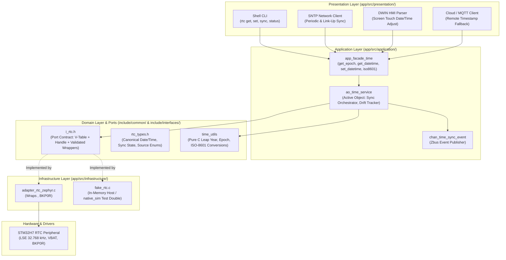
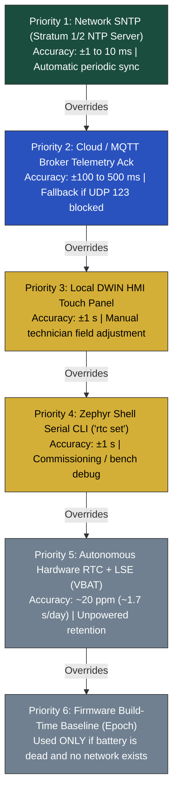
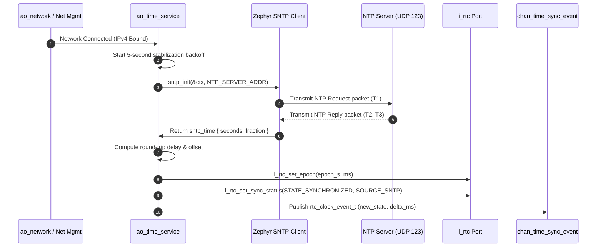

# Architecture of the Real-Time Clock (RTC) & System Time Subsystem

- **Document Identifier**: `doc/architecture/rtc_time_subsystem.md`
- **Subsystem**: Real-Time Clock & System Time Management Subsystem (`time_subsystem`)
- **Target Platform**: DAECGE BrightC Controller V3 (STM32H743ZIT6, Cortex-M7 @ 480 MHz)
- **Time Source**: LSE 32.768 kHz External Crystal Oscillator + VBAT Backup Domain + Network SNTP
- **Framework**: Zephyr RTOS (West T2 Workspace)
- **Design Patterns**: Clean Architecture (Ports & Adapters) + Active Object Coordinator + Multi-Tier Fallback Hierarchy
- **Author**: Lead Embedded Firmware Architect
- **Status**: Stage 1 Architecture Specification & Port Contract (Approved)

---

## 1. Executive Summary & Hardware Context

### 1.1 Purpose of the Time Subsystem
In industrial telecommunications, edge data centers, and HVAC energy management, an unambiguous, monotonically sane, and persistent wall-clock reference is an absolute necessity. The **BrightC Controller V3** time subsystem provides:
1. **Accurate Telemetry Timestamping**: Time-series logs stored in MicroSD FATFS daily CSV files (`/sd/history/YYYY/MM/DD_telemetry.csv`) and spooled to cloud MQTT brokers require coordinated universal time (UTC) with sub-second resolution.
2. **Alarm Sequence of Events (SOE)**: Forensic analysis of critical facility alarms (high/low pressure cutouts, phase failures, fire contacts) requires millisecond-accurate timestamps to establish causal fault ordering.
3. **Thermodynamic Engine Integration**: The Revision F Thermal Energy Engine calculates cumulative thermal energy ($Q = \int \dot{m} \cdot c_p \cdot \Delta T \cdot dt$) and Heat Pump Coefficient of Performance (COP). Discontinuous time jumps or negative time deltas ($\Delta t \le 0$) corrupt thermodynamic integrals.
4. **Autonomous Operation Across Power Loss**: A coin cell battery (CR2032) connected to the STM32 $V_{BAT}$ pin guarantees that the real-time calendar continues advancing during facility power outages, brownouts, or transport without requiring an immediate network connection upon reboot.

### 1.2 STM32H743ZI Hardware Clocking & Silicon Architecture
The STM32H743ZIT6 microcontroller contains a dedicated low-power hardware Real-Time Clock (RTC) and backup registers residing in the isolated **Backup Domain**:

```text
 ┌─────────────────────────────────────────────────────────────────────────────┐
 │                         STM32H743ZI BACKUP DOMAIN                           │
 │                                                                             │
 │    VBAT Pin (CR2032 3.0V Coin Cell) ────┐                                   │
 │                                         ▼ (Internal Power Switch)           │
 │    VDD (Main 3.3V LDO/Buck) ───────────►┌─────────────────────────────┐     │
 │                                         │      BACKUP POWER RAIL      │     │
 │                                         └──────────────┬──────────────┘     │
 │                                                        │                    │
 │         ┌──────────────────────────────────────────────┼───────────────┐    │
 │         │                                              │               │    │
 │         ▼                                              ▼               ▼    │
 │  ┌──────────────┐                             ┌─────────────────┐ ┌────────┐│
 │  │  PC14 / PC15 │                             │ 32x 32-bit      │ │ 4 KB   ││
 │  │  OSC32_IN/OUT│                             │ Backup Regs     │ │ Backup ││
 │  │  32.768 kHz  │                             │ (RTC_BKP0R..31R)│ │ SRAM   ││
 │  │  LSE Crystal │                             └─────────────────┘ └────────┘│
 │  └──────┬───────┘                                                           │
 │         │ f_LSE = 32,768 Hz                                                 │
 │         ▼                                                                   │
 │  ┌──────────────┐     f_CK_APRE = 256 Hz                                    │
 │  │ Asynchronous │─────────────────────────┐                                 │
 │  │ Prescaler    │                         │                                 │
 │  │ PREDIV_A=127 │                         ▼                                 │
 │  └──────┬───────┘               ┌───────────────────┐                       │
 │         │                       │ Subsecond Counter │ (Down-counter         │
 │         ▼                       │ (RTC_SSR: 255->0) │  ~3.9 ms resolution)  │
 │  ┌──────────────┐               └───────────────────┘                       │
 │  │ Synchronous  │     f_CK_SPRE = 1 Hz                                      │
 │  │ Prescaler    │─────────────────────────► Calendar Registers (RTC_TR,     │
 │  │ PREDIV_S=255 │                           RTC_DR: BCD Seconds, Mins,      │
 │  └──────────────┘                           Hours, Day, Month, Year)        │
 └─────────────────────────────────────────────────────────────────────────────┘
```

#### Crystal Specifications & Prescaler Arithmetic
The BrightC V3 hardware equips a $32.768\text{ kHz}$ quartz crystal connected to MCU pins `PC14` (`OSC32_IN`) and `PC15` (`OSC32_OUT`) with parallel load capacitors ($C_{L} = 12.5\text{ pF}$, external $C_1 = C_2 = 15\text{ pF}$):
- **Nominal Frequency**: $f_{LSE} = 32,768\text{ Hz} = 2^{15}\text{ Hz}$.
- **Asynchronous Prescaler ($PREDIV\_A$)**: Configured to $127$.
  $$f_{CK\_APRE} = \frac{f_{LSE}}{PREDIV\_A + 1} = \frac{32,768}{127 + 1} = \frac{32,768}{128} = 256\text{ Hz}$$
- **Synchronous Prescaler ($PREDIV\_S$)**: Configured to $255$.
  $$f_{CK\_SPRE} = \frac{f_{CK\_APRE}}{PREDIV\_S + 1} = \frac{256}{255 + 1} = \frac{256}{256} = 1.000\text{ Hz}$$
- **Sub-Second Downcounter ($RTC\_SSR$)**: Counts down continuously from $255$ down to $0$ at $256\text{ Hz}$.
  - The instantaneous subsecond fraction within the current second is:
    $$\text{Fractional Second} = \frac{PREDIV\_S - RTC\_SSR}{PREDIV\_S + 1} = \frac{255 - RTC\_SSR}{256}$$
  - Milliseconds within the current second:
    $$\text{Millisecond} = \left\lfloor \frac{(255 - RTC\_SSR) \times 1000}{256} \right\rfloor$$
  - This provides a hardware time granularity of $\frac{1000}{256} \approx 3.90625\text{ ms}$ with **zero interrupt overhead** and zero CPU cycles consumed while idle.

### 1.3 VBAT Power Domain & Battery Retention
The STM32H7 backup domain is powered from $V_{DD}$ during normal operation. When $V_{DD}$ falls below the Power-Down Reset ($PDR$) threshold, an internal hardware analog power switch transfers domain supply to $V_{BAT}$:
- **Retention**: LSE oscillator, RTC calendar registers, 32 backup data registers (`RTC_BKPxR`), and 4 KB backup SRAM (`0x38800000`).
- **Current Consumption**: At $V_{BAT} = 3.0\text{ V}$ and $25^\circ\text{C}$, the total RTC + LSE consumption is $< 1.2\ \mu\text{A}$. A standard $220\text{ mAh}$ CR2032 coin cell provides continuous backup retention exceeding $15\text{ years}$ under unpowered shelf conditions.
- **Write Protection & Domain Unlock**: Upon MCU reset, the backup domain is write-protected to shield calendar registers against spurious writes during supply ramp-up. Access requires unlocking bit `DBP` in `PWR_CR1`, followed by RTC key sequence writes (`0xCA` then `0x53` to `RTC_WPR`).

### 1.4 Zephyr RTC Driver Model vs Legacy Counter API
Zephyr RTOS historically managed timers via the generic counter driver API (`CONFIG_COUNTER_RTC_STM32`). However, upstream Zephyr 3.7+ establishes a dedicated **Real-Time Clock Subsystem** (`<zephyr/drivers/rtc.h>`, `CONFIG_RTC=y`, `CONFIG_RTC_STM32=y`), which BrightC Controller V3 explicitly adopts:

| Capability | Legacy Counter Driver (`drivers/counter`) | Modern Zephyr RTC Subsystem (`drivers/rtc`) |
|:---|:---:|:---:|
| **Calendar Abstraction** | No (raw 32-bit integer ticks) | **Yes** (`struct rtc_time`: sec, min, hr, mday, mon, yr, wday) |
| **Leap Year & Century Handling** | No (delegated to application) | **Yes** (hardware BCD registers natively handle leap years) |
| **Sub-Second Precision** | No (limited to 1 Hz ticks) | **Yes** (maps `RTC_SSR` to `tm_nsec` nanoseconds field) |
| **Calibration Interface** | No | **Yes** (`rtc_set_calibration`, `rtc_get_calibration`) |
| **Alarm & Wakeup Events** | Counter alarms only | Dedicated RTC alarm callbacks with date/time matching |
| **Portability Across MCUs** | Limited | Standardized cross-vendor driver interface |

### 1.5 Backup Registers & Cold Boot / Oscillator Health Detection
The subsystem uses Backup Register 0 (`RTC_BKP0R`) as a non-volatile **Magic & Validation Register**:
- `RTC_BKP0R == 0xA55A0002`: Indicates the RTC was previously initialized, calibrated, and maintained uninterrupted VBAT power. Time is considered valid and retained across resets.
- `RTC_BKP0R != 0xA55A0002`: Indicates a cold unpowered boot (battery missing, dead, or first manufacturing power-up). The system flags `RTC_SYNC_STATE_UNINITIALIZED` and falls back to build-time epoch baseline until network/manual synchronization occurs.
- `RCC_BDCR.LSERDY == 0`: Indicates LSE crystal failure or missing external capacitors; system logs a critical hardware diagnostic alarm (`HARDWARE_ALARM_RTC_OSC_FAULT`).

---

## 2. Clean Architecture Layering & Taxonomy

Adhering strictly to `doc/STRUCTURE.md`, Section 4.1.D, and the Golden Invariants, the time subsystem is partitioned across Clean Architecture layers with strict unidirectional dependencies:



### 2.1 The Golden Invariant Compliance
- **Zero Zephyr / Vendor Headers in Domain**: `include/common/rtc_types.h`, `include/interfaces/i_rtc.h`, and `domain/services/time_utils.c` contain **no** `#include <zephyr/...>`, `<stm32...>`, or hardware registers. They compile identically on Cortex-M7 GCC, Host x86_64 Clang, and `native_sim`.
- **Pure Port Design (§4.1.D)**: The port consists of:
  1. A function pointer table (`i_rtc_api_t`).
  2. A fat-pointer handle (`i_rtc_t`).
  3. Validated static inline wrappers (`i_rtc_*()`) guarding against NULL handles and uninitialized v-tables.

---

## 3. Domain Types & Port Contract Specifications

### 3.1 Canonical Types (`app/include/common/rtc_types.h`)

```c
/*
 * Copyright (c) 2026 DAECGE
 * SPDX-License-Identifier: Apache-2.0
 *
 * Canonical domain types for RTC and System Time Management.
 * Zero Zephyr headers, zero hardware registers. Pure C99/C11.
 */

#ifndef APP_COMMON_RTC_TYPES_H_
#define APP_COMMON_RTC_TYPES_H_

#include <stdbool.h>
#include <stddef.h>
#include <stdint.h>

#ifdef __cplusplus
extern "C" {
#endif

#define RTC_ISO8601_STR_LEN     32  /**< "YYYY-MM-DDTHH:MM:SS.sssZ" + NUL */
#define RTC_DATE_STR_LEN        11  /**< "YYYY-MM-DD" + NUL */
#define RTC_TIME_STR_LEN        9   /**< "HH:MM:SS" + NUL */

/**
 * @brief Time source authority hierarchy.
 */
typedef enum {
    RTC_TIME_SOURCE_NONE            = 0, /**< No time source established */
    RTC_TIME_SOURCE_BUILD_DEFAULT   = 1, /**< Compile-time fallback baseline */
    RTC_TIME_SOURCE_VBAT_BACKUP     = 2, /**< Restored from battery-backed hardware RTC */
    RTC_TIME_SOURCE_MANUAL_SHELL    = 3, /**< Manually entered via Zephyr Shell */
    RTC_TIME_SOURCE_HMI_DWIN        = 4, /**< Configured via local DWIN touch panel */
    RTC_TIME_SOURCE_CLOUD_MQTT      = 5, /**< Synchronized from MQTT broker telemetry ack */
    RTC_TIME_SOURCE_SNTP            = 6, /**< Network NTP Stratum clock (highest authority) */
} rtc_time_source_t;

/**
 * @brief System time synchronization state.
 */
typedef enum {
    RTC_SYNC_STATE_UNINITIALIZED    = 0, /**< Clock has not been set; time invalid */
    RTC_SYNC_STATE_BATTERY_RETAINED = 1, /**< Clock running from VBAT, not yet network synced */
    RTC_SYNC_STATE_SYNCHRONIZED     = 2, /**< Synchronized to authoritative reference (SNTP/Cloud) */
    RTC_SYNC_STATE_DRIFTING         = 3, /**< Was synced, but refresh timeout expired without update */
    RTC_SYNC_STATE_HARDWARE_FAULT   = 4, /**< Oscillator stoppage or peripheral communication failure */
} rtc_sync_state_t;

/**
 * @brief Canonical calendar date and time structure.
 */
typedef struct {
    uint16_t year;        /**< Full 4-digit calendar year (e.g. 2026) */
    uint8_t  month;       /**< 1..12 (1 = January) */
    uint8_t  day;         /**< 1..31 */
    uint8_t  hours;       /**< 0..23 (24-hour military format) */
    uint8_t  minutes;     /**< 0..59 */
    uint8_t  seconds;     /**< 0..59 */
    uint16_t milliseconds;/**< 0..999 (subsecond fraction) */
    uint8_t  day_of_week; /**< 1..7 (1 = Monday, 7 = Sunday per ISO-8601) */
} rtc_date_time_t;

/**
 * @brief Time synchronization diagnostic status.
 */
typedef struct {
    rtc_sync_state_t  sync_state;          /**< Current synchronization state */
    rtc_time_source_t last_sync_source;    /**< Source that committed the last time adjustment */
    int64_t           last_sync_epoch_s;   /**< UTC epoch seconds when last sync occurred */
    int64_t           last_sync_uptime_ms; /**< Kernel uptime (ms) when last sync occurred */
    int32_t           estimated_drift_ppb; /**< Estimated drift in parts-per-billion */
    uint32_t          sync_count;          /**< Total successful synchronization cycles */
    bool              battery_ok;          /**< true if VBAT is within operating threshold */
    bool              oscillator_running;  /**< true if LSE 32.768 kHz is locked and stable */
} rtc_sync_status_t;

/**
 * @brief Event published over Zbus when system clock is adjusted or synced.
 */
typedef struct {
    rtc_sync_state_t  new_state;
    rtc_time_source_t source;
    int64_t           epoch_before_s;
    int64_t           epoch_after_s;
    int64_t           delta_ms;            /**< Step adjustment (positive = forward, negative = backward) */
} rtc_clock_event_t;

#ifdef __cplusplus
}
#endif

#endif /* APP_COMMON_RTC_TYPES_H_ */
```

---

### 3.2 Abstract Port Contract (`app/include/interfaces/i_rtc.h`)

```c
/*
 * Copyright (c) 2026 DAECGE
 * SPDX-License-Identifier: Apache-2.0
 *
 * Abstract Port Interface for Hardware Real-Time Clock & System Time.
 * Adheres strictly to Section 4.1.D of doc/STRUCTURE.md:
 * 1) V-Table (i_rtc_api_t)
 * 2) Handle (i_rtc_t)
 * 3) Validated Wrappers (static inline i_rtc_*())
 */

#ifndef APP_INTERFACES_I_RTC_H_
#define APP_INTERFACES_I_RTC_H_

#include <errno.h>
#include <stdbool.h>
#include <stddef.h>
#include <stdint.h>

#include "common/rtc_types.h"

#ifdef __cplusplus
extern "C" {
#endif

/*============================================================================*
 * 1. V-TABLE CONTRACT (Implementation details, never called directly)
 *============================================================================*/

typedef struct {
    /** Initialize hardware peripheral, verify oscillator and backup domain */
    int (*init)(void *impl);

    /** Read current calendar date, time, and hardware subsecond milliseconds */
    int (*get_time)(void *impl, rtc_date_time_t *out_dt);

    /** Write calendar date and time to hardware registers */
    int (*set_time)(void *impl, const rtc_date_time_t *dt);

    /** Fast query: returns UTC epoch seconds and fractional milliseconds */
    int (*get_epoch)(void *impl, int64_t *out_epoch_s, uint32_t *out_ms);

    /** Fast set: commits UTC epoch seconds and fractional milliseconds */
    int (*set_epoch)(void *impl, int64_t epoch_s, uint32_t ms);

    /** Query hardware oscillator health and synchronization metadata */
    int (*get_sync_status)(void *impl, rtc_sync_status_t *out_status);

    /** Update persistent sync status in backup registers */
    int (*set_sync_status)(void *impl, const rtc_sync_status_t *status);

    /** Apply digital smooth calibration offset (-511..+512 ppm trimming) */
    int (*set_calibration)(void *impl, int32_t ppb_offset);
} i_rtc_api_t;

/*============================================================================*
 * 2. HANDLE (Fat pointer passed to consumers)
 *============================================================================*/

typedef struct {
    const i_rtc_api_t *api;
    void *impl;
} i_rtc_t;

/*============================================================================*
 * 3. VALIDATED WRAPPERS (Mandatory per doc/STRUCTURE.md §4.1.D)
 *============================================================================*/

static inline bool i_rtc_is_bound(const i_rtc_t *rtc)
{
    return (rtc != NULL && rtc->api != NULL && rtc->impl != NULL);
}

static inline int i_rtc_init(const i_rtc_t *rtc)
{
    if (!i_rtc_is_bound(rtc) || rtc->api->init == NULL) {
        return -EINVAL;
    }
    return rtc->api->init(rtc->impl);
}

static inline int i_rtc_get_time(const i_rtc_t *rtc, rtc_date_time_t *out_dt)
{
    if (!i_rtc_is_bound(rtc) || rtc->api->get_time == NULL || out_dt == NULL) {
        return -EINVAL;
    }
    return rtc->api->get_time(rtc->impl, out_dt);
}

static inline int i_rtc_set_time(const i_rtc_t *rtc, const rtc_date_time_t *dt)
{
    if (!i_rtc_is_bound(rtc) || rtc->api->set_time == NULL || dt == NULL) {
        return -EINVAL;
    }
    return rtc->api->set_time(rtc->impl, dt);
}

static inline int i_rtc_get_epoch(const i_rtc_t *rtc, int64_t *out_epoch_s, uint32_t *out_ms)
{
    if (!i_rtc_is_bound(rtc) || rtc->api->get_epoch == NULL || out_epoch_s == NULL) {
        return -EINVAL;
    }
    return rtc->api->get_epoch(rtc->impl, out_epoch_s, out_ms);
}

static inline int i_rtc_set_epoch(const i_rtc_t *rtc, int64_t epoch_s, uint32_t ms)
{
    if (!i_rtc_is_bound(rtc) || rtc->api->set_epoch == NULL) {
        return -EINVAL;
    }
    return rtc->api->set_epoch(rtc->impl, epoch_s, ms);
}

static inline int i_rtc_get_sync_status(const i_rtc_t *rtc, rtc_sync_status_t *out_status)
{
    if (!i_rtc_is_bound(rtc) || rtc->api->get_sync_status == NULL || out_status == NULL) {
        return -EINVAL;
    }
    return rtc->api->get_sync_status(rtc->impl, out_status);
}

static inline int i_rtc_set_sync_status(const i_rtc_t *rtc, const rtc_sync_status_t *status)
{
    if (!i_rtc_is_bound(rtc) || rtc->api->set_sync_status == NULL || status == NULL) {
        return -EINVAL;
    }
    return rtc->api->set_sync_status(rtc->impl, status);
}

static inline int i_rtc_set_calibration(const i_rtc_t *rtc, int32_t ppb_offset)
{
    if (!i_rtc_is_bound(rtc) || rtc->api->set_calibration == NULL) {
        return -EINVAL;
    }
    return rtc->api->set_calibration(rtc->impl, ppb_offset);
}

#ifdef __cplusplus
}
#endif

#endif /* APP_INTERFACES_I_RTC_H_ */
```

---

## 4. Application Service Layer & Facade

To ensure that high-frequency consumers (FATFS `get_fattime()`, logger formatting, alarm detectors) do not redundantly re-parse dates or suffer lock contention, the Application Service layer exposes a thread-safe **System Time Facade** (`app_facade_time.h`).

### 4.1 Facade API Signature (`app/src/application/services/app_facade_time.h`)

```c
/*
 * Copyright (c) 2026 DAECGE
 * SPDX-License-Identifier: Apache-2.0
 */

#ifndef APP_FACADE_TIME_H_
#define APP_FACADE_TIME_H_

#include <stdint.h>
#include <stdbool.h>
#include <stddef.h>
#include "common/rtc_types.h"

/**
 * @brief Obtain current UTC Unix epoch time and subsecond milliseconds.
 *
 * Highly optimized, lock-free or lightweight mutex path suitable for logging loops.
 *
 * @param[out] out_sec  Pointer to receive UTC epoch seconds (non-NULL).
 * @param[out] out_ms   Optional pointer to receive fractional milliseconds (0..999, may be NULL).
 * @return 0 on success, negative POSIX error code on failure.
 */
int app_facade_time_get_epoch(int64_t *out_sec, uint32_t *out_ms);

/**
 * @brief Obtain current broken-down calendar date and time.
 *
 * @param[out] out_dt   Pointer to calendar struct to populate.
 * @return 0 on success, negative POSIX error code on failure.
 */
int app_facade_time_get_datetime(rtc_date_time_t *out_dt);

/**
 * @brief Commit a calendar date and time adjustment from a verified source.
 *
 * Validates range, sets hardware RTC, records sync metadata, and notifies Zbus.
 *
 * @param[in] dt      New calendar time.
 * @param[in] source  Originating authority (SHELL, DWIN, CLOUD, SNTP).
 * @return 0 on success, -EINVAL if date is invalid, negative error on driver failure.
 */
int app_facade_time_set_datetime(const rtc_date_time_t *dt, rtc_time_source_t source);

/**
 * @brief Format current UTC timestamp into an ISO-8601 string.
 * Format: "2026-11-11T18:45:00.125Z" (exactly 24 chars + NUL).
 *
 * @param[out] buf       Destination buffer.
 * @param[in]  buf_size  Capacity of destination buffer (must be >= RTC_ISO8601_STR_LEN).
 * @return 0 on success, -ENOBUFS if buffer too small.
 */
int app_facade_time_format_iso8601(char *buf, size_t buf_size);

/**
 * @brief Obtain current 32-bit DOS FATFS timestamp for MicroSD file writes.
 * Format: Bits 31:25=Year-1980, 24:21=Month, 20:16=Day, 15:11=Hour, 10:5=Min, 4:0=Sec/2.
 *
 * @return Packed 32-bit DOS timestamp.
 */
uint32_t app_facade_time_get_fattime(void);

/**
 * @brief Query current synchronization state and drift metadata.
 *
 * @param[out] out_status Pointer to status structure to populate.
 * @return 0 on success, negative error code on failure.
 */
int app_facade_time_get_sync_status(rtc_sync_status_t *out_status);

/**
 * @brief Trigger an immediate asynchronous SNTP network synchronization request.
 *
 * @return 0 if request queued successfully, -ENETDOWN if network unavailable.
 */
int app_facade_time_sync_sntp(void);

#endif /* APP_FACADE_TIME_H_ */
```

---

## 5. Devicetree & Kconfig Specifications

### 5.1 Devicetree Hardware Node (`brightc-controllerv3.dts`)
The STM32H743ZI DTS defines the clock tree routing and enables the RTC and backup SRAM:

```dts
/* ---- Clocks ---- */
&clk_lse {
    status = "okay";
};

/* ---- RTC Clocked from LSE 32.768 kHz ---- */
&rtc {
    clocks = <&rcc STM32_CLOCK(APB4, 16)>,
             <&rcc STM32_SRC_LSE RTC_SEL(1)>;
    status = "okay";
};

/* ---- Backup SRAM in VBAT domain ---- */
&backup_sram {
    status = "okay";
};

/* ---- Aliases ---- */
/ {
    aliases {
        rtc = &rtc;
    };
};
```

### 5.2 Application Kconfig Configuration (`app/prj.conf`)
The following Kconfig symbols are required to activate Zephyr's RTC driver, networking SNTP client, and shell utilities:

```ini
# ==============================================================================
# Real-Time Clock (RTC) Subsystem
# ==============================================================================
CONFIG_RTC=y
CONFIG_RTC_STM32=y
CONFIG_RTC_ALARM=n

# ==============================================================================
# SNTP Network Time Synchronization
# ==============================================================================
CONFIG_SNTP=y
CONFIG_NET_CONFIG_NEED_IPV4=y

# ==============================================================================
# Zephyr Shell & Utilities
# ==============================================================================
CONFIG_SHELL=y
CONFIG_SHELL_CMDS=y
CONFIG_DATE_SHELL=n

# ==============================================================================
# Math & Floating Point Support (Sub-second drift & calibration calculations)
# ==============================================================================
CONFIG_CBPRINTF_FP_SUPPORT=y
```

> [!IMPORTANT]
> Do **NOT** enable `CONFIG_COUNTER_RTC_STM32=y` when `CONFIG_RTC_STM32=y` is active. Both drivers attempt to claim the STM32 RTC peripheral registers and interrupt vectors, resulting in symbol collisions and linker duplicate definitions.

---

## 6. Time Synchronization Hierarchy & Drift Management

### 6.1 Multi-Tier Synchronization Hierarchy
The system enforces a deterministic precedence hierarchy to prevent lower-authority or jittery time sources from overriding higher-precision clocks:



### 6.2 SNTP Synchronization Flow
When the network link transitions to `UP` (via `ao_network` or Zephyr Net Mgmt events), the `ao_time_service` initiates a non-blocking SNTP synchronization transaction:



### 6.3 Quartz Crystal Physical Drift & Parabolic Temperature Profile
Standard $32.768\text{ kHz}$ quartz tuning-fork crystals exhibit a parabolic frequency deviation over temperature:

$$\frac{\Delta f}{f_0} = -B \cdot (T - T_0)^2$$

Where:
- $T_0$: Turnover temperature (typically $+25^\circ\text{C} \pm 5^\circ\text{C}$).
- $B$: Parabolic curvature coefficient (typically $-0.035\text{ to } -0.040\text{ ppm}/(^\circ\text{C})^2$).
- At $T = 25^\circ\text{C}$, frequency error is nominal ($\pm 20\text{ ppm} \approx \pm 1.73\text{ seconds/day}$).
- At extreme industrial enclosure temperatures ($T = +65^\circ\text{C}$, $\Delta T = 40^\circ\text{C}$):
  $$\frac{\Delta f}{f_0} = -0.040 \times (65 - 25)^2 = -0.040 \times 1600 = -64\text{ ppm} \approx -5.5\text{ seconds/day}$$

### 6.4 STM32H7 Smooth Digital Calibration Engine
The STM32H7 RTC includes an on-chip **Smooth Digital Calibration** circuit (`RTC_CALR`) that trims frequency by masking or adding clock cycles over a selectable $32$-second window ($2^{20}$ RTCCLK cycles):
- **Masking Pulses (`CALM[8:0]`)**: Can subtract $0$ to $511$ clock cycles per $32$-second period.
  $$\text{Correction Range: } 0\text{ to } -487.1\text{ ppm, Step: } \frac{10^6}{2^{20}} \approx 0.9537\text{ ppm}$$
- **Adding Pulses (`CALP`)**: Inserts $512$ clock cycles per $32$-second period ($+488.5\text{ ppm}$).
- **Formula for Calibration Register**:
  To correct an observed error of $\Delta_{\text{ppm}}$:
  $$\text{If } \Delta_{\text{ppm}} > 0 \text{ (clock is running fast): } CALP = 0,\ CALM = \text{round}\left(\Delta_{\text{ppm}} \times \frac{2^{20}}{10^6}\right)$$
  $$\text{If } \Delta_{\text{ppm}} < 0 \text{ (clock is running slow): } CALP = 1,\ CALM = \text{round}\left((512 - |\Delta_{\text{ppm}}|) \times \frac{2^{20}}{10^6}\right)$$
The adapter exposes `i_rtc_set_calibration(ppb_offset)` allowing the system to automatically adjust calibration based on measured SNTP drift intervals.

### 6.5 Clock Step vs Monotonic Slew Handling
A major pitfall in industrial telemetry is a **negative time step** (clock jumping backwards from 12:00:05 to 12:00:00 when synced). This causes:
- Duplicate primary keys in time-series databases.
- Negative elapsed time ($\Delta t < 0$) in thermodynamic energy accumulation, producing nonsensical negative kWh readings.
- Inverted timestamps in the alarm sequence of events.

#### The Dual-Clock Solution
1. **Wall-Clock Time (`app_facade_time_get_datetime`)**: Reflects actual calendar time for humans, HMI screens, and file naming. When adjusted, if delta $|\Delta t| > 2000\text{ ms}$, the clock commits the step and broadcasts `rtc_clock_event_t` so logging files can insert a discontinuity record `[TIME_ADJUSTMENT: -5.230s]`.
2. **Monotonic Integration Time (`k_uptime_get()`)**: The thermodynamic engine and debounce filters compute $\Delta t$ strictly from Zephyr's 64-bit monotonic kernel uptime (`k_uptime_get()` / `k_cycle_get_32()`). Kernel uptime never jumps backwards, guaranteeing that $\Delta t \ge 0$ is mathematically invariant regardless of SNTP steps.

---

## 7. Cross-Subsystem Integration

```text
 ┌─────────────────────────────────────────────────────────────────────────────┐
 │                         CROSS-SUBSYSTEM TIME INTEGRATION                    │
 └──────┬──────────────────────┬──────────────────────┬─────────────────┬──────┘
        │                      │                      │                 │
        ▼                      ▼                      ▼                 ▼
 ┌──────────────┐       ┌──────────────┐       ┌──────────────┐  ┌──────────────┐
 │ MicroSD      │       │ Telemetry    │       │ Alarm        │  │ Thermodynamic│
 │ Filesystem   │       │ Datalogger   │       │ Management   │  │ Engine       │
 │ FATFS        │       │ CSV Records  │       │ ao_alarm_mgr │  │ (Revision F) │
 └──────────────┘       └──────────────┘       └──────────────┘  └──────────────┘
```

### 7.1 MicroSD FATFS Volume Integration
ELM FatFS requires a callback `DWORD get_fattime(void)` to stamp file creation and modification attributes. The storage adapter routes this to `app_facade_time_get_fattime()`:
```c
/* FAT bitfield: bits 31:25=Year-1980, 24:21=Month, 20:16=Day, 15:11=Hour, 10:5=Min, 4:0=Sec/2 */
uint32_t app_facade_time_get_fattime(void)
{
    rtc_date_time_t dt;
    if (app_facade_time_get_datetime(&dt) != 0) {
        return ((2026 - 1980) << 25) | (1 << 21) | (1 << 16); /* Fallback */
    }
    return (((uint32_t)(dt.year - 1980) << 25) |
            ((uint32_t)dt.month << 21) |
            ((uint32_t)dt.day << 16) |
            ((uint32_t)dt.hours << 11) |
            ((uint32_t)dt.minutes << 5) |
            ((uint32_t)(dt.seconds >> 1)));
}
```

### 7.2 Telemetry Datalogger CSV Spooling
The historical datalogger writes records to daily files formatted as `/sd/history/YYYY/MM/DD_telemetry.csv`. The date determines the directory structure:
```text
Timestamp,Fan1_RPM,Compressor1_A,Evap_In_C,Evap_Out_C,Thermal_kW,COP
2026-11-11T18:30:00.125Z,1450,18.4,12.5,7.2,45.8,3.82
```
A new directory and file are automatically opened at midnight UTC (`00:00:00`).

### 7.3 Centralized Alarm Management (`ao_alarm_manager`)
Every alarm state transition records exact activation and clearance timestamps in its `alarm_entity_t`:
```c
entity->timestamp_activated_epoch = epoch_s;
entity->timestamp_activated_ms    = ms;
```
This enables the local DWIN HMI and cloud audit log to display precise duration:
$$\text{Duration} = \text{epoch}_{\text{cleared}} - \text{epoch}_{\text{activated}}$$

### 7.4 Modbus Server Register Mapping
Modbus RTU/TCP SCADA clients inspect and adjust RTC time via standard Holding Registers:

| Modbus Address | Register Name | Range | Description |
|:---:|:---|:---:|:---|
| `40100` | `RTC_YEAR` | $2024..2099$ | Calendar year |
| `40101` | `RTC_MONTH` | $1..12$ | Calendar month |
| `40102` | `RTC_DAY` | $1..31$ | Day of month |
| `40103` | `RTC_HOURS` | $0..23$ | Hours |
| `40104` | `RTC_MINUTES` | $0..59$ | Minutes |
| `40105` | `RTC_SECONDS` | $0..59$ | Seconds |
| `40106` | `RTC_SYNC_STATUS` | $0..4$ | Enum `rtc_sync_state_t` |
| `40107` | `RTC_TIME_SOURCE` | $0..6$ | Enum `rtc_time_source_t` |

Writing to registers `40100..40105` in a single Modbus Function 16 (Preset Multiple Registers) burst commits an immediate manual adjustment with source `RTC_TIME_SOURCE_MANUAL_SHELL`.

---

## 8. Presentation Layer Interfaces

### 8.1 Zephyr Shell Commands (`app/src/presentation/shell/shell_rtc.c`)
The shell interface exposes real-time diagnostics and commissioning commands:

```text
uart:~$ rtc
rtc - RTC and System Time Subsystem Commands
Subcommands:
  get     : Display current calendar time, UTC epoch, and subsecond ms
  set     : Set calendar time manually (<YYYY-MM-DD> <HH:MM:SS>)
  sync    : Trigger manual SNTP network time synchronization
  status  : Display hardware oscillator health, sync state, and drift
```

#### Example Output:
```text
uart:~$ rtc get
Current UTC Time : 2026-11-11 18:45:12.382 UTC
ISO-8601 String  : 2026-11-11T18:45:12.382Z
Unix Epoch       : 1794422712 s (1794422712382 ms)
Time Source      : SNTP (Stratum 2 server: pool.ntp.org)
Sync State       : SYNCHRONIZED (Last sync 1420 seconds ago)

uart:~$ rtc status
LSE 32.768 kHz   : LOCKED & STABLE (RCC_BDCR.LSERDY = 1)
VBAT Battery     : OK (Backup registers retained, BKP0R = 0xA55A0002)
Digital Calibr.  : +0.0 ppm (CALR = 0x00000000)
Sync Count       : 14 successful sync cycles since boot
Estimated Drift  : +1.2 ppm (+103 ms / day)
```

### 8.2 DWIN HMI Touchscreen Integration
The DWIN display controller communicates over `USART3` using the T5L protocol. 
1. **Clock Push (BrightC -> DWIN)**: Every 30 seconds, `ao_time_service` transmits an update frame to write DWIN internal RTC registers `0x0010..0x0016`:
   `5A A5 0A 82 00 10 26 11 11 03 18 45 12` (Sets DWIN display clock to 2026-11-11 Wed 18:45:12).
2. **Clock Pull (DWIN -> BrightC)**: When a technician adjusts time via the touch screen settings menu, DWIN transmits a frame write notification to address `0x0010`. The DWIN parser extracts the bytes and calls `app_facade_time_set_datetime(&dt, RTC_TIME_SOURCE_HMI_DWIN)`.

---

## 9. Testing & Verification Strategy

### 9.1 Test-Driven Development (TDD) Implementation Plan for `firmware-dev`

```text
Phase 1: Pure Domain Logic (Host Unit Tests - ZERO Zephyr dependencies)
├── test_time_utils_leap_year.c       -> Test leap year algorithm (4, 100, 400 rules)
├── test_time_utils_epoch_calc.c      -> Test UTC epoch to datetime & datetime to epoch conversions
├── test_time_utils_iso8601.c         -> Test ISO-8601 formatting & parsing bounds
└── test_time_utils_fattime.c         -> Test 32-bit DOS FAT packing and edge cases

Phase 2: Port & Fake Validation (Host Unit Tests)
├── fake_rtc.c                        -> Implement in-memory fake with tick advance and error injection
└── test_i_rtc_port_contract.c        -> Verify §4.1.D null-checks, return codes, and boundary enforcement

Phase 3: Application Facade & Sync FSM (Host Unit Tests)
├── test_time_sync_fsm.c              -> Test state transitions (UNINIT -> RETAINED -> SYNCED -> DRIFTING)
└── test_app_facade_time.c            -> Test facade caching, lock-free queries, and Zbus event emission

Phase 4: Infrastructure Adapter (Zephyr native_sim & Target STM32H7)
├── adapter_rtc_zephyr.c              -> Implement adapter wrapping <zephyr/drivers/rtc.h>
└── test_adapter_rtc_stm32.c          -> Hardware In the Loop verification on BrightC V3
```

### 9.2 In-Memory Fake Specification (`tests/fakes/fake_rtc.c`)
The fake provides full controllable simulation for CI and host testing:
- Allows simulating crystal stoppage (`fake_rtc_set_oscillator_fault(true)`).
- Allows fast-forwarding time (`fake_rtc_advance_time_ms(86400000)`).
- Allows simulating battery brownout (`fake_rtc_corrupt_backup_registers()`).

### 9.3 Hardware-in-the-Loop (HIL) Verification Protocol
1. **Power Retention Test**:
   - Step 1: Flash firmware, sync clock to SNTP reference.
   - Step 2: Cut main $24\text{ V}$ facility power to BrightC V3.
   - Step 3: Wait $10\text{ minutes}$ while unpowered on bench (running strictly on CR2032 $V_{BAT}$).
   - Step 4: Re-apply $24\text{ V}$ power. Inspect boot log.
   - **Pass Criteria**: Boot log reports `RTC restored from VBAT. Elapsed time: 600s ± 1s. BKP0R valid.`
2. **Subsecond Accuracy Test**:
   - Query `app_facade_time_get_epoch()` in a tight loop for $100\text{ ms}$.
   - **Pass Criteria**: Verify fractional milliseconds increment smoothly in steps of $\sim 3.9\text{ ms}$ ($256\text{ Hz}$).
3. **SNTP Fallback Test**:
   - Disconnect Ethernet cable. Trigger `rtc sync`.
   - **Pass Criteria**: Subsystem gracefully returns `-ENETDOWN` without blocking and preserves existing RTC time.

---

## 10. Architectural Traceability Matrix

| Component | Clean Architecture Layer | Implementation File | Interface / Port |
|:---|:---|:---|:---|
| **Domain Types** | Domain Layer | `app/include/common/rtc_types.h` | Pure C99 definitions |
| **Port Contract** | Domain Layer (Port) | `app/include/interfaces/i_rtc.h` | V-Table & Validated Wrappers |
| **Domain Utilities** | Domain Layer | `app/src/domain/services/time_utils.c` | Pure calendar math |
| **Application Facade** | Application Layer | `app/src/application/services/app_facade_time.c` | `app_facade_time.h` |
| **Time Coordinator** | Application Layer (AO) | `app/src/application/active_objects/ao_time_service.c` | Zbus event dispatcher |
| **Zephyr RTC Adapter**| Infrastructure Layer | `app/src/infrastructure/adapters/adapter_rtc_zephyr.c` | Implements `i_rtc_api_t` |
| **Host Test Double** | Infrastructure Layer | `tests/fakes/fake_rtc.c` | Implements `i_rtc_api_t` |
| **Shell CLI** | Presentation Layer | `app/src/presentation/shell/shell_rtc.c` | Zephyr Shell command tree |
| **SNTP Client Hook** | Presentation Layer | `app/src/presentation/network/sntp_sync_hook.c` | Network time client |
| **DWIN HMI Parser** | Presentation Layer | `app/src/presentation/dwin/dwin_rtc_handler.c` | UART3 display protocol |
