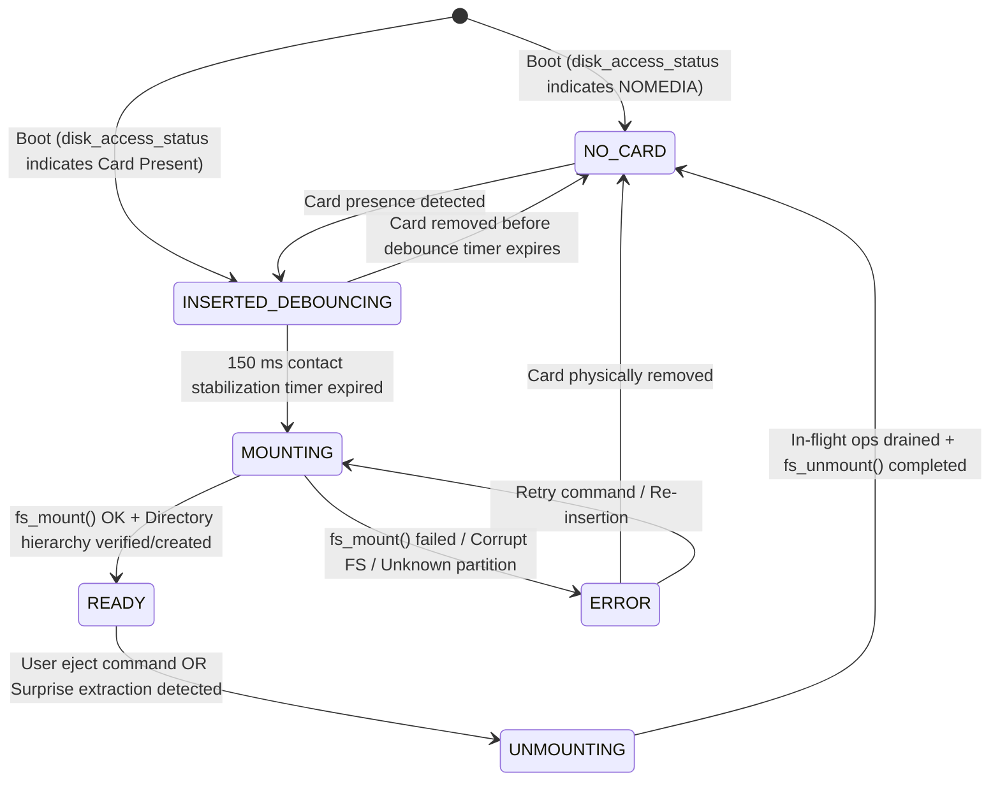

# Architecture of the MicroSD Storage & Filesystem Subsystem

- **Status**: Technical Architecture Specification & Port Contract
- **Platform**: DAECGE BrightC Controller V3 (STM32H743ZIT6 LQFP144)
- **Peripheral**: SDMMC1 (4-bit bus mode @ up to 50 MHz, Internal DMA - IDMA)
- **Card Detect**: PG5 (`GPIO_ACTIVE_LOW`), natively handled by upstream Zephyr Disk Driver (`sdmmc_stm32.c`) via devicetree property `cd-gpios`
- **Filesystem**: ELM FatFS (FAT32 / exFAT interoperable with standard PC operating systems)
- **Architectural Pattern**: Clean Architecture (Ports & Adapters) + Active Object Coordinator (`ao_storage_sd`)

---

## 1. System Overview & Problem Statement

### 1.1 Purpose of the MicroSD Subsystem
The BrightC Controller V3 incorporates an external MicroSD slot to satisfy three critical operational needs:
1. **Embedded Web Server Static Assets**: Serving static HTML5, CSS3, JavaScript bundles (Vue/React/Vanilla), WebAssembly modules, and SVG/PNG image assets from `/SD:/www/`.
2. **Historical Telemetry Logging**: Persistent long-term logging of HVAC group control, 3-phase electrical energy, and Rev F thermodynamic models formatted as 3 distinct daily CSV files (`/SD:/history/YYYY/MM/YYYY-MM-DD_{control,energy,thermal}.csv`) per the authoritative datalogger specification ([`doc/architecture/historical_datalogger_storage_subsystem.md`](historical_datalogger_storage_subsystem.md)).
3. **System Audit Logs & Crash Diagnostics**: Retaining calendar daily rotating operational event and forensic alarm logs (`/SD:/logs/YYYY/MM/YYYY-MM-DD_{system,alarms}.log`), diagnostic traces, and non-volatile core dumps generated during kernel panics or HardFault exceptions (`/SD:/logs/crash/`).

### 1.2 The Hot-Plug Challenge & Zephyr Architectural Boundary
Unlike internal flash memory or soldered I2C EEPROMs, MicroSD cards are **removable physical media**:
- Field technicians and operators can eject or insert cards at arbitrary moments while the controller is fully powered.
- Abrupt card extraction during an active block write cycle can corrupt the File Allocation Table (FAT), invalidate directory clusters, or leave file handles in dangling states.
- Mechanical insertion generates switch bounce on Card Detect (PG5) lasting 20 ms to 100 ms.
- Real-time control loops (ADC sampling, Modbus RTU polling) must never be stalled or blocked by SD card mounting, I/O timeouts, or bus re-enumeration.

#### Zephyr Kernel Responsibilities vs. Application Subsystem Responsibilities
A critical architectural insight in Zephyr RTOS is the strict division between the **Block Disk Driver Layer** and the **Filesystem / Application Layer**:

| Feature / Responsibility | Zephyr Native Disk Driver (`sdmmc_stm32.c`) | Filesystem Adapter (`sd_fatfs_adapter.c`) | Active Object (`ao_storage_sd.c`) |
|:---|:---:|:---:|:---:|
| **Card Detect (PG5) EXTI Configuration** | **YES** (`cd-gpios` in DTS) | NO | NO |
| **ISR & Kernel Workqueue Dispatch** | **YES** (`stm32_sdmmc_cd_handler`) | NO | NO |
| **SDMMC Clock Shutdown on Ejection** | **YES** (`stm32_sdmmc_access_deinit`) | NO | NO |
| **Block-Level Status Reporting** | **YES** (`disk_access_status`) | NO (queries driver) | NO (queries adapter) |
| **VFS / FatFS Mount (`fs_mount`)** | **NO** | Delegates to `<zephyr/fs/fs.h>` | **YES** (orchestrates timing) |
| **VFS / FatFS Unmount (`fs_unmount`)** | **NO** | Delegates to `<zephyr/fs/fs.h>` | **YES** (orchestrates cleanup) |
| **Asynchronous Change Notifications** | **NO** (no callbacks in `disk_access`) | NO | **YES** (publishes to Zbus) |
| **Directory Tree Initialization** | **NO** | Exposes `mkdir`/`stat` | **YES** (`/sd/www`, `/sd/history`) |
| **In-Flight Operation Draining** | **NO** | Atomic reference tracking | **YES** (graceful timeout) |

> [!IMPORTANT]
> Because Zephyr upstream's `zephyr/drivers/disk/sdmmc_stm32.c` already claims ownership of `cd-gpios = <&gpiog 5 GPIO_ACTIVE_LOW>`, **NO duplicate hardware driver (`bsp_sd_card_detect.c`) shall be created**. Creating an independent driver on PG5 would overwrite EXTI registers, conflict with the driver's GPIO callbacks, and cause race conditions.

---

## 2. Hardware Architecture & Silicon Constraints

### 2.1 Hardware Connections (STM32H743ZIT6 LQFP144)
The MicroSD card connects to the STM32H743 via the **SDMMC1** peripheral cluster and a dedicated Card Detect GPIO:

| Signal Name | MCU Pin | Alternate Function | Description | Electrical Characteristic |
|:---|:---|:---|:---|:---|
| **SDMMC1_D0** | `PC8` | `AF12` | Bidirectional Data 0 | 4-bit bus, internal pull-up enabled |
| **SDMMC1_D1** | `PC9` | `AF12` | Bidirectional Data 1 | 4-bit bus, internal pull-up enabled |
| **SDMMC1_D2** | `PC10` | `AF12` | Bidirectional Data 2 | 4-bit bus, internal pull-up enabled |
| **SDMMC1_D3** | `PC11` | `AF12` | Bidirectional Data 3 / Card Detect (pull-up) | 4-bit bus, internal pull-up enabled |
| **SDMMC1_CK** | `PC12` | `AF12` | Clock line | High-speed push-pull, no pull-up/down |
| **SDMMC1_CMD**| `PD2` | `AF12` | Command/Response line | Open-drain/push-pull with pull-up |
| **CARD_DETECT**| `PG5` | `GPIO` (Input) | Physical MicroSD Card Detect switch | `GPIO_ACTIVE_LOW`, pull-up enabled, managed natively by Zephyr SDMMC driver |

### 2.2 Silicon Constraints: STM32H7 IDMA & D-Cache Coherency
The STM32H743 features a dual-issue Cortex-M7 core running at 480 MHz with 16 KB L1 Instruction Cache and 16 KB L1 Data Cache. The SDMMC1 peripheral has its own dedicated **Internal DMA (IDMA)** controller:

```text
 ┌─────────────────────────────────────────────────────────────┐
 │                      Cortex-M7 Core                         │
 │        L1 Data Cache (16 KB) [Write-Back / Write-Allocate]   │
 └──────────────────────────────┬──────────────────────────────┘
                                │ 64-bit AXI Bus Matrix
      ┌─────────────────────────┴────────────────────────┐
      ▼                                                  ▼
 ┌─────────────┐                                  ┌─────────────┐
 │  AXI SRAM   │ (0x24000000 - 512 KB)            │  DTCM RAM   │ (0x20000000 - 128 KB)
 │ DMA-Capable │ <──────────────────────────┐     │ Core ONLY!  │
 └─────────────┘                            │     │ NO DMA ACC! │
                                            │     └─────────────┘
                                     IDMA Transfers
                                            │
                                  ┌─────────┴─────────┐
                                  │  SDMMC1 Master    │
                                  │  IDMA Controller  │
                                  └─────────┬─────────┘
                                            ▼
                                     MicroSD Card
```

> [!CAUTION]
> **Critical Silicon Constraints**:
> 1. **DTCM Inaccessibility**: The SDMMC1 IDMA master **CANNOT** access DTCM (`0x20000000`). Passing buffers located on the stack (which might reside in DTCM) or heap allocated in DTCM directly to SDMMC DMA causes an unrecoverable BusFault.
> 2. **D-Cache Line Coherency**: All I/O buffers for multi-sector DMA transfers must be aligned to **32-byte cache line boundaries** (`__aligned(32)`) and explicitly flushed (`sys_cache_data_flush_range`) before TX and invalidated (`sys_cache_data_inv_range`) after RX, or placed in a dedicated non-cacheable MPU section (`CONFIG_NOCACHE_MEMORY=y`). Zephyr's `sdmmc_stm32.c` automatically performs these cache operations if `idma` is enabled in Devicetree.
> 3. **Clock Generation**: The SDMMC kernel clock uses `HSI48` or `PLL1Q` via the RCC clock tree (`STM32_SRC_HSI48 SDMMC_SEL(2)`), divided to ensure card identification at ≤ 400 kHz and high-speed data transfer at ≤ 50 MHz.

---

## 3. Clean Architecture Layering & Taxonomy

Adhering strictly to `doc/STRUCTURE.md` and the Principal Architect taxonomy, the storage subsystem divides all responsibilities across clearly defined layers:

```text
 ┌─────────────────────────────────────────────────────────────────────────────┐
 │                         PRESENTATION LAYER                                  │
 │   - Web Server HTTP Handlers (stream static files from /sd/www/)            │
 │   - Zephyr Shell Commands (sd status, sd eject, sd mount, ls, df)           │
 └──────────────────────────────────────┬──────────────────────────────────────┘
                                        │ Calls Use Cases / Application
                                        ▼
 ┌─────────────────────────────────────────────────────────────────────────────┐
 │                         APPLICATION LAYER                                   │
 │   - Active Object Coordinator: ao_storage_sd.c                              │
 │       * Dedicated thread & event queue (k_msgq)                             │
 │       * Polls/monitors card presence via i_storage_fs_is_card_present()     │
 │       * Enforces 150 ms electrical debounce delay on insertion             │
 │       * Orchestrates fs_mount() and fs_unmount() lifecycle                 │
 │       * Auto-provisions directory tree (/sd/www, /sd/history, /sd/logs)     │
 │       * Drains in-flight operations before unmount                          │
 │   - Use Cases:                                                              │
 │       * uc_telemetry_logger (time-series serialization and batch write)     │
 │       * uc_system_audit_logger (event and crash dump recorder)              │
 │       * uc_web_asset_provider (safe URI-to-path resolution & streaming)     │
 │   - Event Bus: Zbus channel chan_storage_sd_status                          │
 └───────────────────┬─────────────────────────────────────────┬───────────────┘
                     │                                         │
                     ▼                                         ▼
 ┌─────────────────────────────────────┐   ┌───────────────────────────────────┐
 │            DOMAIN LAYER             │   │        PORTS / INTERFACES         │
 │   - sd_lifecycle_fsm                │   │   - i_storage_fs.h (Fat pointer)  │
 │     (Pure State Machine logic)      │   │   - storage_fs_types.h            │
 │   - telemetry_log_formatter         │   │     (Stat, Dirent, VolumeInfo,    │
 │   - log_rotation_policy             │   │      OpenFlags, SeekOrigin)       │
 │   - web_path_sanitizer              │   │   *ZERO Zephyr / HW headers*      │
 └─────────────────────────────────────┘   └─────────────────▲─────────────────┘
                                                             │
                                                             │ Implements
                                                             │
 ┌───────────────────────────────────────────────────────────┴─────────────────┐
 │                     INFRASTRUCTURE LAYER (ADAPTERS & DRIVERS)               │
 │   - Zephyr Virtual Filesystem Adapter: sd_fatfs_adapter.c                   │
 │       * Implements i_storage_fs_api_t contract                              │
 │       * Wraps Zephyr VFS (<zephyr/fs/fs.h>) & ELM FatFS                     │
 │       * is_card_present() delegates to disk_access_status("SD")             │
 │       * Manages atomic in_flight_ops counter for surprise removal safety    │
 │   - Upstream Zephyr Disk Driver: zephyr/drivers/disk/sdmmc_stm32.c          │
 │       * Natively manages PG5 via cd-gpios = <&gpiog 5 GPIO_ACTIVE_LOW>      │
 │       * Handles EXTI edge interrupt & workqueue (stm32_sdmmc_cd_handler)    │
 │       * Disengages SDMMC clock and transitions disk status to NOMEDIA       │
 └──────────────────────────────────────┬──────────────────────────────────────┘
                                        │ Hardware Control
                                        ▼
 ┌─────────────────────────────────────────────────────────────────────────────┐
 │                   HARDWARE & DEVICETREE (DTS / Overlays)                    │
 │   - boards/daecge/brightc-controllerv3/brightc-controllerv3.dts (&sdmmc1)   │
 └─────────────────────────────────────────────────────────────────────────────┘
```

### 3.1 The Golden Invariant
- **Strict Decoupling**: `i_storage_fs.h`, `storage_fs_types.h`, `telemetry_log_formatter`, `log_rotation_policy`, and `sd_lifecycle_fsm` **NEVER** include `<zephyr/...>` or manufacturer headers (`stm32*.h`).
- **Domain Independence**: Domain use cases operate purely on the `i_storage_fs_t` fat pointer interface. They have zero knowledge of whether the backing store is Zephyr FATFS, POSIX `stdio`, or an in-memory test fake.

### 3.2 Hardware Abstraction Rationale: Elimination of `bsp_sd_card_detect.c`
In early preliminary designs, a standalone driver `bsp_sd_card_detect.c` was contemplated to monitor pin PG5. A deep-dive into upstream Zephyr source (`zephyr/drivers/disk/sdmmc_stm32.c`) revealed that Zephyr already provides native, end-to-end management of `cd-gpios`:

1. **Native Devicetree Binding**:
   When `cd-gpios = <&gpiog 5 GPIO_ACTIVE_LOW>;` is specified under `&sdmmc1`, the Zephyr driver's `stm32_sdmmc_card_detect_init()` function automatically:
   - Configures the GPIO pin as input with internal pull-up.
   - Configures the interrupt on both edges (`GPIO_INT_EDGE_BOTH`).
   - Registers `stm32_sdmmc_cd_callback` on the GPIO controller.
2. **Conflict Prevention**:
   Creating a second, independent driver on PG5 would call `gpio_pin_interrupt_configure_dt()` or `gpio_pin_configure_dt()`, overwriting the EXTI configuration or colliding with Zephyr's internal interrupt dispatch table.
3. **Automated Bus Deinitialization**:
   When the card is physically removed, Zephyr's `stm32_sdmmc_cd_handler` executes on the kernel system workqueue:
   ```c
   /* From zephyr/drivers/disk/sdmmc_stm32.c */
   static void stm32_sdmmc_cd_handler(struct k_work *item)
   {
       struct stm32_sdmmc_priv *priv = CONTAINER_OF(item, struct stm32_sdmmc_priv, work);

       if (stm32_sdmmc_card_present(priv)) {
           LOG_DBG("card inserted");
           priv->status = DISK_STATUS_UNINIT;
       } else {
           LOG_DBG("card removed");
           stm32_sdmmc_access_deinit(priv);
           priv->status = DISK_STATUS_NOMEDIA;
       }
   }
   ```
4. **The Missing Functional Gap**:
   While `sdmmc_stm32.c` reliably manages physical bus power and block status, **Zephyr does NOT provide**:
   - Automated mounting or unmounting of the filesystem (`fs_mount()` / `fs_unmount()`).
   - Asynchronous callback hooks in `disk_access.h` to alert application code of media arrival or departure.
   - Directory structure verification (`/sd/www`, `/sd/history`, `/sd/logs`).
   - In-flight operation reference counting to prevent memory faults during surprise extraction.
   - Zbus event publication.

Therefore, eliminating `bsp_sd_card_detect.c` avoids duplicate hardware code, while the Active Object `ao_storage_sd.c` provides the higher-level orchestration required by the application.

---

## 4. Port Interface Contract: `i_storage_fs.h`

The interface follows the project's standard 3-tier contract:
1. **V-Table (`i_storage_fs_api_t`)**: Function pointer signatures.
2. **Handle (`i_storage_fs_t`)**: Fat pointer pairing `const i_storage_fs_api_t *api` with `void *impl`.
3. **Validated Wrappers (`static inline i_storage_fs_*`)**: Defensive argument checking returning negative `errno` on failure.

### 4.1 Interface Specification

```c
typedef struct {
    /* Volume Operations */
    int (*mount)(void *impl);
    int (*unmount)(void *impl);
    bool (*is_mounted)(void *impl);
    bool (*is_card_present)(void *impl);
    int (*get_volume_info)(void *impl, fs_volume_info_t *out_info);

    /* File Operations */
    int (*file_open)(void *impl, fs_file_t *out_file, const char *path, uint32_t flags);
    int (*file_close)(void *impl, fs_file_t file);
    int (*file_read)(void *impl, fs_file_t file, void *buf, size_t count, size_t *out_bytes_read);
    int (*file_write)(void *impl, fs_file_t file, const void *buf, size_t count, size_t *out_bytes_written);
    int (*file_seek)(void *impl, fs_file_t file, int64_t offset, fs_seek_origin_t origin);
    int (*file_tell)(void *impl, fs_file_t file, int64_t *out_offset);
    int (*file_sync)(void *impl, fs_file_t file);
    int (*file_truncate)(void *impl, fs_file_t file, int64_t length);

    /* Directory & Path Operations */
    int (*dir_open)(void *impl, fs_dir_t *out_dir, const char *path);
    int (*dir_read)(void *impl, fs_dir_t dir, fs_dirent_t *out_entry);
    int (*dir_close)(void *impl, fs_dir_t dir);
    int (*mkdir)(void *impl, const char *path);
    int (*unlink)(void *impl, const char *path);
    int (*rename)(void *impl, const char *old_path, const char *new_path);
    int (*stat)(void *impl, const char *path, fs_stat_t *out_stat);
} i_storage_fs_api_t;
```

### 4.2 Review of Port Types & zephyr Integration
Reviewing `app/include/common/storage_fs_types.h` and `app/include/interfaces/i_storage_fs.h`:
- **`is_card_present` Mapping**: In `sd_fatfs_adapter.c`, `is_card_present` is implemented simply as:
  ```c
  static bool sd_fatfs_adapter_is_card_present(void *impl)
  {
      (void)impl;
      /* Query upstream disk driver directly */
      int status = disk_access_status("SD");
      if (status < 0) {
          return false;
      }
      return ((status & DISK_STATUS_NOMEDIA) == 0);
  }
  ```
- **Port Stability**: No modifications are necessary in `storage_fs_types.h` or `i_storage_fs.h`. The interface abstractly models all filesystem operations, preserves the Golden Invariant, and maps 1-to-1 onto Zephyr's Disk and VFS subsystems.

---

## 5. Concurrency, Hot-Plug & State Machine

### 5.1 Card Detect & Event Propagation Flow
The interaction between physical hardware, the Zephyr kernel driver, the `sd_fatfs_adapter`, and the `ao_storage_sd` Active Object follows a dual-stage architecture:

```text
 ┌─────────────────────────────────────────────────────────────────────────────┐
 │ STAGE 1: HARDWARE & KERNEL DISK DRIVER LEVEL (zephyr/drivers/disk/sdmmc_stm32.c) │
 └─────────────────────────────────────────────────────────────────────────────┘
  Physical MicroSD Slot (PG5 Pin Edge)
        │
        ▼ (EXTI GPIO Edge Interrupt - configured by Zephyr Driver)
  stm32_sdmmc_cd_callback()
        │
        ▼ k_work_submit(&priv->work)
  Zephyr System Workqueue
        │
        ▼
  stm32_sdmmc_cd_handler()
        ├── Card Inserted: priv->status = DISK_STATUS_UNINIT
        └── Card Removed:  stm32_sdmmc_access_deinit() -> priv->status = DISK_STATUS_NOMEDIA

 ┌─────────────────────────────────────────────────────────────────────────────┐
 │ STAGE 2: APPLICATION & ACTIVE OBJECT LEVEL (ao_storage_sd.c & adapter)      │
 └─────────────────────────────────────────────────────────────────────────────┘
  Detection Source:
    • Option A: Secondary non-intrusive gpio_callback on PG5 (no pin reconfig)
    • Option B: Periodic status check (250 ms) or event poll of disk_access_status("SD")
        │
        ▼
  ao_storage_sd Active Object Loop / Workqueue
        │
        ├── Transition: NO_CARD -> INSERTED_DEBOUNCING
        │     Start 150 ms software stabilization timer (let VDD & contacts settle)
        │
        ├── Timer Expired (Still Present? i_storage_fs_is_card_present == true)
        │     Transition: INSERTED_DEBOUNCING -> MOUNTING
        │     Call i_storage_fs_mount() -> invokes fs_mount(&mp)
        │     On Success:
        │       Validate/Create directory tree (/sd/www, /sd/history, /sd/logs)
        │       Transition -> READY
        │       Publish Zbus: chan_storage_sd_status (READY, is_mounted=true)
        │     On Failure:
        │       Transition -> ERROR
        │       Publish Zbus: chan_storage_sd_status (ERROR, is_mounted=false)
        │
        └── Ejection Detected (i_storage_fs_is_card_present == false):
              Transition -> UNMOUNTING
              Invalidate adapter mount flag (reject new I/O with -ENODEV)
              Wait for in_flight_ops == 0 (with 100 ms safety timeout)
              Call i_storage_fs_unmount() -> invokes fs_unmount(&mp)
              Transition -> NO_CARD
              Publish Zbus: chan_storage_sd_status (NO_CARD, is_mounted=false)
```

### 5.2 MicroSD Lifecycle Finite State Machine (FSM)



### 5.3 State Descriptions & Transition Guard Rules

1. **`SD_CARD_STATE_NO_CARD`**:
   - Card is physically absent or `disk_access_status("SD") & DISK_STATUS_NOMEDIA` is true.
   - Any consumer attempting `i_storage_fs_file_open()` immediately receives `-ENODEV`.
   - Zbus announces `is_mounted = false`.
2. **`SD_CARD_STATE_INSERTED_DEBOUNCING`**:
   - Card insertion detected.
   - Active Object runs a 150 ms stabilization timer to ensure $V_{DD}$ ramp-up and contact settling before initiating SD bus command sequences (CMD0, CMD8, ACMD41).
3. **`SD_CARD_STATE_MOUNTING`**:
   - Calls `i_storage_fs_mount()` which executes Zephyr `fs_mount(&mp)`.
   - On success, verifies and creates standard directories (`/sd/www`, `/sd/history`, `/sd/logs`, `/sd/config`).
   - Populates volume metrics (total bytes, free bytes).
   - On success: transitions to `READY`. On failure: transitions to `ERROR`.
4. **`SD_CARD_STATE_READY`**:
   - Filesystem is mounted and validated. Read/write access enabled.
   - All I/O operations increment `in_flight_ops`.
5. **`SD_CARD_STATE_UNMOUNTING`**:
   - Triggered either gracefully (CLI `sd eject`) or reactively upon card extraction.
   - Sets internal mount state to `false` (immediate `-ENODEV` for new requests).
   - Drains active file operations (`in_flight_ops == 0` or 100 ms timeout).
   - Executes `fs_unmount()` to release Zephyr FatFS structures and sync caches.
6. **`SD_CARD_STATE_ERROR`**:
   - Card unformatted, unsupported format (e.g., NTFS), or bus communication fault.
   - Broadcasts failure over Zbus; status indicator LED reports error pattern.

### 5.4 Concurrency & Surprise Removal Protection
To guarantee deterministic execution and avoid kernel panics or deadlock when a card is abruptly extracted during high-speed logging:
- **Reference Counting (`atomic_t in_flight_ops`)**:
  - Every file open, read, write, or sync operation acquires an atomic reference:
    ```c
    if (!atomic_get(&adapter->mounted)) {
        return -ENODEV;
    }
    atomic_inc(&adapter->in_flight_ops);
    /* perform filesystem operation */
    atomic_dec(&adapter->in_flight_ops);
    ```
- **Surprise Removal Synchronization**:
  - When card extraction occurs, Zephyr's `sdmmc_stm32.c` automatically deinitializes the SDMMC peripheral (`stm32_sdmmc_access_deinit`), causing pending IDMA transfers to fail immediately with `-EIO`.
  - Active threads receive `-EIO` and release their `in_flight_ops` reference.
  - The `ao_storage_sd` active object waits for `in_flight_ops == 0` (with a 100 ms timeout guard) before executing `fs_unmount(&adapter->mp)` to safely deallocate Zephyr VFS mount structures.

---

## 6. Zbus Event Publication: `chan_storage_sd_status`

The storage active object announces all state changes via Zephyr Zbus:

### 6.1 Channel Declaration
```c
/* In application/zbus/storage_channels.h */
ZBUS_CHAN_DECLARE(chan_storage_sd_status);
```

### 6.2 Channel Payload (`sd_status_event_t`)
```c
typedef struct {
    sd_card_state_t state;               /**< State machine status enum */
    bool            is_mounted;          /**< Mount flag */
    bool            is_write_protected;  /**< Write-protection switch status */
    int32_t         last_error;          /**< 0 on success, negative errno on error */
    uint64_t        total_bytes;         /**< Total capacity in bytes */
    uint64_t        free_bytes;          /**< Remaining free capacity in bytes */
} sd_status_event_t;
```

### 6.3 Subsystem Integration Matrix
- **`ao_system_indicator`**:
  - Subscribes to `chan_storage_sd_status`.
  - Updates the SD Card indicator LED:
    - Off: `SD_CARD_STATE_NO_CARD`
    - Solid Green: `SD_CARD_STATE_READY`
    - Fast Blinking Amber: `SD_CARD_STATE_ERROR` or `INSERTED_DEBOUNCING`
    - Brief Green Pulse: Active I/O operation.
- **`uc_telemetry_logger`**:
  - If card is unmounted, spools telemetry records in a circular RAM buffer (up to 256 KB in AXI SRAM).
  - When card transitions to `READY`, flushes RAM backlog to daily log file.
- **`uc_web_asset_provider`**:
  - When card is `READY`, serves static assets from `/sd/www/`.
  - If card is removed, serves a lightweight embedded fallback page ("Maintenance Mode / SD Unmounted") stored in internal flash ROM.

---

## 7. Filesystem Choice & Zephyr Configuration

### 7.1 FATFS (ELM FatFS) vs LittleFS Justification

| Architectural Criteria | FATFS (ELM Chan FatFS) | LittleFS | Subsystem Decision & Justification |
|:---|:---|:---|:---|
| **PC Interoperability** | **Native** (Windows, macOS, Linux natively mount FAT32/exFAT). | **None** (Requires custom FUSE drivers or proprietary CLI extractors). | **FATFS is mandatory**. Technicians must be able to remove the card and insert it into a standard PC to read CSV logs or update web assets without installing software. |
| **High Throughput (IDMA)** | **Very High** (Up to 25 MB/s with SDMMC 4-bit multi-block IDMA). | **Moderate** (Optimized for small block SPI NOR, high metadata overhead). | **FATFS is superior** for streaming large web assets and writing massive batch telemetry. |
| **Wear Leveling Overhead** | Relies on SD card's internal Flash Translation Layer (FTL). | Software wear-leveling in RAM/flash. | SD cards already possess internal wear-leveling controllers. Software wear-leveling in LittleFS adds redundant CPU/RAM overhead. |
| **Power-Fail Resilience** | Sensitive to FAT corruption without safe unmount / sync. | Ultra-resilient (COW copy-on-write architecture). | Mitigated in FATFS by periodic `f_sync()`, ping-pong log files, and atomic in-flight draining. |

### 7.2 Zephyr Kconfig Requirements

In `app/prj.conf` (or `boards/brightc-controllerv3.conf`):

```ini
# ---- Disk & SDMMC Subsystem ----
CONFIG_DISK_ACCESS=y
CONFIG_DISK_ACCESS_SDMMC=y
CONFIG_SDMMC_STM32=y

# ---- File System Layer ----
CONFIG_FILE_SYSTEM=y
CONFIG_FAT_FILESYSTEM_ELM=y
CONFIG_FS_FATFS_LFN=y
CONFIG_FS_FATFS_LFN_MODE_STACK=y
CONFIG_FS_FATFS_MAX_LFN=255
CONFIG_FS_FATFS_NUM_FILES=8
CONFIG_FS_FATFS_NUM_DIRS=4
CONFIG_FS_FATFS_EXFAT=y

# ---- STM32H7 Cache & DMA Safety ----
CONFIG_NOCACHE_MEMORY=y
CONFIG_CPU_HAS_DCACHE=y

# ---- Zbus Notification ----
CONFIG_ZBUS=y
```

### 7.3 Devicetree Configuration (`brightc-controllerv3.dts`)

The board devicetree configures `&sdmmc1` including the native card detect GPIO:

```dts
&sdmmc1 {
    pinctrl-0 = <&sdmmc1_d0_pc8 &sdmmc1_d1_pc9
                 &sdmmc1_d2_pc10 &sdmmc1_d3_pc11
                 &sdmmc1_ck_pc12 &sdmmc1_cmd_pd2>;
    pinctrl-names = "default";
    clocks = <&rcc STM32_CLOCK(AHB3, 16)>,
             <&rcc STM32_SRC_HSI48 SDMMC_SEL(2)>;
    cd-gpios = <&gpiog 5 GPIO_ACTIVE_LOW>;
    disk-name = "SD";
    bus-width = <4>;
    clk-div = <4>;
    idma;
    status = "okay";
};
```

When `cd-gpios` is defined, `zephyr/drivers/disk/sdmmc_stm32.c` automatically configures PG5 interrupt and executes internal power-down upon removal.

---

## 8. Standard Directory Layout on MicroSD

When a newly formatted card is inserted, `ao_storage_sd` validates and initializes the directory structure under mount point `/SD:` (refer to [`doc/architecture/historical_datalogger_storage_subsystem.md`](historical_datalogger_storage_subsystem.md) for full telemetry and log stream specifications):

```text
/SD:/
├── brightc.id                   # Plaintext file containing Controller Model & Hardware UUID
├── www/                         # Embedded Web Server Root
│   ├── index.html               # Main Single Page App (SPA) dashboard
│   ├── css/
│   │   └── app.min.css          # Compressed stylesheets
│   ├── js/
│   │   ├── app.min.js           # Frontend logic
│   │   └── uPlot.iife.min.js    # Ultra-fast micro-charting engine for client-side CSV parsing
│   └── assets/
│       └── logo.svg             # Graphic assets
├── history/                     # Granular Telemetry Time-Series Data (Separation of Concerns)
│   └── YYYY/
│       └── MM/
│           ├── YYYY-MM-DD_control.csv    # HVAC Group Control & Units (~85 B/line, 10m + event triggers)
│           ├── YYYY-MM-DD_energy.csv     # Electrical Energy Meter JSY-MK-339 (~75 B/line, 10m periodic)
│           └── YYYY-MM-DD_thermal.csv    # Thermodynamic Model Rev F (~90 B/line, 10m + anomaly triggers)
├── logs/                        # Calendar Daily Rotating Operational & Forensic Logs
│   └── YYYY/
│       └── MM/
│           ├── YYYY-MM-DD_system.log     # System events, network status, FSM state changes
│           ├── YYYY-MM-DD_alarms.log     # Alarm transitions, trips, clears, and ACKs
│           └── crash/                    # Non-volatile crash and HardFault exception dumps
│               └── crash_YYYYMMDD_HHMMSS.dump
└── config/                      # Offline Backups & Parameter Snapshots
    └── backup_eeprom.bin        # Manual or scheduled mirror of EEPROM microconf tables
```

> [!TIP]
> Segregating telemetry into 3 distinct daily CSV files and 2 daily log streams minimizes file transfer sizes (<25 KB each), eliminates concurrency bottlenecks between fast discrete events and slow thermodynamic models, and allows zero-copy HTTP streaming from MicroSD to web browsers with zero CPU parsing overhead on the STM32H743.

---

## 9. Testability & Step-by-Step TDD Implementation Plan

### 9.1 Host & `native_sim` Unit Testing Strategy
Because `i_storage_fs.h` is a pure interface with zero hardware or Zephyr dependencies:
1. **`fake_storage_fs.c` (In-Memory Fake)**:
   - Implements `i_storage_fs_api_t` using an in-memory virtual RAM filesystem.
   - Allows fault injection:
     - `fake_storage_fs_set_disk_full(true)` -> triggers `-ENOSPC`.
     - `fake_storage_fs_simulate_card_eject()` -> triggers `-ENODEV`.
     - `fake_storage_fs_corrupt_next_read(true)` -> triggers `-EIO`.
2. **POSIX File Adapter (`posix_storage_fs.c`)**:
   - Optional adapter wrapping standard C `fopen`, `fread`, `fwrite`, `mkdir` under `/tmp/brightc_test/` for testing log rotation and telemetry serialization on Linux host runner.

### 9.2 Step-by-Step TDD Roadmap for `firmware-dev`

```text
 Phase 1: Pure Domain Contracts & Fakes (Host TDD)
   ├── Step 1.1: Verify storage_fs_types.h and i_storage_fs.h compilation on host.
   ├── Step 1.2: Implement tests/fakes/fake_storage_fs.c & fake_storage_fs.h.
   ├── Step 1.3: Write unit tests in tests/unit/domain/test_sd_lifecycle_sm.c.
   └── Step 1.4: Implement app/src/domain/sm/sd_lifecycle_sm.c (FSM state transitions).

 Phase 2: Use Cases & Safe Path Resolution (Host TDD)
   ├── Step 2.1: Write unit tests for web asset path sanitizer (prevent directory traversal ../).
   ├── Step 2.2: Implement app/src/application/use_cases/uc_web_asset_provider.c.
   ├── Step 2.3: Write unit tests for telemetry logger rotation (test max file size & day boundary).
   └── Step 2.4: Implement app/src/application/use_cases/uc_telemetry_logger.c.

 Phase 3: Infrastructure Adapter & Active Object (Zephyr native_sim & Target STM32)
   ├── Step 3.1: Implement app/src/infrastructure/adapters/sd_fatfs_adapter.c (<zephyr/fs/fs.h> wrapper).
   │             - Binds i_storage_fs_api_t to Zephyr VFS.
   │             - is_card_present() delegates to (disk_access_status("SD") & DISK_STATUS_NOMEDIA) == 0.
   │             - Implements atomic in_flight_ops reference tracking for surprise extraction safety.
   ├── Step 3.2: Implement Active Object app/src/application/active_objects/ao_storage_sd.c.
   │             - Dedicated thread & k_msgq event queue.
   │             - Debounce delay (150 ms) after card presence detection.
   │             - Orchestrates fs_mount / fs_unmount calls.
   │             - Automatically provisions /sd/www, /sd/history, /sd/logs directories on initial mount.
   │             - Drains in_flight_ops on card ejection before unmounting.
   ├── Step 3.3: Register Zbus channel chan_storage_sd_status in app/src/application/zbus/storage_channels.c.
   └── Step 3.4: Write integration test verifying ao_storage_sd, sd_fatfs_adapter, and fake disk interaction.

 Phase 4: Integration, Shell & HIL Verification
   ├── Step 4.1: Implement Zephyr Shell commands (sd mount, sd eject, sd status, ls, df).
   ├── Step 4.2: Wire Dependency Injection in app/src/infrastructure/di/composition_root.c.
   └── Step 4.3: HIL test card insertion, hot removal during write, and format verification on physical hardware.
```
