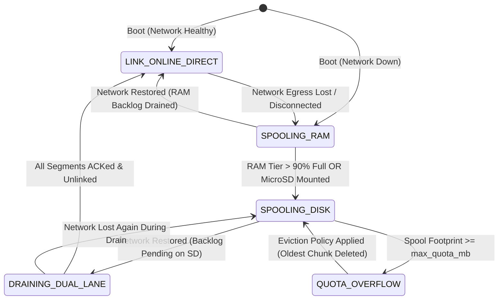

# Architecture of the Telemetry Store & Forward Engine (Store & Forward Subsystem)

- **Status**: Technical Architecture Specification & Port Contract
- **Platform**: DAECGE BrightC Controller V3 (STM32H743ZIT6, Cortex-M7 @ 480 MHz)
- **Physical Medium**: MicroSD via SDMMC1 (ELM FatFS) & AXI SRAM (In-Memory Fast Tier)
- **Upstream Transports**: MQTT Client (QoS 1), HTTP REST Telemetry Client, Cloud IoT (AWS/Azure)
- **Architectural Pattern**: Clean Architecture (Ports & Adapters) + Active Object Coordinator (`ao_telemetry_spool`)
- **Language**: English (per project convention)

---

## 1. Executive Summary & Problem Statement

### 1.1 The Operational Problem in Edge Telemetry
The BrightC Controller V3 continuously samples high-frequency industrial sensors: 16-channel RTDs, electrical energy parameters from the JSY-MK-339, compressor operational states, and thermal efficiency metrics (Revision F). 

When upstream push protocols (e.g. MQTT or HTTP REST) are enabled:
1. **Network Outages are Inevitable**: WAN outages, Wi-Fi interference, cellular disconnects, or upstream cloud maintenance will interrupt egress connectivity for minutes, hours, or days.
2. **RAM is Finite**: Even with the STM32H743's 1 MB SRAM (512 KB AXI SRAM), buffering high-frequency time-series data solely in RAM causes buffer overflow within a few hours.
3. **Data Gaps are Unacceptable**: Regulated data centers, cold chain facilities, and telecom power rooms require unbroken historical audit records for SLA compliance, fault correlation, and energy billing.

### 1.2 What the Store & Forward Engine Solves
The **Store & Forward Engine** is a transactional, persistent queuing subsystem designed to:
- Intercept telemetry messages when the network connection is degraded or down.
- Persist messages into a bounded, segmented, power-fail resilient FIFO queue on the MicroSD card (with RAM ring-buffer tiering).
- Coordinate a controlled, rate-limited draining process once the network link is restored, ensuring that **real-time live telemetry is never blocked by historical replay**.
- Ensure **idempotency and zero data loss** through sequence numbers and broker ACK confirmations.

### 1.3 Boundary Distinction: Data Logging vs. Store & Forward
To prevent architectural confusion, the system explicitly separates local data logging from network store & forward:

| Functional Aspect | Local Data Logger (`sd_card_filesystem_subsystem.md`) | Store & Forward Engine (This Document) |
|:---|:---|:---|
| **Primary Target** | Local human technicians, offline forensic analysis, Excel auditing. | Remote IoT Cloud, MQTT Broker, SCADA/DCIM Telemetry Endpoint. |
| **Data Format** | Daily rotating CSV text files (`/sd/history/YYYY/MM/DD_sensors.csv`). | Framed compact binary / CBOR spool segments (`/sd/spool/chunk_XXXXX.bin`). |
| **Consumption Model** | Passive / File download (Web server, physical card extraction). | Active / Autonomous streaming with broker ACK tracking. |
| **Retention Policy** | Calendar-based rotation (deleted when disk space drops below threshold). | **Transactional deletion**: records are purged immediately upon confirmed upstream server ACK. |

---

## 2. Architectural Principles & Design Decisions (Closed)

| # | Decision | Technical Justification |
|---|----------|-------------------------|
| **D1** | **Dual-Lane Priority (Live Stream vs. Spool Drain)** | Live current telemetry must **never** wait behind gigabytes of accumulated historical backlog. When the network returns, live samples flow through **Lane 1 (Priority)**, while backlogged data drains through **Lane 2 (Background Rate-Limited)**. |
| **D2** | **Two-Tier Storage Hierarchy (RAM Buffer $\rightarrow$ MicroSD Spool)** | Network outages spanning hours or days (depending on the configured reporting interval: 1 min, 5 min, 15 min) are absorbed entirely by a fast 128 KB AXI SRAM ring buffer without touching physical flash memory. Long-term outages exceeding RAM capacity seamlessly roll over to MicroSD disk spooling. |
| **D3** | **Rolling Segment Architecture (`chunk_XXXXX.bin`)** | Avoids a single massive multi-gigabyte file. Spool data is partitioned into fixed-size chunks (e.g. 2 MB - 4 MB). Once all records in a chunk receive broker ACK, the chunk is unlinked via `i_storage_fs_unlink()`, eliminating fragmentation and seek overhead. |
| **D4** | **Pre-Serialized Compact Binary Framing** | Spool records are stored in network-ready binary format (CBOR or framed structs) with a 16-byte header containing sequence ID, timestamp, and CRC16. Upon retransmission, records are read directly from disk to network buffers with **zero CPU parsing or string conversion**. |
| **D5** | **Atomic Metadata State (`spool.meta`)** | Head (write), Tail (read), and Committed (ACKed) indices are tracked in an atomic double-buffered metadata record. Unexpected power cuts never corrupt queue topology. |
| **D6** | **Congestion Control & Rate-Limited Draining** | Prevents network floods upon reconnection. Draining rate is governed by a token-bucket algorithm (e.g. max 20 msgs/sec or 50 KB/sec), dynamically backing off if socket buffers return `-EAGAIN` or broker disconnects. |
| **D7** | **Zero Dynamic Allocation & MPU Compliance** | In accordance with project governance, all spool queues, ring buffers, active object stacks, and file descriptors are statically allocated by value inside container structures. |

---

## 3. Layered Clean Architecture & Data Flow

```text
 ┌─────────────────────────────────────────────────────────────────────────────┐
 │                         DOMAIN TELEMETRY PRODUCERS                          │
 │  - Mathematical Model Engine (Revision F)   - JSY-MK-339 Energy Metrics     │
 │  - Sensor Matrix Mapper (RTDs / Analogs)    - System Health & Alarms        │
 └──────────────────────────────────────┬──────────────────────────────────────┘
                                        │ Zbus: chan_telemetry_stream
                                        ▼
 ┌─────────────────────────────────────────────────────────────────────────────┐
 │             STORE & FORWARD ACTIVE OBJECT (ao_telemetry_spool.c)            │
 │                                                                             │
 │  ┌───────────────────────────────────────────────────────────────────────┐  │
 │  │ 1. ROUTING & LINK EVALUATION (Inspects chan_network_eth / wifi)        │  │
 │  │    - Network ONLINE & Healthy ──▶ Route to Lane 1: LIVE EGRESS         │  │
 │  │    - Network OFFLINE / Dropping ──▶ Route to Lane 2: SPOOL STORAGE    │  │
 │  └───────────────────────────────────┬───────────────────────────────────┘  │
 │                                      ▼                                      │
 │  ┌───────────────────────────────────────────────────────────────────────┐  │
 │  │ 2. TWO-TIER QUEUE COORDINATOR                                          │  │
 │  │    [ Tier 1: AXI SRAM Fast Ring Buffer (128 KB) ]                      │  │
 │  │       │ (If full or SD card available)                                 │  │
 │  │       ▼                                                                │  │
 │  │    [ Tier 2: Persistent MicroSD Spool Manager (/sd/spool/) ]          │  │
 │  │       * chunk_00001.bin, chunk_00002.bin ... (2 MB segments)           │  │
 │  │       * spool.meta (Atomic Ping-Pong Metadata tracking pointers)       │  │
 │  │       * Enforces Max Quota (e.g. 4 GB max, FIFO drop-oldest)           │  │
 │  └───────────────────────────────────┬───────────────────────────────────┘  │
 │                                      │ On Network Reconnection              │
 │                                      ▼                                      │
 │  ┌───────────────────────────────────────────────────────────────────────┐  │
 │  │ 3. RATE-LIMITED BACKLOG FLUSHER (Leaky / Token Bucket Engine)         │  │
 │  │    - Interleaves 1 live frame for every N backlog frames               │  │
 │  │    - Bounded throughput (e.g. 25 msgs/sec) to prevent socket choke     │  │
 │  │    - Advances 'Committed' pointer ONLY on MQTT PUBACK / HTTP 200 OK   │  │
 │  └───────────────────────────────────────────────────────────────────────┘  │
 └───────────────────┬─────────────────────────────────────────┬───────────────┘
                     │                                         │
                     ▼ (Consumes Port Contract)                ▼ (Uses Port Contract)
 ┌─────────────────────────────────────┐   ┌───────────────────────────────────┐
 │       PORT: i_telemetry_spool.h     │   │      PORT: i_storage_fs.h         │
 │   - push(), peek_batch(), ack()     │   │   (MicroSD FATFS file operations) │
 └───────────────────▲─────────────────┘   └─────────────────▲─────────────────┘
                     │                                       │
 ┌───────────────────┴─────────────────┐   ┌─────────────────┴─────────────────┐
 │      NETWORK EGRESS CLIENTS         │   │   INFRASTRUCTURE: ADAPTER FATFS   │
 │   - MQTT Client (QoS 1 publisher)   │   │   - sd_fatfs_adapter.c            │
 │   - HTTP REST Batch Uploader        │   │   - Low-level disk IDMA           │
 └─────────────────────────────────────┘   └───────────────────────────────────┘
```

---

## 4. Domain Data Structures & Binary Wire Format (Pure ISO C99)

File: `app/include/common/spool_types.h`

### 4.1 On-Disk Spool Record Wire Format
Every stored record begins with a fixed 16-byte header followed by the variable payload:

```text
 0                   1                   2                   3
 0 1 2 3 4 5 6 7 8 9 0 1 2 3 4 5 6 7 8 9 0 1 2 3 4 5 6 7 8 9 0 1
+-+-+-+-+-+-+-+-+-+-+-+-+-+-+-+-+-+-+-+-+-+-+-+-+-+-+-+-+-+-+-+-+
|       Magic (0x5350 'SP')     |       Domain Type Enum        |
+-+-+-+-+-+-+-+-+-+-+-+-+-+-+-+-+-+-+-+-+-+-+-+-+-+-+-+-+-+-+-+-+
|                     Monotonic Sequence ID                     |
+-+-+-+-+-+-+-+-+-+-+-+-+-+-+-+-+-+-+-+-+-+-+-+-+-+-+-+-+-+-+-+-+
|                 Epoch Timestamp (Seconds, High)               |
+-+-+-+-+-+-+-+-+-+-+-+-+-+-+-+-+-+-+-+-+-+-+-+-+-+-+-+-+-+-+-+-+
|                 Epoch Timestamp (Seconds, Low)                |
+-+-+-+-+-+-+-+-+-+-+-+-+-+-+-+-+-+-+-+-+-+-+-+-+-+-+-+-+-+-+-+-+
|       Payload Length          |            CRC-16             |
+-+-+-+-+-+-+-+-+-+-+-+-+-+-+-+-+-+-+-+-+-+-+-+-+-+-+-+-+-+-+-+-+
|                    Variable Payload Data ...                  |
+-+-+-+-+-+-+-+-+-+-+-+-+-+-+-+-+-+-+-+-+-+-+-+-+-+-+-+-+-+-+-+-+
```

```c
#ifndef APP_COMMON_SPOOL_TYPES_H_
#define APP_COMMON_SPOOL_TYPES_H_

#include <stdbool.h>
#include <stddef.h>
#include <stdint.h>

#ifdef __cplusplus
extern "C" {
#endif

#define SPOOL_RECORD_MAGIC        0x5350U /**< 'SP' in ASCII */
#define SPOOL_MAX_PAYLOAD_SIZE    1024U  /**< Max bytes per single telemetry message */
#define SPOOL_DEFAULT_SEGMENT_KB  2048U  /**< 2 MB per segment file */
#define SPOOL_DEFAULT_MAX_MB      4096U  /**< 4 GB max total spool quota */

/** Telemetry domain payload type */
typedef enum {
    SPOOL_DOMAIN_SENSORS = 0,    /**< Raw RTD and analog values */
    SPOOL_DOMAIN_ENERGY,         /**< JSY-MK-339 3-phase measurements */
    SPOOL_DOMAIN_THERMAL_MODEL,  /**< Revision F mathematical outputs */
    SPOOL_DOMAIN_ALARM_EVENT,    /**< Discrete system alarm or trip */
    SPOOL_DOMAIN_MAX
} spool_domain_type_t;

/** On-disk record header (16 bytes packed) */
typedef struct __attribute__((packed)) {
    uint16_t magic;         /**< Must match SPOOL_RECORD_MAGIC */
    uint16_t domain;        /**< spool_domain_type_t */
    uint32_t sequence_id;   /**< Monotonically increasing 32-bit counter */
    uint64_t timestamp_ms;  /**< Milliseconds epoch when captured */
    uint16_t payload_len;   /**< Length of following payload */
    uint16_t header_crc16;  /**< CRC16-CCITT of header bytes 0..13 */
} spool_record_header_t;

/** Full in-memory representation */
typedef struct {
    spool_record_header_t header;
    uint8_t payload[SPOOL_MAX_PAYLOAD_SIZE];
} spool_record_t;

/** Eviction policy when storage quota is reached */
typedef enum {
    SPOOL_EVICTION_DROP_OLDEST = 0, /**< Purge oldest segment (FIFO wrap) */
    SPOOL_EVICTION_DROP_NEWEST,     /**< Reject new incoming samples */
    SPOOL_EVICTION_HALT             /**< Stop spooling and issue critical alarm */
} spool_eviction_policy_t;

/** Persistent metadata structure tracked in /sd/spool/spool.meta */
typedef struct __attribute__((packed)) {
    uint32_t format_version;        /**< Metadata format version (1) */
    uint32_t head_segment_id;       /**< Segment currently being written */
    uint32_t head_offset;           /**< Byte offset in head segment */
    uint32_t tail_segment_id;       /**< Segment currently being drained */
    uint32_t tail_offset;           /**< Byte offset in tail segment */
    uint32_t committed_sequence_id; /**< Highest sequence acknowledged by broker */
    uint32_t total_spooled_records; /**< Cumulative lifetime records spooled */
    uint32_t total_drained_records; /**< Cumulative lifetime records drained */
    uint32_t dropped_records;       /**< Cumulative records lost to overflow */
    uint64_t total_spool_bytes;     /**< Current total bytes occupied on disk */
    uint32_t meta_crc32;            /**< CRC32 of preceding fields */
} spool_meta_t;

/** Dynamic spool configuration */
typedef struct {
    uint32_t max_quota_mb;          /**< Maximum disk space allocated in MB */
    uint32_t segment_size_kb;       /**< Target file size before rolling in KB */
    uint16_t max_drain_rate_hz;     /**< Maximum backlog records to transmit per sec */
    uint8_t  live_to_backlog_ratio; /**< Interleaving ratio (e.g. 1 live : 5 backlog) */
    spool_eviction_policy_t eviction;/**< Quota overflow strategy */
} spool_config_t;

/** Runtime statistics */
typedef struct {
    bool     is_draining;           /**< True if currently replaying backlog */
    uint32_t pending_records;       /**< Estimated records awaiting transmission */
    uint64_t pending_bytes;         /**< Current disk footprint in bytes */
    uint32_t ram_buffer_used_bytes; /**< High-speed RAM tier usage */
    uint32_t active_segments_count; /**< Number of .bin files currently on disk */
} spool_stats_t;

#ifdef __cplusplus
}
#endif

#endif /* APP_COMMON_SPOOL_TYPES_H_ */
```

---

## 5. Port Interface Contract — `i_telemetry_spool.h`

Following Section 4.1.D of `doc/STRUCTURE.md`:

```c
#ifndef APP_INTERFACES_I_TELEMETRY_SPOOL_H_
#define APP_INTERFACES_I_TELEMETRY_SPOOL_H_

#include <errno.h>
#include <stdbool.h>
#include <stddef.h>
#include <stdint.h>

#include "common/spool_types.h"

#ifdef __cplusplus
extern "C" {
#endif

/* 1. V-TABLE */
typedef struct {
    int (*init)(void *impl, const spool_config_t *cfg);
    int (*push)(void *impl, spool_domain_type_t domain, uint64_t timestamp_ms,
                const void *data, size_t len);
    int (*peek_next_batch)(void *impl, spool_record_t *out_records,
                           size_t max_count, size_t *out_count);
    int (*commit_ack)(void *impl, uint32_t sequence_id);
    int (*get_stats)(void *impl, spool_stats_t *out_stats);
    int (*flush)(void *impl);
    int (*purge_all)(void *impl);
} i_telemetry_spool_api_t;

/* 2. HANDLE */
typedef struct {
    const i_telemetry_spool_api_t *api;
    void *impl;
} i_telemetry_spool_t;

/* 3. VALIDATED WRAPPERS */
static inline bool i_telemetry_spool_is_bound(const i_telemetry_spool_t *spool)
{
    return spool != NULL && spool->api != NULL && spool->impl != NULL;
}

static inline int i_telemetry_spool_init(const i_telemetry_spool_t *spool, const spool_config_t *cfg)
{
    if (!i_telemetry_spool_is_bound(spool) || cfg == NULL) {
        return -EINVAL;
    }
    return spool->api->init(spool->impl, cfg);
}

static inline int i_telemetry_spool_push(const i_telemetry_spool_t *spool,
                                        spool_domain_type_t domain,
                                        uint64_t timestamp_ms,
                                        const void *data,
                                        size_t len)
{
    if (!i_telemetry_spool_is_bound(spool) || data == NULL || len == 0U || len > SPOOL_MAX_PAYLOAD_SIZE) {
        return -EINVAL;
    }
    return spool->api->push(spool->impl, domain, timestamp_ms, data, len);
}

static inline int i_telemetry_spool_peek_next_batch(const i_telemetry_spool_t *spool,
                                                   spool_record_t *out_records,
                                                   size_t max_count,
                                                   size_t *out_count)
{
    if (!i_telemetry_spool_is_bound(spool) || out_records == NULL || max_count == 0U || out_count == NULL) {
        return -EINVAL;
    }
    return spool->api->peek_next_batch(spool->impl, out_records, max_count, out_count);
}

static inline int i_telemetry_spool_commit_ack(const i_telemetry_spool_t *spool, uint32_t sequence_id)
{
    if (!i_telemetry_spool_is_bound(spool)) {
        return -EINVAL;
    }
    return spool->api->commit_ack(spool->impl, sequence_id);
}

static inline int i_telemetry_spool_get_stats(const i_telemetry_spool_t *spool, spool_stats_t *out_stats)
{
    if (!i_telemetry_spool_is_bound(spool) || out_stats == NULL) {
        return -EINVAL;
    }
    return spool->api->get_stats(spool->impl, out_stats);
}

#ifdef __cplusplus
}
#endif

#endif /* APP_INTERFACES_I_TELEMETRY_SPOOL_H_ */
```

---

## 6. Detailed Operational Dynamics & Finite State Machine

### 6.1 Spool Lifecycle Finite State Machine (FSM)



### 6.2 The Dual-Lane Transmission Protocol
To satisfy **Decision D1**, the egress thread (e.g. MQTT client worker) executes a dual-lane multiplexing loop:

```text
Every Transmission Cycle:
 ├── 1. Check Lane 1 (Real-time Live Telemetry Queue):
 │       IF live_msg available:
 │           Transmit live_msg immediately (Topic: "brightc/live/...")
 │           Reset interleave_counter = 0
 │
 └── 2. Check Lane 2 (Spool Backlog Draining):
         IF network link has remaining bandwidth AND interleave_counter < RATIO:
             peek_next_batch(&batch, count=10)
             Transmit batch item (Topic: "brightc/history/...")
             WAIT for PUBACK (or HTTP 200)
             commit_ack(seq_id) -> updates tail pointer & unlinks segment if exhausted
             increment interleave_counter
```

### 6.3 Segment Rotation and Transactional Deletion
1. **Writing**:
   - Telemetry records append to `/sd/spool/chunk_00042.bin`.
   - When file size exceeds `segment_size_kb` (e.g. 2 MB), the file is closed and `head_segment_id` increments to `00043`.
   - Metadata is flushed atomically: `spool.meta.new` $
ightarrow$ `fs_rename()` $
ightarrow$ `spool.meta`.
2. **Reading & Draining**:
   - The flusher opens `tail_segment_id` (`chunk_00030.bin`) at `tail_offset`.
   - Reads consecutive valid frames, checking `magic == 0x5350` and `header_crc16`.
3. **Purging (Unlinking)**:
   - When all records in `chunk_00030.bin` have received broker ACK (`committed_sequence_id >= chunk_max_sequence`):
   - The file handle is closed.
   - `i_storage_fs_unlink("/sd/spool/chunk_00030.bin")` is called immediately.
   - Physical storage clusters return to the FAT pool with zero fragmentation.

---

## 7. Power-Fail Resilience & Crash Recovery

### 7.1 The Double-Buffered Metadata Pattern
Flash corruption or power disruption during file operations is guarded by:
1. **Metadata Ping-Pong**: The directory `/sd/spool/` maintains `spool.meta` and `spool.meta.bak`. Every update alternates between them with a 32-bit CRC. On boot, the engine loads the file with the valid CRC and highest generation sequence.
2. **Crash Recovery Scan**:
   - If power is cut mid-write to a segment, the tail of the head segment might contain a truncated or incomplete frame.
   - On boot, the spool engine verifies the active segment from `head_offset`. If a corrupted frame CRC is encountered, the file is truncated to the last known valid record boundary using `i_storage_fs_file_truncate()`, preventing corrupt data from ever reaching the cloud broker.

---

## 8. Sizing, Memory Footprint & Hardware Constraints

On the STM32H743ZIT6 target:

| Resource | Allocation | Location / Section |
|:---|:---:|:---|
| **RAM Tier Fast Ring Buffer** | 128 KB | AXI SRAM (`.nocache` or standard AXI) |
| **`ao_telemetry_spool` Thread Stack**| 4096 B | Static file scope (`K_THREAD_STACK_DEFINE`) |
| **Active Object Event Queue** | 16 msgs * 32 B = 512 B | Static container RAM |
| **Segment Buffer Cache** | 2 * 2048 B = 4096 B | AXI SRAM (32-byte cache line aligned) |
| **MicroSD Disk Quota** | 1 GB to 8 GB (Configurable)| FAT32 Volume partition on SDMMC1 |

### 8.1 Autonomy & Retention Analysis (Configurable Reporting Intervals)

Telemetry transmission to the upstream broker/cloud is **not** a 1 Hz stream; rather, it is emitted at a **configurable reporting interval** ($T_{\text{interval}}$: typically 1 min, 5 min, 15 min, or higher), packing aggregated statistical frames (averages, minimums, maximums, and current values):

Assuming an average binary/CBOR framed telemetry record of **$S_{\text{rec}} \approx 256\text{ bytes}$** (up to 512 bytes with extended metadata):
- **128 KB Fast RAM Tier** holds:
  $$\text{Capacity}_{\text{RAM}} = \frac{128 \times 1024\text{ bytes}}{256\text{ bytes/record}} = 512\text{ records}$$
- **2 GB MicroSD Spool Quota** holds:
  $$\text{Capacity}_{\text{SD}} = \frac{2 \times 1024 \times 1024 \times 1024\text{ bytes}}{256\text{ bytes/record}} \approx 8,388,608\text{ records}$$

| Configured Reporting Interval ($T_{\text{interval}}$) | 128 KB Fast RAM Autonomy (No SD write) | 2 GB MicroSD Spool Autonomy |
|:---|:---:|:---:|
| **1 minute** ($T = 1\text{ min}$) | **8.5 hours** (512 minutes) | **~15.9 years** (~8.38M minutes) |
| **5 minutes** ($T = 5\text{ min}$, Default) | **42.6 hours** (~1.8 days) | **~79.7 years** |
| **15 minutes** ($T = 15\text{ min}$) | **128 hours** (~5.3 days) | **> 100 years** |
| **30 minutes** ($T = 30\text{ min}$) | **256 hours** (~10.6 days) | **> 100 years** |

Even in the most demanding scenario where records expand to **$S_{\text{rec}} \approx 512\text{ bytes}$** (or high-event bursts):
- At $T = 1\text{ min}$: The 128 KB RAM tier still absorbs **4.25 hours** of network disruption.
- At $T = 5\text{ min}$: The 128 KB RAM tier absorbs **21.3 hours** (~1 full day) completely in RAM.
- The MicroSD quota easily provides virtually unlimited persistence, ensuring that flash wear cycles are minimized while zero telemetry records are dropped.

---

## 9. Verification & Testability Strategy

### 9.1 Unit Testing on Host (`native_sim`)
Using Clean Architecture and dependency injection:
1. **Fake Storage**: Tested against `fake_storage_fs.c` (in-memory RAM filesystem).
2. **Fault Injection Scenarios**:
   - `test_spool_ram_to_disk_overflow`: verifies seamless transition when 128 KB RAM fills.
   - `test_spool_broker_ack_unlinks_segment`: verifies that completed chunks are deleted.
   - `test_spool_power_cut_truncates_garbage`: writes half a record, forces engine reload, asserts truncation and recovery.
   - `test_spool_dual_lane_interleaving`: asserts live messages are transmitted within 50 ms even with 10,000 pending backlog records.

---

## 10. Summary & Roadmap for Implementation

When the MQTT / Cloud telemetry layer is scheduled for implementation:
1. Implement `spool_types.h` and abstract port `i_telemetry_spool.h`.
2. Implement domain FSM and rolling chunk manager in `app/src/domain/services/telemetry_spool_manager.c`.
3. Wrap behind Active Object `ao_telemetry_spool.c` consuming `i_storage_fs.h`.
4. Wire MQTT publisher to submit frames to `i_telemetry_spool_push()` and invoke `peek_next_batch()` / `commit_ack()` in its background transmission loop.