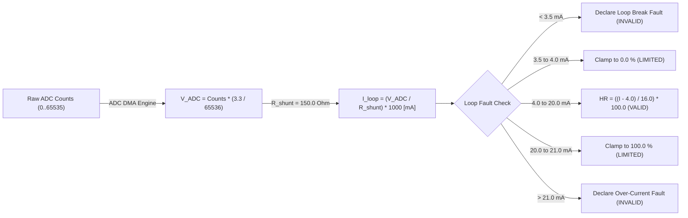

# Thermal and Energy System: Configuration, Calibration & Storage Strategy

- **Document Identifier**: `doc/architecture/thermal_energy_system_configuration.md`
- **Subsystem**: Thermal and Energy System (`thermal_energy`)
- **Target Platform**: DAECGE BrightC Controller V3 (STM32H743ZIT6, Cortex-M7 @ 480 MHz)
- **Framework**: Zephyr RTOS (West T2 Workspace)
- **Storage Medium**: On-board `AT24C256C` (32 KB I2C EEPROM) via `adapter_storage_microconf`
- **Reference Specification**: `doc/request/Mathematical_Model_Specification_REVF.md` (Revision F Baseline)
- **Author**: Lead Embedded Firmware Architect
- **Status**: Stage 1 Architecture Deliverable (Ready for Technical Review)

---

## 1. Executive Summary & Configuration Policy

To satisfy Section 8 of `doc/tasks/2.thermal.md`, configuration parameters are structured under strict tier segregation:

```
┌─────────────────────────────────────────────────────────────────────────────────────────────┐
│ TIER 0: COMPILE-TIME BUILD CONFIGURATION (Kconfig / Devicetree)                             │
│ Hardware limits, buffer bounds, ADC channel bindings, peripheral driver enablement.          │
└─────────────────────────────────────────────────────────────────────────────────────────────┘
                                             │
                                             ▼
┌─────────────────────────────────────────────────────────────────────────────────────────────┐
│ TIER 1: FIELD-COMMISSIONED PERSISTENT CONFIGURATION (I²C EEPROM AT24C256C)                  │
│ Site topology, probe mappings, nominal HVAC airflow/capacity, altitude, calibration offsets.│
└─────────────────────────────────────────────────────────────────────────────────────────────┘
                                             │
                                             ▼
┌─────────────────────────────────────────────────────────────────────────────────────────────┐
│ TIER 2: MACHINE-LEARNED PERSISTENT SIGNATURES (I²C EEPROM AT24C256C)                        │
│ OLS regression coefficients (beta0..3), baseline exergy, reference thermal differentials.   │
└─────────────────────────────────────────────────────────────────────────────────────────────┘
                                             │
                                             ▼
┌─────────────────────────────────────────────────────────────────────────────────────────────┐
│ TIER 3: REAL-TIME EPHEMERAL STATE (STM32H7 AXI SRAM)                                        │
│ Live 1 Hz accumulators, stabilization timers, 720-hour RAM ring buffer.                     │
└─────────────────────────────────────────────────────────────────────────────────────────────┘
                                             │
                                             ▼
┌─────────────────────────────────────────────────────────────────────────────────────────────┐
│ TIER 4: LONG-TERM HISTORICAL LOGGING (Industrial MicroSD Card / FATFS)                      │
│ 64-byte hourly binary telemetry records indexed by UNIX timestamp.                          │
└─────────────────────────────────────────────────────────────────────────────────────────────┘
```

> [!IMPORTANT]
> **Cardinal Rules**:
> 1. Never use Kconfig for parameters that an on-site technician must configure without recompiling.
> 2. Never write high-frequency runtime data (1 Hz samples or 15-second timers) to EEPROM; doing so destroys EEPROM write endurance.
> 3. Learned signatures must be stored with explicit training metadata and validated prior to operational adoption.

---

## 2. Configuration Parameter Classification

### Category A: Site & Hardware Topology
Parameters defining the physical layout of the telecom shelter or server room:
- `configured_pairs_count` ($N$): Number of operational supply/return pairs ($1 \le N \le 16$, default 6).
- `pair_mapping_table`: Array of $N$ tuples `{supply_flat_id, return_flat_id, hvac_unit_id}`.
- `configured_room_probes` ($M$): Number of room zone ambient probes ($1 \le M \le 16$, default 2).
- `room_probes_table`: Array of $M$ flat sensor IDs (1..59).
- `configured_outdoor_probes` ($L$): Number of outdoor condenser probes ($1 \le L \le 8$, default 2).
- `outdoor_probes_table`: Array of $L$ flat sensor IDs (1..59).
- `site_altitude_m` ($Z$): Elevation above sea level in meters ($0 \le Z \le 4000\text{ m}$, default 0).
- `nominal_airflow_m3h` ($V_{nom,u}$): Rated volumetric airflow per HVAC unit in $\text{m}^3/\text{h}$ (default $4500\text{ m}^3/\text{h}$).
- `nominal_capacity_kw` ($Q_{nominal,u}$): Rated cooling capacity per HVAC unit in $\text{kW}$ (default $14.0\text{ kW}$).
- `required_redundancy_units` ($U_{req}$): Active units needed to support load in $N+1$ configuration (default 2).
- `design_outdoor_temp_c` ($T_{ext,design}$): Design outdoor temperature per AHRI 210/240 ($35.0\,^\circ\text{C}$).
- `derating_coefficient` ($k_{ext}$): High-ambient thermal derating slope ($0.005\,^\circ\text{C}^{-1}$).

> [!NOTE]
> **Physical Hardware Pinouts Separation**: In accordance with Clean Architecture and firmware safety invariants, physical terminal blocks, expander pin routing, and Modbus coil/register maps are strictly excluded from EEPROM storage. They are defined immutably at compile time in `hardware_pin_map.h` as the single authoritative source of truth. EEPROM persists only commissioning parameters and thermodynamic setpoints.

### Category B: Calibration & Trim Offsets
Parameters required to maintain laboratory-grade measurement accuracy:
- `pt100_lead_wire_resistance` ($\Delta R_{cable}$): Resistance trim in $\Omega$ subtracted from internal INA826 channels.
- `temperature_cal_offsets`: 2-point offset trim in $0.01\,^\circ\text{C}$ per channel.
- `temperature_cal_gains`: 2-point gain multiplier in PPM ($10000 = 1.0$) per channel.
- `humidity_shunt_resistance` ($R_{shunt}$): Shunt resistor trim in $0.1\,\Omega$ (nominal $150.0\,\Omega$).
- `humidity_zero_offset_ma`: Transducer $4\text{ mA}$ zero trim.
- `humidity_span_gain_ppm`: Transducer $16\text{ mA}$ span trim.

### Category C: Machine-Learned Baselines & Reference Signatures
Parameters acquired during steady-state operation:
- `ols_coefficients`: 4x 64-bit `double` values ($\beta_0, \beta_1, \beta_2, \beta_3$) stored in IEEE 754 format (32 bytes).
- `baseline_exergetic_efficiency` ($\eta_{II,\text{base}}$): Reference Second Law efficiency in % (default $42.0\%$).
- `baseline_pair_delta_t` ($\Delta T_{base,k}$): Reference thermal differentials per pair in $^\circ\text{C}$.
- `baseline_pair_t_inj` ($T_{inj\_base,k}$): Reference clean-filter supply temperatures in $^\circ\text{C}$.
- `compressor_power_signatures` ($\Delta P_{comp,c}$): Isolated step electrical power per compressor in $\text{kW}$.
- `training_metadata`: Timestamp of training completion, cumulative steady-state hours (must equal 168), OLS condition number, and algorithm version.

### Category D: Ephemeral Runtime State (RAM)
- `live_capture`: Latest coherent multi-source capture snapshot.
- `live_result`: Latest computed thermodynamic result snapshot.
- `compressor_timers`: Elapsed $t_{off}$ and $t_{on}$ timers per compressor.
- `ram_history_ring`: Circular buffer of 720 hourly summaries ($720 \times 64\text{ bytes} = 46.08\text{ KB}$).

---

## 3. Comprehensive Parameter Matrix

| Parameter Name | Data Type | Configuration Tier | Storage Location | Default Value | Validation Rule | Update / Write Frequency |
| :--- | :--- | :--- | :--- | :--- | :--- | :--- |
| `BRIGHTC_THERMAL_ENERGY` | boolean | Kconfig | Flash (Code) | `y` | Build-time boolean | At compile time |
| `BRIGHTC_THERMAL_HUMIDITY_J9_CHANNEL` | integer | Kconfig | Flash (Code) | `1` | Range `1..10` | At compile time |
| `configured_pairs_count` ($N$) | `uint8_t` | Commissioning | EEPROM (Site) | `6` | $1 \le N \le 16$ | Site commissioning only |
| `pair_mapping_table` | `pair_cfg_t[16]` | Commissioning | EEPROM (Site) | Pilot bindings | Valid IDs, distinct pairs | Site commissioning only |
| `configured_room_probes` ($M$) | `uint8_t` | Commissioning | EEPROM (Site) | `2` | $1 \le M \le 16$ | Site commissioning only |
| `room_probes_table` | `uint8_t[16]` | Commissioning | EEPROM (Site) | `[18, 19]` | Registered flat IDs | Site commissioning only |
| `configured_outdoor_probes` ($L$) | `uint8_t` | Commissioning | EEPROM (Site) | `2` | $1 \le L \le 8$ | Site commissioning only |
| `outdoor_probes_table` | `uint8_t[8]` | Commissioning | EEPROM (Site) | `[22, 23]` | Registered flat IDs | Site commissioning only |
| `site_altitude_m` ($Z$) | `int16_t` | Commissioning | EEPROM (Site) | `0` | $-100 \le Z \le 4000\text{ m}$ | Site commissioning only |
| `nominal_airflow_m3h` | `float[8]` | Commissioning | EEPROM (Site) | `4500.0` | $500.0 \le V \le 25000.0$ | Site commissioning only |
| `nominal_capacity_kw` | `float[8]` | Commissioning | EEPROM (Site) | `14.0` | $2.0 \le Q \le 100.0$ | Site commissioning only |
| `required_redundancy_units` | `uint8_t` | Commissioning | EEPROM (Site) | `2` | $1 \le U_{req} \le 8$ | Site commissioning only |
| `pt100_lead_wire_resistance` | `float[5]` | Calibration | EEPROM (Calib) | `0.0` | $0.0 \le \Delta R \le 20.0\,\Omega$ | Factory/Field calibration |
| `humidity_shunt_resistance` | `float` | Calibration | EEPROM (Calib) | `150.0` | $145.0 \le R \le 155.0\,\Omega$ | Factory calibration |
| `ols_beta_coefficients` | `double[4]` | Learned Signature | EEPROM (Base) | All `0.0` | Finite, non-zero after 168h | Once per 168h training |
| `baseline_exergetic_efficiency` | `float` | Learned Signature | EEPROM (Base) | `42.0` | $20.0\% \le \eta \le 65.0\%$ | Once per 168h training |
| `baseline_pair_delta_t` | `float[16]` | Learned Signature | EEPROM (Base) | All `0.0` | $2.0 \le \Delta T \le 20.0\,^\circ\text{C}$ | Once per 168h training |
| `baseline_pair_t_inj` | `float[16]` | Learned Signature | EEPROM (Base) | All `0.0` | $5.0 \le T \le 22.0\,^\circ\text{C}$ | Once per 168h training |
| `compressor_power_signatures` | `float[8]` | Learned Signature | EEPROM (Base) | All `0.0` | $0.5 \le \Delta P \le 50.0\text{ kW}$ | Disaggregated step |
| `hourly_record_ring` | `record_t[720]` | Ephemeral | AXI SRAM | Cleared at boot | Validated on restore | Written once per hour |

---

## 4. Selection of 4–20 mA Humidity ADC Channel via Kconfig

Connector `J9` provides 10 analog current loop channels. In accordance with §5.3 of `doc/tasks/2.thermal.md`, the assignment is selectable at compile time:

```kconfig
config BRIGHTC_THERMAL_HUMIDITY_J9_CHANNEL
    int "J9 current loop channel for return humidity transmitter"
    depends on BRIGHTC_THERMAL_ENERGY
    default 1
    range 1 10
    help
      Selects which physical channel on connector J9 (1 to 10) is wired to the
      return humidity 4-20 mA transducer.
      Channel 1 maps to PF14 (logical ADC index 5).
```

### 4.1 Electrical Conversion & Scaling Pipeline


---

## 5. Persistent Storage & EEPROM Layout

The BrightC V3 hardware features an industrial `AT24C256C` (32,768 bytes, 64-byte page size) managed by `adapter_storage_microconf.c`.

### 5.1 EEPROM Memory Map Allocation
The current memory map allocates domains 0..4 in `0x0000` to `0x09FF` (2,560 bytes total).
From `0x0A00` to `0x7FFF` reside **30,208 bytes (29.5 KB) of unallocated storage**.

```
Offset Range        Size     Ping-Pong Slots   Domain Identifier                Contents
──────────────────────────────────────────────────────────────────────────────────────────────────────────
0x0000 - 0x00FF     256 B    2 x 128 B         CONFIG_DOMAIN_DEVICE             Serial, Hardware Rev, Alias
0x0100 - 0x017F     128 B    2 x 64 B          CONFIG_DOMAIN_NET_ETH            Ethernet IP, DHCP, MAC
0x0180 - 0x03FF     640 B    2 x 320 B         CONFIG_DOMAIN_NET_WIFI           Wi-Fi Mode, SSID, PSK
0x0400 - 0x087F    1152 B    2 x 576 B         CONFIG_DOMAIN_HVAC               HVAC Sequencer Config (~188 B payload; units[8] moved to pin map)
0x0880 - 0x09FF     384 B    2 x 192 B         CONFIG_DOMAIN_CALIBRATION        Analog Offsets & Gain Trims
──────────────────────────────────────────────────────────────────────────────────────────────────────────
0x0A00 - 0x0FFF    1536 B    2 x 768 B         CONFIG_DOMAIN_THERMAL_SITE       [NEW] Site Topology, Airflow, Capacities
0x1000 - 0x13FF    1024 B    2 x 512 B         CONFIG_DOMAIN_THERMAL_BASELINE   [NEW] OLS Beta, Exergy Base, Signatures
0x1400 - 0x7FFF   27648 B    -                 RESERVED / EVENT LOG             System Event Log & Expansion
```

### 5.2 Microconf Envelope & Ping-Pong Persistence Mechanics
Every stored slot begins with the standard 12-byte `config_envelope_header_t`:
1. `magic`: `0x4243544C` (ASCII "BCTL").
2. `version`: Domain schema version.
3. `domain`: Logical category enumerator.
4. `payload_len`: Exact length of following payload struct.
5. `crc16`: CRC-16-CCITT computed across payload bytes.

#### Atomic Ping-Pong Safety:
- Each domain allocates two identical slots (Slot A and Slot B).
- A monotonic sequence counter inside the payload identifies the most recent valid write.
- When committing:
  1. Payload is serialized and its CRC-16 is computed.
  2. Data is written to the inactive slot.
  3. The inactive slot is verified.
  4. Only upon successful CRC verification is the new slot marked active.
  5. If power is interrupted mid-write, the previous slot remains 100% intact.

---

## 6. MicroSD Card Datalogger Binary Format (Exact 64 Bytes)

To resolve **OBS-02** identified in the audit, the hourly record structure is strictly sized and aligned to **exactly 64 bytes**:

```c
typedef struct __attribute__((packed)) {
    uint32_t timestamp_unix;               /**< 4 B: UNIX Epoch timestamp (seconds) */
    int16_t  t_inj_x10[6];                 /**< 12 B: 6 Supply temperatures in 0.1 deg C */
    int16_t  t_ret_x10[6];                 /**< 12 B: 6 Return temperatures in 0.1 deg C */
    int16_t  t_room_x10[2];                /**< 4 B: 2 Room ambient temperatures in 0.1 deg C */
    int16_t  t_outdoor_x10[2];             /**< 4 B: 2 Outdoor ambient temperatures in 0.1 deg C */
    uint16_t humidity_return_x10;          /**< 2 B: Return relative humidity in 0.1 %RH */
    float    active_power_kw;              /**< 4 B: Total active electrical power [kW] */
    float    sensible_capacity_kw;         /**< 4 B: Sensible cooling capacity [kW] */
    float    latent_capacity_kw;           /**< 4 B: Latent cooling capacity [kW] */
    uint16_t cop_real_x100;                /**< 2 B: Operational COP * 100 */
    uint16_t eta_ii_x100;                  /**< 2 B: Exergetic efficiency * 100 */
    uint16_t fan_state_mask;               /**< 2 B: Bit u = 1 if fan u was running */
    uint16_t comp_state_mask;              /**< 2 B: Bit c = 1 if compressor c was running */
    uint32_t comp_starts_count;            /**< 4 B: Cumulative compressor start events */
    uint16_t crc16;                        /**< 2 B: CRC-16-CCITT over preceding 62 bytes */
} thermal_hourly_record_t;

BUILD_ASSERT(sizeof(thermal_hourly_record_t) == 64, "Hourly record MUST be exactly 64 bytes");
```

- **Storage Efficiency**: 64 bytes per hour = $1.536\text{ KB/day}$ = $560.64\text{ KB/year}$.
- **Fast Boot Recovery**: At system startup, the controller reads the last 720 records ($46.08\text{ KB}$) from MicroSD into SRAM in under $10\text{ ms}$, validating CRCs and restoring the 30-day window without resetting the 168-hour learning counter.

---

## 7. Operational Profiles Hardware Mapping Strategy in `hardware_pin_map.h`

To eliminate redundant hardware declarations in EEPROM storage, `hardware_pin_map.h` is established as the **single authoritative source of truth** for all physical wiring. Physical channels are partitioned and mapped according to the active system operational profile (`system_operation_mode_t` / `hvac_operation_mode_t`):

### 7.1 Profile 1: `HVAC_MODE_TELEMETRY_ONLY` (Audit & Passive Diagnostics)
- **Target**: Sites where existing third-party thermostats or BMS control the HVAC units, and BrightC V3 acts purely as an edge psychrometric and exergy auditing computer (Revision F Mathematical Model).
- **Actuation**: Zero physical relays are actuated. `relay_sm = 0` (mechanical bypass mode).
- **Monitoring Scope**: Up to 8 AC units ($AC_1 \dots AC_8$).
- **Feedback Inputs per Unit**: Exactly 2 auxiliary dry contacts (1 + 1):
  1. Compressor Run auxiliary feedback (`fb_compressor`)
  2. Evaporator Fan Run auxiliary feedback (`fb_fan`)
- **Total Monitored Feedback Channels**: 16 digital inputs ($8 \times 2 = 16$).
- **100% On-Board Local Inputs**: Sourced exclusively from the 24 optocoupled inputs on the BrightC V3 PCB (`ALM_IN_1` to `ALM_IN_16`, spanning pins 0..11 on `&mcp23s17_0` and pins 0..3 on `&mcp23s17_1`):

```
Terminal Block    Expander Pin       Telemetry-Only Role                  Hybrid / Control Role
──────────────────────────────────────────────────────────────────────────────────────────────────
ALM_IN_1          mcp23s17_0 Pin 0   AC1 Compressor Run (fb_compressor)   AC1 High-Pressure Alarm (HP)
ALM_IN_2          mcp23s17_0 Pin 1   AC1 Fan Run (fb_fan)                 AC1 Low-Pressure Alarm (LP)
ALM_IN_3          mcp23s17_0 Pin 2   AC2 Compressor Run (fb_compressor)   AC1 Flow Alarm (FLOW)
ALM_IN_4          mcp23s17_0 Pin 3   AC2 Fan Run (fb_fan)                 AC1 Voltage Alarm (VOLT)
ALM_IN_5          mcp23s17_0 Pin 4   AC3 Compressor Run (fb_compressor)   AC2 High-Pressure Alarm (HP)
ALM_IN_6          mcp23s17_0 Pin 5   AC3 Fan Run (fb_fan)                 AC2 Low-Pressure Alarm (LP)
ALM_IN_7          mcp23s17_0 Pin 6   AC4 Compressor Run (fb_compressor)   AC2 Flow Alarm (FLOW)
ALM_IN_8          mcp23s17_0 Pin 7   AC4 Fan Run (fb_fan)                 AC2 Voltage Alarm (VOLT)
ALM_IN_9          mcp23s17_0 Pin 8   AC5 Compressor Run (fb_compressor)   AC3 High-Pressure Alarm (HP)
ALM_IN_10         mcp23s17_0 Pin 9   AC5 Fan Run (fb_fan)                 AC3 Low-Pressure Alarm (LP)
ALM_IN_11         mcp23s17_0 Pin 10  AC6 Compressor Run (fb_compressor)   AC3 Flow Alarm (FLOW)
ALM_IN_12         mcp23s17_0 Pin 11  AC6 Fan Run (fb_fan)                 AC3 Voltage Alarm (VOLT)
ALM_IN_13         mcp23s17_1 Pin 0   AC7 Compressor Run (fb_compressor)   AC4 High-Pressure Alarm (HP)
ALM_IN_14         mcp23s17_1 Pin 1   AC7 Fan Run (fb_fan)                 AC4 Low-Pressure Alarm (LP)
ALM_IN_15         mcp23s17_1 Pin 2   AC8 Compressor Run (fb_compressor)   AC4 Flow Alarm (FLOW)
ALM_IN_16         mcp23s17_1 Pin 3   AC8 Fan Run (fb_fan)                 AC4 Voltage Alarm (VOLT)
──────────────────────────────────────────────────────────────────────────────────────────────────
ALM_IN_17         mcp23s17_1 Pin 4   Smoke / Fire Interlock (DI_ROLE_SMOKE_FIRE)
ALM_IN_18         mcp23s17_1 Pin 5   Door Open Alarm (DI_ROLE_DOOR_OPEN)
ALM_IN_19         mcp23s17_1 Pin 6   Water Leak Alarm (DI_ROLE_WATER_LEAK)
ALM_IN_20         mcp23s17_1 Pin 7   Surge Protector / DPS (DI_ROLE_SURGE_PROTECTOR)
ALM_IN_21         mcp23s17_1 Pin 8   Phase Monitor Trip (DI_ROLE_PHASE_MONITOR)
ALM_IN_22..24     mcp23s17_1 Pin 9..11 User Spares
```

> [!IMPORTANT]
> **Zero External Modbus Hardware Overhead**: In `HVAC_MODE_TELEMETRY_ONLY`, all 8 AC units and shelter safety inputs are processed entirely through the local SPI expanders. No external RS-485 Modbus digital input module (`MBSL32DI`) or relay module is required.

### 7.2 Profiles 2 & 3: `HVAC_MODE_HYBRID_FULL` & `HVAC_MODE_HVAC_CONTROL_ONLY`
- **Target**: Sites where BrightC V3 acts as the primary autonomous sequencer driving contactors with lead-lag $N+M$ rotation, anti-inrush staggering, and safety interlocks.
- **Units 1..4 (Local Actuation & Safety Cutouts)**:
  * Driven by on-board relays on `&mcp23s17_2` (`relay_aa`, `relay_sm`, `relay_g`).
  * Safety cutouts (`HP`, `LP`, `FLOW`, `VOLT`) wired to local inputs `ALM_IN_1` through `ALM_IN_16` (4 inputs per unit).
- **Units 5..8 (Remote Modbus Expansion, configured when `total_units > 4`)**:
  * Driven by remote Modbus RTU relay module (Waveshare 32CH, Slave Addr 2, coils 0..11).
  * Safety cutouts (`HP`, `LP`, `FLOW`, `VOLT`) wired to remote Modbus `MBSL32DI` (Slave Addr 4), channels 0..15.
- **Telemetry Feedback for All Units 1..8 in Hybrid Mode**:
  * Fans 1..8 auxiliary contacts (`fb_fan`): Remote Modbus `MBSL32DI` channels 16..23.
  * Compressors 1..8 auxiliary contacts (`fb_compressor`): Remote Modbus `MBSL32DI` channels 24..31.
