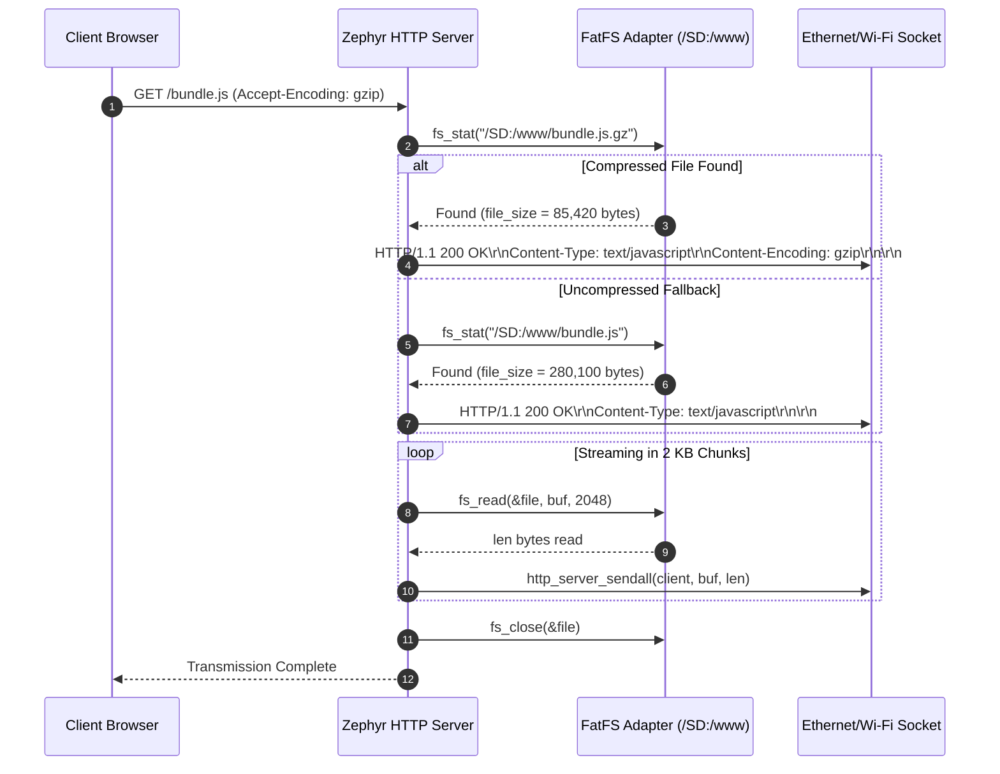
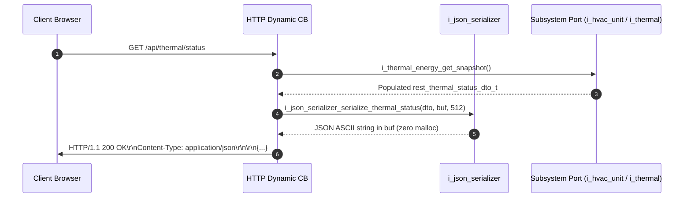
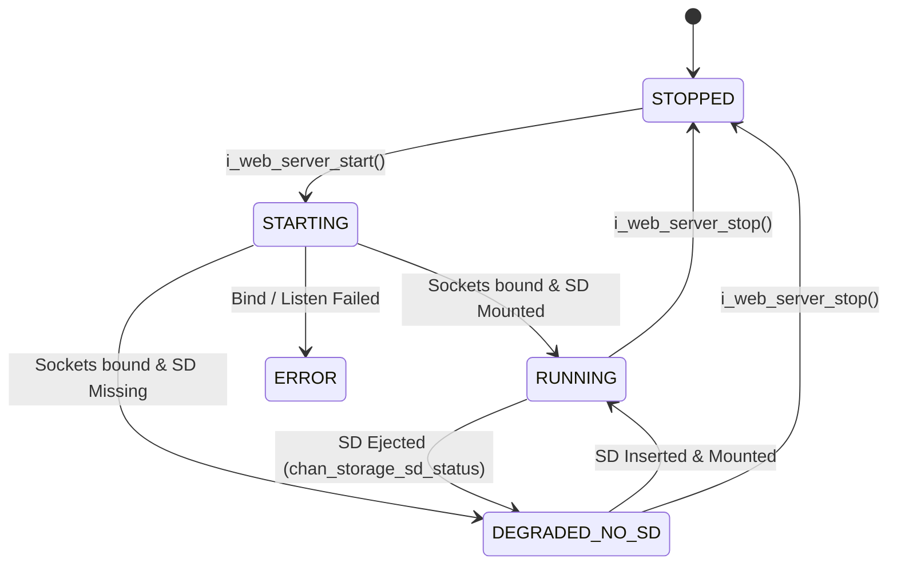

# Architecture of the Embedded Web Server & REST API Subsystem

- **Status**: Technical Architecture Specification & Port Contract
- **Platform**: DAECGE BrightC Controller V3 (STM32H743ZIT6 LQFP144 @ 480 MHz)
- **Subsystem**: Embedded Web Server & REST API (`CONFIG_HTTP_SERVER=y`)
- **Network Interface**: Dual Homed — RMII 10/100 Ethernet (LAN) & ESP-Hosted SPI Wi-Fi (WLAN)
- **Filesystem Base**: MicroSD FatFS (`/SD:/www`, `/SD:/history`) via SDMMC1 IDMA
- **Architectural Pattern**: Clean Architecture (Ports & Adapters) + Zero-Malloc Descriptors + Zero-Copy Streaming

---

## 1. System Overview & Problem Statement

### 1.1 Dual Operational Responsibilities
The BrightC Controller V3 serves as an industrial edge-automation and telemetry unit. The Embedded Web Server subsystem fulfills two distinct, high-throughput roles:

1. **Static Web Single Page Application (SPA) Delivery**:
   - Serving modern frontend web assets (HTML5, JavaScript bundles, CSS3 stylesheets, SVG icons, WebAssembly binaries) directly from the external MicroSD card mount point (`/SD:/www`).
   - The edge dashboard allows maintenance technicians, commissioning engineers, and facility managers to monitor and configure the unit via any standard web browser without cloud or external server dependencies.

2. **Real-Time Dynamic REST API & Historical Data Streaming**:
   - Providing structured JSON endpoints for real-time telemetry (HVAC operating modes, compressor stage states, 3-phase electrical power, Rev F thermodynamic balance).
   - Receiving authenticated supervisory command payloads (setpoints, temperature hysteresis, compressor staging delays, alarm acknowledgement, buzzer mute).
   - Streaming historical CSV logs directly from disk clusters to client browsers with zero CPU parsing overhead.

```text
 ┌─────────────────────────────────────────────────────────────────────────────────┐
 │                      BROWSER CLIENT (EDGE SPA DASHBOARD)                        │
 └─────────────────────────┬─────────────────────────────┬─────────────────────────┘
                           │ Static Asset Requests       │ REST API & Telemetry
                           │ (GET /, GET /bundle.js)     │ (GET /api/*, POST /api/*)
                           ▼                             ▼
 ┌─────────────────────────────────────────────────────────────────────────────────┐
 │                  ZEPHYR NATIVE HTTP SERVER (CONFIG_HTTP_SERVER=y)               │
 │                                                                                 │
 │   ┌──────────────────────────────────┐     ┌────────────────────────────────┐   │
 │   │  HTTP_RESOURCE_TYPE_STATIC_FS    │     │  HTTP_RESOURCE_TYPE_DYNAMIC    │   │
 │   │  - Link-time declarative route   │     │  - Non-blocking callbacks      │   │
 │   │  - Fixed 2 KB chunked streaming  │     │  - Zero-malloc JSON codec      │   │
 │   │  - Native gzip/br negotiation    │     │  - DIP queries to domain/ports │   │
 │   └─────────────────┬────────────────┘     └────────────────┬───────────────┘   │
 └─────────────────────┼───────────────────────────────────────┼───────────────────┘
                       │                                       │
                       ▼                                       ▼
        ┌─────────────────────────────┐         ┌─────────────────────────────┐
        │  MicroSD Card (/SD:/www)    │         │  Active Domains & Ports     │
        │  Static Assets & Gz Files   │         │  HVAC, Energy, Thermal, RTC │
        └─────────────────────────────┘         └─────────────────────────────┘
```

### 1.2 Architectural Parity: Legacy CycloneTCP vs. Zephyr Native HTTP Server
Previous generations of the controller utilized CycloneTCP on top of Azure RTOS (ThreadX). Transitioning to Zephyr RTOS preserves complete behavioral parity while eliminating proprietary licensing constraints and modernizing the software stack:

| Operational Feature | Legacy Architecture (CycloneTCP + ThreadX) | BrightC V3 (Zephyr RTOS Native Stack) | Architectural Advantage |
|:---|:---|:---|:---|
| **Core Framework** | CycloneTCP HTTP Server module | Zephyr `CONFIG_HTTP_SERVER=y` | Fully integrated upstream Zephyr socket subsystem |
| **Resource Routing** | Imperative runtime URI tables and callback arrays | Link-time declarative macros (`HTTP_SERVICE_DEFINE`, `HTTP_RESOURCE_DEFINE`) | Static link-time placement in ROM linker sections (`STRUCT_SECTION_ITERABLE`), zero runtime allocation |
| **Static FS Serving** | Manual file handle loop and chunk buffering | Native `HTTP_RESOURCE_TYPE_STATIC_FS` | Kernel-managed chunked transmission via `fs_read()` and `http_server_sendall()` |
| **Asset Compression** | Custom `.gz` URL rewriting logic in request hook | Native `CONFIG_HTTP_SERVER_COMPRESSION=y` | Automatic `Accept-Encoding: gzip, br` parsing, `.gz` detection via `http_server_find_file()`, header injection |
| **Dynamic JSON Codec** | `cJSON` library utilizing runtime `malloc()` / `free()` | Compile-time descriptor tables via `<zephyr/data/json.h>` | **Zero heap allocation**; eliminates memory fragmentation and OOM crashes |
| **Historical Streaming** | Dedicated custom streaming socket task | High-efficiency chunked transfer via `i_storage_fs_t` port | Constant 2 KB RAM footprint regardless of file size (10 KB or 100 MB) |
| **Fault Isolation** | Single-threaded event loop | MPU-isolated worker thread with `CONFIG_MPU_STACK_GUARD` | Hardware-enforced stack overflow detection on Cortex-M7 |

---

## 2. Component Classification & Layering

Strictly enforcing the architectural taxonomy from [Section 1 of `AGENTS.md`](file:///media/jeffry/jqb/embedded-mcu/BrightC-workspace/BrightC-telemetry/AGENTS.md):

```text
 ┌─────────────────────────────────────────────────────────────────────────────────┐
 │ Pure Interfaces (app/include/interfaces/) - ZERO Zephyr / ZERO Vendor Headers  │
 │   ├── i_web_server.h        : Port contract for Web Server lifecycle & metrics  │
 │   └── i_json_serializer.h   : Abstract zero-malloc JSON serialization contract  │
 ├─────────────────────────────────────────────────────────────────────────────────┤
 │ Common Domain Types (app/include/common/) - Pure ISO C99/C11                    │
 │   └── web_server_types.h    : Enums, configs, metrics, and REST DTO structs     │
 ├─────────────────────────────────────────────────────────────────────────────────┤
 │ Infrastructure Adapters (app/src/infrastructure/adapters/)                      │
 │   ├── adapter_web_server.c       : Zephyr HTTP server wrapper & route dispatcher│
 │   └── adapter_json_serializer.c  : zephyr/data/json.h compile-time codecs       │
 ├─────────────────────────────────────────────────────────────────────────────────┤
 │ Composition Root & Dependency Injection (app/src/infrastructure/di/)           │
 │   └── composition_root.c    : Instantiates adapters, wires ports to REST handlers│
 └─────────────────────────────────────────────────────────────────────────────────┘
```

- **Domain Independence**: DTO structures (`rest_hvac_status_dto_t`, `rest_energy_status_dto_t`, etc.) are pure C structs without any RTOS or serialization library dependencies.
- **Single Responsibility Principle (SRP)**:
  - `adapter_web_server.c` handles HTTP protocol compliance, URL dispatch, MIME headers, and connection lifecycles.
  - `adapter_json_serializer.c` handles mapping between domain DTOs and JSON byte streams using static descriptors.
  - Domain Active Objects (`ao_hvac`, `ao_thermal_energy`, `ao_alarm`) only process domain state transitions and expose status through their respective interface ports.

---

## 3. Zephyr Native HTTP Server Subsystem (`CONFIG_HTTP_SERVER=y`)

### 3.1 Declarative Link-Time Resource Definition
The Zephyr HTTP server utilizes linker-section iteration to discover services and routes without runtime registration or heap allocations.

#### HTTP Service Declaration
The listening service is defined statically using `HTTP_SERVICE_DEFINE`:

```c
static uint16_t s_http_port = 80;

/* Fallback resource served when a requested URL is not found */
static const struct http_resource_detail_static s_res_fallback = {
    .common = {
        .type = HTTP_RESOURCE_TYPE_STATIC,
        .bitmask_of_supported_http_methods = BIT(HTTP_GET),
        .content_type = "text/html",
    },
    .static_data = g_maintenance_fallback_html,
    .static_data_len = sizeof(g_maintenance_fallback_html) - 1,
};

HTTP_SERVICE_DEFINE(brightc_http_svc,
                    NULL,                   /* Listen on all network interfaces (Ethernet & Wi-Fi) */
                    &s_http_port,
                    CONFIG_HTTP_SERVER_MAX_CLIENTS, /* Concurrent client connections (default: 4) */
                    CONFIG_HTTP_SERVER_MAX_CLIENTS, /* Socket backlog */
                    NULL,                   /* Service detail */
                    (struct http_resource_detail *)&s_res_fallback,
                    NULL);                  /* Service configuration */
```

### 3.2 Filesystem Serving via `HTTP_RESOURCE_TYPE_STATIC_FS`
Static web assets located on the MicroSD card under `/SD:/www` are exposed using `HTTP_RESOURCE_TYPE_STATIC_FS`.

```c
static const struct http_resource_detail_static_fs s_www_fs_resource = {
    .common = {
        .type = HTTP_RESOURCE_TYPE_STATIC_FS,
        .bitmask_of_supported_http_methods = BIT(HTTP_GET),
    },
    .fs_path = "/SD:/www",
};

/* Catch-all route mapping GET /... to /SD:/www/... */
HTTP_RESOURCE_DEFINE(brightc_www_route,
                     brightc_http_svc,
                     "/",
                     &s_www_fs_resource);
```

#### Automatic Index Resolution & URL Mapping
When a browser navigates to `http://<ip>/`, the path length is 1 (`/`). The Zephyr HTTP engine automatically resolves:
$$\text{Path} = \text{fs\_path} + \text{"/index.html"} \implies \text{"/SD:/www/index.html"}$$
For any sub-resource (e.g. `http://<ip>/assets/app.js`), the engine maps:
$$\text{Path} = \text{fs\_path} + \text{"/assets/app.js"} \implies \text{"/SD:/www/assets/app.js"}$$

#### Fixed-Size Chunked Streaming (Constant 1–2 KB RAM Footprint)
Serving large static files (such as modern JavaScript bundles of 300 KB–1 MB) in embedded systems frequently causes RAM exhaustion if entire files are loaded into memory.
Zephyr's `handle_http1_static_fs_resource()` implements chunked kernel streaming:

```c
/* Streaming loop internal to Zephyr subsystem */
remaining = file_size;
while (remaining > 0) {
    len = fs_read(&file, http_response, sizeof(http_response));
    if (len < 0) {
        break;
    }
    ret = http_server_sendall(client, http_response, len);
    if (ret < 0) {
        break;
    }
    remaining -= len;
}
```

The transfer buffer size is strictly governed by `CONFIG_HTTP_SERVER_STATIC_FS_RESPONSE_SIZE` (configured to **2048 bytes**). Consequently, whether transmitting a 2 KB stylesheet or a 10 MB bundle, **the RAM footprint remains constant at 2 KB**.

### 3.3 Native Transparent Compression (`CONFIG_HTTP_SERVER_COMPRESSION=y`)
To maximize throughput on embedded links and minimize MicroSD read cycles, all static web assets (HTML, JS, CSS, SVG) can be pre-compressed using Gzip or Brotli at deployment time.

1. When a modern browser connects, it emits:
   ```http
   Accept-Encoding: gzip, deflate, br
   ```
2. When `CONFIG_HTTP_SERVER_COMPRESSION=y` is enabled, the Zephyr server invokes `http_server_find_file()`:
   - For a request to `/app.js`, it first tests for `/SD:/www/app.js.gz`.
   - If `/SD:/www/app.js.gz` exists, it selects `HTTP_GZIP`, sets `Content-Encoding: gzip`, and sets `Content-Type: text/javascript`.
   - If compressed file is absent, it transparently falls back to `/SD:/www/app.js` without `Content-Encoding`.
3. Pre-compressed assets reduce transfer size by 65%–80%, allowing a 400 KB SPA bundle to transfer in under 25 ms over 100 Mbps RMII Ethernet.

### 3.4 Linker Content-Type Registration
MIME content types are registered statically in ROM sections using `HTTP_SERVER_CONTENT_TYPE`:

```c
HTTP_SERVER_CONTENT_TYPE(html, "text/html; charset=utf-8");
HTTP_SERVER_CONTENT_TYPE(js,   "text/javascript; charset=utf-8");
HTTP_SERVER_CONTENT_TYPE(css,  "text/css; charset=utf-8");
HTTP_SERVER_CONTENT_TYPE(json, "application/json");
HTTP_SERVER_CONTENT_TYPE(csv,  "text/csv; charset=utf-8");
HTTP_SERVER_CONTENT_TYPE(svg,  "image/svg+xml");
HTTP_SERVER_CONTENT_TYPE(png,  "image/png");
HTTP_SERVER_CONTENT_TYPE(ico,  "image/x-icon");
HTTP_SERVER_CONTENT_TYPE(wasm, "application/wasm");
```

---

## 4. Zero-Malloc JSON Serialization Architecture

### 4.1 The Dynamic Memory Anti-Pattern (`cJSON` Flaw)
In typical firmware designs, JSON serialization relies on `cJSON`, which constructs a heap-allocated Abstract Syntax Tree (AST):
- Every JSON key, value, and container allocates a heap node via `malloc()`.
- Serializing a 20-field telemetry frame triggers 50+ individual heap allocations and deallocations per second.
- On long-running industrial controllers, heap fragmentation inevitably leads to memory exhaustion and system crashes, directly violating **Invariant 5 (Zero Dynamic Memory Allocation)**.

### 4.2 Zephyr Compile-Time Descriptors (`<zephyr/data/json.h>`)
BrightC Controller V3 enforces zero heap allocation by utilizing Zephyr's compile-time JSON reflection engine:
- Descriptors are placed in Flash ROM (`const struct json_obj_descr`).
- Encoding reads directly from C struct members into a caller-provided fixed stack buffer via `json_obj_encode_buf()`.
- Parsing directly populates C struct members from the raw HTTP payload via `json_obj_parse()`.

```text
 ┌────────────────────────┐      Compile-Time Descriptors      ┌────────────────────────┐
 │   C Struct / DTO       ├───────────────────────────────────►│  Fixed Stack Buffer    │
 │   (Plain Memory)       │    json_obj_encode_buf() (ROM)     │  (e.g., char[512])     │
 └────────────────────────┘                                    └───────────┬────────────┘
                                                                           │
                                                                           ▼
                                                               ┌────────────────────────┐
                                                               │  TCP Socket sendall()  │
                                                               └────────────────────────┘
```

#### Descriptor Table Example: HVAC Setpoint
```c
static const struct json_obj_descr s_hvac_setpoint_descr[] = {
    JSON_OBJ_DESCR_PRIM(rest_hvac_setpoint_dto_t, target_temp_c_x100, JSON_TOK_NUMBER),
    JSON_OBJ_DESCR_PRIM(rest_hvac_setpoint_dto_t, hysteresis_c_x100, JSON_TOK_NUMBER),
    JSON_OBJ_DESCR_PRIM(rest_hvac_setpoint_dto_t, stage_delay_sec, JSON_TOK_NUMBER),
    JSON_OBJ_DESCR_PRIM(rest_hvac_setpoint_dto_t, high_temp_alarm_c_x100, JSON_TOK_NUMBER),
};
```

### 4.3 Clean Architecture Port Contract (`i_json_serializer.h`)
Following the pattern established in the ThingsBoard Embedded SDK (`i_tb_serializer.h`), the serialization engine is abstracted behind a fat-pointer interface. Application code and HTTP handlers interact exclusively with `i_json_serializer_t`, never importing `<zephyr/data/json.h>` directly.

---

## 5. REST API Taxonomy & Endpoint Specifications

All dynamic endpoints are registered using `HTTP_RESOURCE_DEFINE` with `HTTP_RESOURCE_TYPE_DYNAMIC` and handled via `http_resource_dynamic_cb_t`.

```c
#define REST_RESOURCE_DEFINE(_name, _path, _methods, _callback)                       \
    static struct http_resource_detail_dynamic _name##_detail = {                    \
        .common = {                                                                   \
            .type = HTTP_RESOURCE_TYPE_DYNAMIC,                                      \
            .bitmask_of_supported_http_methods = (_methods),                          \
            .content_type = "application/json",                                       \
        },                                                                            \
        .cb = (_callback),                                                            \
    };                                                                                \
    HTTP_RESOURCE_DEFINE(_name, brightc_http_svc, _path, &_name##_detail)
```

### 5.1 Endpoint Master Catalog

| HTTP Method | URI Path | Resource Type | Content-Type | Purpose | Payload / Parameters |
|:---|:---|:---:|:---:|:---|:---|
| **GET** | `/*` | `STATIC_FS` | Auto (MIME) | Serve SPA frontend assets from `/SD:/www` | — |
| **GET** | `/api/hvac/status` | `DYNAMIC` | `application/json` | Real-time HVAC mode, active stages, temperatures, alarm bits | — |
| **POST** | `/api/hvac/setpoint` | `DYNAMIC` | `application/json` | Update HVAC target temperature & hysteresis | `{"target_temp_c_x100": 2200, ...}` |
| **GET** | `/api/energy/status` | `DYNAMIC` | `application/json` | Real-time 3-phase electrical telemetry (V, I, kW, PF, kWh) | — |
| **GET** | `/api/thermal/status` | `DYNAMIC` | `application/json` | Real-time Rev F thermodynamic balance (Q_sens, Q_lat, COP) | — |
| **POST** | `/api/alarm/ack` | `DYNAMIC` | `application/json` | Acknowledge active alarm & mute audible buzzer | `{"alarm_id": 4, "mute_buzzer": true}` |
| **GET** | `/api/history/download`| `DYNAMIC` | `text/csv` | Zero-copy direct streaming of daily CSV datalogger files | `?type=control\|energy\|thermal&date=YYYY-MM-DD` |
| **GET** | `/api/system/status` | `DYNAMIC` | `application/json` | Controller health, uptime, SD status, memory stats | — |

---

### 5.2 Endpoint Specifications

#### 1. `GET /api/hvac/status`
Returns real-time operating state of the HVAC control subsystem.
- **Request**: `GET /api/hvac/status HTTP/1.1`
- **Response Headers**:
  ```http
  HTTP/1.1 200 OK
  Content-Type: application/json
  Cache-Control: no-cache
  ```
- **Response Body**:
  ```json
  {
    "system_mode": 2,
    "active_units_mask": 3,
    "duty_rotation_index": 0,
    "room_temp_c_x100": 2345,
    "return_temp_c_x100": 2510,
    "setpoint_c_x100": 2200,
    "stage_run_seconds": [3600, 3600, 0, 0, 0, 0, 0, 0],
    "alarm_flags": 0
  }
  ```

#### 2. `POST /api/hvac/setpoint`
Applies new operational setpoint parameters.
- **Request**:
  ```http
  POST /api/hvac/setpoint HTTP/1.1
  Content-Type: application/json

  {
    "target_temp_c_x100": 2250,
    "hysteresis_c_x100": 150,
    "stage_delay_sec": 180,
    "high_temp_alarm_c_x100": 2800
  }
  ```
- **Validation**:
  - $1600 \le \text{target\_temp\_c\_x100} \le 3000$ ($16.0^\circ\text{C}$ to $30.0^\circ\text{C}$).
  - $50 \le \text{hysteresis\_c\_x100} \le 500$ ($0.5^\circ\text{C}$ to $5.0^\circ\text{C}$).
  - Stage delay $\ge 60\text{ s}$.
- **Response**:
  ```http
  HTTP/1.1 200 OK
  Content-Type: application/json

  {"status": "ok", "message": "Setpoint applied"}
  ```

#### 3. `GET /api/energy/status`
Returns 3-phase electrical power metrics acquired from the JSY-MK-339 energy meter via RS-485 Modbus.
- **Response Body**:
  ```json
  {
    "voltage_rms_mv": [220100, 219800, 220400],
    "current_rms_ma": [14200, 13800, 14100],
    "active_power_w": 9320,
    "reactive_power_var": 1210,
    "power_factor_x1000": 985,
    "frequency_hz_x100": 6002,
    "total_energy_wh": 14258900
  }
  ```

#### 4. `GET /api/thermal/status`
Returns the thermodynamic state calculated by the Rev F Thermodynamic Engine.
- **Response Body**:
  ```json
  {
    "q_sensible_w": 8200,
    "q_latent_w": 1400,
    "q_total_w": 9600,
    "cop_x100": 342,
    "delta_t_c_x100": 780,
    "airflow_m3h": 3200,
    "dew_point_c_x100": 1240,
    "thermodynamic_state": 1
  }
  ```

#### 5. `POST /api/alarm/ack`
Acknowledges an active alarm condition and optionally silences the physical buzzer melody.
- **Request Body**:
  ```json
  {
    "alarm_id": 102,
    "mute_buzzer": true,
    "ack_timestamp_utc": 1731388800
  }
  ```
- **Response Body**:
  ```json
  {"status": "ok", "alarm_id": 102, "buzzer_muted": true}
  ```

#### 6. `GET /api/history/download?type=control|energy|thermal&date=YYYY-MM-DD`
Zero-copy direct streaming of historical daily CSV files.
- **Query Parameter Parsing**:
  - `type`: Selects stream (`control`, `energy`, `thermal`).
  - `date`: Validates date format `YYYY-MM-DD`.
- **Target Path Resolution**:
  $$\text{Path} = \text{"/SD:/history/"} + \text{YYYY} + \text{"/"} + \text{MM} + \text{"/"} + \text{YYYY-MM-DD\_"type"} + \text{".csv"}$$
  *Example*: `GET /api/history/download?type=thermal&date=2026-11-12` $\implies$ `/SD:/history/2026/11/2026-11-12_thermal.csv`.
- **Zero-Copy Streaming Execution**:
  1. Dynamic callback checks file existence via `i_storage_fs_stat()`.
  2. Emits `HTTP/1.1 200 OK`, `Content-Type: text/csv; charset=utf-8`, and `Content-Disposition: attachment; filename="2026-11-12_thermal.csv"`.
  3. Enters 2 KB chunk read loop using `i_storage_fs_read()` and `http_server_sendall()`.
  4. Stream finishes in under 5 ms over Ethernet for typical daily files (<25 KB).

---

## 6. Safety, Concurrency & Invariant Enforcement

### 6.1 MPU Stack Protection & Thread Execution Model
- **Thread Context**: The Zephyr HTTP server operates on dedicated client worker threads managed by the kernel HTTP service.
- **Stack Alignment Invariant (Invariant 4)**: The HTTP server stack is allocated at file scope using `K_THREAD_STACK_ARRAY_DEFINE` or configured via `CONFIG_HTTP_SERVER_STACK_SIZE` (set to **4096 bytes**). Cortex-M7 hardware stack protection (`CONFIG_HW_STACK_PROTECTION=y` and `CONFIG_MPU_STACK_GUARD=y`) strictly guards against stack overflow.
- **Priority**: Configured with preemptible priority `CONFIG_HTTP_SERVER_CLIENT_PRIORITY=10`, ensuring high-priority control loops (`ao_hvac`, `ao_modbus`) take precedence at all times.

### 6.2 Zero File-Scope Mutable State (Invariant 6)
No static mutable variables exist in any server module. All state resides in:
1. `adapter_web_server_t`: Static instance context containing metrics, port handles, and runtime flags.
2. Stack-allocated buffers inside dynamic callbacks:
   ```c
   char response_buf[512];
   size_t encoded_len = 0;
   ```

### 6.3 Hot-Unplug & Surprise MicroSD Removal Handling
MicroSD cards may be physically extracted at runtime:
1. **Zbus Status Subscription**: The web server adapter subscribes to `chan_storage_sd_status`.
2. **Transition to Degraded Mode**: Upon receiving `SD_CARD_STATUS_REMOVED`, the server sets `is_sd_mounted = false` and status `WEB_SERVER_STATUS_DEGRADED_NO_SD`:
   - Requests to static web assets (`GET /*`) bypass filesystem access and immediately return:
     a) An embedded, minimal Flash-resident HTML maintenance page (`g_maintenance_fallback_html`), or:
     b) `HTTP/1.1 503 Service Unavailable` with `Retry-After: 5`.
   - Dynamic REST endpoints (`/api/hvac/status`, `/api/energy/status`, `/api/thermal/status`) **continue operating normally**, fetching data from in-memory ports and Zbus channels.
   - Historical download endpoints (`/api/history/download`) return `HTTP/1.1 503 Service Unavailable` (`"MicroSD media offline"`).
3. **Restoration**: Upon receiving `SD_CARD_STATUS_MOUNTED`, normal static FS serving and history downloads resume immediately without reboot.

---

## 7. Sequence Flows & State Transitions

### 7.1 Static Asset Chunked Streaming Sequence


### 7.2 Dynamic REST API Dispatch Flow


### 7.3 Operational State Machine: Normal vs. Degraded Mode


---

## 8. Step-by-Step TDD Implementation Plan

The implementation follows strict Test-Driven Development (TDD) using `native_sim` unit test suites:

### Phase 1: Interfaces & Pure DTO Models (Completed)
- Define `app/include/common/web_server_types.h`.
- Define abstract fat-pointer contracts `app/include/interfaces/i_json_serializer.h` and `app/include/interfaces/i_web_server.h`.

### Phase 2: Zero-Malloc JSON Codec Adapter (`tests/unit/web_server/test_json_serializer.c`)
- **Red Phase**: Write unit tests for JSON serialization and deserialization of all 5 DTOs:
  - Verify HVAC status encoding matches expected schema.
  - Verify HVAC setpoint parsing handles valid inputs, missing fields, and out-of-range boundaries.
  - Verify Energy and Thermal status encoding with negative values and 64-bit totals.
  - Verify Alarm acknowledgement parsing.
  - Assert zero memory allocations occur.
- **Green Phase**: Implement `app/src/infrastructure/adapters/adapter_json_serializer.c` using `<zephyr/data/json.h>` descriptor tables.
- **Refactor Phase**: Optimize descriptor alignments and verify zero stack overflow.

### Phase 3: REST API Dynamic Callbacks & URL Routing (`tests/unit/web_server/test_rest_handlers.c`)
- **Red Phase**: Write unit tests injecting in-memory fakes (`fake_hvac_unit`, `fake_thermal_energy`, `fake_storage_fs`):
  - Test valid `GET /api/hvac/status` returns HTTP 200 with JSON payload.
  - Test `POST /api/hvac/setpoint` updates setpoints correctly and rejects invalid ranges with HTTP 400.
  - Test `GET /api/history/download` query validation and simulated CSV chunk streaming.
- **Green Phase**: Implement REST handler callbacks in `app/src/infrastructure/adapters/adapter_web_server.c`.
- **Refactor Phase**: Streamline error code translation and header formatting.

### Phase 4: Static FS Streaming & Degraded Mode Simulation (`tests/unit/web_server/test_web_server_fs.c`)
- **Red Phase**: Test static asset routing, `.gz` compression priority, and degraded fallback when SD is unmounted.
- **Green Phase**: Connect Zephyr `HTTP_RESOURCE_TYPE_STATIC_FS` declarations and fallback HTML handler.
- **Refactor Phase**: Verify all HTTP server metrics track requests, byte counts, and 404/500 errors.

### Phase 5: Composition Root & Target Firmware Integration
- Wire `adapter_web_server` and `adapter_json_serializer` in `composition_root.c`.
- Build for physical target `brightc-controllerv3`:
  ```bash
  west build -p -b brightc-controllerv3 app -d build/primary
  ```
- Validate Flash (<50%) and RAM (<50%) footprints.
